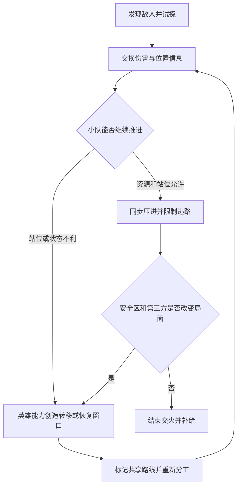

<!-- Imported from 游戏拆解分析/37款游戏拆解案/11_APEX.md; original analysis and evidence boundaries preserved. -->

# APEX：英雄如何让一场枪战拥有第二次机会

<figure class="official-game-screenshot">
  
  <figcaption>官方商店截图 · 第一人称视角下的技能视觉效果与近处角色，周围建筑提供高低与遮挡关系。来源：<a href="https://store.steampowered.com/app/1172470/">Steam 官方商店</a>。Electronic Arts / Respawn Entertainment. All game imagery belongs to its respective owners. 画面版本可能与本文限定范围不同，仅作视觉参考，不作为文中案例的实录。</figcaption>
</figure>

> **分析范围**：三人小队大逃杀的基础设计，以恶灵、直布罗陀长期存在的基础能力为案例；不讨论 2026 年赛季强度、传奇升级选项、限时模式及具体数值。角色基础功能依据 EA 官方指南核对，历史讨论以 2024 年「From the Rift」开发说明为界。本文是规则关系的原创分析，场景为构造案例，不是实测战报。
>
> **剧透提示**：无剧情剧透，涉及战斗、倒地救援与小队转移。

**核心论点：APEX 的突出体验，是把“发现敌人并射击”延长为一段可以推进、失误、脱战、接应和重新组织的共同冒险。英雄能力的关键价值，是改变小队能在什么时候、什么位置继续打枪。**

## 1. 吸引力来自还能做决定，而不只是移动速度

APEX 容易被概括为移动快、枪感好、英雄有特色，但这些形容没有解释一次遭遇为何能留下记忆。真正有分析价值的是交火中的状态变化：玩家先在中距离消耗对方，发现自己被侧面夹击，退入建筑补充护盾，队友利用另一扇门牵制，最后三人重新集中火力。胜负在这段过程里多次变得不确定，每个人都能指出自己改变局面的一个动作。

护盾、治疗消耗品、掩体和移动手段共同为这些变化提供条件。它们并不保证任何人都有逃跑机会；在开阔地被集火，仍可能迅速倒下。重要的是，部分交火会留下一个短暂间隙，让“我现在应该继续对枪吗”成为真实问题。一次伤害交换因而不必立刻结束，射击准确度之外还出现撤退路线、恢复次序和支援时机。

这也是为什么不能单独用击杀时间解释游戏。相同生存时间，若周围没有可用遮挡、角色没有转移路线、队友无法形成压力，就只是在承受更久的伤害。APEX 的基础空间组织使生存时间有机会转换成行动余地，再由玩家把余地兑现为下一轮交战。

## 2. 大逃杀把小规模枪战放进更大的风险账本

三人小队面对的不只是一支敌队。安全区变化、物资储备与可能出现的第三方，使“能不能赢这一枪”不同于“值不值得打这一队”。战斗没有一个始终公平的封闭边界，开枪也意味着暴露自己的位置与当前状态。

因此，团队需要同时处理两个尺度的决策。近处是选哪块掩体、谁先恢复、从哪个方向补枪；远处是交火会不会拖到转移时间、胜利后能否及时补给、附近是否还有队伍。英雄能力既服务当前交火，也会消耗未来处理意外的工具。恶灵的传送门用来追击时，同样可能失去一次从坏位置撤出的机会。

这套结构让谨慎并不天然等于保守。有时主动压制敌人，才能给队友安全通过空地的时间；有时停止攻击，才能保留全队重新选择交战地点的权利。英雄设计应当放在这一层风险结构中理解，而不是只比较技能能制造多少伤害。

## 3. 恶灵与直布罗陀：移动安全与原地安全

恶灵的虚空能力提供受保护的转移，传送门连接两个位置；直布罗陀的穹顶形成阻挡攻击的临时边界。这些基础功能可由 [EA 传奇指南](https://help.ea.com/en/articles/apex-legends/abilities/)核对。本文只采用上述功能，不采用页面中会随版本变化的职业被动、升级和持续时间。

两名英雄对同一个危险给出了不同答案。恶灵优先处理“这个位置已经不值得待了”，她把空间之间的距离转变成可组织的转移线路。直布罗陀优先处理“队友现在需要一点时间”，他临时改变交火边界，使恢复、重新瞄准或判断下一步成为可能。前者让队伍去另一个地方，后者让当前地方短暂拥有新的用途。

| 对照维度 | 恶灵的转移思路 | 直布罗陀的防护思路 |
|---|---|---|
| 主要解决的问题 | 暴露位置难以继续停留 | 行动需要时间但缺少遮挡 |
| 对队友的价值 | 把个人走出的路线分享给小队 | 让多人围绕一个临时边界重组 |
| 主要判断 | 出口是否安全、队友能否跟上 | 放在哪里、哪些方向仍然危险 |
| 对手的应对 | 观察出口、改变追击路线 | 靠近边界、调整角度、等待时机 |
| 失败方式 | 转移到了另一个被控制的位置 | 保护结束后仍然没有退路 |

英雄差异因此不只是按钮不同，而是承担不同的团队承诺。选了转移工具，就需要认识目的地；选了防护工具，就需要估算队友究竟要用这段时间完成什么。能力本身创造可能，玩家判断决定可能是否有价值。

## 4. 场景一：公路上的遭遇，如何变成建筑内的重组

设想三人在道路边缘与高处敌人交火，直布罗陀的护盾受损，一名队友正在换弹，恶灵看见侧面的建筑能切断主要枪线。此时最直观的冲动是继续输出，试图先击倒一个敌人；但三人的恢复和进攻节奏已经错开，继续暴露会让高处敌人轮流取得优势。

直布罗陀建立临时防护，作用不是自动赢下对枪，而是减少小队眼前必须同时处理的威胁。恶灵利用这段间隙组织到建筑附近的转移。队友需要先明确出口方向，再决定谁先通过、谁留意追击。抵达后，一人恢复，一人观察门口，另一人守侧面，才算把技能产生的安全窗口兑现成新的队形。

对手并没有退出这场设计。高处敌人可以停止无效射击，改盯建筑出口；也可以分人绕侧面，迫使小队再次移动。若恶灵只看见最近的建筑，却没发现出口处已有另一队，技能只是把死亡地点换了一处。案例说明，优秀转移能力应当奖励对空间的理解，而不是取消空间的重要性。

## 5. 场景二：击倒一人之后，为什么仍不能一拥而上

再设想室内交火中，玩家击倒了对方一人。团队看似已经获得人数优势，但受损队友正在恢复，另一人站在门外，只有前排玩家能立即追击。若三人把“对面少一人”理解成无条件冲锋，实际进入下一间房的可能仍然只有一个人。

敌方直布罗陀的防护可以争取重组时间，恶灵则可能把剩余成员带离当前房间。进攻者必须选择是争夺倒地者附近空间、切断逃跑路线，还是先让自己的队伍恢复一致节奏。此时击倒是一个可利用的窗口，而不是已经完成的胜利。窗户、门和走廊把抽象人数优势转化为具体的可交火人数。

第三队的出现又会改变判断。追击越深入，退出建筑的路线可能越少。哪怕最后收掉了原先的敌队，补给前遭到夹击仍可能输掉整场。因此，小队协作的重要内容是共同承认一个停止追击的时刻。战斗策划需要看到，制造兴奋的既可以是成功突进，也可以是三人及时理解“现在走”的瞬间。

## 6. 标记让空间判断成为可以分享的行动

团队游戏的难题在于：一名玩家看见的机会，必须及时成为其他玩家能理解的目标。APEX 的情境标记可以标示敌人、位置和物品，复活信标则让被淘汰队友在一定条件下返回战局；这些基础设计在 [2019 年官方发布说明](https://news.ea.com/press-releases/press-releases-details/2019/Respawn-Launches-Apex-Legends-a-Free-to-Play-Battle-Royale-Experience-Available-Now-on-PC-PS4-and-Xbox-One/default.aspx)中已有说明。

标记的价值不应只归纳为方便不开麦。它把“那边”固定在可见位置上，减少口头描述和空间识别之间的误差。标记一处门口，既可能传递敌人信息，也可能成为集合和撤退的共同参照。英雄技能拥有团队用途之后，这种低成本沟通尤其重要，否则传送门和防护区容易成为队友错过的私人操作。

但标记不能替玩家承担判断。重复标记可能造成噪声，一个准确坐标也不能说明敌人的全部资源。信息工具应帮助团队更快形成可讨论的局面，而不是让获得信息的一方必然获胜。这里的协作空间，来自信息准确度、行动同步程度与个体执行之间仍保留距离。

<figure>
  
  <figcaption>图 1 · 小队接战、脱离、接应与重组的流程。用于概括本文分析，不代表游戏内部状态机。</figcaption>
</figure>

查看可编辑图源

## 7. 可读性与反制：对手也要看懂机会在哪里

能力越能改写枪战，就越需要明确的存在方式。一个可见的防护边界能让双方判断何时改变位置；一条转移路线则让追击者重新理解对方可能出现的方向。对手未必能立即阻止技能，但应当有机会调整后续行动。否则局面会从“对方打得聪明”滑向“对方无缘无故消失或免伤”。

EA 在 [2024 年 From the Rift 更新说明](https://www.ea.com/security/news/from-the-rift-season-updates)中讨论了直布罗陀穹顶的多用途以及部分硬反制调整。该资料支持一个有限事实：设计团队确实在调整能力的可靠性与反制关系。它不能直接证明取消硬反制就会让所有玩家更满意。

从设计上看，反制不一定要做成“一个按钮消除另一个按钮”。占住出口、逼迫对方提前交技能、在其恢复阶段改变位置，都属于更依赖场景的应对。硬反制清楚，但可能让阵容选择压过临场发挥；软反制更开放，却要求地图、声音与视觉反馈提供足够信息。

## 8. 与另外两类英雄射击的差别

无畏契约通常围绕回合目标，把信息与技能投入压缩成一次危险的进点或回防；守望先锋让英雄的武器、移动和职责共同构成交战方式。APEX 则保留大量共享的枪械和拾取选择，英雄更多改变小队在开放环境里怎样接触、退出与续接交火。

这并不意味着 APEX 技能只是辅助。能够让整队越过一段危险空间，可能比直接造成伤害更彻底地改变战斗。区别在于，能力的效果经常需要通过后续枪战、物资使用和大地图决策兑现。玩家记住的不是单独一招，而是“我们怎样从那个位置活着走出来，又重新拿回主动”。

所以迁移 APEX 的英雄思路时，不能只复制一个穹顶或传送门。若项目没有队伍状态差、恢复时间和可替代路线，这些技能要么价值很低，要么变成直接免除失败的按钮。能力必须插在真实存在的决策空隙里。

## 9. 设计代价与可迁移结论

周旋空间会产生代价。恢复和脱战越有效，交火越可能拖长；战斗时间越长，第三队介入机会越多。队友之间的默契也会放大差距，单人玩家可能知道正确路线，却无法让队伍及时执行。大量移动与技能同时出现时，准确理解伤害来源和敌人位置也更加困难。

因此，这套设计的目标不应是无限增加生存手段，而是让失败前后都有可理解的决定。对战斗策划最有价值的迁移原则，是先确定团队在哪个节点失去行动选择，再设计一种有限、可识别、需要后续执行的恢复手段。检验它时同时看施放者、受益队友和敌人的下一步，而不只看施放者能否活下来。

APEX 的英雄魅力由此建立在一种可表达的团队身份上：有人敢先探路，有人为队伍争取时间，有人把不同步的三个人重新接在一起。当这些贡献最终转化为一次共同完成的交火，技能、枪战与大逃杀风险才成为同一段体验。

## 资料与证据边界

- [EA 传奇指南](https://help.ea.com/en/articles/apex-legends/abilities/)：支持恶灵虚空与连接位置、直布罗陀穹顶的基础功能；动态页面，不作为历史数值或 2026 年强度结论。
- [EA / Respawn 2019 发布说明](https://news.ea.com/press-releases/press-releases-details/2019/Respawn-Launches-Apex-Legends-a-Free-to-Play-Battle-Royale-Experience-Available-Now-on-PC-PS4-and-Xbox-One/default.aspx)：支持三人协作、情境标记和复活信标的原始设计介绍。
- [From the Rift 开发说明](https://www.ea.com/security/news/from-the-rift-season-updates)：支持 2024 年对穹顶用途和硬反制关系的公开调整；本文未复用具体平衡数值。

以上来源用于核对规则与公开意图。心理体验、场景推演、取舍和迁移结论属于作者分析；不包含玩家访谈、留存数据或实际对局统计。

---

[返回游戏拆解](/blog/game-breakdown/)
