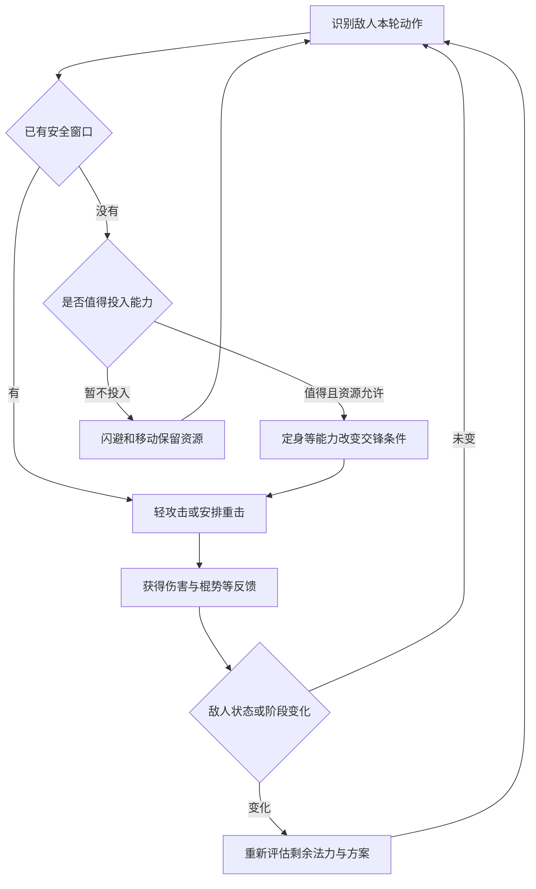

<!-- Imported from 游戏拆解分析/37款游戏拆解案/03_黑神话悟空.md; original analysis and evidence boundaries preserved. -->

# 黑神话：悟空：怎样把神魔奇观变成玩家亲手赢下的一场战斗

> 范围：《黑神话：悟空》本体单周目主线及本体隐藏内容，以常规成长为讨论基础，不把后续挑战模式、极限速杀或修改器表现混入。涉及牛牯护院、虎先锋、黄风大圣与第二章隐藏内容，含机制及剧情剧透。本文依据公开成品内容展开分析，没有进行帧数、伤害阈值或玩家访谈实测。

《黑神话：悟空》的突出吸引力，是把神魔故事中“对付一个有来历、有本事的妖怪”转成可操作的过程。场景、音乐、人物姿态和法术共同建立神话期待，战斗则要求玩家通过试探与准备赢下这场遭遇。对于熟悉西游的玩家，认知中的神通得到了动作形式；对于不熟悉原著的玩家，敌人的外形、招式与登场也能独立构成好奇心。

本作值得拆解的中心问题，是如何让法术显得强大，同时保留近身判断的必要性。若所有困难都被技能按钮直接抹平，敌人的个性难以成立；若神通始终只是微小数值加成，题材承诺又难以兑现。棍法、棍势、法力与多类能力在不同时间尺度上分工，构成了这项平衡。

## 1. 棍法的关键是怎样兑现一次重击

基础近战围绕轻攻击、重攻击、闪避与棍势组织。轻攻击既造成伤害，也帮助积累重击需要的资源；重击则把此前积累转换为更显著的一次结果。玩家面临的核心问题不是“重击亮了就按”，而是当前距离、敌人动作和自己的后续处境，是否允许这笔积累顺利落地。

劈棍、立棍与戳棍提供不同的空间和动作关系。它们共享棍这一角色身份，却不只是伤害倍率的替换。动作发生时玩家在哪里、能覆盖哪个方向、需要持续站住多久，都会影响打法。由此产生的学习，是把同一种资源放进不同局势，而不是把三套招式菜单全部背下来。

棍势还使短期忍耐有了可见回报。一次只打一小段就闪开，未必意味着进攻完全中断；此前积累可能在下一个窗口被兑现。不过，这不等于资源能够消除命中条件。敌人退离、进入不合适的阶段，或玩家低估动作距离，都能让准备充分的重击失去价值。

## 2. 法术把短时间的主动权交到玩家手中

定身术的直接价值，是暂时改变敌人能够行动的状态。它创造的不是一个抽象增伤数字，而是一段可以重新安排的时间：接近、输出、调整朝向，或利用空隙处理自身危机。官方介绍把棍法与法术组合列为战斗的重要组成，也将变化、法宝置于神话表达之中。[官方游戏介绍](https://www.playstation.com/en-us/games/black-myth-wukong/)

主动权仍有成本。常规战斗中的法力不像气力那样持续快速回补，法术也存在冷却与具体生效条件。玩家过早用尽资源，后半场就必须更依赖棍法和闪避；保留过久，又可能在失败时带着未使用的能力离场。因此法力分配是一整场战斗的计划，而棍势兑现更接近一轮交锋的安排。

不同能力也在回答不同问题。聚形散气改变敌我接触方式，铜头铁臂强调对来袭时机的处理，身外身法提供阶段性的并行压力。不能只按“每点法力换多少伤害”评价它们，还要看是否降低最困难阶段的操作负担、是否帮助制造一个原本不存在的稳定窗口。

<figure>
  
  <figcaption>图 1 · 棍势、法术与战斗机会的资源循环。用于概括本文分析，不代表游戏内部状态机。</figcaption>
</figure>

查看可编辑图源

这个循环强调能力投入的时机。它不表示所有法术具有相同效果，也不暗示每个 Boss 都接受同一种控制。

## 3. 变化与精魄让敌人的形象进入玩家动作库

变化和精魄都能让玩家使用带有妖怪身份的动作，但其持续方式、资源与战斗角色并不相同。持续变化会暂时改变玩家的操作节奏和行动能力；精魄更接近一次具有明确表现和用途的调用。将二者混称为“变身技能”，会错过它们在战斗时间结构上的差异。

这种获得方式把胜利延伸为后续能力。一个敌人不再只是留下材料，它的可辨认动作可能成为玩家之后的工具。玩家对妖怪外形与招式的记忆，因而既来自对抗，也来自使用。对角色策划而言，这是内容复用与角色记忆相互支持的例子，但不能据此断言实际制作成本低：敌我动作适配仍可能需要大量工作。

能力越多，越需要明确使用理由。若某个选项只在菜单中显示更高伤害，玩家很容易固定携带；若不同能力在打断、范围、位移或容错上有清楚差异，切换就可能对应真实的问题诊断。实际成长中的强度差异会影响这个理想，因此应把“允许组合”与“组合始终均衡”分开。

## 4. 场景一：牛牯护院让“定”先成为一个答案

牛牯护院位于早期流程，玩家尚在熟悉棍击、闪避与敌人的攻击距离。定身术在这类压力已经能够被感知的情况下进入战斗，其教学意义不只是告诉玩家一个按键，而是先让“敌人还会继续行动”成为问题，再展示暂停这一问题的能力。

当敌人被定住时，动作表现直接解释效果：刚才需要回避的对象短暂失去行动，玩家可以重新安排自己的位置。这种因果关系不依赖阅读大量术语，也与“定身”这个文化概念吻合。题材知识因此降低了一部分理解成本，视觉反馈又为缺少题材背景的玩家提供了入口。

但教学中的成功容易形成过宽预期。后续面对不同敌人、特殊动作或阶段时，同一次施法未必能换到等量机会。游戏要继续让玩家学习的是“在哪里用能得到什么”，而不是把早期的强烈效果当作永久保证。这一转变若缺少清楚反馈，玩家可能把条件变化理解为规则失信。

## 5. 场景二：虎先锋迫使玩家区分动作与节奏

卧虎寺血池中的虎先锋，通过近身拳脚、兵器动作和节奏变化建立明确个性。血池的色彩与身体运动让这场搏斗显得直接而凶猛，但真正影响决策的是：眼前这次抬手意味着哪一种攻击，当前闪避结束后能否立即出手，还是仍处于对方的后续覆盖中。

只根据“看见起手就闪避”很容易把不同攻击压成同一种节奏。玩家需要逐渐区分起手后的停顿、连续攻击与真正收束。成功的反击于是体现为对具体招式的理解，而非连续按键带来的偶然无伤。这里不需要虚构读指令算法；仅分析可见的动作变化，就能解释玩家为什么会失误。

定身与变化能够帮助玩家跨过局部压力，却不能代替所有判断。定身后站位不合适，重击可能无法有效兑现；投入强能力但没有保留后续生存手段，也可能让优势停留在前半场。虎先锋的作用，是让玩家把“我拥有神通”升级为“我知道这次该用什么”。

这场战斗的代价也清楚：当延迟、连续追击与华丽表现同时出现时，初见玩家未必能分清失误原因。若每次失败只记得被打中而无法辨认是哪一段，学习会变成记忆整场表演。战斗分析应记录真正改变选择的动作信号，而不是把所有变化都赞为高难度设计。

## 6. 场景三：黄风大圣让探索成为战斗准备

第二章黄风大圣把风沙、空间感和持续压迫放在一起。它不只增加单招难度，也改变玩家观察敌人、判断距离与安排输出的条件。玩家在这种战斗中遇到的困难，可能同时来自操作失误、对阶段不了解，以及尚未找到能够改变局势的准备手段。

本体隐藏区域中的定风珠，为这条关系提供了鲜明例子。探索所得能够介入与风相关的战斗条件，使此前看似纯粹的反应挑战增加一条世界探索的解决路径。对西游题材而言，“找到克制妖怪本领的宝物”本身也符合神魔故事的行动逻辑。

这不意味着隐藏法宝应当被称为强制钥匙。熟练玩家仍可能通过其他方式获胜，装备与能力也会改变结果。更准确的判断是：额外探索可以重新配置困难，而不是仅提供更高攻击力。代价则是信息不对称；没有意识到隐藏路径的玩家，可能把整个问题归因于自己操作不足。

## 7. 声画、镜头与路径共同建立神魔尺度

敌人的轮廓、兵器、步态和语音，使 Boss 在交锋前就表现出不同性格。进入战斗后，这些表现还需要承担功能信息：攻击从哪里来，敌人是否已经转向，效果遮挡之后身体处于什么状态。视觉辨识度和战斗可读性相互支持时，角色记忆才会转化为操作记忆。

锁定镜头有利于持续围绕单个目标行动，但面对体型大、位移远或贴近边界的敌人，观察条件可能下降。此时失误未必来自不懂招式，也可能来自画面里缺少完整的运动线索。对策划而言，需要区分动作难度与观察难度，不能用“Boss 很强”掩盖两者。

章节中的寺院、林地、荒漠与山路提供了不同的进入情绪。安静的行走、人物相遇、战斗和章末动画形成节奏间隔，使高强度 Boss 连战之外仍有观看世界的理由。地图可行边界与视觉边界偶尔不一致时，又会削弱探索直觉；这属于路径信息的问题，与美术细节丰富并不矛盾。

## 8. 成长允许重新安排方案，难度仍要求亲自执行

技能点调整、装备制造和能力搭配，为玩家提供了战斗之外的解释空间。失败后可以改变资源分配与打法，而不必认定唯一选择是原样再试。对希望体验故事但动作熟练度不同的玩家，这种可调整性具有价值。

不过，菜单选择不能消除动作的时间与空间成本。重击仍需要命中，法术仍需要在适当阶段产生收益，葫芦恢复也需要机会。构筑与操作因此形成互相补充的关系：准备改变可承受的风险，执行决定准备能否兑现。文章不宜把一次高强度构筑的速杀直接当作常规战斗循环。

重复挑战的正向体验，来自每次失败后能说清一个可调整因素；负向体验则来自条件不明、长时间无法兑现伤害，或相似敌人反应缺少可辨差异。难度并不是一个独立数字，而是信息、资源、惩罚和重试成本的组合。

## 9. 对战斗策划的启示：让题材承诺在选择中兑现

《黑神话》的可迁移经验，是把文化概念转译成改变交锋条件的动作。定身之所以有辨识度，不只因为角色喊出一个字，而是玩家真的获得了重新安排时间的能力；法宝之所以能形成故事记忆，也在于探索所得能够回应一个具体困难。

设计类似能力时，应先写清它让玩家多了哪一种选择，再决定视觉规模和伤害。若技能只有演出区别，组合容易退化为按冷却轮流使用；若每个强能力都完全禁止敌人行动，又会让敌人的个性难以出现。有效的方案需要留下代价、适用条件和敌方重新取得行动的时刻。

本作的亮点可以概括为神话对象、动作身份与克敌过程相互接通。其边界同样重要：熟悉西游可能增强感受，但不能替代机制说明；壮观演出可能提升期待，却不能自动解决镜头和反馈问题。分析的价值在于说明这些部分怎样合作，以及哪一处失配会让体验断开。

## 资料与支持范围

- [PlayStation：《黑神话：悟空》官方介绍](https://www.playstation.com/en-us/games/black-myth-wukong/)：支持神话背景、棍法与法术组合、变化和法宝的产品定位；没有用宣传材料证明用户动机或平衡效果。
- [Game Science 发布的 Steam 商店页](https://store.steampowered.com/app/2358720/Black_Myth_Wukong/)：用于核对作品身份与本体范围；页面可能要求年龄验证。
- 牛牯护院、虎先锋、黄风大圣及隐藏法宝的因果分析依据成品公开内容，不代表开发者自述意图。文中不提供未经测量的无敌帧、硬直阈值或内部判定算法。资料核对日期：2026-09-20。

---

[返回游戏拆解](/blog/game-breakdown/)
