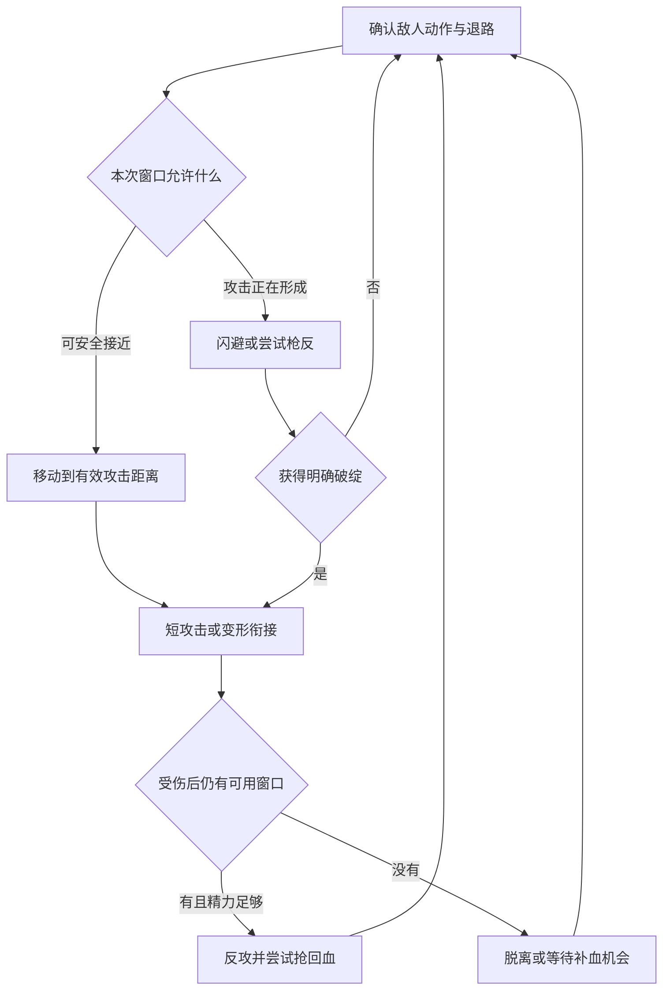

<!-- Imported from 游戏拆解分析/37款游戏拆解案/02_血源诅咒.md; original analysis and evidence boundaries preserved. -->

# 血源诅咒：恐惧为什么会把玩家推向敌人

> 范围：2015 年《Bloodborne》本体的单人常规流程，不含《老猎人》DLC；不以极端血宝石构筑或速通打法代表普通体验。涉及雅南中部、加斯科因与世界观展开，含中度剧透。本文分析公开游戏内容，不是一次带仪器的实测；关于玩家心理的描述是有条件的设计解释。

《血源》最有辨识度的体验，是玩家明明身处令人不安的世界，却逐渐学会用靠近来夺回主动。恐怖场景负责建立威胁，动作规则则让部分威胁可以被利用：敌人挥出的一击可能成为枪反机会，自己刚失去的生命可能成为反攻理由，陌生街道也可能在找到捷径后变成可控制的路线。吸引愿意钻研的玩家持续投入的，是恐惧对象不断被重新理解的过程。

这一论点有明确边界。游戏没有保证勇敢必定获得奖励；盲目抢血、在连招中出枪、在拥挤墓碑间连按闪避，都可能让失误扩大。优秀的猎人需要辨认“现在能够前进”的条件。战斗策划值得学习的，是多套规则如何共同建立这种有条件的进攻欲望。

## 1. 战斗循环同时询问生命、精力与位置

最小战斗循环可以概括为辨认威胁、取得角度、选择动作、判断结果、决定继续或退出。生命值决定还能承担多少错误，精力决定眼前能串联多少攻击与闪避，位置决定敌人哪些招式真正构成威胁。这三者不能相互替代：生命很多也无法让精力耗尽后的动作突然出现，精力充足也不能让被墙角封住的后退路线安全。

精力恢复提供了循环中的停顿，但停顿不必总表现为远离。围绕敌人侧面移动、等待挥空、短暂观察下一招，都可以与恢复并行。于是战斗节奏不是简单的“我攻击完，轮到敌人攻击”，而是不断寻找可以重叠的行动：既躲开攻击，又留在武器够得到的位置；既恢复资源，又维持观察角度。

<figure>
  
  <figcaption>图 1 · 生命、精力、位置与受伤后反攻的决策关系。用于概括本文分析，不代表游戏内部状态机。</figcaption>
</figure>

查看可编辑图源

图中的“窗口”是可观察的动作关系，不等同于未测量的固定帧数。同一招在近身、斜后方和障碍边缘，会产生不同的可行动时间。

## 2. 抢回血改变的是受伤后的问题

通常的动作游戏把受伤后的首要目标设为恢复安全距离。《血源》的抢回血增加了另一种问题：刚才损失的生命，还有没有机会通过下一次攻击挽回？官方介绍确认，受伤后的短暂期间可以通过反击恢复部分失血，并将其与果断但有策略的冒险联系起来。[开发者介绍：Regain](https://blog.playstation.com/2014/08/13/bloodborne-on-ps4-new-combat-details/)

它的作用不是单纯降低难度，而是给损失附上一段会过期的价值。玩家如果决定后退，需要接受可恢复部分消失；如果决定前进，则必须承担敌人后续攻击的风险。时间压力使选择带有冲动诱惑，敌人连招又要求玩家克制这种冲动。两者相互约束，才形成有张力的反攻。

不同武器的触及范围、攻击速度和单次动作承诺，会改变可兑现的抢血机会。不能只比较“哪把武器每次回血多”，还要看为了命中需要移动多久、能不能及时停手、是否把自己留在危险朝向。抢血适合放在整个动作链中分析，而不是作为独立的回复数值。

## 3. 变形武器让熟悉感和重新学习并存

变形武器把两种战斗用途绑定在同一件身份鲜明的工具上。以锯肉刀为例，形态变化会改变攻击方式和触及关系；以手杖为例，近距离刺击与鞭状范围攻击让玩家面对不同数量、距离的敌人时产生不同倾向。真正需要判断的是“这个形态现在能解决什么”，而不是哪个形态永远更强。

变形攻击的价值在于把模式选择塞进正在发生的交锋。玩家可以在连续动作中改变后续招式，不必完全退出战斗再重新准备。但衔接也有成本：多执行一个动作意味着更长的暴露，长距离形态的覆盖能力也可能伴随不适合狭窄空间的挥动方式。动作库因此既提供表达，也要求认识场地。

武器总量相对克制有助于形成长期学习关系。玩家反复看到同一件工具，能更细致地理解它对不同体型敌人的效果。这里的成长不仅是获得新东西，也包含对旧动作更有把握。若大量重复遭遇只要求同一种安全打法，这份深度仍会被削弱；武器的潜力需要敌人和空间持续调用。

## 4. 枪反把敌人的进攻变成一种邀请

副手枪械在常规近战构筑中不仅用于削减生命，还用于打断符合条件的攻击并制造内脏暴击机会。它将“敌人正在出招”从纯粹的危险信号变成一种可能有利的时机。可枪反的敌人与不可用同样方式处理的对手，又阻止玩家把所有威胁都归为同一答案。

这类设计依赖动作信息的可信度。玩家需要从起手、身体重心和武器轨迹识别攻击进程；成功后的敌人失衡、声音和姿态变化，则确认自己的判断已经生效。仅仅给出漂亮特效不足以产生掌握感，反馈必须对应一种玩家能够逐渐复现的关系。

枪弹消耗让试探带有资源代价，但真正限制连续尝试的往往是失败后还站在哪里。出枪时机不对可能只造成普通伤害，敌人的攻击却继续到来。因而枪反不是无需付出位置成本的远程防御，更不应被写成所有 Boss 通用的最优解。

## 5. 场景一：雅南篝火广场把人数变成空间问题

雅南中部的篝火人群很适合说明遭遇设计如何教玩家思考。若沿主要路线直接冲入人群，近战追击、远处火力以及视野边缘的威胁会叠在一起。此时任何单个敌人的招式都未必复杂，困难却来自多个攻击方向同时争夺玩家注意力。

玩家改变路线、利用转角或将部分敌人引离群体后，问题会被拆开：先处理能够安全接近的对象，再面对剩余敌人。武器的范围攻击在密集目标之间有价值，但同时卷入过多人又会抬高风险。广场因此允许玩家从失败中得出空间性的解释，而不仅是“我的伤害不够”。

这一案例体现了恐怖氛围与战斗教学的配合。远处聚集的人群先构成视觉压迫，实际交战又表明压迫可以通过观察路线来削减。等玩家熟悉回路与捷径后，同一地区的情绪会变化。环境没有消失，玩家对环境的预测能力增加了。不能由此推断敌人采用了某种固定协同算法；本文解释的是其可见的空间关系。

## 6. 场景二：加斯科因反复改写安全距离

加斯科因的人形阶段拥有猎人式的枪械与斧头，使玩家面对一个与自己动作身份相近的对手。后退并不天然安全，远离也可能把自己交给枪击或追击；贴近虽然危险，却可能创造绕侧、枪反和反击机会。玩家必须结合对方正在执行的动作判断距离。

墓碑进一步改变这个判断。它们可以阻隔部分直接接近，也可能卡住玩家的闪避路线，遮挡对方的身体动作。对于尚不熟悉场地的玩家，一次后退输入可能没有产生预期的实际位移。这个失败不是单纯反应慢，而是屏幕中的空间信息没有被正确转化为可行路线。

兽化后，体型、推进方式和攻击压迫明显变化。此前在人形阶段有效的间隔与绕障碍习惯，需要重新评估。若玩家仅凭“已经离开上一击范围”就开始补血，后续追击可能打破预期；若为了抢血在连段中强行出手，也可能连续受罚。转阶段的作用是改写旧规则的适用条件，而不只是换一条更长的血条。

| 当下判断 | 可能收益 | 必须检查的条件 |
|---|---|---|
| 后退补血 | 恢复稳定生命储备 | 是否脱离后续追击，背后是否有障碍 |
| 向侧面接近 | 保持反击距离 | 当前攻击覆盖方向，剩余精力 |
| 原地抢血 | 挽回损失并维持压制 | 连招是否结束，己方动作能否及时收束 |
| 尝试枪反 | 获得显著反击机会 | 敌人动作是否适用，时机判断是否可靠 |

这场战斗还将机制与叙事连接起来：一个猎人最终呈现出兽的形态，玩家刚刚学习的进攻本能因而带上不安。故事不是等战斗结束后才发生，规则的变化本身就在改变玩家对猎人身份的理解。

## 7. 镜头、声音与关卡共同安排注意力

锁定使闪避和接敌更容易围绕单个对象组织，面对大型敌人或近墙位置时，却可能让身体局部占满画面。解除锁定能够获得不同的观察方式，同时把调整朝向的责任交还玩家。两种操作没有统一优劣，关键在于当前需要读清一个起手，还是需要理解整片空间。

声音承担了部分屏幕之外的信息。脚步、敌人嘶吼、远处枪声和近身命中的差异，都能帮助玩家建立方向与强度预期。但哥特建筑的遮挡、狭窄通道和强烈明暗，也可能让威胁直到很近才变得明确。惊吓与可读性之间存在真实取舍：太早暴露会减少不安，太晚暴露又可能让失败只剩突袭感。

捷径是关卡中最重要的情绪反馈之一。它减少再次挑战的路径成本，同时证明玩家刚才理解了空间。灯点、门、升降梯与回环组合起来，使探索成果不仅体现为道具，还体现为今后如何行动。重试距离的变化也会直接影响玩家是否愿意继续学习 Boss。

## 8. 成长一面支持练习，一面也可能放大挫折

等级、武器强化和血宝石提供数值成长，让玩家不必仅靠操作跨过所有困难。但获得更高伤害，并不自动解决连招误判、角落卡位和多方向威胁。数值缓冲与动作理解并存，有利于不同玩家找到自己的推进速度。

血瓶和枪弹的库存则形成另一条曲线。补给充足时，玩家可以连续试错；库存耗尽后，再次挑战前可能需要补充资源。对已经接近掌握的玩家，这会打断学习节奏；对探索导向玩家，补给过程又可能促使其走向尚未探索的区域。应分别讨论恢复压力如何改变行为，不能把所有跑图都归为“必要磨练”。

世界观从街巷猎兽逐步扩展，维持了动作熟练之外的未知。玩家可以越来越会战斗，却越来越难确定自己正在参与什么。熟悉动作与陌生意义同时增长，是本作长期吸引力的重要来源；它也解释了为什么只列武器、属性和敌人表，无法完整说明《血源》的体验。

## 9. 可迁移的不是强制进攻，而是进攻条件的可学习性

如果将抢回血迁移到另一款游戏，首先需要确定敌人是否真的提供了可辨认的反攻机会。若攻击几乎不能打断、连招尾端没有差异、镜头又经常遮住起手，短时回血只会诱导玩家犯错。奖励必须与一组能够学习的条件绑定。

同样，阶段变化应让玩家重新解释已有能力。加斯科因的价值不在于证明“三阶段更精彩”，而在于同一座场地、同一套玩家动作，在对手变化后产生了新的风险关系。制作成本有限时，改变推进方向、攻击覆盖和障碍关系，可能比单纯增加招式数量更能带来新的判断。

评价类似方案时，可以观察受伤后的行动是否更丰富、玩家能否说明自己为何选择反攻、失败是否能够归因到具体信息。本文没有进行这类用户测试，因此不声称所有玩家都会产生相同情绪。《血源》提供的设计启示是：允许玩家凭理解靠近危险，世界才可能同时令人害怕、又令人想要继续探索。

## 资料与支持范围

- [Bloodborne on PS4: New Combat Details](https://blog.playstation.com/2014/08/13/bloodborne-on-ps4-new-combat-details/)：支持抢回血规则及主动进攻的设计方向，未用于证明具体玩家心理。
- [Bloodborne: 24 Tips for Survival](https://blog.playstation.com/2015/03/23/bloodborne-24-tips-for-survival/)：支持变形衔接、基础战斗与成长功能的核对。
- 文中广场、加斯科因与空间关系的段落为基于成品公开内容的原创机制分析；未引用内部 AI、碰撞参数或帧数。资料核对日期：2026-09-20。

---

[返回游戏拆解](/blog/game-breakdown/)
