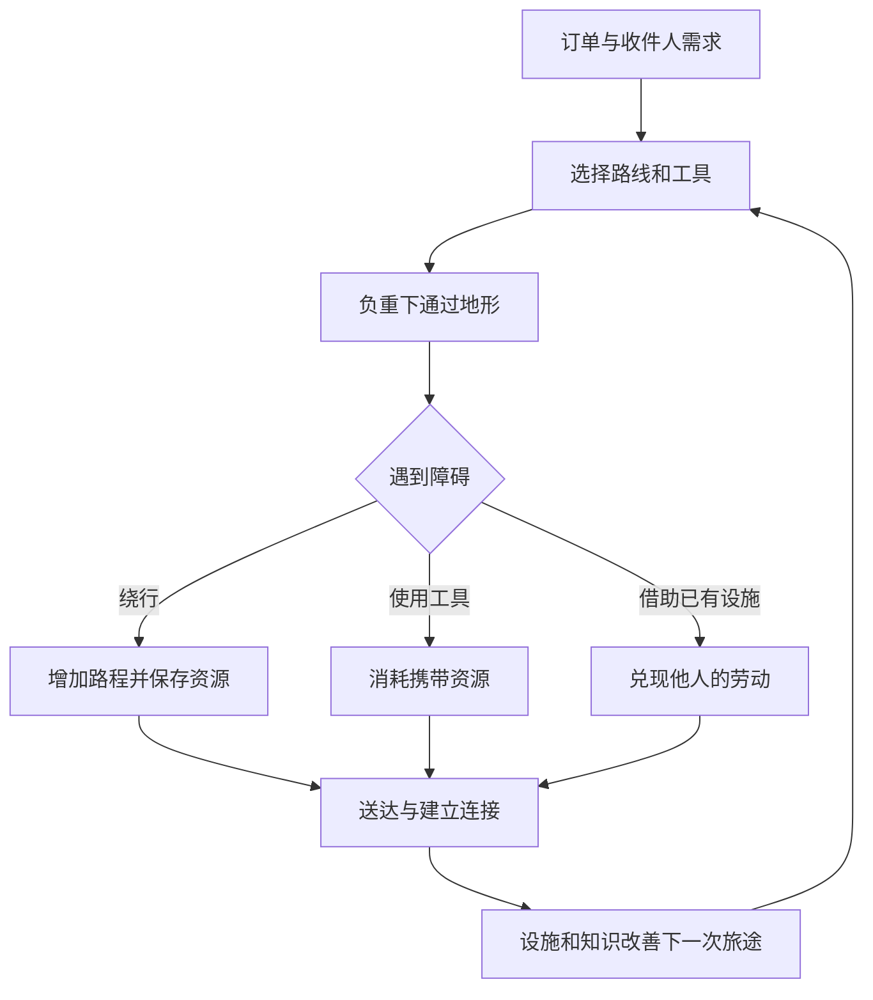

<!-- Imported from 游戏拆解分析/37款游戏拆解案/31_死亡搁浅.md; original analysis and evidence boundaries preserved. -->

# 死亡搁浅拆解案
## 路途的阻力怎样让连接成为可以亲手完成的事情

**范围：**2019年《Death Stranding》本体的送货、移动、建设与异步联机设计。导演剪辑版新增工具不作为本体基础，续作不在范围内。含世界观及中前期玩法说明，避免结局揭露。资料核对：2026年9月20日。

## 核心判断

《死亡搁浅》把许多游戏默认省略的移动过程，变成需要持续判断的主体。走到目的地不只是按住前进，而是在地形、负重、风险与工具之间组织一条可以执行的路线。之后出现的桥、公路和其他玩家留下的设施，才能被理解为对具体困难的帮助。

本作的突出情感并非只来自故事里的“连接”一词。玩家先知道独自通过某处有多麻烦，再感受到世界因为自己的劳动或别人的劳动变得不同。阻力、建设和感谢形成了同一条体验关系。

## 一 订单是一份需要落实的行动方案

订单规定目的地与货物要求，玩家需要把这些条件转化为装备和路线。工具会占用携带空间，带得多可以扩大应对范围，却也让移动更加笨重。地图上看起来短的路线，可能因河流、坡度或危险区域而更难完成。

这使准备与执行之间存在可解释的联系。一次失败不一定只是操作失误，也可能来自对路线的误判，或为节省重量而没有携带必要工具。相反，准备过度也会降低效率。游戏允许玩家用不同方式承担风险，而不是提供一个显然全优的出发配置。

小岛秀夫展示的官方实机包含路线规划、货物配置、工具与其他玩家设施等环节。这里引用它核对公开机制，具体因果解释是本文的分析。[官方实机介绍](https://blog.playstation.com/2019/09/12/death-stranding-new-tgs-gameplay-video/)

<figure>
  
  <figcaption>图 1 · 负重、地形、工具与异步合作的关系。用于概括本文分析，不代表游戏内部状态机。</figcaption>
</figure>

查看可编辑图源

## 二 移动中的身体状态取代了空白路程

负重、失衡与落脚点把角色的身体状态放进玩家注意力中心。目的地仍在远方，眼前几步却可能需要选择更平稳的坡面、调整速度或寻找可通过的河段。宏观路线与微观动作因而同时存在。

这类3C设计的关键，是让玩家预先读到危险。地面形态、扫描信息、人物姿态和声音反馈，必须在失误之前提供足够线索。如果角色只是无原因地摔倒，阻力会被理解为控制不可靠；如果一切都能无脑通过，地形又会退回装饰。

镜头需要兼顾背上的货物、脚下地形和前方路线。货物高度让负重可见，也可能遮挡观察；大地形景观帮助远程规划，却不能替代近处可通行性的表达。身体存在感正是在这些限制中形成的，而不是来自模型细节数量本身。

## 三 工具将地形问题变成可选择的解法

梯子、攀爬绳、载具和后来可用的运输设施，各自改变某类成本。它们不是同一移动方式的纯速度升级，而是使部分路线变得可行，同时保留新的约束。适合平坦路面的运输手段，到了复杂地形可能需要卸货或改道。

好的工具反馈应让玩家明白“这一次为什么省力”。当工具正好解决此前亲身承受的障碍，获得它的价值容易被感知。如果一开始就提供无条件跨越所有地形的手段，很多后续建设回报就失去比较基准。

| 玩家选择 | 得到的好处 | 留下的成本 |
|---|---|---|
| 少带工具轻装上路 | 减轻移动负担 | 面对意外时解法减少 |
| 准备多种设施与装备 | 扩大可处理的路线范围 | 重量、空间与资源投入 |
| 走熟悉路线 | 风险较容易估计 | 可能放弃更高效率 |
| 选择未经验证的近路 | 有机会缩短后续运输 | 首次探索的时间与损失 |

## 四 案例一 河流把地图距离改写为身体风险

从地图上看，河流可能只是连接两岸的一条直线障碍。到达岸边后，玩家需要寻找较合适的通过位置，判断水流与深度信息，并考虑当前负重。原先“过去就到了”的目标，转化为一组与身体有关的问题。

如果选择徒步涉水，玩家在移动中承担风险；如果铺设梯子或寻找已有通路，就把风险转换为工具、绕路或此前建设的成本。不同解法都围绕同一个明确障碍，因而容易形成可理解的取舍。

这一案例的情感来源很具体：在吃过一次亏之后，看到别人留下的有效通路会具有实际意义。所谓“感谢陌生人”，有机会来自对节省掉的困难的认识，而不必完全依赖系统要求点赞。反例是设施已经密集到无需任何判断的路线，此时帮助仍有效，但探索与劳动感会下降。

## 五 案例二 雪山让路线规划与负重发生冲突

进入山地后，地图上的直线距离更难代表行动成本。坡度、落差和环境条件会迫使玩家更谨慎地考虑路线。多带一些应急工具看似稳妥，却可能加重身体负担；少带又会在某个障碍前暴露准备不足。

当玩家逐步建立更便利的通路，满足感来自对同一地点的重新认识。第一次是需要小心经过的障碍，之后可以成为自己运输网络的一部分。游戏把经验保存在环境与设施中，使成长不只体现在角色数值上。

不过，便利也会消耗原本的核心玩法。如果某种设施组合使大量订单只剩固定操作，系统就要依靠新地形、新的约束或更有意义的目的地来恢复判断。不能把运输速度提升视为没有代价的改进。

## 六 异步联机让帮助存在 让陪伴保持距离

玩家主要面对独自行动的旅途，却会发现他人的设施、物资和行动痕迹。帮助在空间中存在，而帮助者通常不直接出现在身边。这种安排保留了孤独的感官氛围，同时允许玩家感觉自己属于更大的协作过程。

与实时组队相比，异步结构不要求双方同步在线，也减少了持续沟通的负担。玩家可以在适合自己的时间受益或贡献。反过来，它也降低了对某个具体同伴的控制与回应能力，形成一种较疏离的互助关系。

共享有一条明确的生效条件：在线游玩时，玩家在开罗尔网络覆盖区域内才可能看到其他玩家使用的设备和建筑。这使未入网区域的首次开路与接入网络后的往返具有不同条件；先亲自承担一段阻力，后来遇到设施时，就更容易理解它替自己省去了什么。[小岛工作室官方指南](https://www.kojimaproductions.jp/en/DSTips)

具体哪些设施被分配给哪位玩家，则不能仅由体验反推服务端算法。对设计而言，需要分别考虑入网时机和共享密度：帮助要让人感到有效，也应保留玩家判断路线与参与建设的空间。

## 七 战斗让货物成为行动的牵挂

对米尔人或BT的遭遇，改变了移动中的注意力结构。玩家不能只问怎样最快清除敌人，还要考虑货物位置、受损风险、绕行可能和脱离后怎样恢复订单。战斗与运输的连接，来自玩家已经携带着一个不愿轻易丢弃的目标。

卸下货物再应对威胁，是一种将身体机动性和任务责任暂时分离的选择。它使战斗结束之后仍有事情需要处理：重新整理、找回和继续前进。战斗因此成为旅途中的扰动，不必承担整款游戏最主要的重复乐趣。

这里同样存在取舍。武器与能力提高后，如果敌人能够轻松被清理，危险区域对路线的影响可能减弱；如果遭遇过于频繁，送货的沉静节奏又会被打断。战斗强度必须服务于旅途，而不是独立追求最高刺激。

## 八 故事怎样为劳动赋予对象

收件人、据点和连接任务，让货物具有去向。玩家的行动不只是把数值从仓库A转到仓库B，而是参与一群隔离者之间的联系。设施接入与关系推进将宏大世界观落在具体交付上。

但长篇解释和实际劳动也可能彼此竞争。玩家刚建立起探索节奏时，密集通讯或过场会改变注意力；如果故事中的感谢过于重复，人物可能变成任务结算的包装。叙事有效的地方，是让玩家理解这一次劳动的特殊意义，而不是每次都重新宣讲同一个主题。

本作的情绪曲线包含准备时的预期、行进时的负担、风险时的紧张和接近目的地时的释放。音乐进入开阔景观时，可以强化已经由路途建立的变化。即使不分析具体曲目，也能看到声音与地形节奏的关系。

## 九 技术表现的重点是使地面可信

坡面、岩石、水体、角色姿态与货物晃动，需要让玩家对“这里能否走、怎样走”形成稳定判断。若美术显示可以落脚而碰撞持续阻止通行，世界的真实性就会在操作中受损；反过来，规则略有简化但反馈一致，仍可能保持可信。

这里的核心标准是可预测性，而非模拟每一个物理细节。由于没有完整公开实现资料，本文不指定其平衡系统、网络共享或地形判断使用何种内部算法。可观察的设计成果已经足以讨论：地形是否成为信息，工具是否改变行动，选择是否产生可解释后果。

## 十 可迁移的设计原则

若希望玩家重视一种便利，先让他理解该便利解决的具体问题；若希望玩家关心建设，允许劳动在世界中留下可再次使用的结果；若希望玩家感受互助，让帮助解决他已经遇到的困难。

这些原则同样适用于战斗：队友的掩护只有在玩家理解暴露风险后才容易被感知，支援工具也需要清晰的使用前后差异。但不能为了突出帮助无限增加前置痛苦。阻力必须仍然提供判断、学习和替代路线。

可以通过首次与重复路线的选择差异、设施使用位置、主动绕行和失误原因，检查设计是否有效。便利之后是否仍有值得决定的事情，比平均送达时间单独下降更重要。

## 资料与证据边界

- [官方实机与玩法介绍](https://blog.playstation.com/2019/09/12/death-stranding-new-tgs-gameplay-video/)：核对路线、工具、载具及异步共享的公开展示；这是上市前介绍，不用于证明后续版本全部规则。
- [PlayStation游戏页面](https://www.playstation.com/en-us/games/death-stranding/)：用于作品与版本入口，导演剪辑版新增内容需单独辨认。
- 河流和山地案例为对游戏常见场景的机制分析，不是本次录制的实验报告；没有断言所有玩家会产生相同情绪。

---

[返回游戏拆解](/blog/game-breakdown/)
