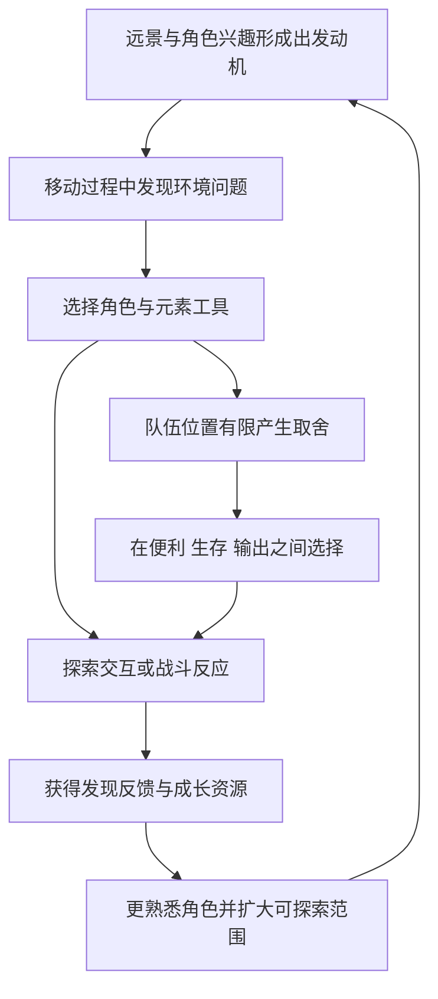

<!-- Imported from 游戏拆解分析/37款游戏拆解案/17_原神.md; original analysis and evidence boundaries preserved. -->

# 原神：让喜欢的角色，成为探索世界与理解战斗的同一种语言

> **分析范围**：1.0 时期蒙德、璃月的单人开放世界，以及早期角色的基础元素协作；不覆盖草元素角色体系、后续国家探索机制、现行深境螺旋环境或 2026 年角色强度。以 2020 年开发者介绍核对探索、组队与元素反应的基础规则。
>
> **剧透提示**：涉及蒙德地理、常见野外敌人与基础解谜，不涉及主要剧情结局。案例是由真实机制构造的情境，不声称某个坐标必然有对应宝箱，也不是实际路线测试。

**核心论点：原神的一项核心吸引力，是让玩家带着喜欢的角色进入一个值得继续走下去的世界。元素把角色能力、环境交互和队伍战斗连在一起，使“我想用这个角色”同时具有情感、探索和战术上的意义。**

## 1. 世界首先提出一个愿望，而不是一张待办清单

玩家站在高处看见远处的城、山和遗迹，很容易产生一个具体愿望：走到那里看看。这个愿望比地图上的任务数量更接近开放世界的第一层吸引力。远处地标提供方向，但抵达方式尚未完全确定，途中遇见的物件、敌人和地形会不断修改路线。

原神的攀爬与滑翔让视觉好奇能够转换为行动。山体不是只供观看的背景，玩家可以尝试接近、登上，再从更高位置发现新的目标。移动本身带着耐力和落点判断，使“看得见”与“能不能到达”之间保留一段需要自己解决的过程。

开发者在 [2020 年上线介绍](https://blog.playstation.com/2020/09/28/your-journey-in-genshin-impact-begins-now/)中将探索与元素战斗放在同一篇说明中。它支持本文采用的基础设计范围，但“因此吸引所有玩家”并不是来源能够证明的结论。这里关注的是一种成立条件：世界必须不断给出值得采取行动的线索，移动工具又能兑现这些线索。

## 2. 探索密度的价值，在于不断接续而不过早打断

从城外前往山坡，玩家可能先看见可收集物，再注意到小营地，随后从更高处发现一处谜题。好的接续并不要求每一步都有奖励，而是让前一个行动的结束自然暴露下一个有意义的目标。玩家知道自己原本要去哪，同时愿意临时改变主意。

这种结构需要控制尺度。远处地标负责长期方向，中距离兴趣点负责分流，近处物件提供即时回应。如果所有目标都以同样强度呼喊玩家，世界会变成密集图标；如果距离太远又缺少过程变化，抵达只剩耗时移动。

战斗在其中应承担某种节奏作用。短暂遭遇可以让玩家使用刚学到的元素关系，也可以为一个地点提供阻碍和回报。但若每走几步都被迫投入较长战斗，探索的自主感就会下降。战斗设计因此需要理解路线和情绪节奏，不能只在独立竞技场里判断敌人配置是否有趣。

## 3. 元素让世界规则与战斗规则发生联系

火可以参与点燃类交互，冰可以改变水面的通行条件，风与其他元素又能产生反应。具体对象仍按游戏规则限定，并不意味着所有真实世界物理关系都能模拟。玩家学到的是一套选择性的世界语言：看见某种颜色、材质或状态，会想到尝试某个角色能力。

这种学习能跨越场景。先在安全环境里理解水与冰的联系，再在战斗里看见冻结效果，同一组概念就获得新的用途。能力因此不像只在战斗界面生效的标签，角色也不只是伤害属性的载体。它们参与了玩家认识世界的方式。

官方开发介绍明确把元素与队伍、环境交互联系起来。[2020 年开发者介绍](https://blog.playstation.com/2020/08/06/genshin-impact-hits-ps4-this-fall/)支持这一基础事实。至于这种一致性能够降低多少学习成本，需要玩家研究才能量化；本文只指出它如何提供可迁移的理解路径。

| 同一个设计要素 | 探索中的用途 | 战斗中的用途 | 共同形成的理解 |
|---|---|---|---|
| 元素状态 | 识别可交互对象 | 判断可触发的反应 | 先观察对象已有条件 |
| 角色切换 | 取出适合当前障碍的工具 | 连接不同角色的能力 | 队伍是一套可组合工具 |
| 高差与移动 | 到达视野中的目标 | 调整接触方向和距离 | 空间选择会改变问题难度 |
| 奖励 | 确认发现与解决问题 | 支持角色继续成长 | 当下行动与长期旅程相连 |

## 4. 场景一：风起地附近的一次绕路，如何成为完整小冒险

设想玩家从风起地一带前往能看见的山坡。路上遇到河流，直接游过去需要考虑耐力和上岸地点，绕到浅处较慢，使用凯亚的冰元素能力则提供另一种短程处理思路。这里的重点不在某条路线是否最优，而在角色能力使环境产生了多于一种可理解的解法。

过河后，玩家看见一处营地。原本目标是登高观察，但营地提供了立即战斗的诱因。玩家可以暂时绕过，也可以清理后再出发。若营地附近存在符合规则的火元素交互，安柏又能从远距离触发，角色的远程能力与元素用途共同参与判断。

继续登上山坡，新的视野让玩家重新定位原先目的地，并发现另一个可探索方向。整段过程里，路线没有被一个任务脚本完全安排，却也并非毫无结构：远景引导、地形问题、短战斗与新的视野形成了一条可追溯的经历。

反例是同一路线在内容已经清理后重游。奖励与未知减少，玩家可能只想快速通过。由此可以区分世界本身的审美吸引、首次发现的惊喜和奖励动机。不能把第一次探索的丰富感，直接当成长期重复日常也必然成立的结论。

## 5. 四人队伍把角色选择变成相互依赖

单人模式下玩家在队伍角色之间切换。一个角色的能力可以先创造状态，另一个角色再利用它；部分技能在角色离场后仍继续发挥作用，因而队伍关系不能只按谁当前站在场上理解。玩家安排的是一段时间内不同能力如何重叠。

这让每个位置都存在机会成本。多带一种元素，可能更方便处理探索障碍；多带治疗，可能提高失误容忍；增加某种输出配合，则可能牺牲上述便利。野外队伍与高压战斗队伍的目标并不完全相同，因此同一角色在两种环境中的价值也会不同。

战斗的技术点在于把切换变成有理由的选择。技能是否已经可用，已有状态能持续多久，敌人是否正在移动，换人后能否继续接触，这些问题共同决定顺序。若只按冷却结束就逐个按键，玩家可能看见很多效果，却没有建立稳定的协作。

## 6. 场景二：凯亚与芭芭拉，如何把生存问题变成输出机会

设想面对一组能够被冻结的普通敌人，玩家用芭芭拉提供水元素条件，再让凯亚施加冰元素，形成冻结。水与冰可触发冻结的基础关系见[官方元素反应说明](https://blog.playstation.com/2020/09/28/your-journey-in-genshin-impact-begins-now/)。这里不讨论精确附着频率，也不假定所有敌人都能冻结。

冻结的价值不只在于画面变蓝。敌人暂时减少移动与攻击，玩家更容易安排近距离输出，原先用于追逐或回避的注意力可以转向下一次技能。控制因此间接提高了输出可实现程度，也降低了同时处理多名敌人的认知压力。

若换成香菱与芭芭拉，水火反应会把组合的重点更多推向伤害兑现，但谁先施加元素、技能是否持续命中、敌人是否离开有效范围都会影响结果。这里不能粗略说成“水火同队就每一下都蒸发”；反应成立需要具体攻击与状态满足条件。

这两组对照说明，同样利用元素组合，可以追求不同体验。控制组合提供更稳定的行动窗口，伤害组合要求更关注施加顺序和命中维持。队伍价值既包含理论效果，也包含玩家能否在真实敌人行为中完成它。强度讨论若完全脱离敌人类型、养成和操作条件，就容易丢失这一层。

## 7. 角色为何能同时承载陪伴与机制学习

玩家在剧情、语音、动作和日常探索中不断接触角色，角色能力因此带着人格与视觉记忆。凯亚的冰、安柏的弓与火、芭芭拉的治疗，并不是菜单里彼此无关的模块，而是玩家反复使用某个人物时形成的习惯。

这种关系让战斗学习有了情感入口。喜欢一个角色的玩家更愿意理解其适合什么场景，遇到新问题时也会先想自己熟悉的角色能否解决。但角色喜爱与实际可用性如果长期冲突，体验就会产生摩擦：玩家想带着某人旅行，却不断被要求换成更适合当前数值或机制的角色。

因此，角色设计需要给出多个可感知的价值维度。即使不是某一时期高压战斗的最优选择，探索便利、操作舒适、独特表现和叙事联系也可能构成使用理由。这是一种设计空间，并不意味着可以用情感包装掩盖明显失效的机制；喜欢角色的玩家同样需要其动作得到合理回应。

<figure>
  
  <figcaption>图 1 · 元素、队伍与探索战斗的联系。用于概括本文分析，不代表游戏内部状态机。</figcaption>
</figure>

查看可编辑图源

## 8. 设计代价：广泛可进入与深度战斗并不总是同向

开放世界需要让大量玩家能够继续旅行，因此普通遭遇通常不能处处要求严格循环和精密反应。高压战斗则需要让养成、配队和操作差异有足够表现空间。两种内容服务不同节奏，不能用一种难度标准衡量全部游戏。

当野外敌人很快被击败，某些协同可能来不及展开，玩家便觉得复杂配队没有必要；当高压环境对数值与特定解法要求很高，喜欢的探索队伍又可能难以适用。战斗策划需要明确每类内容到底要验证什么，避免把“更难”当成唯一的深度来源。

元素体系也有可读性成本。表面上易懂的水火冰，背后存在施加顺序、持续效果和敌人例外。玩家的直觉若与实际结果反复不一致，就需要更清楚的状态反馈和教学机会。可组合规则越多，越需要让失败能够被解释，而不是依赖外部攻略才能知道自己漏了什么。

## 9. 对战斗策划的迁移启示

原神值得迁移的首先是连通性：角色能力应当参与玩家真正关心的体验。若项目的核心是探索，就让战斗规则与世界交互共享一部分概念；若角色陪伴很重要，就让角色在常见行动中不断表达自己的特点。机制不必在所有场景通用，但通用部分应当稳定、可理解。

其次是把队伍作为时间上的合作关系来设计。一个角色创造条件，另一个角色利用条件，第三个角色维持状态，才能让切换具有因果意义。设计新角色时，应说明它插入了现有队伍的哪一个环节，以及由此改变了哪种敌人问题，而不只写新增多少倍率。

最后，探索与战斗应当共同完成“我愿意继续走”的体验。远方要值得接近，途中要有可理解的小问题，角色要能以鲜明方式参与解决。它们相互接续时，玩家的成长既表现为数值提高，也表现为对世界和自己的队伍越来越熟悉。

## 资料与证据边界

- [HoYoverse 开发者：Genshin Impact hits PS4 this fall，2020](https://blog.playstation.com/2020/08/06/genshin-impact-hits-ps4-this-fall/)：支持元素能力、四人队伍及环境互动的基础介绍。
- [HoYoverse 开发者：Your journey in Genshin Impact begins now，2020](https://blog.playstation.com/2020/09/28/your-journey-in-genshin-impact-begins-now/)：支持首发探索范围及冻结、蒸发等基本反应；不作为后续元素规则与当前角色强度的依据。

路线、队伍比较、体验解释和迁移建议为原创分析。本文没有测量元素附着、帧数、反应覆盖率或玩家偏好，也没有把角色付费与留存关系当作已证实因果。

---

[返回游戏拆解](/blog/game-breakdown/)
