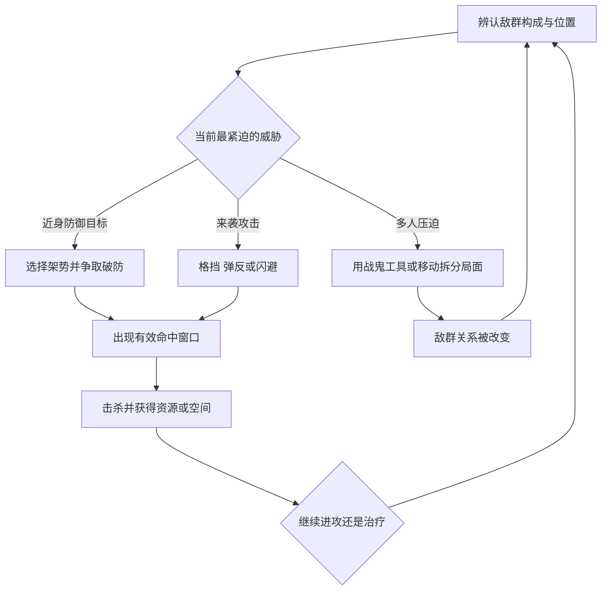

<!-- Imported from 游戏拆解分析/37款游戏拆解案/16_对马岛之魂.md; original analysis and evidence boundaries preserved. -->

# 对马岛之魂：怎样让玩家的刀既致命，又值得反复使用

> 范围：《Ghost of Tsushima》本体单人主线与支线，不含壹岐岛 DLC 和《奇谭》合作模式；导演剪辑版仅采用本体共有内容。普通遭遇与决斗分开讨论，不把致命难度的表现推广到所有难度。涉及石川师父早期任务、雅里川之战和小次郎决斗，含中度剧情剧透。本文未做伤害、反应时间或玩家行为实测。

《对马岛之魂》的突出吸引力，是让玩家持续处在武士电影式的行动与意境之中。风吹过草地，角色在对峙中等待对手动手，刀刃落下后敌人迅速倒地；这些部分共同兑现一种清楚的角色期待：玩家的行动应当显得果断、准确，并能结束一场战斗。

难点在于，致命感与长期挑战天然存在张力。敌人太快死亡，玩家可能没有机会使用复杂动作；敌人承受过多命中，又会削弱刀的可信度。本作通过防御、破防、敌群组成、反击和战鬼工具，将难度更多放在取得有效命中的过程里，再让命中后的结果足够干脆。

## 1. 战斗首先追求打穿防御，而不只是削减生命

普通敌人能够用防御和攻击维持自己的生存。玩家需要通过适合的重攻击、架势、反击或工具创造有效窗口，随后完成击杀。这个结构把战斗拆为接触前的争取与接触后的兑现，避免每一次命中都只是给长生命条扣掉一小格。

战斗主设计师在复盘中明确提到，早期测试的敌人过于耐打，破坏了刀剑致命的期待；团队随后围绕命中次数、破防和敌人行为调整方案。[主设计师谈致命感与平衡](https://blog.playstation.com/2020/11/25/honoring-the-blade-the-lethality-contract-and-combat-balance-in-ghost-of-tsushima/)

从成品分析，玩家真正经营的是“怎样尽快让一个目标失去防御，同时不把自己暴露给其他人”。这使普通敌人的价值不只在单体招式，而在他能够占用玩家多少时间，以及这段时间内其他敌人能形成什么压力。

## 2. 架势给敌人类别一个容易理解的处理入口

四种主要架势与剑、盾、枪和较重型敌人的关系，为玩家提供清楚的学习入口。看到敌人持有的武器，就能初步判断应采用哪种处理方式。这降低了大量敌人差异需要通过纯记忆学习的负担，也使切换动作与武士身份相契合。

架势不只是选择一个伤害颜色。不同动作的推进、覆盖和连段方式，会影响玩家在敌群中的位置。正确架势可以更快解决防御，但是否现在就贴上去、先处理远程还是近战、是否要保留决心，仍然需要现场判断。官方战斗介绍也把架势与面对不同敌人时的选择相联系。[开发者谈武士刀操作](https://blog.playstation.com/2020/06/23/ghost-of-tsushima-mastering-the-katana/)

它的边界是克制关系过于明确后，单个目标可能只剩识别类型和执行答案。真正延长学习空间的，需要是混合敌群、位置与资源，而不能只增加更多同类敌人的生命。多种架势是否有深度，应看切换之后发生什么，而不是看切换按钮按了多少次。

<figure>
  
  <figcaption>图 1 · 架势、破防、决心与战斗选择的联系。用于概括本文分析，不代表游戏内部状态机。</figcaption>
</figure>

查看可编辑图源

## 3. 决心把进攻成果与生存选择连接起来

决心用于治疗和部分强力能力，使战斗成果能够转化为后续生存或主动进攻。玩家拥有足够储备时，可以选择提前解决危险，也可以保留给失误后的恢复。这让资源并非只在濒死时才被注意，而是参与整场战斗的风险安排。

工具则提供另一种局面干预。苦无、烟雾弹等能够改变目标状态或玩家与敌人的接触条件，让遭遇不必始终沿正面刀剑交锋进行。强工具的存在不是对武士战斗的简单否定，而是在规则上支持主角逐渐成为战鬼的过程。

问题也由此出现：当工具足够方便且收益很高，玩家可能没有理由认真处理架势与反击。对重视角色幻想的人，这种支配力可能正是奖励；对希望持续挑战剑术的人，则可能缩短学习曲线。分析必须区分设计允许某种强大，与所有路径都具有同等深度。

## 4. 场景一：石川师父任务把观察转成战斗计划

石川师父早期任务中的蒙古营地，先允许玩家从高处观察敌人和场景，再进入实际交锋。弓箭、环境物件、敌人站位和接近路线都成为计划材料。玩家在开打之前已经开始做战斗决策，而非走到触发范围后才面对一份固定敌人清单。

先处理远程或孤立目标，可以减少近身交锋时同时出现的威胁；利用场景中的可交互危险物，又能以一次行动改变多名敌人的状态。进入营地后，玩家需要根据计划是否成功调整。如果某个敌人没有如预期被处理，近身目标的优先级也会变化。

这一场景让观察有了可兑现的收益。风景中看见的东西不是纯装饰，部分线索可以进入行动计划。它也把师徒情境与教学接在一起：同伴的存在为观察和远程处理提供合理语境，减少突然插入系统说明的割裂。

这种遭遇的代价是首轮计划通常比重玩更有新鲜感。布局已经熟悉后，玩家可能直接执行高效路径。因此可重玩深度还需要不同接近方式、能力组合或混合敌人发挥作用，不能只依赖一次“原来可以引爆那里”的发现。

## 5. 场景二：雅里川把战鬼架势变成故事与能力的共同转折

雅里川之战通过战场压力、关键敌人与连续冲突，为主角身份的改变积累条件。战鬼架势的出现并不是孤立解锁一个强技能，而是在玩家已经经历守城和反击之后，让局势以非常鲜明的方式倒向自己。

它的动作结果与普通刀剑交换不同：玩家暂时获得更直接的支配能力，敌人也通过恐惧等表现回应。这使“战鬼”不只存在于对白或称号里，而成为一种角色与敌群关系的变化。玩家的强大被对手的行为和整片场面的气氛共同确认。

常规流程中，这种能力的积累与失误有关联，因此又能引导玩家在日常战斗中追求稳定表现。不过，剧情中首次出现的强烈情境，不能等同于以后每次释放都会产生同等情绪。第一次的感染力来自故事、音乐、场面与机制同步到达，重复使用主要依赖机械收益。

可迁移的经验是，让关键能力在角色关系发生变化时被交付，并立刻展示它如何改变敌人。代价则是后续平衡压力：首次表现太强，普通使用可能显得缩水；长期保持同等压倒性，又可能削弱其他战斗工具的需求。

## 6. 决斗把群战中的选择收束为对手本身

小次郎等决斗将玩家从营地、远程与多种战鬼工具构成的环境中抽离，把注意力集中到刀剑动作和相互距离。场景往往具有强烈构图，双方的起手、停顿和交锋更容易成为画面中心。游戏由此换用一种更集中的武士电影体验。

决斗中的敌人比普通士兵承受更长对抗，这是角色期待的另一套规则。玩家接受对手作为重要剑士需要一场较长较量，但仍希望每个阶段具有明确进展。动作变化、剑刃相持与场面转折，可以把持续战斗分成可感知的段落，避免只剩重复消耗。

这种模式也暴露了基础动作的边界。没有敌群和工具提供变化时，挑战更依赖单个对手的招式辨识与节奏。若动作组合差异不足，多个决斗会趋于相似；若只依赖更晚出手的延迟，又可能让玩家觉得被迫重新记忆。决斗质量应按其自身规则评价，不能直接搬用营地的自由度标准。

## 7. 镜头和声音负责保护刀剑动作的可读性

普通群战中，玩家需要看到近身目标，也需要知道外围敌人的动向。角色的闪避、转向和攻击动作应让当前意图易于理解，远程敌人的声音提示则能补充画面外信息。镜头距离与构图因此直接影响玩家是否能正确选择目标。

强烈的血迹、衣物运动、刀刃声音和收刀表现，为较短的击杀提供足够完成感。这里的反馈有效，不只是因为画面精细，而是结果足够明确：敌人失去抵抗，玩家有一小段时间重新观察。若敌人倒下后的视觉状态含糊，击杀再华丽也会损害下一次判断。

战斗之外，引导之风、地标、植被运动与骑马移动让探索延续同一视觉气质。界面导航被部分转译为世界表现，玩家寻找路径时仍在观看风景。代价是线索过于含蓄时可能降低导航效率；开放世界还需要任务结构和可辨认地点来补足方向感。

## 8. 成长和难度必须保护“刀能结束战斗”的期待

武器升级、护甲、护符和技能提供不同的成长方向。玩家可以增加容错、改变资源收益，或强化偏爱的战斗方式。问题在于，成长越多，敌人如果只靠同步加血维持挑战，就越容易破坏致命感；若敌人完全不跟进，后期又可能缺少压力。

普通敌人、决斗和不同难度因此不宜放在同一把尺上。致命难度强调更高的生死速度，但不能推导为所有 Boss 都能像普通士兵一样迅速处理。不同模式改变的是玩家需要承受和执行的关系，文章应明确所谈对象。

| 设计目标 | 本作采用的主要关系 | 可能付出的代价 |
|---|---|---|
| 刀剑显得致命 | 先争取有效窗口，再迅速兑现 | 单个普通敌人的展示时间有限 |
| 战斗具有变化 | 混合兵种、位置与工具 | 群战信息可能拥挤 |
| 主角成为战鬼 | 强工具与敌人恐惧反馈 | 剑术挑战可能被绕过 |
| 决斗有戏剧性 | 集中对手、阶段变化与场景构图 | 多场决斗容易共享相似节奏 |

成长最有价值的状态，是玩家能感到更有余裕，同时仍需要选择。若所有能力最后只让同一种打法更快，角色成长的宽度就没有完全转化为战斗宽度。

## 9. 可迁移启示：把难度放在取得命中的过程里

如果一款游戏承诺武器锋利、动作干净，直接增加敌人生命往往是代价很高的调节方式。可以先考虑敌人怎样防御、怎样与同伴形成压力、玩家需要在什么位置才能有效出手，再让真正命中后的结果保持干脆。

这种方法并不意味着敌人应该无限挡刀。过度防御同样会让玩家缺少主动性，需要破防、绕侧、反击或工具等可理解入口。入口越明确，越要通过空间和敌群组合保持选择，而不是把战斗变成固定克制问答。

《对马岛之魂》的亮点，是让战斗、风景和角色变化持续兑现同一种武士体验。它的价值不在于每个系统都比其他动作游戏复杂，而在于玩家多次完成简单而有力度的行动，仍能感到自己正在成为故事里的那个人。战斗策划可以学习这种一致性，同时保留对重复性、工具强度和观察负担的判断。

## 资料与支持范围

- [Honoring the blade: The lethality contract and combat balance](https://blog.playstation.com/2020/11/25/honoring-the-blade-the-lethality-contract-and-combat-balance-in-ghost-of-tsushima/)：支持团队曾处理敌人过于耐打、破防与难度之间的取舍；文中未搬用其全部数值或奇谭规则。
- [Ghost of Tsushima: Mastering the katana](https://blog.playstation.com/2020/06/23/ghost-of-tsushima-mastering-the-katana/)：支持架势、刀剑操作与武士电影影响的设计背景。
- 石川任务、雅里川与小次郎的场景解释为公开成品内容的原创分析；玩家动机与情绪效果属于有条件的解释，不是调查结论。资料核对日期：2026-09-20。

---

[返回游戏拆解](/blog/game-breakdown/)
