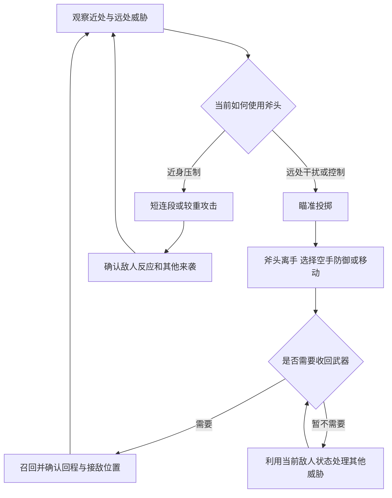

<!-- Imported from 游戏拆解分析/37款游戏拆解案/20_战神2018.md; original analysis and evidence boundaries preserved. -->

# 战神2018：一把能离手的斧头，怎样把力量感与战场控制接在一起

> 范围：2018 年《God of War》本体单人流程，包含可选女武神挑战，不混入《诸神黄昏》的长矛、盾牌分类与新增能力；不以新游戏加或最高等级配装代表首次通关。涉及陌生人、混沌之刃和希格露恩，含主要机制及剧情剧透。本文依据公开成品与开发者资料分析，没有实测动作参数。

《战神2018》的改变，不只是镜头靠近了奎托斯，而是力量的表达从远景里的大规模破坏，更多转向一连串近身、明确、能够掌控的接触。利维坦之斧被掷出、嵌住目标，再从远处回到手中；阿特柔斯则在同行中逐渐成为可以依靠的伙伴。工具的可靠与关系的变化，共同支持父子旅程的核心体验。

战斗的关键因此不是“斧头很有打击感”，而是同一件武器能够在近战、远程和控制之间转换，让玩家用较少的基础输入重新安排敌人。力量感并非只来自强烈音效，也来自行动确实改变了局势，而且这种改变可以被理解与复现。

## 1. 投出斧头以后，战斗并没有暂停

利维坦之斧离手时，玩家仍可移动、防御，并使用空手动作。某些目标能够被投斧造成的状态暂时限制，玩家因而可以先处理另一项威胁，再决定何时召回。官方早期实机介绍明确呈现了投掷、空手交锋与召回之间的衔接。[官方实机介绍](https://blog.playstation.com/2018/03/19/god-of-war-first-hands-on-report/)

这使斧头不仅是一个始终握在手里的攻击菜单，也成为被放在战场某处的工具。玩家需要考虑它现在影响谁，自己接下来面对谁，以及召回是否会改变目前的控制关系。一次投掷同时具有伤害、状态和空间价值。

并非所有敌人都接受相同控制，体型、等级与具体状态都会改变结果。若把能冻结普通目标的表现推广给所有 Boss，分析就会失真。设计的深度恰好来自这种条件差异：同一把斧头在不同遭遇中，需要承担不同任务。

<figure>
  
  <figcaption>图 1 · 斧头、距离、敌群与伙伴协作的关系。用于概括本文分析，不代表游戏内部状态机。</figcaption>
</figure>

查看可编辑图源

## 2. 召回动作的反馈同时保护可靠性与重量

负责相关设计的 Vince Napoli 在复盘中说明，召回路径、返回时间与动画经过多次调整，目标包括让玩家看得见斧头回来，并避免距离过远导致等待失控。[开发者复盘：Recalling the Leviathan Axe](https://www.gamedeveloper.com/design/recalling-the-leviathan-axe)

这一取舍很重要。若完全追求物理距离对应的飞行时间，玩家在压力中可能难以预测多久能重新使用武器；若按键后立即无过程地出现，又会损害重量和神话能力的表现。可控的返回与可见的运动，让实用性和表演同时成立。

声音、接斧姿态与反馈强化了动作完成的瞬间。玩家不必一直盯着武器位置，也能感知它正在接近以及已经回到手中。这里的技术细节有开发者材料支持，但不能把召回的具体实现推广为全游戏所有攻击的实现方法。其他招式仍应按可见结果分析。

回程能够伤及沿途敌人，还让玩家移动具有额外意义。斧头离手之后改变位置，可能让召回形成新的穿行方向；即便玩家最初只是想取回武器，也可能从意外命中中发现这种用途。这类发现把一个方便功能转化为主动练习的对象。不过，偶然命中并不等于任何落点都能稳定复现，真正的控制仍需要观察敌人站位和回程条件。设计上的价值，是让基础功能自然暴露更深一层用途，而不要求玩家先读完另一套教程。

## 3. 空手、斧头与怒气分别改变敌人的哪一部分

空手动作在眩晕积累和近身控制上具有用途，斧头提供不同距离下的伤害与状态，斯巴达之怒则在资源足够时给予显著的局势干预。它们不只是三种伤害皮肤，而是让玩家在生命压力、敌人状态和目标数量之间重新分配工具。

眩晕条提供了区别于生命的进度。玩家可以有意识地追求处决或强力处置机会，决定是否继续以适合的动作推进这一状态。敌人一旦进入明确可处置状态，长时间的风险管理便获得一次强烈收束，完成感因此不完全依赖最后一击造成了多少伤害。

混沌之刃加入后，又扩展了覆盖与属性关系。但它在本作中经过剧情铺垫才出现，不能像讨论续作那样假设玩家从开场就同时拥有完整双武器思维。解锁顺序控制了学习与情绪：玩家先与斧头建立关系，再重新认识奎托斯的旧武器。

## 4. 同伴把战斗关系做成日常可用的动作

阿特柔斯的箭矢与协助，使玩家可以在自己执行近战或移动时，对另一个目标施加影响。它增加了一种并行处理能力：奎托斯不必亲自到达每个位置，才能改变那里的局面。同伴由此成为战斗工具，也在反复协作中形成可靠感。

这与需要持续保护一个脆弱对象的护送压力不同。玩家更多时候是在借助阿特柔斯完成动作，而不是把整个注意力放在防止他拖累自己。开发者对战斗的讨论也强调了同伴在控制、干扰和连续动作中的贡献。[开发者谈同伴与战斗](https://blog.playstation.com/2022/10/04/game-developers-explain-what-makes-god-of-war-2018s-combat-tick/)

关系表达因此不只在过场中发生。一次箭矢帮助结束敌人的危险动作，一次战后对白接上刚才的遭遇，都在加强“我们一起走过这里”的连续感。剧情中的争执和成长又会改变玩家对这些动作的理解，让机械协作拥有角色意义。

## 5. 场景一：家门前的陌生人让近身动作承受神话尺度

开场陌生人战发生在与家庭相连的空间。敌人通过语言、身体承受与反击展示异常力量，玩家则在相对集中的对抗中使用基础动作。这里的核心效果，是在还没有庞大技能树时，让玩家感到奎托斯的每一次接触仍然具有神的力量。

场地破坏、近距离扭打与阶段转换扩大了基本输入的结果。玩家打出的拳击和斧击，不仅表现为生命条变化，还能推动人物位置和环境关系。由此建立的尺度不同于《战神3》的远景巨物：画面距离更近，力量更多通过身体与环境的直接接触被感知。

这场战斗同时提出人物问题。奎托斯为什么压抑自己，对方为什么能够承受这些伤害，家门后又有什么需要保护？动作没有脱离叙事，战斗中的表现正在制造继续前进的动机。玩家可能因战斗刺激而投入，也可能因这些未解问题而继续旅程。

但演出阶段与常规交锋的规则应当分开。场面中的极端破坏不意味着日常攻击具有同等环境自由，关键节点也经过严格编排。它的成功在于让受控变化紧跟玩家投入，而不是提供一个所有对象都可任意破坏的模拟世界。

## 6. 场景二：希格露恩把此前学习变成连续检索

可选女武神战提供与主线奇观不同的挑战。希格露恩综合多种需要辨认的攻击方式，让玩家不断确认当前信号对应什么处理。此前在其他女武神身上建立的经验，在此成为可调用的知识，而不是被一套完全陌生的规则取代。

玩家需要同时管理攻击承诺和观察。符文攻击虽然强力，但发动时如果没有明确窗口，仍可能导致无法及时回应下一次威胁；一味保存所有资源，又会拉长需要保持准确的时间。强能力的投入时机因此比“冷却好了就用”更重要。

这场战斗也能检验反馈是否足够区分。外观相近的起手如果对应不同应答，细节必须能在实际镜头下被辨认。学习成功时，玩家会感到此前经历被整合；学习失败时，则可能只感到招式很多、惩罚很重。其质量不应仅用死亡次数衡量。

希格露恩属于可选高压内容，允许主线保持较宽的体验入口。把这一场的要求当成全作平均战斗强度，会掩盖游戏实际的难度分层；完全忽略它，又会漏掉动作系统为熟练玩家保留的集中考试。

## 7. 近肩镜头让接触更近，也让视野外威胁更重要

相较旧作，近肩镜头突出角色身体、武器与命中对象，却减少了同时看清周围空间的能力。玩家在处理面前目标时，需要通过威胁提示、声音、同伴提醒和主动转向补足信息。战斗难度因此部分来自注意力分配，而不只来自单个敌人的招式。

群战若能够让玩家理解敌人进入的位置，并通过移动将威胁重新放到前方，就会形成有意义的空间经营；若攻击频繁从缺少提示的画面外到来，近景力量感便可能以不透明受击为代价。镜头方案的好坏不能脱离敌人配置评价。

在探索中，斧头的投掷与召回又被用于机关与空间问题。战斗里熟悉的工具能够作用于世界，使玩家的动作经验连续延伸。船行、攀爬、对白和战斗之间的衔接，则支持长时间同行的情绪。节奏较慢时，这些连接有助于关系积累，也可能被纯战斗导向玩家视为中断。

## 8. 装备等级和技能成长会改变动作能否兑现

护甲、附魔、武器升级和符文选择提供成长路线。玩家可以提升容错、强化偏爱的能力，或缩短部分资源循环。装备等级与敌人强度的关系，也会影响实际伤害及压制感，因此同一套动作在不同成长状态下不一定获得相同反馈。

这带来一个重要分析边界：敌人没有按预期后仰，可能与等级和状态有关，不必直接推断为动画或命中失效。反过来，若等级差异影响很大却传达不足，玩家会误以为自己没有掌握正确输入。成长系统需要与敌人可读性一起被讨论。

主线遭遇、可选区域和女武神把不同压力分开，允许玩家按兴趣探索并强化。代价是装备选择可能让某些场景偏离原本节奏：过强配装缩短敌人展示，过弱配装延长消耗。以战斗策划角度分析时，应说明难度与成长背景，避免把个人一次通关的强度当成唯一标准。

## 9. 可迁移启示：让武器可靠地改变局势

利维坦之斧最值得借鉴的地方，是同一个动作同时承担角色身份与战术用途。投掷像神话武器该做的事，也确实能改变距离与敌人状态；召回既具有强烈完成感，又让玩家重新掌握工具。反馈之所以有分量，是因为玩家知道行动已经生效。

设计类似武器时，可以分别检查三件事：离手后玩家还能做什么，返回是否容易预测，命中到底改变了敌人什么状态。若其中任何一项缺失，武器可能只剩好看的飞行动画，或者只剩效率高却没有身份的远程按钮。

同伴设计也可以采用相同原则。先让玩家在普通行动中感到伙伴可靠，再用剧情改变这份可靠的意义。战斗与关系不必每秒都同步表达，但只要长期反复发生在同一组可理解动作上，父子同行就能够成为玩家亲自参与的经历，而不只是两段过场之间的故事。

## 资料与支持范围

- [God of War: First Hands-on Report](https://blog.playstation.com/2018/03/19/god-of-war-first-hands-on-report/)：支持投斧、空手与召回的基础战斗关系。
- [Vince Napoli: Recalling the Leviathan Axe](https://www.gamedeveloper.com/design/recalling-the-leviathan-axe)：参与开发者的一手复盘，支持召回路径、时序与反馈曾为可见性及可靠性进行调整；本文不复刻其具体参数。
- [Game developers explain God of War (2018)’s combat](https://blog.playstation.com/2022/10/04/game-developers-explain-what-makes-god-of-war-2018s-combat-tick/)：支持同伴参与与动作反馈的行业开发者观察。
- 陌生人、希格露恩和成长关系的解释为公开成品内容的原创分析，未声称掌握全部敌人内部规则。资料核对日期：2026-09-20。

---

[返回游戏拆解](/blog/game-breakdown/)
