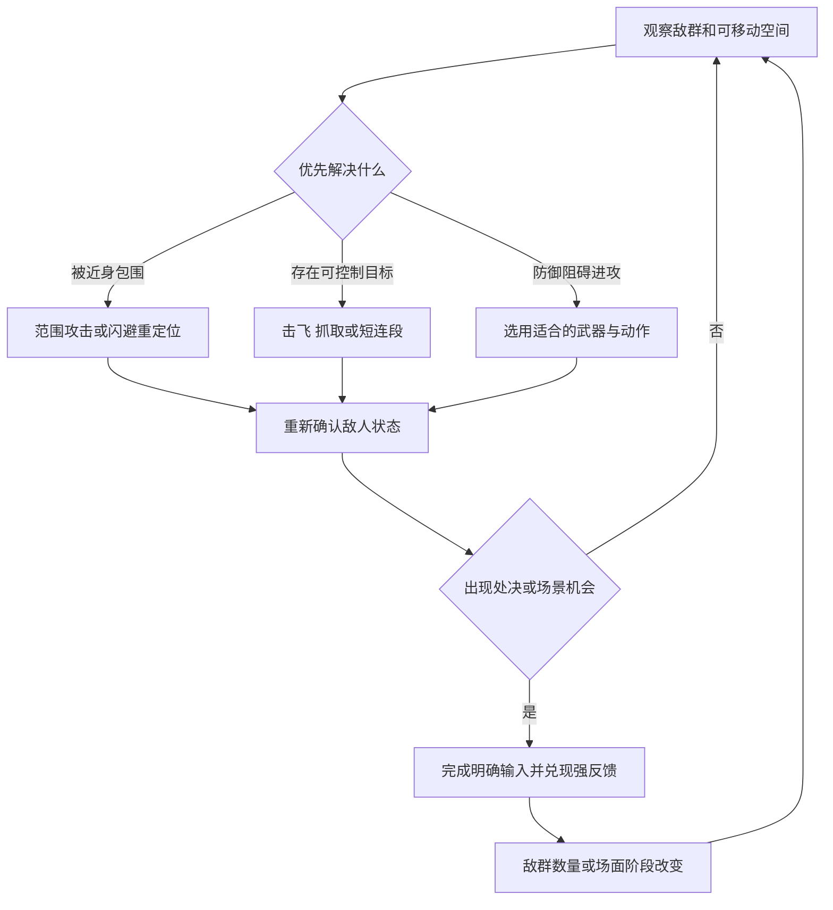

<!-- Imported from 游戏拆解分析/37款游戏拆解案/07_战神3.md; original analysis and evidence boundaries preserved. -->

# 战神3：巨大奇观怎样变成一次有因果的亲手弑神

> 范围：2010 年《God of War III》本体主线，重制版可参照同一核心规则；不讨论系列其他作品和挑战模式。涉及波塞冬、赫拉克勒斯及宙斯相关场面，含主要流程剧透。以下是成品设计分析，不声称实际测量过连招帧数、敌人调度或镜头系统参数。

《战神3》最鲜明的吸引力，是玩家能以相对直观的操作参与远超角色体型的破坏。山体、泰坦与神明并非始终停留在背景，它们会成为脚下场地、攻击来源和最终可以击倒的对象。游戏不断把巨大目标分解成此刻能够理解的局部动作，再用镜头与场景后果放大成功。

这种力量感依赖操作与结果之间的衔接。若场面全部自动播放，玩家容易变成观众；若让玩家同时管理所有巨型物体的空间关系，输入负担又会淹没奇观。《战神3》的主要工作，是在普通战斗、环境行动和处决演出之间不断调整控制粒度，让每个阶段都有明确可完成的动作。

## 1. 群战循环首先处理敌人的状态与相互位置

流亡剑的链刃攻击具有明显的空间覆盖能力，普通敌人又可以被打断、击飞、抓取或用于后续动作。玩家面对的因而不是一组彼此独立的生命条，而是一群能够被重新组织的身体。把一个敌人打离地面、从包围中打开方向，往往同时创造伤害和空间收益。

轻重攻击、跳跃、闪避、防御与抓取形成不同程度的动作承诺。短动作适合重新确认局势，长连段适合已经掌握的窗口。能否完整打完一套招式，取决于其他敌人的位置和反应，而不仅是被攻击对象是否仍然站着。连招表提供可能性，遭遇设计决定这些可能性有没有用。

群战中最重要的判断之一，是当前目标的状态是否允许继续控制。容易被打断的小敌人可以成为建立连段的入口，具有更强防御或不同攻击节奏的对象则要求调整方式。把所有敌人都写成“杂兵”，会漏掉它们如何分别承担可支配目标、进攻阻力与打断来源。

<figure>
  
  <figcaption>图 1 · 群战、场景变化与动作演出的联系。用于概括本文分析，不代表游戏内部状态机。</figcaption>
</figure>

查看可编辑图源

## 2. 武器差异需要被敌人调用，而不只是换一种颜色

流亡剑、哈迪斯钩爪、涅墨亚拳套和复仇女神鞭提供不同的动作与能力。它们保持相近的基本操作入口，减少学习新武器时的断裂，同时用覆盖、推进、敌人反应及对应魔法建立差异。玩家可以较快使用新工具，再逐渐理解其适合的情境。

拳套尤其适合展示武器身份如何被关卡承认。它在流程中与强硬防御、特殊障碍的处理联系起来，使获得武器不仅表示攻击力增长，也表示一类此前不能直接解决的问题现在可以被解决。外形、命中表现与功能因此互相印证。

但存在一种退化风险：如果武器只在指定障碍前必须使用，其他战斗仍完全依赖旧武器，它就更像钥匙。要形成真正的战斗选择，需要在日常遭遇中也提供适用差异。评价多武器系统时，应看玩家为何切换、切换后敌人状态怎样改变，而不是仅统计武器数量。

魔法、怒气与道具能力则提供不同强度的局面干预。把强资源花在清理包围、缩短危险阶段或处理难以接近的目标上，收益并不相同。资源管理因此服务于推进节奏：在当前战斗中花掉，是为了避免哪一种具体损失，又会让后续少掉什么保险。

## 3. 动作反馈把一个小输入扩大为身体力量

链刃的大幅轨迹让玩家容易理解攻击覆盖方向，敌人后仰、浮空与位移则显示力量确实传递到了目标。这里的重点不只是镜头震动强不强，而是敌人是否以足够清晰的身体变化回应命中。攻击没有改变对方状态时，声音再响也可能显得空。

角色尺度与镜头距离会改变反馈方法。在较远的画面中，微小肌肉细节不足以传达结果，需要更清楚的姿态、轨迹和群体变化；进入处决镜头后，局部动作与身体接触又能承担更细的表达。同一作品在不同镜头下使用不同的信息密度，避免远景看不清、近景又只剩夸张效果。

处决的价值还在于明确收束。一场持续交锋中，玩家始终在判断敌人是否还能反抗；处决机会出现后，目标变成完成一组较清晰的动作。风险管理短暂让位于结果兑现。这种转换制造了释放感，但如果频率过高或重复过长，也会不断打断普通动作的连续性。

## 4. 场景一：波塞冬开场把泰坦身体变成行动空间

开场战斗最重要的安排，是盖亚既作为巨大生命体被观看，又作为玩家能够移动和战斗的场地。镜头展示她与奥林匹斯山的关系，玩家的短程行动则在其身体局部发生。宏观尺度与微观可操作空间交替出现，让角色的渺小与力量同时成立。

波塞冬相关的巨型结构并不要求玩家一次读懂全身。战斗把眼前可攻击的部分、攀附与移动区段、阶段推进分别呈现。玩家只需处理当下局部问题，成功后镜头和场景变化再告诉他，这个动作属于更大的一场神战。巨大对象因此不会仅仅成为血量夸张的普通敌人。

官方美术资料说明，波塞冬的怪物造型结合了海马、甲壳肢体和水等元素。[官方怪物设计资料](https://blog.playstation.com/2011/05/25/god-of-war-iii-how-to-make-a-monster/) 从成品效果分析，这些可辨认的部件也帮助巨型目标保留局部形态，玩家可以把注意力落在某个肢体及其运动上，而不是面对一团无结构特效。

最后的近距离处置又把尺度倒转：刚才压倒场景的神明，成为奎托斯能够直接支配的对象。视角变化让力量关系被重新感知。它具有强烈记忆点，同时也暴露了本作的取舍：参与主要来自被安排好的关键输入，不能把这种参与误称为完全自由的交战结果。

## 5. 场景二：赫拉克勒斯让武器获得成为战斗结论

赫拉克勒斯的巨大身体与拳套，先把力量身份放在敌人一边。竞技场中的敌群、正面压迫和场地边缘，使玩家需要处理群战与强敌推进的交替。面对普通士兵形成的行动习惯，不能全部照搬到这个更难直接控制的对象身上。

这场战斗把“夺取他的力量”做成可见过程。玩家经过对抗与阶段推进，最终获得与敌人形象紧密绑定的拳套。奖励因此不只是菜单弹出的新装备，而是刚才关系逆转的延续：对手曾经施加的力量，之后进入玩家自己的动作库。

获得后在环境与敌人上兑现用途，是这一结构完成闭环的关键。若新武器只存在于领取画面，战斗胜利的记忆很快会淡去；当后续障碍和攻击方式继续提醒玩家拳套的功能，赫拉克勒斯就以机械性的方式留在流程中。Boss、成长与关卡因此形成连续叙述。

它也有明确代价。武器获得被主线严格安排，玩家选择成长方向的自由有限；新功能的首次使用又可能显得过于指定。设计目标若是高度开放的构筑，不宜直接复制这种线性授予方式；目标若是控制学习顺序与戏剧节奏，它则具有优势。

## 6. 导演式镜头替玩家完成一部分注意力管理

《战神3》主要由系统安排镜头构图，把可操作区域、巨型背景和即将出现的威胁组织在一起。它让玩家在观看奇观时不必持续自行寻找最佳视角，也能在转场中明确此刻的目标。开发团队早期问答将宏大尺度下的流程清晰度列为需要处理的问题。[官方开发问答](https://blog.playstation.com/2009/02/13/god-of-war-iii-press-event-qa-and-new-trailer/)

这种控制也意味着作品承担更多可读性责任。玩家很难完全自由地转动观察时，边缘敌人、落点与路径就必须被画面、声音或场景结构充分说明。一次镜头变化若同时改变角色运动方向的感知，也可能让输入产生短暂混乱。因此镜头不是战斗外的包装，而是直接参与规则传达。

高质量的构图应当让重要信息与视觉焦点一致：需要移动时看得见可走位置，需要攻击时能够判断目标状态，需要欣赏规模时又有足够的操作余裕。不能简单要求每个镜头都最震撼；最震撼的画面未必最适合同时做复杂决策。

## 7. 战斗、谜题与移动让强烈刺激拥有间隔

本作把平台移动、机关、环境谜题与群战交替安排。它们不仅补充内容种类，也改变玩家注意力的使用方式：刚才关注敌人起手，接下来观察空间连接与机关状态。战斗疲劳因此得到缓冲，后续强刺激又能重新占据感知。

环境解法经常与新能力相连，形成“得到工具—看懂障碍—继续前进”的学习节奏。这样既帮助玩家理解武器用途，也把成长与世界变化绑定。问题在于，过于唯一的交互会降低重玩时的新鲜感；已经知道答案后，谜题可能只剩执行成本。

叙事同样借助行动后果建立连贯性。弑神造成的世界灾变，使胜利不只是过关，而是在提醒玩家奎托斯的目标与世界的存续并不一致。力量越明显，后果也越难忽略。这份不适感为纯粹的强者幻想增加了另一层意义，但不需要推断每位玩家都会因此产生同样的道德判断。

## 8. 难度提高后，奇观与动作深度的矛盾会更明显

较低压力下，广覆盖攻击与资源释放更容易保持顺畅，玩家可以把更多注意力放在规模与表现上。压力提高后，同一场遭遇会更强调取消贪刀、识别控制抗性和规划资源。不同难度并不只是战斗时长变化，也会改变玩家实际使用动作库的方式。

若敌人生命与伤害提高过多，处决前的重复消耗可能压住原本的速度感；若控制能力过强，又可能让强敌很难形成威胁。设计需要在“我能够支配场面”和“我必须判断才能支配”之间调节，而不只是保证所有武器数值接近。

成长主要沿主线逐步扩展，强化选择又给玩家有限的偏好表达。这适合保持一次完整冒险的节奏，但不足以单独支撑无限的构筑追求。评价本作时，应把主线中的动作丰富度与长期刷装目标分开，避免用另一类型的留存标准遮住其实际目标。

## 9. 可迁移启示：把规模拆成清楚的行动层级

制作大型 Boss 不必先从巨大血量开始。可以先设计三个层级：此刻玩家要处理的局部动作，这个动作怎样改变阶段，以及阶段变化怎样让宏观场面发生后果。只有三者连接起来，玩家才会把大场景理解为自己的行动成果。

同时，需要诚实区分控制权。普通战斗允许较多动作选择，移动与机关提供有限路径，处决输入强调完成与兑现。各段的参与方式不同并不是缺点，问题在于切换是否清楚、结果是否配得上此前投入。把所有段落都称作自由战斗，会让分析失去精度。

《战神3》的独特价值，在于让动作、镜头、敌人状态和神话后果朝同一个方向工作。可迁移的是这种因果组织，而不是无限增大敌人体型或增加处决长度。若玩家看见壮观画面，却说不清自己刚才做了什么使其发生，奇观与操作之间的连接仍然没有完成。

## 资料与支持范围

- [God of War III: How to Make a Monster](https://blog.playstation.com/2011/05/25/god-of-war-iii-how-to-make-a-monster/)：支持波塞冬相关造型的美术构成，不用于证明战斗判定或制作预算。
- [God of War III! Press Event Q&A](https://blog.playstation.com/2009/02/13/god-of-war-iii-press-event-qa-and-new-trailer/)：支持团队对规模与流程清晰度的设计讨论；早期资料未被当作全部最终实现。
- 波塞冬、赫拉克勒斯、武器功能与流程节奏的论述为基于公开成品内容的原创分析；未声称掌握内部镜头算法、AI 调度或精确动作参数。资料核对日期：2026-09-20。

---

[返回游戏拆解](/blog/game-breakdown/)
