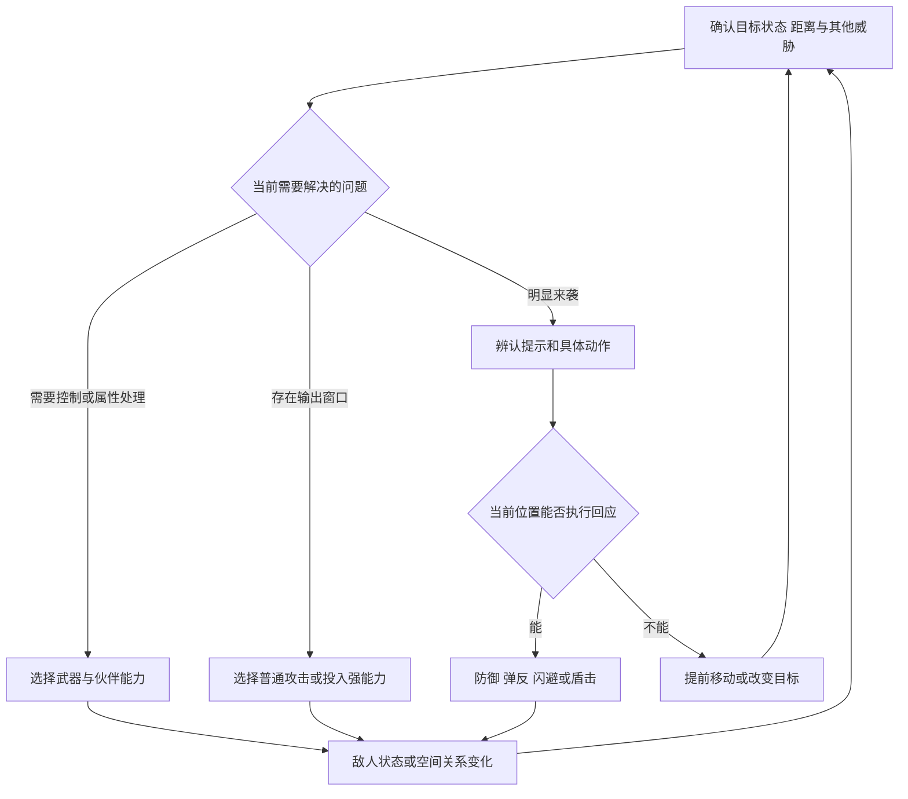

<!-- Imported from 游戏拆解分析/37款游戏拆解案/21_战神诸神黄昏.md; original analysis and evidence boundaries preserved. -->

# 战神：诸神黄昏：更多工具怎样变成一场战斗里的真实选择

> 范围：2022 年《God of War Ragnarök》本体单人主线与常规支线，不含《英灵殿》DLC，不把新游戏加或极限配装当作首次体验。涉及德罗普尼尔长矛、海姆达尔、父子分开行动等主要内容，含较重剧透。本文依据公开成品与官方资料分析，没有实测帧数、攻击概率或构筑上限。

《诸神黄昏》承接了前作的近身力量感与人物关系，但战斗问题已经发生变化。玩家不再主要学习一把斧头能做什么，而是在更早拥有多种武器、盾牌和伙伴能力的情况下，判断此刻应该调用哪一种。它最值得研究的，是怎样让丰富工具进入一场具体遭遇，而不是停留在技能树和装备菜单。

叙事方面，父子关系从共同出发进一步转向各自判断与彼此信任。操控角色和同行者发生变化，战斗节奏、移动方式与对白也随之改变。作品的突出体验因此来自两个扩展：战术工具变得更丰富，人物也不再只围绕一条简单的同行关系行动。

## 1. 双武器更早就位，改变了基础教学的起点

本作较早让玩家同时使用利维坦之斧和混沌之刃。前作中后期才建立的武器差异，在这里更早参与遭遇选择。斧头与链刃分别提供不同的距离、覆盖、属性和敌人处理方式，玩家需要从开始就理解它们如何互补。

官方实机介绍展示了冰霜觉醒、烈焰相关动作与更强调高差的交战方式。[官方实机报告](https://blog.playstation.com/2022/10/21/god-of-war-ragnarok-hands-on-gameplay-report/) 从设计关系看，蓄积属性让短暂停顿也能成为准备：还没有安全出手时，可以为下一次动作安排更明确的收益，而不只是原地等待。

但选项增加不等于必须频繁切换。一个短遭遇可能用单一武器就能顺利解决；真正重要的是其他选项能否提供不同的、可感知的收益。若切换只因为敌人带了某种指定防护，玩家完成的是条件匹配；若距离、敌群与状态共同改变收益，才会出现更有表达空间的选择。

## 2. 红、黄、蓝提示把防御问题拆成不同动作

普通防御、弹反、闪避与盾击构成不同的应对入口。双蓝圈攻击尤其强调主动接近并及时盾击打断，而红圈等危险提示要求避开不适用的防御方式。官方指南给出了这些基础区别，同时说明盾牌会改变防御能力的使用方式。[官方战斗指南](https://www.playstation.com/en-ph/games/god-of-war-ragnarok/god-of-war-combat-refresher-course/)

提示颜色并不提供全部答案。玩家还要判断距离是否足够、敌人是否被另一个对象遮挡、自己的动作是否已经承诺出去。看到双蓝圈但站得太远，与根本没有认出提示，是两种不同失败。前者说明之前的站位已经影响之后的可选动作。

盾牌选择进一步改变风险偏好。偏重承受和蓄积的方案，与偏重精准弹反收益的方案，提供不同容错和回报。不能把某一种盾的格挡能力推广给全部盾牌，也不能把防御系统只写成固定颜色口诀。真正的决策发生在提示、装备与位置交汇的地方。

<figure>
  
  <figcaption>图 1 · 武器、敌人条件与战斗选择的联系。用于概括本文分析，不代表游戏内部状态机。</figcaption>
</figure>

查看可编辑图源

## 3. 武器、符文与伙伴应该形成分工，而不是轮流按冷却

符文攻击、遗物、斯巴达之怒与伙伴能力提供强度不同的局势干预。它们有各自资源与动作成本，玩家需要决定是现在缩短危险阶段，还是保存给更困难的后续。强能力也并非每次都能无条件打断所有敌人，安全窗口仍然重要。

多个工具组合最有价值的状态，是前一个动作改变条件，后一个动作利用条件。例如先改变敌人的位置或状态，再使用合适覆盖的攻击；先控制一项外围威胁，再近身处理另一个目标。组合因此具有语义，而不只是让所有图标一起进入冷却。

冰霜与火焰、防护与眩晕、近战与远程各自提供选择维度，但维度太多也会形成负担。玩家如果不知道哪一项差异实际重要，可能退回到最熟悉的一套打法。敌人和遭遇需要通过清楚后果让这些差异被看见，否则工具库越大，未被使用的部分也越多。

## 4. 场景一：德雷基把防御、位置与范围威胁组合起来

早期德雷基战提供一个相对集中的组合考试。兽形身体带来咬击、尾部覆盖与接近压力，电属性攻击又改变周围空间的安全性。玩家不能只保持一个固定距离等待反击，而需要随攻击类型调整防御和位置。

成功弹反近身攻击可以维持接触并争取收益，范围电击则可能要求移动到更合适的位置。两种需求交替出现，迫使玩家判断此刻是保住近身输出位置，还是先离开。场景因此同时调用前作熟悉的基础动作与续作更丰富的选择。

这场战斗也说明，画面上的身体运动与提示必须合作。若玩家只看圈色而不看攻击范围，可能做对输入却站错位置；若只看兽的动作又忽视特殊提示，则可能尝试无效格挡。战斗深度来自两类信息的结合，而不是用界面代替所有动作辨认。

官方实机报告介绍了德雷基的咬击、尾击与电攻击，但它没有证明每位玩家都会认为这场战斗公平。公平感还取决于镜头、难度、装备和个人对信号的理解。本文将其用作规则组合案例，而不是借官方评价替代分析。

## 5. 场景二：海姆达尔让新武器成为对手问题的答案

海姆达尔的叙事身份强调预知与优越感，战斗前后的表现让玩家认识到，常规直接命中很难按原先预期取得效果。德罗普尼尔长矛则把投掷与引爆分开，使一次攻击不再只有当下的接触，还能留下稍后触发的威胁。

这一结构与对手身份形成直接关系。玩家通过布置和触发，改变对方需要处理的时序；此前显得可靠的回避或接住动作，不能继续以相同方式覆盖所有后果。这里可以分析可见的操作逻辑，但不能据此断言敌人程序真的预测了玩家输入或未来状态。

战斗推进后，玩家仍需要使用已经学会的移动、防御和攻击，而不是只重复新武器的解谜步骤。新工具先打破对手优势，再进入更完整的动作较量，使武器获得具有叙事意义，也避免整个 Boss 只剩寻找唯一道具。

它的代价是较强的作者安排。玩家在这一关键关系上的自由有限，新武器被明确塑造成答案。对于强调剧情兑现的主线，这是合理的集中；对于强调多构筑等价通关的系统，则需要谨慎迁移。不能把剧情上漂亮的克制，直接当作全系统选择自由的证明。

## 6. 高差与混合敌人要求玩家不断重排目标

本作部分战场加入更多上下层、移动连接和可利用环境物件。链刃攀附、跃下攻击等使位置变化能够直接进入进攻，而不是战斗外的纯移动。远处或高处敌人因此不只是要求玩家跑过去，也可能提供一次改变战场层级的机会。

混合敌群的价值，在于让工具选择受到同时存在的条件约束。优先追击远程可能让近战从后方接近，继续压制面前目标又可能承受持续干扰。玩家需要通过控制、移动和击杀逐步减少问题数量，而不是只寻找单个敌人的最优连招。

彩虹桥伤害等状态进一步改变受击后的判断。暂时附着的损失风险与后续再受攻击的关系，会使“先稳住避免连续受击”变得重要。它增加了一种局势压力，但若与画面外攻击叠加得过密，也会提高玩家难以归因的挫折。状态规则必须能在实际交锋中读懂，不能仅在菜单里解释清楚。

## 7. 近肩镜头面对更多信息，需要更严格的优先级

续作保留贴近奎托斯的观察方式，提供强烈身体接触，同时仍需要处理周边视野不足的问题。威胁提示、伙伴语音和主动转向帮助补充信息，但它们不能替代合理的敌人进入节奏。敌人越多、效果越复杂，越需要明确哪些信号必须首先被看到。

武器切换与属性蓄积也增加了角色自身的视觉信息。玩家要同时知道手中是什么、是否已准备强化、目标是否处于特殊状态，以及某项能力是否可以使用。好的反馈应降低反复查看界面的需要，让动作与音效本身传达一部分状态。

这不是要求所有效果都变得克制。关键在于效果有层级：命中庆祝不能长期遮住下一次致命起手，镜头震动也不能让玩家失去方向。力量感与可读性并不永远冲突，但需要在具体时段分配优先级，不能用“更震撼”作为所有变化的理由。

## 8. 阿特柔斯的独立行动改变节奏，也改变玩家理解关系的方式

操控阿特柔斯的段落让玩家从奎托斯的重量与工具转向另一套身体、距离和能力。它既是叙事视角变化，也是动作节奏变化。此前被视为同伴指令的角色，获得了自己直接面对世界的操作空间。

这种切换有助于让父子分歧不只通过对白传达。玩家暂时站在另一方的行动条件里，理解他所接触的人物与处境。但对于已经建立奎托斯构筑、希望持续磨炼连招的玩家，较长切换也可能中断正在形成的战斗目标。情感节奏与动作熟练节奏未必完全重合。

不同同行者还改变箭矢、能力和交流，强化世界关系的扩展。九界探索、支线人物与主线危机提供战斗之外的动力，使作品不只是工具测试场。代价是篇幅和信息密度更高，若支线与主线压力衔接不佳，玩家可能感到紧迫叙事与自由探索互相拉扯。

## 9. 成长允许保留偏好，难度需要区分知识与执行

本作装备升级更支持玩家长期保留喜欢的效果，而不必完全随着等级抛弃旧选择。开发团队还介绍了技能使用进度与进一步定制的关系。[主创成长系统介绍](https://blog.playstation.com/2022/11/08/10-gameplay-tips-for-god-of-war-ragnarok-power-levels-skill-labors-armor-set-bonuses-and-more/)

这种方案让偏好的动作更容易形成构筑身份，但也可能强化熟悉动作的重复使用。若奖励只鼓励把某招用很多次，而没有遭遇要求玩家改变场景应用，它就可能成为计数任务。技能成长是否推动理解，要看玩家是在不同条件下更好使用，还是只在安全目标上反复刷次数。

本作的失败还需要区分知识与执行。没认出防护或提示，是规则理解问题；知道要盾击却距离不足，是站位规划问题；已经到位但时机不对，才更接近执行问题。只用更高生命或伤害统一提高难度，会掩盖这些不同层次。

| 选择来源 | 带来的真实价值 | 可能退化的形式 |
|---|---|---|
| 多种武器 | 适应距离、覆盖和状态 | 只按指定属性换答案 |
| 盾牌差异 | 选择防御风险与回报 | 玩家不知道不同盾的条件 |
| 强能力组合 | 改变局势后集中兑现 | 所有冷却轮流释放 |
| 可持续升级的装备 | 长期保留个人打法 | 一套强方案压住其他选项 |

## 10. 可迁移启示：扩展动作库之前，先扩展选择理由

《诸神黄昏》最有用的经验，是让新能力进入旧循环中的明确位置。长矛改变攻击后果的触发时序，盾牌改变防御收益，高差改变接敌与输出的关系。每一种扩展都应该能回答一个具体问题：它使玩家现在可以做什么，以前为什么不容易做到？

同时，新增规则要有可读的敌人和场景承接。把十种能力放进菜单容易，让玩家在一次交锋里理解其中两种为何不同更难。可以优先观察切换是否由可见局势引发，切换后是否产生明确结果，以及玩家能否说明自己为什么选择它。

本作的亮点是更丰富的战斗手段与更复杂的人物关系共同推进。它的边界则是工具、信息和篇幅都可能过载。战斗策划应保留这种双重判断：既看到扩展带来的表达，也检查玩家是否真的拥有使用这些表达的空间，而不是仅面对更多要记住的东西。

## 资料与支持范围

- [God of War Ragnarök: Hands-on gameplay report](https://blog.playstation.com/2022/10/21/god-of-war-ragnarok-hands-on-gameplay-report/)：支持早期双武器、高差与德雷基基础招式的公开展示。
- [官方战斗指南](https://www.playstation.com/en-ph/games/god-of-war-ragnarok/god-of-war-combat-refresher-course/)：支持基础提示、盾击及工具类型的规则核对，不将单一盾牌条件推广到全部装备。
- [Santa Monica Studio：10 gameplay tips](https://blog.playstation.com/2022/11/08/10-gameplay-tips-for-god-of-war-ragnarok-power-levels-skill-labors-armor-set-bonuses-and-more/)：支持装备持续升级与技能使用成长的设计说明。
- 海姆达尔、角色切换和遭遇关系的因果解释基于公开成品内容；关于预知的描述属于角色呈现，不是对 AI 算法的断言。资料核对日期：2026-09-20。

---

[返回游戏拆解](/blog/game-breakdown/)
