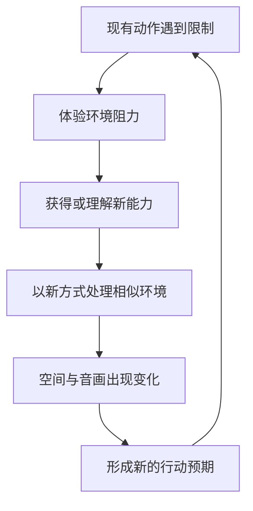

<!-- Imported from 游戏拆解分析/37款游戏拆解案/35_GRIS.md; original analysis and evidence boundaries preserved. -->

# GRIS拆解案
## 能力与世界的共同变化如何形成情绪旅程

**范围：**2018年《GRIS》的核心流程；PS4版本的资源升级仅作技术旁证，不混入其他作品。**剧透级别：中，涉及能力获得、颜色恢复及主要象征性场景。**本文把情绪解释视为阅读路径，不把作品强制套入一种心理学阶段表。资料核对：2026年9月20日。

## 核心判断

《GRIS》的亮点是让画面、声音、角色动作和可到达空间共同变化。玩家经历的不是一组插画之间的移动，而是自己的行动能力逐渐与世界建立新的关系。某处原本令人停滞的环境，后来可以以另一种方式通过，变化因此具有身体层面的参照。

色彩恢复可以直接被看见，动作能力的增长则需要通过操作体会。两者相互配合，才使“世界重新变得可以接近”具有超过视觉装饰的意义。本文关注这种关系如何成立，而不裁定每一种颜色只能对应某一种情绪。

## 一 开场先建立失去能力的基准

开场中的声音、身体状态与空间变化，让玩家先接触到一种受限状态。角色能做什么、不能做什么，比长篇人物背景更早进入体验。随后获得的行动能力因此可以被与开场比较。

如果角色一开始就具备全部工具，后续场景仍然可以美丽，但“逐步能够面对世界”的结构会减弱。本作把学习动作与改变状态安排在同一个过程，使玩法进展也成为叙事表达的一部分。

这种设计并不要求玩家准确说出主题。即使没有形成明确的象征解释，也可以感知到动作由受限到丰富、空间由阻碍到可通过的变化。情绪理解因此允许不同深度，而不完全依赖阅读或文化知识。

## 二 平台规则让景观拥有可操作的意义

平台、路径、收集目标和轻度谜题，为观看提供方向。玩家需要辨认可以抵达的地方、判断下一步动作，再在移动中接触新的构图和声音。景观的展开时机因此部分由自己的行动决定。

发行商的商店说明将衣裙能力、逐渐开放的探索空间和低失败压力列为基本体验。本文对这些要素的情绪联系属于分析，而不是引用官方对每个场景的唯一解释。[官方商店说明](https://store.steampowered.com/app/683320/GRIS/)

低惩罚使注意力较少被“这次失败会损失多少”占据，却仍然可以保留观察和执行的要求。遇到阻碍、短暂停顿、再找到通过方法，足以制造局部张力。挑战并不必须通过生命值损失或死亡重试才能存在。

<figure>
  
  <figcaption>图 1 · 能力、空间与情绪旅程的联系。用于概括本文分析，不代表游戏内部状态机。</figcaption>
</figure>

查看可编辑图源

## 三 案例一 重量能力让抵抗成为身体选择

面对风的压力，角色的普通移动能力会受到环境限制。衣裙相关的重量能力提供另一种身体状态，使玩家能够在特定情况下站稳、承受或改变与地面的关系。状态切换因此不是单纯获得一个更高数值，而是换一种应对方式。

这里的关键对照是移动与稳定。想迅速前进和想避免被推离，并不总能由同一状态同时完成。玩家需要根据环境选择何时保持重量、何时恢复灵活，而不是一直按住新能力就能解决所有问题。

从情绪解释看，这可以被理解为对压力的一种回应：未必立刻消除风，也可以先获得承受它的能力。但这只是机制允许的阅读，不等于开发者宣称“重就是某个固定心理阶段”。分析应先解释真实动作关系，再讨论其可能意义。

## 四 案例二 水下移动改变世界的可达方式

水下段落让移动空间从以落脚点为中心，转向更连续的方向选择。不同介质改变了身体与路径的关系，先前作为边界的区域可以成为通路。玩家对世界的认识因此发生重新分类。

这种变化之所以容易带来舒展感，是因为先前的限制已经形成参照。空间不只是变大，而是能够用新的动作穿过。环境、角色动画与声音共同提示移动状态，让身体变化在多个感官通道上保持一致。

威胁性形象或追逐段落又会重新压缩这种自由。玩家刚建立起新的能力预期，就需要在更强压力下使用它。情绪旅程因此不是单调地增加舒适，而是在舒展与收紧之间改变节奏。

## 五 摄像机通过尺度分配注意力

固定或受导演控制的构图，可以让角色显得微小，也可以把注意力集中到一个局部行动。镜头拉远时，玩家更多感知自身与环境的尺度关系；镜头接近时，动作与表情更容易被辨认。

这种控制牺牲了自由观察，却换取了视觉叙述的精确度。对平台玩法来说，精确构图还必须兼顾路径可读性：角色与背景的对比、可交互物的轮廓、落点是否处于视野内，都影响玩家能否在欣赏景观时保持可靠操作。

“漂亮但不知道往哪走”并非审美与玩法不可调和的证明，而是信息层级没有在该处匹配。丰富的背景应该支持方向感，不能在需要判断的瞬间与可操作对象竞争到难以区分。

## 六 音乐与静默怎样组织释放

音乐的作用不只是在美丽画面上增加情绪。它可以伴随到达、能力变化和空间展开，帮助玩家把一个过程理解为阶段性的完成。此前的移动与停顿提供积累，声音则强化变化被感知的时刻。

同样重要的是不持续占满所有时刻。若每一段都保持同样强度，关键场景的幅度就会降低。环境声、动作声和较安静的段落，能够为音乐进入保留空间。

不能只用“音乐好听”解释其设计价值。应观察音乐出现时玩家正在做什么：刚解决问题、刚离开压力区域，还是仍在困惑中寻找路线。相同乐段放在不同操作状态下，可能产生完全不同的效果。

## 七 无对白叙事依赖重复与变奏

缺少大量语言解释，意味着人物、环境与符号之间的关系需要通过再次出现来建立。相似形象在不同状态、尺度或情境中回归，玩家才能将它们联系起来，而不是把每一幕看作独立图像。

动作本身也可以形成变奏。相同的前进，在身体受限时表现为困难，在获得能力之后变为可执行的目标，在压力再次来临时又需要重新组织。故事因此能在规则连续的情况下推进，而不必不断增加说明文字。

这种表达保留了个人理解，也会让部分玩家缺少明确的叙事抓手。作品需要接受这种选择的代价。可以分析它支持哪些解释，但不宜把没有直接文本支撑的寓意写成标准答案。

## 八 美术技术的价值在运动中接受检验

纸张质感、色彩层次与动画风格，需要在角色移动和镜头变化时仍保持一致。静止截图的美不能直接证明动态体验；需要关注轮廓是否稳定、特效是否遮蔽落点、场景变化是否保持视觉重心。

开发者在PS4版本介绍中提到资源分辨率和音频品质的提升。它说明平台版本确实会调整呈现，但不能由此推断所有画面效果的底层渲染方案。[Nomada开发者介绍](https://blog.playstation.com/?p=218836)

对设计而言，技术实现的目标应是维护艺术表达与操作信息之间的关系。若更复杂的粒子或更细的背景降低了角色可读性，细节增加未必是体验改善。本文不对未公开的着色器、动画混合或相机代码作确定断言。

## 九 作品为何适合集中体验 也有哪些限制

能力与景观持续变化，让流程获得明确推进感；重复失败较少，使玩家能较连贯地接收情绪结构。这些选择适合一次相对集中的旅程，却不会自然生成高强度动作游戏那样的长期熟练追求。

可选收集和技巧挑战可以扩展停留时间，但如果玩家为了清单反复穿行，注意力可能从感受转向核对完成度。这不意味着收集一定破坏体验，而是主线情绪与完成目标之间存在不同的节奏要求。

| 设计选择 | 支持的体验 | 可能损失 |
|---|---|---|
| 低失败惩罚 | 连贯地观察与感受 | 高压挑战的成就感 |
| 镜头精确编排 | 稳定的构图与尺度表达 | 自由观察的控制权 |
| 新能力打开空间 | 身体变化与世界变化相连 | 熟练一套规则的时间 |
| 象征而非大量对白 | 多种个人理解 | 清楚明确的情节解释 |

## 十 对战斗策划也有价值的启示

能力升级最好改变玩家与障碍的关系，而不只是提高一个数值。一个新位移、新防御或新攻击方式，如果能让玩家重新处理已经认识的威胁，就更容易形成可感知的成长。

反馈的组织也需要多层一致。角色姿态、相机、声音与环境反应最好表达同一件事：现在是承受、抵抗、释放还是失控。若音画已经演成强烈成功，实际规则却仍要求玩家停手，就容易让信息相互冲突。

迁移时必须改变取舍。本作可以使用较强的镜头控制和较低的失败成本；竞技或高难动作游戏则需要更多信息公平与持续可控性。可以借鉴能力与情绪的关系，不能直接照搬全部控制限制。

## 资料与证据边界

- [GRIS官方商店说明](https://store.steampowered.com/app/683320/GRIS/)：核对衣裙能力、探索、轻度谜题和作品的基本表达方向。
- [Nomada关于PS4版本的介绍](https://blog.playstation.com/?p=218836)：支持该版本的资源与音频调整，不代表所有平台的技术细节。
- 重量、水下移动和摄像机的体验解释为本文分析；不把颜色与固定心理阶段作一一对应，也不宣称本文完成了玩家情绪测量。

---

[返回游戏拆解](/blog/game-breakdown/)
