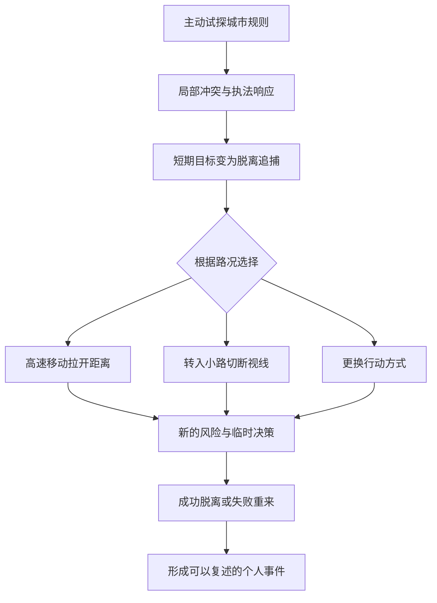

<!-- Imported from 游戏拆解分析/37款游戏拆解案/06_GTA5.md; original analysis and evidence boundaries preserved. -->

# 《GTA 5》：一座任你惹事的城市，为何又需要严格导演

> 剧透等级：中。涉及珠宝店抢劫、“三人成伍”及故事模式中的角色关系，不展开最终结局。本文讨论 2013 年本体建立的故事模式与第三人称基础体验，后续第一人称模式只作边界说明；GTA Online 不作为单机结论的证据。本文未进行本轮实机测试，技术部分仅讨论成品可观察效果与已公开信息。

## 1. 核心论点：城市提供可能，任务提供值得回忆的顺序

《GTA 5》的突出吸引力，是玩家可以在一个具有鲜明性格的城市里快速把念头变成事件。看到车就能开走，开车可以闯入新的区域，冲突会引来警察，追逐又会把玩家带进原本没有计划经过的道路。行动不必等待正式任务批准，因此城市像一个能回应试探的舞台。

但它最容易被记住的大型犯罪场面，又往往来自严格编排的任务。指定的角色站位、追逐路线、对话和切换时机，把松散可能性压缩成有起伏的演出。本文的核心判断是：游戏同时出售“我可以这样做”和“我刚刚经历了这一场”，前者依赖系统组合，后者依赖作者控制。它的成绩与摩擦，都来自两种承诺交替生效。

Rockstar 的故事模式宣传和官方实机展示明确围绕三位主角、犯罪活动及城市行动展开。本文以这些公开展示确认对象范围，以下关于自由与导演的关系则属于分析。[Rockstar 官方实机展示](https://www.rockstargames.com/videos/ra124rca)

## 2. 自由的基础是动作之间没有太多手续

城市自由首先不是地图面积，而是行动切换的连续性。下车、开枪、抢另一辆车、穿越小巷、上高速，每一步都能利用当前空间中的对象。车辆既是移动工具，也是临时掩体、碰撞物和脱离追捕的办法；道路既负责通行，也决定追逐中的转弯、视野和速度风险。不同系统共享城市几何，才会出现“本来只是想去那里，结果发生了一串事”。

玩家的投入因此可以从很小的好奇开始。随手碰撞一次车辆便足以改变交通局面；决定继续加速或下车，就会把短事件引向不同方向。游戏不必为每一种组合写专门任务，只要反馈能够被玩家辨认，并且后续行动仍然可执行，就能让事件继续生长。

这里的自由并不等于所有对象都能永久改变。许多反馈是局部、短时和可恢复的。正是这种恢复性，让城市经得起频繁试探，而不会被一次冲动破坏到无法继续游玩。评价时应关注一次行动能产生多少有意义的后续决定，而不是要求城市模拟现实中的所有后果。

## 3. 场景一：一次街头追捕如何生成自发故事

以市区驾车引发追捕为例，玩家最初的目标可能只是逃离眼前警车。高速路提供速度，却减少可突然转向的选择；小巷降低车速，但能够切断视线；换车和离开主要道路，则改变下一阶段的风险判断。警星、警笛、视野中的车辆和地图信息共同告诉玩家，局势正在升级还是暂时缓和。

这段体验的主角其实是不断变化的小目标：先保持车辆可用，再甩开近处追兵，再避开搜索范围，最后确认自己有时间停下来。玩家因路况和碰撞临时改变计划，事后便容易把过程讲成一段自己的经历。游戏无需替这段经历写完整剧情，反馈链已经为它提供因果结构。

反例是威胁出现方式无法被理解时，玩家会感到自己只是在逃离一个无形计时器。若道路选择看不出收益，逃脱就可能退化成不断开快；若失败后的返回成本太高，小规模试探也会变得不划算。因此，这类设计的关键不只是增加追兵，而是使不同空间选择持续有区别，并让局势变化足够可读。

<figure>
  
  <figcaption>图 1 · 自由探索、事件响应与导演式任务的关系。用于概括本文分析，不代表游戏内部状态机。</figcaption>
</figure>

查看可编辑图源

## 4. 场景二：珠宝店抢劫怎样把自由变成组织感

早期珠宝店抢劫将犯罪行为拆成勘察、选择方案、准备和执行。与自由漫游中的即时惹事相比，这里最明显的变化是行动有了前后依赖。玩家先观察地点和安保，随后选择进入方式并完成对应准备，因此正式行动不再像临时生成的一场枪战，而像自己参与组织的计划。

执行阶段又明显收紧自由。抢劫和逃离拥有预定节奏，角色职责、时间压力和路线使场面朝特定方向发展。玩家的主动性主要体现在方案与人员等前置选择，以及执行中完成当前职责，而不在于随时重新定义任务。前置决策与现场限制形成互补：因为前面参与过计划，后面遵守计划更容易被理解为配合团队。

这个案例说明，“选择”不一定要持续发生在每一秒。较少但能改变准备与执行感受的选择，可能比大量无差别路径更有组织感。反过来，如果前置方案对后续体验差别很小，或者任务失败条件与计划理由不一致，玩家就会更清楚地感到自己在遵守关卡脚本，而不是落实一份计划。

## 5. 三主角切换怎样同时服务人物与战斗

迈克尔、富兰克林和崔佛不是三套完全独立的操作系统，却对应不同社会位置、生活空间和情绪能量。切换角色会改变玩家接触世界的入口：住宅、熟人、职业期待和冲突方式都随之变化。一张地图由此能够承担几种生活，而不用把所有关系强行集中在一个人物身上。

“三人成伍”提供了更直接的战斗案例。任务让不同角色承担直升机驾驶、建筑外行动与远处支援等职责。切换并非仅是给同一场战斗换一把枪，而是改变信息范围和空间尺度：一人需要关注近处目标，一人从远处覆盖局面，一人负责载具与撤离。玩家能在同一事件中体验互相依赖的位置。

但这种协作感由单个玩家顺序接管，不是多人实时协作。系统与脚本必须替未操控角色维持演出，否则切换时就会失去整体可控性。因此不能把它直接照搬成多人设计：多人需要处理同步、沟通与等待，单机切换则需要清晰地提示当前最有价值的接管对象。三位主角的公开定位可由官方人物资料确认。[Rockstar 三主角官方介绍素材](https://www.rockstargames.com/newswire/article/25o2411819aok8/original-gtav-artwork-michael-franklin-trevor.html)

## 6. 驾驶、射击与镜头如何构成连续的犯罪动作

驾驶承担绝大多数城市尺度的变化，射击则把注意力收缩到掩体、目标和生存。驾驶镜头需要让玩家读到前方路线，射击镜头需要让玩家确认目标与身体暴露程度。下车进入交火，本质上是从路径判断转换为局部威胁判断；再次上车撤离，则把威胁转化为距离与路线的问题。

角色特殊能力强化了各自的动作标签：富兰克林偏向驾驶控制，迈克尔的能力强化射击处理，崔佛强调更具压迫感的正面冲突。它们能降低某类高压时刻的处理负担，并让角色差异体现在玩家愿意怎样解决问题。分析其作用时，应区分“能力数值更强”与“更愿意选择某种行动”，后者才与人物身份发生连接。

掩体枪战提供较稳定的可读结构，却未必具有同等丰富的敌人博弈。许多高潮依赖空间、数量、载具和切换安排来变化，而不是每个敌人都有复杂招式。这是一种内容重心选择：枪战作为多种活动间的共同语言，应优先可靠地承接场面，但重复任务也会暴露同质化。

## 7. 导演越强，规则边界越需要说清楚

自由漫游教会玩家用车辆和地形临时解决问题，主线任务有时却要求特定人物、载具或路线继续存在。玩家可能采取了在城市规则下合理的行动，却触发任务失败。这种时刻的失落并非单纯来自“不够自由”，而是两套规则之间的交接不够清楚。

| 游玩状态 | 主要承诺 | 有效的失败解释 |
| --- | --- | --- |
| 自由漫游 | 试探并接受系统反馈 | 追捕、损失、死亡等可理解后果 |
| 抢劫准备 | 改变正式行动的条件 | 准备目标未达成 |
| 导演任务 | 完成连续的角色演出 | 当前职责或关键关系被破坏 |
| 任务重试 | 快速重新进入关键操作 | 让玩家看清刚才失败的原因 |

固定演出能带来精准笑点、节奏与壮观场景，其成本是容纳行为的范围变窄。优化方向不一定是去掉限制，而是让限制变得有情境理由，尽量保留通向同一结果的多种局部行为，并让检查点靠近真正需要重新尝试的操作。

## 8. 讽刺性的世界与模式边界

电台、广告、路人反应和任务人物让城市拥有持续的表达。驾驶过程中听到的内容，并不只是填补空白；它让玩家在移动时接触这个社会如何夸耀自己、消费他人和解释暴力。三主角的欲望与周围世界互相呼应，犯罪自由因此带有一种荒诞感，而非纯粹的军事征服。

这种语气也有代价。当游戏一方面把暴力呈现为夸张娱乐，另一方面要求玩家认真投入人物伤害时，情绪未必总能平滑衔接。拆解应具体讨论哪个场景的操作与叙事互相支持，哪个场景又让玩家站到了不同位置，不能用“讽刺”两个字解释全部矛盾。

GTA Online 的长期资产、合作任务、竞争和玩家社交，会改变行动动机与风险含义，因此不应拿它的留存机制解释故事模式。后续第一人称视角也改变身体尺度与射击观看方式，不能被当作原始第三人称设计的必然效果。

## 9. 对战斗与关卡策划的迁移价值

《GTA 5》最可迁移的经验，是先让少数动词共享同一空间，再通过任务重排动词的顺序。驾驶、下车、交火和撤离如果各自断开，新增内容只能不断生产新玩法；如果它们能自然接续，改变角色职责、出入口和压力方向，就能生成不同场景。这里真正重要的是转换成本，而不是系统数量。

迁移的另一半是约束管理。单机叙事项目可以用前置计划为现场限制建立理由；合作项目应使职责互补但避免长时间无事可做；强调涌现的沙盒则要避免任务频繁否定玩家已经学会的规则。不能只复制壮观任务，再期待城市自由自动出现，也不能只搭出大量系统，便期待它们自然组成戏剧。

一场值得回忆的事件，需要玩家理解自己为何行动、局势为何变化，以及自己的决定产生了什么作用。城市负责使这些变化可能发生，任务导演负责使某些变化按足够有力的顺序发生。

## 来源与论证边界

- [Rockstar：GTA V 官方实机展示](https://www.rockstargames.com/videos/ra124rca)：确认故事模式的城市活动、角色切换和任务表现范围，不作为后台模拟算法的证据。
- [Rockstar：Michael、Franklin、Trevor 官方人物素材](https://www.rockstargames.com/newswire/article/25o2411819aok8/original-gtav-artwork-michael-franklin-trevor.html)：确认三主角定位与宣传对象，不证明本文对玩家情绪的推论。

追捕、抢劫与切换的因果解释为本文设计分析；未宣称量化了 AI、交通生成、难度或玩家自由感。不同平台、辅助瞄准与驾驶设置会影响操作体验，实测应单独记录。

---

[返回游戏拆解](/blog/game-breakdown/)
