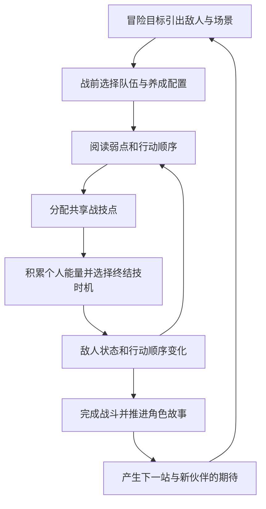

<!-- Imported from 游戏拆解分析/37款游戏拆解案/19_崩坏星穹铁道.md; original analysis and evidence boundaries preserved. -->

# 崩坏：星穹铁道：少量战斗按钮，怎样承载一支队伍的决策

> **分析范围**：2023 年 1.0—1.5 的基础回合制、战技点、能量、弱点击破与列车冒险，角色案例限当时的基础形态。三月七指冰属性存护形态，丹恒指风属性巡猎形态。本文不涵盖后续超击破、忆灵、角色强化或 2026 年终局环境。
>
> **剧透提示**：涉及空间站、雅利洛六号和仙舟罗浮的基本设定，以及寒鸦、银枝的机制，不涉及主线结局。战斗情境为规则推演，不是实测轮次、推荐配队或通关记录。

**核心论点：星穹铁道把大量战斗复杂度放在队伍关系和行动时机上，让单个角色的操作界面保持简洁；与此同时，用列车旅行和角色相遇为重复的配队、成长与战斗赋予冒险方向。吸引力来自“这支队伍运转起来了”与“还想知道下一站”的共同作用。**

## 1. 操作简单，不代表决定只发生在按键时

单个角色轮到行动时，可见选项并不多。玩家很容易把战斗概括为普通攻击、战技和有能量就放终结技，但这只是输入表面。选择一个动作之前，队伍已经通过配队、装备、速度与敌人弱点匹配，决定了许多可用解法。

一次普通攻击可能在伤害上不如战技，却能为后面的队友保留或创造资源；一次立即释放的终结技能处理当前危险，也可能失去稍后集中爆发的机会。按钮数量没有变，动作对其他角色的后果却让决策成立。

开发团队在 [2023 年战斗基础介绍](https://blog.playstation.com/2023/09/14/honkai-star-rail-hits-ps5-on-october-11-new-story-and-combat-details-revealed/)中强调普攻、战技、终结技、天赋与战前角色选择的配合。本文要解释的是这些选择为何互相影响，不把“易上手、难精通”的宣传表达直接当作深度已经得到证明。

## 2. 战技点让四个角色成为一个资源共同体

在本文所讨论的常规角色中，普通攻击通常补充战技点，战技通常消耗战技点；具体角色存在例外，所以不能把这句话当成全角色硬规则。关键结构是资源由队伍共享，一个人提高当前行动收益，会改变其他人随后能做什么。

这让“最强动作”无法只在角色内部判断。输出角色使用战技可能带来更高伤害，但若接下来的治疗者因此没有资源，团队可能付出远高于这一轮增伤的损失。反过来，状态安全时仍然反复投入防护，也可能压缩队伍尽快结束威胁的能力。

共享资源因此把角色职责连接起来：有些动作主要消费，有些动作可以在完成较低强度任务时补充资源，有些角色又通过自身机制改变供需关系。寒鸦在 1.5 的公开介绍中便通过标记目标、满足攻击条件后恢复战技点体现这种关系。[1.5 开发者介绍](https://blog.playstation.com/2023/11/03/honkai-star-rail-version-1-5-unveils-ghost-hunting-adventures-on-the-xianzhou-luofu-live-nov-15/)

这也说明一个支持角色的价值可以是让别人的计划持续成立。若只看她自己打掉多少生命，就会漏掉队伍因资源改善而多完成的行动。战斗拆解需要追踪资源在角色之间怎样流动，而不是给每个按钮单独排名。

## 3. 能量与行动顺序，给计划保留临场调整空间

终结技的能量与战技点承担不同职责。战技点让角色争用同一资源，能量则让每个人积累自身的关键行动机会。终结技可以在规则允许的时机插入常规行动顺序，但并不意味着能随意取消已经开始的任何敌方动作。玩家需要观察接下来是谁行动，以及现在投入资源会改变什么。

比如，治疗终结技在全员状态充足时使用，可能浪费一部分恢复；等到敌人行动之后再使用，可能更有效，但也必须判断队伍能否先承受这次攻击。输出终结技则可能用于及时移除危险目标，或者保留到更适合集中伤害的阶段。时机使同一个技能产生不同战略价值。

行动顺序的显示把这些推理变成可见问题。玩家不必靠实时反应跟上攻击，而可以阅读下一批行动，再分配资源。这是回合制的重要优势：它允许把压力放在预测后果和安排先后，而非要求所有人具备相同反应速度。

## 4. 弱点击破让攻击对象与节奏发生联系

敌人的生命与韧性分别提供不同目标。匹配弱点属性的攻击可以削减韧性，击破后会产生对应效果；没有匹配弱点的攻击并不等于完全无法造成生命伤害。把弱点理解为“只能用指定颜色攻击”，会低估队伍整体伤害与资源关系。

弱点真正增加的，是另一个值得考虑的行动时机。玩家可能暂缓对低血量目标补刀，先用合适属性处理即将行动的危险敌人；也可能放弃当下击破，优先结束一个持续制造威胁的单位。生命伤害、韧性变化与敌人行动的顺序共同构成判断。

这种设计让战前配队与战中选择发生连续关系。带来某种属性，只是获得处理一类问题的工具；工具放在哪个行动节点使用，仍影响其价值。若角色数值足够高到可以直接消灭敌人，击破关系可能变得不重要；若敌人设计只接受极窄解法，配队又容易成为入场资格检查。这两端都是需要观察的边界。

| 决策发生的位置 | 主要问题 | 可能收益 | 常见代价 |
|---|---|---|---|
| 战前配队 | 能否覆盖伤害、生存与弱点需求 | 提供可行解法 | 队伍位置有限 |
| 当前普攻或战技 | 谁更值得使用共享资源 | 提高当前收益或维持后续行动 | 会影响下一人的选择 |
| 终结技时机 | 现在解决危险还是稍后兑现 | 改变局部行动结果 | 可能过早投入或等待过头 |
| 攻击对象 | 先压生命还是先处理韧性 | 移除威胁或改变节奏 | 另一目标可能获得行动 |
| 长期养成 | 强化哪一段队伍关系 | 提高计划稳定性 | 资源无法同时投入所有角色 |

## 5. 场景一：新手队伍为什么会“每个人都很忙，仍然撑不住”

设想丹恒、三月七、娜塔莎与物理开拓者组成队伍，面对一名精英和几名普通敌人。玩家习惯轮到谁就用战技：输出角色追求伤害，三月七不断提供护盾，娜塔莎看到有人受伤便立即治疗。每个人的单次动作都能找到理由，队伍却很快面临资源紧张。

问题在于动作理由没有按紧迫程度排序。一个已有足够保护的角色未必需要再投入防护，一个暂时不会承受致命攻击的伤者也未必需要立刻消耗战技点。部分回合通过普攻维持资源，可以让丹恒在关键目标暴露时继续使用需要的动作，也给真正危险时的治疗留下余地。

接着需要看敌人顺序。若一个普通敌人即将行动且容易被击倒，先处理它可能减少后续恢复需求；若精英马上造成更大压力，保留防护或及时削减其韧性可能更重要。这里没有一个固定“治疗永远普攻”或“输出永远战技”的答案，正确选择依赖局面。

这个案例说明，支持角色不总是通过施放更多支持技能证明价值。有时合理贡献恰恰是以低成本动作让队伍继续运转。系统若能让玩家理解这点，就能把普通攻击从无奈过渡变成有计划的资源行为。

## 6. 场景二：寒鸦与银枝，把资源分配变成两段时间规划

银枝在 1.5 的官方介绍中拥有不同能量投入档位的终结技，较高投入对应更强的攻击表现；寒鸦则能通过对标记目标的攻击条件帮助恢复队伍战技点。这些基础机制见[开发者对 1.5 新角色的说明](https://blog.playstation.com/2023/11/03/honkai-star-rail-version-1-5-unveils-ghost-hunting-adventures-on-the-xianzhou-luofu-live-nov-15/)。本文不提供数值最优循环。

设想敌人以多目标波次出现。银枝可以用较早达到的终结技档位处理当前一波，也可以继续积累，为下一段更强威胁准备。等待可能提高之后的爆发，却让当前敌人继续行动；立即投入可以降低眼前压力，却改变下一波资源起点。

寒鸦的加入又让团队考虑攻击对象的一致性。若队伍对标记目标的行动能够满足资源恢复条件，就可能支持后续战技投入；如果为了追逐标记而忽略真正危险的敌人，又会付出场面代价。资源机制不是脱离敌人的后台收益，它会改变玩家愿意把攻击放到哪里。

这里的趣味来自两种时间规划叠在一起：共享战技点决定接下来几个人能否执行计划，个人能量决定未来某个高潮何时到来。角色组合因此具有明显运行方式。它不是宣称这套组合在任何关卡都最强，而是展示两个角色怎样让队伍的资源问题变得不同。

## 7. 列车冒险为何能给战斗循环提供持续方向

星穹铁道的世界并不依赖一张连续大地图来维持探索。列车把不同地点连接成旅程，空间站、冰雪星球与仙舟具有不同视觉和社会语境，玩家会期待下一站的环境、人物与冲突。开发者的[旅程介绍](https://blog.playstation.com/2023/03/24/space-fantasy-rpg-honkai-star-rail-comes-to-playstation-soon/)支持这种宇宙旅行与伙伴相遇的基本设定。

这种结构让内容可以按章节形成相对完整的情绪过程：抵达陌生地点，认识当地角色，理解矛盾，参与关键战斗，再带着新的关系返回列车。战斗因此拥有“为什么现在要面对这个敌人”的理由，而不仅是下一项养成资源来源。

与此同时，列车和固定伙伴提供连续性。世界不断更换，但玩家仍有熟悉的同行者与返回地点。新角色的战斗方式、对白和个人经历，会在不同场景里补充对同一人物的认识。角色养成由此能与冒险记忆连接，不过这种联系的强弱仍因玩家偏好而异。

## 8. 表演、幽默与自动战斗，需要不同的节奏位置

终结技演出给角色提供高度集中的表达机会：动作、台词与视觉符号反复确认其身份。第一次看见时，演出可能是奖励；重复战斗中，同样内容又可能成为时间成本。因此，表现需要与内容频率一起判断，不能只按单次观看的精彩程度评价。

自动战斗与加速改变的是玩家对重复内容投入多少注意力。它们能让已经掌握的战斗流程少占精力，但也可能暴露一些内容本来就不需要持续决策。自动能够处理某场普通战斗，并不能证明整个战斗系统没有深度；反过来，也不能把只有高压关卡才出现的深度，描述成每分钟都存在。

叙事中的轻松对话和环境小互动也承担节奏调节。它们在宏大危机之外提供短小、可亲近的行动，使世界不始终处在同一种严肃情绪中。对战斗策划的提醒是，战斗强度应当放在整段冒险里看：连续高压与连续自动都可能削弱关键战斗的突出程度。

<figure>
  
  <figcaption>图 1 · 战技点、能量与行动顺序的团队决策。用于概括本文分析，不代表游戏内部状态机。</figcaption>
</figure>

查看可编辑图源

## 9. 设计代价与对战斗策划的启示

把复杂度放在战前和队伍关系中，能降低单次输入负担，却也可能让玩家觉得结果在开战前已经被决定。若养成差距很大，临场判断不足以补偿；若推荐解法过窄，玩家会把配队理解为寻找标准答案。角色获取与养成成本还会限制实际能尝试的组合，理论选择数量不能直接等同于玩家拥有的选择。

可以迁移的原则，是让共享资源真正产生角色间的机会成本，同时保留可以在战中重新分配的余地。普通动作应有合理用途，强力动作应有时机差别，敌人的信息应足够支持预判。这样少量按钮也能让玩家连续思考，而不是把复杂文本全部挪到战前阅读。

星穹铁道对战斗策划的另一项启示，是角色队伍可以承载一种旅行中的熟悉感。玩家不只在优化数值，也在带着越来越熟悉的人继续冒险。战斗资源解释“这支队伍怎样合作”，叙事解释“为什么愿意继续带着他们”，两者共同构成长期体验的基础。

## 资料与证据边界

- [HoYoverse：PS5 版战斗与世界介绍，2023](https://blog.playstation.com/2023/09/14/honkai-star-rail-hits-ps5-on-october-11-new-story-and-combat-details-revealed/)：支持基本战斗动作、命途分工及早期世界范围。
- [HoYoverse：1.5 版本介绍](https://blog.playstation.com/2023/11/03/honkai-star-rail-version-1-5-unveils-ghost-hunting-adventures-on-the-xianzhou-luofu-live-nov-15/)：支持寒鸦战技点恢复条件与银枝终结技能量档位的基础机制。
- [HoYoverse：星际冒险介绍，2023](https://blog.playstation.com/2023/03/24/space-fantasy-rpg-honkai-star-rail-comes-to-playstation-soon/)：支持列车旅行、不同世界与伙伴相遇的产品设定。

资源规划、两个战斗案例及体验因果为原创分析，不包含实测行动值、最佳配速、通关轮次、抽取建议或玩家留存结论。

---

[返回游戏拆解](/blog/game-breakdown/)
