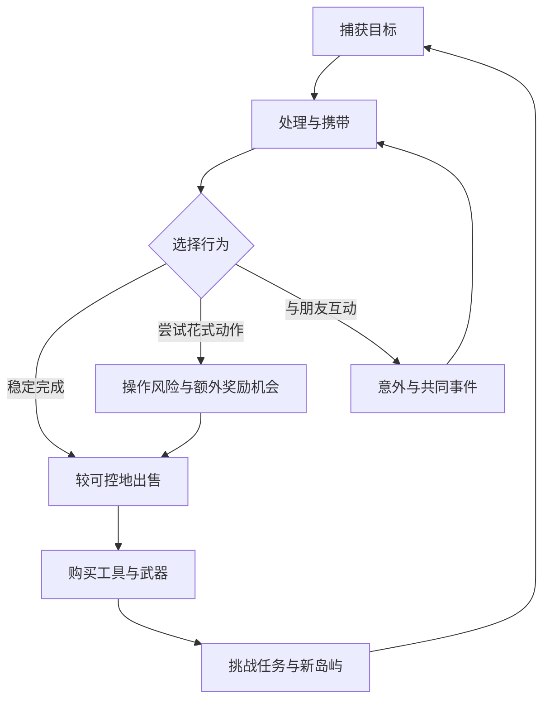

<!-- Imported from 游戏拆解分析/37款游戏拆解案/36_How_to_Fish.md; original analysis and evidence boundaries preserved. -->

# How to Fish拆解案
## 荒诞动作怎样在合作与成长目标之间持续发生

**范围：**Dazed Games开发的《How to Fish》，Steam App 4001890。以2026年9月20日可查的商店说明及官方1.0.4至1.0.12更新为证据范围，不冒称覆盖未核实的后续内容。商店仍写初始1至4人，1.0.4公告已加入最多8人房间；本文不把两者混成同一版本。含基础循环及更新实例，无结局揭露。

**证据性质：**这是基于公开机制与开发者公告完成的设计分析。文中的行为链推演不是本次实测，也不包含虚构的Boss逐帧记录。

## 核心判断

《How to Fish》把钓鱼这种通常与等待和耐心联系的活动，与处理猎物、使用武器和物理意外组合起来。反差让玩家迅速理解它的语气，而赚钱、装备与岛屿推进，为反复尝试这些行为提供了短期方向。

它值得研究的地方，是怎样让玩家既愿意完成目标，又愿意偏离效率去做一件好笑的事。若只有胡闹，活动容易失去持续目标；若奖励只认可最稳定的高效率行为，胡闹又可能在成长过程中被淘汰。

## 一 捕获并不是循环的终点

官方介绍将捕获、处理和出售串成基本循环，再把收入连接到装备、武器、任务和新的岛屿。捕获之后还有实际行动，使鱼既是奖励对象，也能继续成为操作与意外的来源。[开发商商店介绍](https://store.steampowered.com/app/4001890/How_to_Fish/)

这一结构延迟了收益确认。玩家已经得到一件有价值的东西，却还没有完成转换，于是自然产生保护、搬动、处理和交付等行为。物品停留在世界中的时间越长，就越有机会与其他玩家和物理反馈发生关系。

分析这种设计时，要分别看“拿到了”“处理好了”和“卖出去了”。三个阶段承担不同情绪：获得时的期待，处理时的行动压力，出售时的确认。如果某一环节只增加重复劳动而没有新的判断，就可能成为循环中的负担。

<figure>
  
  <figcaption>图 1 · 物理互动、花式奖励与合作成长的循环。用于概括本文分析，不代表游戏内部状态机。</figcaption>
</figure>

查看可编辑图源

## 二 武器改变了题材的预期

把武器放进钓鱼循环，首先改变的是玩家对题材的预期。钓上来的对象不再只是进入背包的图鉴条目，处理过程可以具有明显的动作性。熟悉的射击语言被放到不寻常的目标上，降低理解成本的同时制造反差。

对战斗设计来说，关键问题不是是否拥有枪械，而是射击在循环中解决什么：保护自己、加快处理、挑战更危险的对象，还是进行带表演性的操作。不同目的需要不同的反馈与难度，不能只用伤害提升统一替代。

这种混合也存在期待冲突。只想轻松钓鱼的玩家可能觉得战斗打断节奏，追求精密射击的玩家又可能觉得物理目标和判定不够严肃。作品需要通过早期行为和视觉语气明确自己提供的是哪一种混合体验。

## 三 花式奖励让效率之外的行为进入经济

官方明确列出花式射击可以获得更多金钱。这意味着额外动作不仅是玩家自发的表演，也被规则认可为一种可转化的收益。[官方玩法说明](https://store.steampowered.com/app/4001890/How_to_Fish/)

从设计上看，花式动作增加了一个中间目标：完成原本简单的处理之前，玩家可以选择提高动作难度。收益因此不只来自找到更高价值的对象，也可能来自怎样处理它。表演性操作与装备成长由同一种货币连接起来。

这里不需要假定固定奖励倍率，就能指出平衡问题。奖励太少，花式只对已有表演欲望的人有吸引力；奖励太高，原本可选的胡闹可能变成赚钱的标准流程。当所有人都机械重复最赚钱动作时，搞笑行为也会被效率化。

## 四 案例一 从稳定处理到花式处理的选择链

以捕获后面对同一对象为例，玩家可以采用更稳定的处理方式，也可以尝试官方鼓励的花式射击。后者增加输入与判断，却有机会带来额外回报。这是由公开规则推演的比较情境，不是声称录制了两段真实对照。

如果朋友在场，动作的可见性又会改变行为价值。一次成功可能同时获得系统奖励和同伴反应；一次失败也可能成为可复述的事件。多人情况下，行为的价值因此不能只用金钱效率表示。

这个关系并非必然产生笑点。如果失败损失过大、物品找不回来，或者其他人没有看见关键过程，事件可能只留下烦躁。可观看的反馈、能理解的因果和适当的恢复成本，是让意外转化为共同经历的条件。

## 五 合作的自由与他人的干扰共享同一空间

多人可以一起处理目标，也能各自探索、尝试工具或制造混乱。相比严格分配职业的合作游戏，它更依赖共享场景中的即时配合与事件传播。分工可以自然出现，但未必被职业规则固定。

这让进入门槛较低，也使协作质量依赖参与者。有人希望推进任务，有人只想实验物理行为时，目标会冲突。房间的隐私、友伤和恢复规则因此并非外围设置，它们影响玩家是否愿意接受他人的不可预测性。

1.0.4增加最多8人房间，之后又提供私人房间选项。这里只据此说明合作环境可被配置，不以人数增加直接推断游戏更好玩。更多人同时操作也可能增加视觉拥挤、信息噪声与进度协调成本。[官方更新公告](https://steamcommunity.com/app/4001890/announcements/)

## 六 案例二 限制物品速度为何可能保护物理乐趣

官方1.0.12记录了对物品速度的限制，目的涉及减少物品丢失。这提供了一个很具体的设计取舍：物理结果足够夸张时容易制造意外，但如果重要物品飞到无法恢复的位置，事件就可能破坏长期进度。[1.0.12官方公告](https://steamcommunity.com/app/4001890/announcements/)

值得分析的不是“越真实越好”或“越失控越好”，而是失控之后玩家还有没有继续行动的空间。限制极端速度，可能牺牲一部分夸张轨迹，却保留物品仍然可见、可追索的条件。

这是依据补丁目标作出的设计推断，不能据此宣布问题已完全解决，也不能推定底层采用了某种特定物理算法。公告说明了修改方向，实际效果仍取决于碰撞、同步和恢复条件。

## 七 3C与提示决定混乱是否可理解

第一人称视角强化了亲手拿取和瞄准的直接感，也使近处物品和突然移动的目标容易遮挡观察。玩家要在看自己的工具、看目标和看伙伴之间切换，界面需要帮助区分当前最重要的信息。

官方1.0.11通过不同颜色区分部分地面目标，并加入瞄准、冲刺和攻击的输入选项。这些事实说明，信息识别和持续输入负担是实际被调整的对象。[1.0.11官方公告](https://steamcommunity.com/app/4001890/announcements/)

从体验层面看，混乱需要一个稳定底座。玩家可以不知道下一秒会发生什么，却最好知道刚才发生了什么、东西在哪、自己为什么失败。否则同样的意外很容易被解释为控制或系统不可靠。

## 八 岛屿与装备把短笑点组织成长流程

新的岛屿、任务和更危险的对象，为工具升级提供目的地。玩家不只是为了让数字变高而赚钱，而是在为下一类挑战做准备。这种短期目标能够在一连串即兴行为之间恢复方向。

但成长也可能反过来压平互动。当装备使旧对象不再构成任何操作问题，原有捕获与处理循环就需要新的空间关系或行为变化来维持兴趣。只增加生命值可能延长时间，却不一定增加可玩的判断。

难度选项进一步说明，同一个规则框架可以通过战斗压力服务不同团队。不过数值调节不能自动解决目标混乱、读不清提示或配合失衡。设计者需要区分执行难度与规则理解难度。

## 九 技术问题何时直接变成设计问题

物理物品、多人同步和保存状态相互关联。一次丢失或状态不一致，可能让玩家不知道对象到底被拿走、卖掉，还是因为错误消失。对以物品循环为核心的作品，这会直接破坏行动与结果之间的信任。

公开补丁可以确认团队在修复物品、联机和存档方面的问题，但不足以支持完整架构逆向。本文不假设服务器权威模式，也不推断碰撞判定具体实现。可迁移的设计要求是：关键对象应有清楚状态、异常后的恢复路径，以及能让队友理解的结果反馈。

技术稳定与喜剧意外不是相反目标。越能保证重要结果可靠，玩家越有余地把可恢复的失败当作游戏的一部分，而不是担心整个进度被破坏。

## 十 最值得迁移的经验与边界

本作可以作为研究“荒诞行为怎样进入核心循环”的案例。题材反差负责快速建立语气，物理和合作提供变化，经济与关卡负责让玩家愿意继续。三者需要同时工作，才能避免只有短暂笑点或只有重复劳动。

| 设计目标 | 有效条件 | 可能失败的方式 |
|---|---|---|
| 让玩家敢胡闹 | 失败可理解且通常可恢复 | 物品永久丢失或进度受损 |
| 让表演行为有价值 | 反馈可见且奖励不过度支配 | 花式动作变成强制刷钱 |
| 让朋友共同参与 | 能观察对方并协调目标 | 一人推进、他人持续破坏 |
| 让升级持续有意义 | 新工具改变处理问题的方式 | 只缩短相同动作的重复时间 |

对战斗策划而言，额外奖励可以鼓励玩家尝试更有表现力的操作，但必须保留稳定打法的合理地位。对合作设计而言，真正应保护的是共同事件可以继续发展，而不是任何失控结果都必须保留。

## 资料与证据边界

- [开发商Steam商店页](https://store.steampowered.com/app/4001890/How_to_Fish/)：捕获、处理、出售、花式奖励和成长方向。
- [官方公告列表](https://steamcommunity.com/app/4001890/announcements/)：本文使用1.0.4、1.0.5、1.0.11及1.0.12中的少量规则与修复事实。它们不能替代当前安装版本的实际表现。
- 合作心理、奖励权衡和行为链比较属于机制推演；没有据此推断销量、留存、全部Boss品质或多人体验的普遍结论。

---

[返回游戏拆解](/blog/game-breakdown/)
