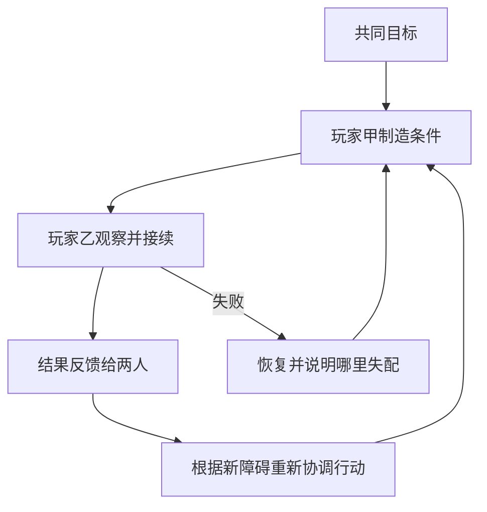

<!-- Imported from 游戏拆解分析/37款游戏拆解案/34_双人成行.md; original analysis and evidence boundaries preserved. -->

# 双人成行拆解案
## 互补能力如何把共同游玩变成彼此需要

**范围：**2021年《It Takes Two》主线合作流程，不以平台移植差异为重点。**剧透级别：中高，涉及工具棚、树屋、时钟与小象情节。**资料核对：2026年9月20日。

## 核心判断

《双人成行》的核心吸引力，是不断提供新的共同活动，并让两个人分别掌握完成活动所必需的一部分能力。合作不只表现为两人同时在场，而是一个人的行动能够为另一个人创造条件，双方必须理解这种关系。

游戏的叙事讲述一段需要修复的关系，机制则让玩家反复练习依赖、等待、沟通和共同完成。两者经常相互支持，但也不是任何合作机关都能自动表达关系成长。判断它们是否结合，需要看角色、行为和情境是否有具体联系。

## 一 一项合作任务需要分配控制权

如果两名玩家拥有同样手段、可以各自完成全部目标，那么协作往往只提高效率。《双人成行》大量使用不同能力，将解决问题的控制权分给双方。一个人发现目标后，还要说明另一人应该在何处、何时采取什么行动。

这种结构让沟通具有内容：不是不断喊“快一点”，而是解释条件与顺序。玩家在成功后也容易辨认双方贡献，因为缺少其中一个动作，结果就不会出现。

EA的官方功能介绍强调关卡中的新能力与合作挑战。本文将这种表述进一步分析为控制权、行动依赖与共同结果之间的关系，后者是分析模型，不是官方术语。[官方功能介绍](https://www.ea.com/games/it-takes-two/it-takes-two/features)

<figure>
  
  <figcaption>图 1 · 互补能力、控制权与协作恢复的关系。用于概括本文分析，不代表游戏内部状态机。</figcaption>
</figure>

查看可编辑图源

## 二 案例一 钉子与锤子把空间控制分给两人

工具棚中的钉子与锤子，提供了不同的交互语言。钉子可以改变某些机关或路线的状态，锤子则负责敲击、摆荡等动作。玩家需要理解对方的工具能做什么，才知道怎样为他铺路。

一段平台挑战因此会包含两个层次：自己的执行，以及对另一人行动条件的维护。一方不能只看自己的终点，还要观察对方是否已经到位、路径能否继续使用。困难不完全来自跳跃精度，也来自两个人是否共享同一份计划。

在与工具箱相关的战斗中，这类能力又从通路解法进入敌人处理。Boss的威胁要求玩家移动和避让，而可利用的结构要求双方在短暂机会中完成接续。原本安全环境里学过的协作关系，被放到压力下检验。

这里的教学价值在于复用关系、改变情境。玩家无需在Boss出现后从头理解合作，但必须重新处理时机和风险。若前面的教学只展示了答案，没有让双方分别理解自己负责的条件，战斗压力就会放大混乱。

## 三 案例二 树脂与火柴让攻击成为共同完成的句子

树脂枪与火柴枪的组合，把攻击拆成布置与引爆。树脂的堆积建立一个可见状态，火柴使它兑现为结果。两个人的输入分别处在同一条因果链的不同位置，因此能够直接感到“刚才那一下是一起完成的”。

它也创造了目标优先级的分歧：布置的一方需要判断哪里值得投入，引爆的一方需要判断什么时候兑现。若两人各自更换目标，准备好的机会可能没有得到利用；若过早兑现，又可能失去更高价值的聚集效果。合作因此需要共享目标，而不只是同时攻击。

敌人的移动与场地威胁使这种关系不总是静态的。压力增加时，一方可能忙于生存，另一方就需要调整节奏。机制把队友的处境变成自己的行动条件，推动玩家从关注个人输出转向观察共同局面。

但互补能力也可能产生等待感。一方长期负责铺垫、另一方长期负责显眼的最后一击，贡献的感知可能不均衡。反馈需要让布置过程也清楚可见，关卡还需要给双方各自的操作空间，避免一人只是另一人的工具按钮。

## 四 变化快 为什么没有完全失去连贯性

游戏不断更换能力、环境和玩法类型，缩短一套规则被消耗殆尽之前的停留时间。新鲜感因此来自行为更新，而不只是背景更换。前一章擅长的平台操作，未必足够应对下一章的信息分工。

这种变化需要稳定的基础：移动、跳跃、视角理解、检查对方位置，以及寻找能力之间的关系。局部工具经常变化，合作的阅读方式却可以逐步积累。玩家逐渐知道进入新关卡后，首先应该试探自己和伙伴分别控制什么。

内容成本也因此很高。一次性能力需要专门关卡、反馈与教学，不能只做出工具就认为完成设计。若复用过少，玩家刚开始理解深度就被迫离开；若复用过多，又会削弱作品承诺的新鲜感。

## 五 分屏让队友的世界保持可见

分屏不仅是容纳两台摄像机的呈现方式，也给玩家提供观察对方处境的渠道。两人分处不同位置时，仍可能通过另一半画面理解开关、路线或危险。这会减少纯口头描述的困难，让“看我的画面”成为一种协作工具。

代价是注意力和显示面积。玩家需要在自己的操作与伙伴的信息之间切换，小屏幕上较远的目标也可能不易辨认。清楚的色彩、轮廓、动作反馈和镜头距离，在合作中承担的是信息协调功能。

共享视角和分开视角的使用，还会改变双方的节奏。空间合并时容易感到共同参与同一个场面，空间分开时则更强调各自职责。评价摄像机时，应检查它是否支持当前的合作关系，而不是只追求画面壮观。

## 六 恢复机制决定两人敢不敢一起尝试

合作游戏的失败会影响两个人。如果一个人的错误导致双方长期等待或重走大段路程，技术差距很容易变成社交压力。本作较频繁的恢复机会和局部重试，使尝试新能力的成本相对可控。

在战斗中，只要局面还有恢复余地，存活的一方就不只是继续输出，而可能以生存为优先，为合作重新建立条件。失败处理因此也属于战斗职责的一部分。

宽容并不表示不存在挑战。跳跃时机、能力配合和信息理解仍可能要求双方反复调整。关键是让失败说明哪里需要协调，而不是把所有责任简单落在较弱的一方身上。某些特定小段仍可能成为能力门槛，不能仅凭总体风格宣称完全适合任意水平组合。

## 七 案例三 时间与分身怎样对应人物关系

时钟相关章节把时间与位置操作分配给两位角色。两人面对同一障碍，却不能各自独立处理全部条件，必须协调状态变化与行动位置。空间解谜因此获得一种“相互配合才让事情继续”的节奏。

将这些操作放进夫妻关系的故事里，可以产生对等待、错位与重新对齐的联想。有效之处是，玩家确实在用行动处理错位；局限则在于，这些能力本身不等于对现实关系问题的完整解释。

叙事评价要保留这种尺度。游戏提供的是可参与的隐喻与共同经历，而不是“合作打通关就修复关系”的普遍结论。两位现实玩家的关系也可能与故事角色完全不同。

## 八 小象情节暴露了合作与道德的一次冲突

涉及小象的段落要求两位玩家共同执行令人不适的行为。此前学会的合作语言在这里仍然有效，但共同目标的道德意义发生了变化。两个人配合顺利，并不意味着他们在做正确的事。

这个片段可以打破“合作自动等于善意”的简单解释，让玩家注意到角色的自私和错判。然而，它也可能使玩家拒绝情境：如果既不认同目标，又无法选择其他行动，操作可能被体验为被迫服从。

因此，故事与机制在这里的关系具有张力。不能为了证明作品统一而忽略不适，也不宜把不适全部称作设计失败。应检查该段是否推动后续认识、玩家是否理解被要求参与的原因，以及强制操作的成本是否得到叙事回应。

## 九 战斗设计中真正可以复制的部分

可复制的是把一个清楚目标分成相互可见的贡献。标记与打击、控制与爆发、保护与推进，都可以建立类似关系。但“一个人先做A，另一个人再做B”只是最简单形式，长期使用容易变成机械接龙。

更丰富的合作需要允许顺序、时机或角色承担发生变化。队友暂时无法完成职责时，另一人最好仍有观察、保护、调整位置等有意义的行动。否则合作会被感受为等待故障排除。

| 合作问题 | 可采用的设计手段 | 应避免的结果 |
|---|---|---|
| 一人看不出自己的贡献 | 显示准备状态与结果关联 | 只夸奖最后一击 |
| 技术差异过大 | 局部恢复与不同执行职责 | 让弱者持续背负失败 |
| 沟通只剩催促 | 提供需要解释的条件与信息 | 两人反复同时按键 |
| 能力很快重复 | 复用关系但改变空间与威胁 | 只增加敌人数量和血量 |

## 十 可迁移的评估方式

观察一次合作遭遇时，应记录双方什么时候需要看对方、什么时候需要说话、失败后调整了什么，以及有没有人长期没有决定可做。完成速度不能单独说明合作质量，一名强者替另一名玩家处理全部问题也可能很快。

本作对策划最有价值的提醒是：合作体验需要设计双方之间的关系。两套单独好玩的技能并不自动构成好合作，只有当它们在同一个局面里产生可理解的依赖、反馈和替代空间，玩家才容易感到彼此需要。

## 资料与证据边界

- [EA官方功能介绍](https://www.ea.com/games/it-takes-two/it-takes-two/features)：支持双人合作、关卡能力变化和故事定位。
- [EA游戏说明](https://help.ea.com/sv/articles/it-takes-two/it-takes-two/how-to-play/)：用于核对必须双人参与的基本范围。
- 工具棚、树屋、时钟和小象案例为对游戏关卡与情节的分析；未以虚构对局、玩家访谈或测试数据证明普遍情感效果。

---

[返回游戏拆解](/blog/game-breakdown/)
