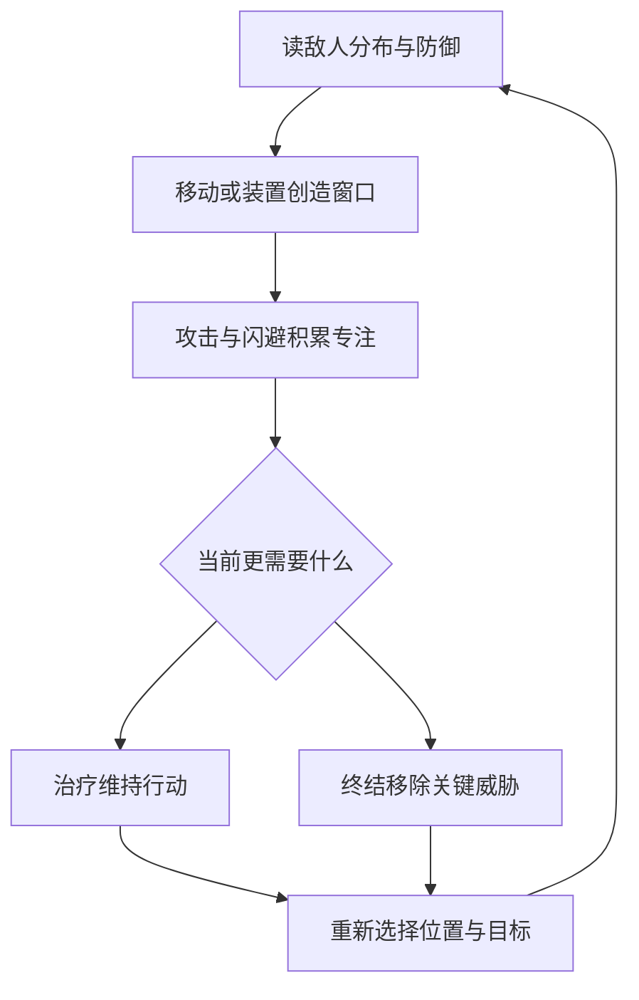

<!-- Imported from 游戏拆解分析/37款游戏拆解案/28_漫威蜘蛛侠.md; original analysis and evidence boundaries preserved. -->

# 《漫威蜘蛛侠》：怎样让玩家持续做出“蜘蛛侠才会做”的动作

> 剧透等级：高。涉及菲斯克大楼、恶魔帮袭击、监狱事件、奥托与梅姨的终局。本文以 2018 年本体单人体验为对象，不纳入 DLC、迈尔斯或《蜘蛛侠 2》的新增能力；Remastered 素材须另注版本。本文没有进行本轮实机或逐帧测试。

## 1. 核心论点：英雄感来自普通操作也能持续兑现身份

《漫威蜘蛛侠》的突出吸引力，是玩家不必先成为动作高手，就能反复做出符合蜘蛛侠形象的事：从高处跃下、在楼间摆荡、迅速接近危险、把敌人拉离地面，再把局势重新控制住。它将角色幻想放进高频输入，而不是只在偶尔出现的终结演出里发放奖励。

这一结构兼顾两层体验。基础操作需要足够容易，让玩家尽快获得身体自由；熟练以后，又需要通过路线、目标顺序、空战和资源使用继续改善表现。游戏的目标并非完全写实地模拟蛛丝，也不是要求每一招都有复杂输入，而是让玩家的意图稳定变成漂亮、有效的动作。

故事则为这种能力建立边界。彼得在街头能够连续解决问题，生活中却无法同时履行所有责任。动作上的强大与关系中的有限，使作品不只是在展示超能力，也在解释英雄为什么仍然会疲惫、失去和做出困难选择。

## 2. 摆荡如何把通勤变成最频繁的奖励

在许多开放世界中，移动主要用于抵达活动；本作把沿途本身做成可享受的动作。高楼提供附着环境，街道形成可预判的通道，俯冲、放开蛛丝、转向与借力改变高度和速度。玩家即使暂时没有选择任务，也可以通过一条更流畅的路线获得回报。

辅助的作用是保护基本英雄形象。遇到建筑时，动作能够接续为爬墙或跑酷，而不总是被普通碰撞打断。更细的熟练度则藏在释放时机、路线和高度管理里。新手与熟练玩家都能移动，但后者更能主动安排下一次加速和落点。这种分层使易上手不必等于没有可学内容。

Insomniac 技术负责人明确表示，完全照搬真实绳索物理未必能产生所需的英雄感，镜头、视野和动画参与构建体验。本文只引用这一取舍，不推导未公开的辅助参数。[Insomniac 官方技术访谈](https://blog.playstation.com/?p=204132)

反例是辅助过强时，玩家难以分辨自己为何更快，练习的回报就会被华丽动作掩盖。应观察同一路线第二次是否能主动改善，而不只评价首次摆荡是否令人兴奋。

## 3. 从摆荡到接敌，能力必须保持同一种语言

蜘蛛侠的移动身份在战斗中不能突然消失。蛛丝突进、拉拽、挑空、空中连击和对环境物体的利用，使距离和高度成为主动调节的条件。玩家不是走到敌人面前才开始战斗，而是用进入距离的方式参与战斗。

挑空的价值也不只是好看。它暂时把目标从地面敌群中分离，改变同时面对的威胁数量；但远程敌人仍需要关注，因此空中并不等于无条件安全。拉近目标与拉近自己又产生不同的位置结果：一个让敌人进入当前空间，一个让自己进入敌人附近。相似的蛛丝动作因为落点不同，能够服务不同决策。

设计的风险在于自动接敌与目标选择不一致。玩家希望攻击眼前对象，动作却把角色送往另一个方向，英雄感会立刻转成失控。镜头、锁定倾向与可见提示必须共同维护意图；没有实测时，不应给出所谓吸附距离或目标评分公式，只需明确描述需要验证的可见问题。

## 4. 场景一：菲斯克大楼怎样把战斗规则教成身份表达

开场菲斯克大楼把犯罪现场、救援与近身战斗放在同一场行动里。玩家先学会基本攻击与闪避，再遇到需要改变处理方式的敌人和环境。盾牌阻止直接正面连续攻击，迫使玩家考虑绕到背后、改变高度或使用其他办法；不同火力则要求玩家把注意力从当前拳脚目标移开。

这一教程并不只是逐项弹出按键。它让玩家体会“蜘蛛侠不必硬撞障碍”的作战方式：敌人正面有优势，自己可以移动；距离不合适，可以用蛛丝改变；局部被包围，可以利用空中与环境。角色身份由解决问题的方法建立，而不只是由服装和对白宣布。

菲斯克的体量和攻击又让玩家认识到，英雄能力需要先创造合适的攻击窗口，不能对所有对象重复同一套轻攻击。反例是玩家只记住敌人对应按钮，而没有理解空间与风险变化。教学若只告诉“盾牌用某招”，容易形成查表；若让错误的正面尝试和正确的换位产生明确反馈，规则更可能转化为判断。

## 5. 专注、装置与敌人组合如何形成持续进攻

战斗中的专注资源将积极行动与恢复、终结联系起来。治疗能让玩家继续承受风险，终结则能立即减少一个威胁，二者对同一资源的竞争使生存与进攻相互牵引。理想状态下，玩家不是一直退后等待恢复，而是评估是否通过一次可靠进攻重新获得优势。

蛛网与装置提供不同的控场方式。把敌人束缚在表面附近、利用环境投掷物打断、暂时处理一组目标，会改变后续拳脚的安全程度。敌人组合因此比单个敌人血量更重要：近身敌人限制停留，远程敌人惩罚忽略方向，特殊防御要求先创造条件。玩家需要安排处理顺序，而不只背诵连招。

| 玩家选择 | 立即收益 | 需要考虑的代价 |
| --- | --- | --- |
| 挑空并继续空战 | 分离地面目标 | 仍需留意远程威胁 |
| 使用装置控场 | 为移动或攻击创造空档 | 装置资源与后续需求 |
| 花费专注治疗 | 扩大失误容忍 | 放弃立即终结的机会 |
| 花费专注终结 | 快速移除优先目标 | 之后可能缺少恢复余量 |

强势装置或成长组合也可能压缩这些取舍。若某种控场能稳定处理全部敌人，空战与目标排序便不再必要。不同难度、技能与战衣配置会影响结论，不能用一套成熟构筑代表初期教程的体验。

<figure>
  
  <figcaption>图 1 · 摆荡、空战、装置与救援的动作关系。用于概括本文分析，不代表游戏内部状态机。</figcaption>
</figure>

查看可编辑图源

## 6. 场景二：直升机追逐为什么必须以救援结束

恶魔帮相关的直升机危机，将城市移动能力转化为追逐与救援。玩家不是从一个任务标记摆荡到另一个标记，而是在追上移动目标的同时穿过楼宇结构。原本自由通勤中的高度、路线和速度判断，获得了明确的时间压力。

场面升级以后，目标不再只是击败敌人，失控载具与市民危险要求蜘蛛侠接住、固定和挽救。这样安排使蛛丝的意义超过战斗工具：同一种能力既能束缚对手，也能维持即将崩塌的秩序。英雄身份因此通过动作目标得以区分，和单纯摧毁目标的追逐产生差别。

其中部分救援受到强导演和提示控制，策略空间有限。它们的价值主要在于让玩家参与角色标志性行为，而不是考查开放式解法。若每一次高潮都采用同样的输入节奏，玩家可能只等提示；因此需要普通遭遇中更自由的动作组合，为这些集中演出提供对照。

## 7. 彼得的普通生活怎样给超能力增加意义

实验室、收容所和与熟人的互动，暂时拿走摆荡与高强度战斗，让玩家接触彼得的工作、经济压力与照顾关系。任务类型变慢，不只是为了轮换玩法，而是在展示英雄行为所依赖的普通人生活。玩家救的是一座拥有具体关系的城市，而非只有敌人和奖励的地图。

MJ 与年轻迈尔斯的潜行段落进一步改变能力条件。相似空间在缺少蜘蛛侠力量时显得危险，使角色差异能够被操作感知。但强制潜行也可能打断玩家最享受的动作节奏，尤其当失败只是重复固定路径时，人物补充的价值未必抵得过操作挫折。

因此不能把所有非战斗段落都解释为必要。应具体检查它带来了什么新理解：这个人物有什么能动性，城市危险怎样变化，彼得的责任是否因此更清楚。如果只是为了让玩家慢下来，却没有新的关系或信息，节奏调整就显得机械。

## 8. 奥托与梅姨：为什么最强能力解决不了最后的问题

奥托与彼得的关系，使终局对抗超出普通超级反派挑战。此前实验室的合作建立了尊敬与依赖，战斗后来却要求彼得对抗同一个人。机械臂、空间破坏与近身对峙把关系破裂放进身体冲突，而不是仅在战前揭示身份。

梅姨相关的最终选择，则将“保护重要的人”和“承担更广泛责任”推到无法全部满足的位置。玩家已经经历大量以成功救援收尾的行动，此时游戏不再允许更快摆荡或更强攻击解决一切。动作上的全能感与人物的有限性形成落差，让责任从口号变成损失。

这并不意味着结局否定此前英雄乐趣。正因为玩家长期体验能力可以产生帮助，最后的限制才有力量。若全程都是无能为力，责任会变成受苦；若全程都能完美救下所有人，选择又失去重量。作品需要两者之间的比例。

## 9. 迁移原则：先保证身份，再让熟练产生额外回报

对战斗策划，最直接的借鉴是围绕角色的动词设计，而不是先拼齐通用系统。蜘蛛侠需要快速改变距离、利用高度、束缚和救援；这些能力既进入通勤，也进入战斗与剧情高潮，才会形成统一身份。相反，换一套皮肤但保留完全相同的站桩输出，很难得到同样效果。

易上手可以通过保护基础动作来实现，深度则放在目标顺序、落点、资源和风险中。必须保留玩家能察觉的改进空间，避免所有失误都被系统无声修正。测试应比较新手和熟练玩家为什么选择不同路线与解法，而不是只统计能否完成关卡。

这套方案适合强调单人英雄幻想、可控敌群与城市移动的作品。竞争性多人需要更严格的对抗信息和可预测性，不能直接照搬大量自动校正；高难度动作作品也需要重新平衡容错与表达。可迁移的是意图、动作和角色身份的稳定对应。

## 来源与论证边界

- [Insomniac：2017 年 E3 演示说明](https://blog.playstation.com/2017/06/13/marvels-spider-man-insomniac-details-the-e3-trailer/)：支持成熟彼得的杂技式战斗、空战与装置方向，不能证明全部最终数值。
- [Insomniac 官方技术访谈](https://blog.playstation.com/?p=204132)：本文仅使用物理、镜头与动画为英雄感服务的局部说明，没有推定未公开技术参数。
- [PlayStation 官方试玩](https://blog.playstation.com/?p=202161)：支持基础移动、空战与专注终结的公开展示；试玩阶段信息未被当作最终版所有配置的定量证据。

具体场景因果及叙事评价为本文分析。本文不宣称测试了伤害、输入窗口、装置最优搭配或所有玩家的英雄感。

---

[返回游戏拆解](/blog/game-breakdown/)
