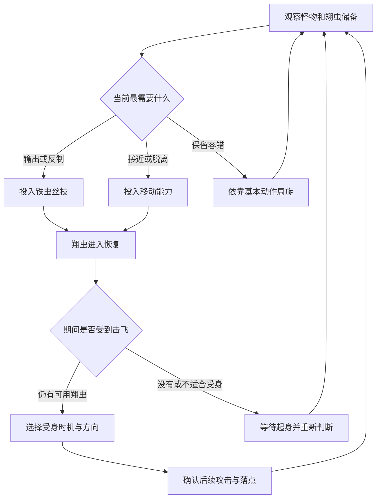

<!-- Imported from 游戏拆解分析/37款游戏拆解案/10_怪物猎人崛起.md; original analysis and evidence boundaries preserved. -->

# 怪物猎人崛起：高机动如何重新分配一次狩猎中的主动权

> 范围：《怪物猎人：崛起》本体，包含本体更新后的常规下位、上位狩猎；不以《曙光》的大师位、怪异炼化或新增虫技代表本体。第十节单独比较《曙光》，其余均为本体分析。涉及怨虎龙、雷狼龙与御龙机制，无主要剧情剧透。本文不宣称实测了动作帧数、失衡阈值或最优输出。

《崛起》最突出的体验，是让猎人更快到达想去的位置，也更快回到能够参与战斗的状态。翔虫、翔虫受身、铁虫丝技与牙猎犬，并非分别增加几个功能，而是一起压缩了部分移动和中断时间。对于喜欢武器操作与反复狩猎的玩家，整场任务可以包含更密集的行动表达。

速度增加同时改变了决策。玩家能快速恢复，不代表每次恢复都安全；能用虫技取得优势，也意味着下一次被击飞时可能没有资源。游戏把一部分传统的“我现在站在哪里”问题，扩展成“我还保留多少改变位置与局势的能力”。这才是翔虫值得深入拆解的地方。

## 1. 狩猎的长期目标没有变，抵达目标的节奏变了

选择任务、准备装备、狩猎怪物、获得素材并制造装备，仍然构成长期循环。不同武器和怪物提供反复练习的理由，素材目标则把重复挑战转化为可累积的成果。本作没有因为机动性提高而放弃怪猎的准备与成长结构。

变化发生在循环内部。地图移动更快，怪物位置的信息获取更直接，牙猎犬允许玩家在移动过程中处理部分事务。原先容易成为停顿的过程被压缩后，短时间游玩也更容易完成一轮有起点和结果的任务。卡普空访谈明确将便携性以及利用零散时间完成狩猎的节奏列为开发考虑。[卡普空开发者访谈](https://www.capcom.co.jp/ir/english/interview/2021.html)

代价是探索与接敌之间的比例变化。喜欢观察生态、慢慢寻找目标的玩家，可能较少经历追踪带来的期待；喜欢直接练习武器的人则更容易进入重点。不能简单把前者叫拖延、后者叫进步，两种节奏服务于不同的核心体验。

## 2. 翔虫把移动能力变成可分配资源

翔虫行动具有使用次数与恢复过程，玩家不能无限连续调用。它的价值又同时横跨探索、接敌、攻击与脱险，因此一次使用存在机会成本。用来发动强力虫技的资源，也可能是稍后受身脱离危险需要的资源。[任天堂官方猎人手册](https://www.nintendo.com/au/news-and-articles/monster-hunter-rise-hunters-handbook/)

这与普通耐力管理不同。耐力经常约束连续动作的长度，翔虫更像几次可以显著改变局面的主动权。玩家可以选择把它们集中用于进攻，也可以保留一部分作为意外情况的应对。两种分配没有脱离怪物和武器的统一答案。

这种机制让冷却时间具有空间意义。等待资源恢复期间，玩家仍可用武器基本动作与站位周旋；资源恢复以后，则重新拥有更远位移或更强介入。战斗节奏由此在普通能力与额外能力之间起伏。若虫技收益过高，普通动作也可能被挤成等待冷却的填充，这是需要警惕的另一面。

<figure>
  
  <figcaption>图 1 · 翔虫、机动、受身与攻击机会的关系。用于概括本文分析，不代表游戏内部状态机。</figcaption>
</figure>

查看可编辑图源

## 3. 翔虫受身把挨打后的空白变成一次选择

传统击飞后的流程，常由倒地、等待与起身组成。《崛起》给玩家一个更主动的恢复入口：在允许的情形下投入翔虫，选择方向迅速脱离。它降低了失误后完全失去参与感的时长，也使受伤后的处理成为熟练度的一部分。

受身却不能只按“越快越好”理解。怪物的后续攻击仍然存在，错误方向可能把玩家送进另一次覆盖；资源已经被攻击技能花光时，原先习惯的恢复也可能无法执行。受身改变的是可选路径，不是赠送一次无条件安全。

从体验上看，它把一次失误拆成两段。第一段是为什么被击中，第二段是被击中后怎样避免局势继续恶化。对喜欢主动处理问题的玩家，这是额外表达空间；对尚未看清招式的新玩家，则可能养成见击飞就立即操作的习惯，直到连续攻击突然处罚这种习惯。

## 4. 虫技与替换技重新定义武器的典型窗口

铁虫丝技为各武器增加不同的接近、强化、反制或输出方式。重要的不是每把武器都获得同一种能力，而是新增动作怎样与原有资源及节奏相接。某些武器能够更主动制造机会，另一些则更容易维持强化或调整位置，不能用一句“所有武器都更快”代替具体分析。

替换技允许玩家在特定动作之间选择，形成进入任务前的打法偏好。这种选择在本体中不同于《曙光》的战斗中迅速切换两套配置。前者要求预先接受某种取舍，后者则进一步增加现场选择，必须分开评价。

以大剑为例，原本较长的攻击承诺仍然存在，但强化纳刀等动作可以改变收束后的移动和下一次准备。它并不让蓄力自动命中，却可能让失败后的重新定位更积极。武器身份因此没有完全消失，而是周边行动获得了新的连接方式。

## 5. 场景一：怨虎龙检验受身之后是否还在观察

怨虎龙的突进、尾部动作与鬼火表现，让玩家需要同时理解本体运动和随后形成的威胁。被击飞后快速受身能够摆脱部分不利位置，但如果仅把受身视为紧急按钮，就可能忽略怪物仍在推进，或自己的落点正处于后续攻击方向。

分析一段失败时，应把受击点、受身方向、落点和敌人后续动作放在同一张位置图中。这样才能判断问题发生在哪里：是最初贪刀，还是恢复方向不合适，或为了提前输出耗尽了翔虫。三种错误需要不同调整，不能统称为反应慢。

鬼火也使怪物身份进入空间管理。玩家不仅在记忆肉体攻击，还要处理附着状态和场面效果。它增加了怪物的辨识度，但也带来信息遮挡风险。特效越强烈，越需要让主要身体轮廓与攻击方向保持可读，否则高机动反而可能成为在混乱画面里频繁逃跑。

这场狩猎的设计启示，是允许玩家快速行动之后，必须继续提供值得判断的落点。若所有方向都同样安全，受身会趋向机械；若多数方向都无法理解地受罚，又会让能力显得不可信。方向差异和可见后续共同决定其深度。

## 6. 场景二：雷狼龙让准备阶段与强化阶段互相解释

雷狼龙的蓄电与强化状态，提供了观察怪物状态如何改变猎人选择的清楚案例。蓄电期间，玩家可以考虑接近施压，争取影响其准备过程；进入强化后，攻击覆盖与节奏带来的压力又要求更谨慎地安排自己的承诺。

翔虫机动让猎人更容易尝试抓住距离外的机会，但到达并不等于命中。若为了赶上准备动作投入位移，抵达时怪物已经转入攻击，玩家就需要承担预判失误。资源提高了行动可达性，仍然要求理解时机，这保留了狩猎中的学习价值。

不同武器对同一状态会有不同答案。某些反制动作希望敌人先攻击，较长的输出动作则更需要稳定窗口。雷狼龙的状态变化因此不只是更强或更弱，而是在重新分配各类工具的收益。配装与熟练度过高时，状态可能被快速压过去；这种样本不能代表普通成长阶段。

## 7. 御龙让其他怪物成为可利用的事件

御龙把怪物之间的接触转化为玩家能够临时操控的强力场面。原本可能只被视为干扰的非目标怪物，现在也可能提供撞击、攻击与资源收益。玩家会重新评估地图上的大型生物：它们不仅是障碍，也可能成为改变任务节奏的工具。

这种设计能在熟悉的武器循环之间提供明显变化，强化规模和力量感。它也可能让原本带有不确定性的生态碰撞变得更像一次可预期奖励。对于重视世界自然性的玩家，这可能削弱独立生物互相作用的感觉；对于追求明确参与感的玩家，操控权又是优势。

重点不在于判定御龙是否“破坏生态”，而是确认它把价值放在哪里。它优先给玩家一段显著、易辨认的主动参与。若出现过于频繁，可能切断武器练习的连续性；若出现过少，又难以成为本作身份的一部分。频率、触发条件和收益都应一起分析。

## 8. 关卡与3C让赶路本身成为短动作练习

翔虫移动和可攀爬地形，让高差不再只意味着绕远路。玩家能够主动寻找更直接的路径，熟悉地图后又可以把移动连起来。牙猎犬进一步降低地面移动的成本，使大型地图在短任务中更容易被使用。

鬼火鸟等环境资源则让快速直达与途中准备形成取舍。绕路收集可以改善狩猎条件，也会花掉时间；对任务已经熟悉的人，这段准备可能显得重复。它是否形成有意义路线选择，取决于地图路径、收益与挑战强度，而不是只看环境生物种类多不多。

战斗中高速移动要求镜头与角色朝向保持可理解。玩家从地面跃起、快速转向或受身后，必须知道怪物在哪里，自己的武器将朝哪里作用。多人狩猎叠加随从和特效时，信息压力还会增加。观察敌人动作是否清楚，与动作本身是否华丽应分开评估。

## 9. 本体的难度与成长：效率收益会改变练习内容

装备、技能与武器熟练度共同提高狩猎效率。随着玩家掌握虫技和怪物，部分原本需要退让的时段可以被转成进攻，掌握感因此明显。但如果一项技能收益远高于普通动作，玩家可能逐渐只练习怎样让它更频繁出现，而较少使用其他动作。

百龙夜行是本体中另一种节奏：防御设施、波次与大型目标让任务更强调区域控制。它确实拓展了狩猎表现，却不一定满足只想练习一武器一怪物的玩家。把这部分当作本体内容理解很重要，但不应把它的多目标节奏混进普通狩猎结论。

对战斗策划而言，本作最值得迁移的是“恢复参与感”的设计。可以观察失误后多久重新出现有意义选择、玩家是否保留脱险资源，以及新增移动是否仍要求判断。提高行动速度本身不是目标，让快速行动仍有后果，才可能保持长期的武器学习空间。

## 10. 单独比较《曙光》：新增选择不能倒算成本体优点

《曙光》加入迅速切换等机制，让玩家在战斗中切换两套替换技配置。官方动作介绍确认了这项扩展能力。[卡普空《曙光》迅速切换演示](https://www.youtube.com/watch?v=z3k2g4rMvHg)

这会把本体的部分战前取舍移到现场：玩家可以按敌人状态改变工具，但也必须管理更大的动作集合。大师位敌人、新虫技与后续成长系统还会改变节奏和强度，因此不能用《曙光》的反制密度或终盘构筑评价本体初体验。

作为系列比较，《崛起》本体已经确立了高机动和快速恢复参与的方向，《曙光》则在此基础上增加配置转换与更复杂挑战。它们共同说明，行动自由增加以后，敌人、资源和信息反馈都必须跟着调整，否则自由可能只表现为更高的伤害或更长的操作清单。

## 资料与支持范围

- [卡普空：Developer Interviews 2021](https://www.capcom.co.jp/ir/english/interview/2021.html)：支持便携、任务节奏与翔虫移动的设计背景。
- [任天堂：Hunter’s Handbook](https://www.nintendo.com/au/news-and-articles/monster-hunter-rise-hunters-handbook/)：支持翔虫恢复与基础移动规则。
- [卡普空：《曙光》Switch Skill Swap 演示](https://www.youtube.com/watch?v=z3k2g4rMvHg)：仅支持第十节的扩展内容边界。
- 怨虎龙、雷狼龙、御龙与武器关系为公开成品内容的原创分析；没有混用大师位参数或宣称所有武器具有相同反制能力。资料核对日期：2026-09-20。

---

[返回游戏拆解](/blog/game-breakdown/)
