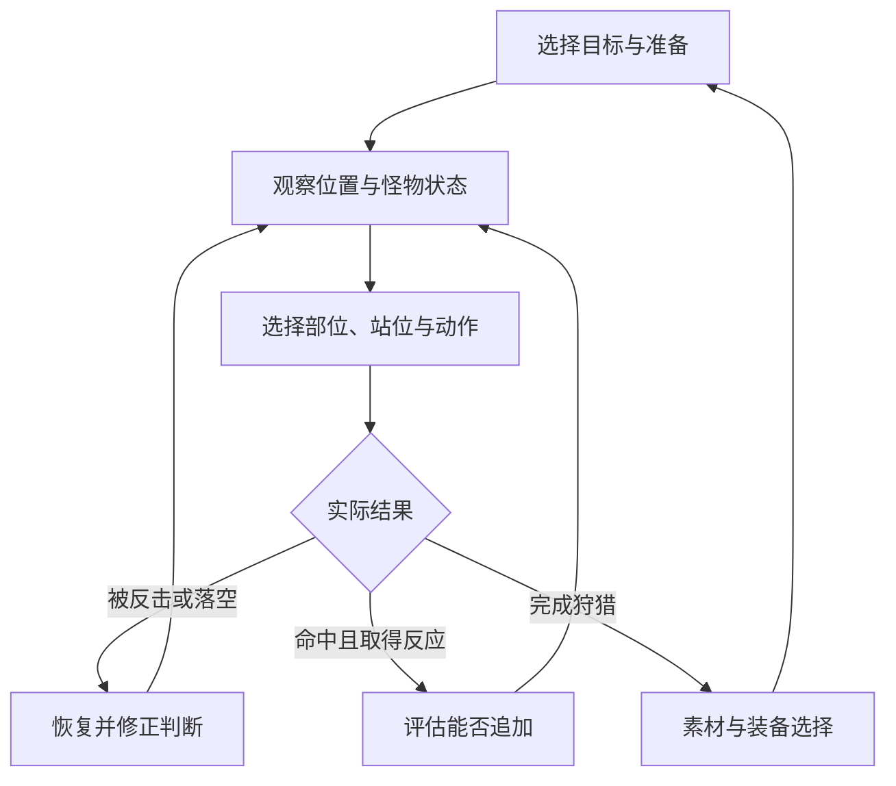

<!-- Imported from 游戏拆解分析/37款游戏拆解案/01_怪物猎人世界.md; original analysis and evidence boundaries preserved. -->

# 怪物猎人世界拆解案
## 狩猎如何把动作知识变成对局势的掌控

<figure class="official-game-screenshot">
  
  <figcaption>官方商店截图 · 猎人骑乘蛮颚龙头部，展示近身战斗中的体型、站位与动作关系。来源：<a href="https://store.steampowered.com/app/582010/">Steam 官方商店</a>。© CAPCOM CO., LTD. ALL RIGHTS RESERVED. 画面版本可能与本文限定范围不同，仅作视觉参考，不作为文中案例的实录。</figcaption>
</figure>

**范围：**以《Monster Hunter: World》本体的武器、怪物和任务结构为主体；《冰原》的钩爪仅在边界讨论中出现，不纳入本体规则。本文分析常规单人狩猎，并说明多人条件的变化。含怪物行为和成长结构说明，无重要剧情揭露。资料核对：2026年9月20日。

## 核心判断

《世界》最有辨识度的吸引力，是让玩家逐渐理解一个能活动、能反抗的庞然大物，再用自己选择的武器组织一次成功狩猎。武器熟练度、怪物知识、装备准备与环境利用，都在改变玩家可以争取到的机会。击杀结果相同，过程却可能从不断救急，变为有意识地安排站位、命中部位与下一次出手。

“掌控感”在本文中是一种体验解释，不是玩家调查结论。它由可观察的关系支撑：原来只能回避的攻击，后来可以利用；原来偶然出现的倒地，后来可以为它提前选择位置；原来只是较高的伤害数字，后来可以换成一段更有价值的行动窗口。

## 一 从任务循环进入一次战斗

接任务、准备、追踪、交战、制作装备的循环，分别回答不同的问题。任务明确目标，准备让玩家预先表达判断，追踪建立怪物所在的空间背景，交战检验判断，装备回报再提供下一次尝试的方向。素材需求使重复狩猎有外部目的，而操作改善为重复提供内部变化。

如果只有素材奖励，同一目标很容易成为次数消耗。如果只有动作掌握，玩家又可能在第一次过关后失去方向。《世界》把两者叠加：新装备提供尝试的理由，既有怪物提供可比较的表现环境。这里不能把所有重复都称作成长；随机掉落迟迟不满足目标时，玩家也可能只感受到劳动。

<figure>
  
  <figcaption>图 1 · 狩猎准备、观察、行动与结果反馈的循环。用于概括本文分析，不代表游戏内部状态机。</figcaption>
</figure>

查看可编辑图源

图中“命中且取得反应”不是每次命中都会发生。伤害、部位破坏、失衡和倒地需要分别判断，不能互相替代。

## 二 武器设计改变的是观察方式

十四类武器提供的差异，不只在连招长度与伤害形式。武器的移动、攻击承诺、有效距离、防御方式和资源管理，会改变玩家在同一只怪物面前关注的信息。

以大剑和太刀为例，大剑更容易把玩家的注意力集中到一个有价值的命中时机：怪物最终停在哪里，蓄力能否赶上，继续蓄力是否会失去弱点。太刀则让连续攻击、气刃资源和特定反应动作共同影响下一步。这个对照不是“慢武器只预判，快武器只反应”；两者都需要预判，只是错误会在不同位置暴露。

| 设计维度 | 改变的玩家问题 | 分析时应看什么 |
|---|---|---|
| 攻击前后过程 | 现在承诺这次动作是否值得 | 可调整方向的阶段、动作结束的位置 |
| 有效距离 | 我应该从哪里进攻 | 刀身覆盖、弱点高度、目标移动 |
| 防御与回避 | 怎样处理怪物的反击 | 退出方向、资源代价、后续位置 |
| 武器专属资源 | 当前收益是否值得透支未来 | 强化维持、消耗后的可用动作 |

《世界》导演曾强调，慢武器的满足感不仅来自大招命中，还来自能够精确调整位置的移动选项。该表述支持把“打击感”与动作机会放在一起分析，而不是只罗列震屏、音效和特效。[开发者访谈](https://blog.playstation.com/2022/10/04/game-developers-explain-what-makes-god-of-war-2018s-combat-tick/)

## 三 有效输出由时间与空间共同决定

“怪物收招了”不等于玩家能够输出。猎人还要处于适合的距离、面向和动作状态；目标部位也必须停留在攻击能够覆盖的位置。一次空档的价值，因此由怪物和武器共同决定。

同样长度的空档，对刚收刀且离得较远的猎人，与已经站在弱点旁、能够接续派生的猎人并不等价。站位不是攻击之前的准备工作，它就是攻击收益的一部分。许多看似“熟练后手速变快”的现象，实际上来自省掉了不必要的接近、转向和重置动作。

这个关系也解释了为什么最大伤害动作并非处处最优。伤害系数只是一次动作的一个属性。较低收益但及时结束、位置有利的动作，可能保留下一轮输出；强行完成长动作，可能让玩家失去恢复、追击甚至生存机会。

## 四 怪物的身体既是目标也是规则载体

分部位受击使玩家必须讨论“打哪里”，而不只是“有没有打到”。部位的伤害收益、破坏价值、可达性及可能引起的动作反应并不一致。高收益位置也可能位于危险攻击的覆盖区，从而让瞄准、走位与风险共享一个目标。

更重要的是，怪物状态变化让同一身体不断改变价值。愤怒、疲劳、部位状态和不同动作结束位置，会影响玩家应该等待、追击还是转移。不能一概断言所有怪物愤怒后肉质变好，也不能把所有换区归结为固定血量条件；具体规律必须按对象核对。

这类设计的学习回报来自可复用知识。玩家知道某个动作之后头部会短暂落在某处，就能提前到位。若所有机会都依靠毫无线索的随机停顿，这种学习便难以成立；如果所有行为完全固定且容易锁死，对抗又可能退化为执行脚本。

## 五 案例一 灭尽龙的部位状态怎样牵动攻防

本体灭尽龙适合观察身体状态与进攻节奏的关系：棘刺的生长与变化，让玩家面对具有时效性的攻击目标。玩家既要判断当前攻击，又要注意哪些部位仍适合集中处理。身体上的变化把一部分战斗进程直接放在模型上，降低完全依赖界面的程度。

从设计上看，这相当于把“尽量输出”收紧为“在变化发生之前，把合适攻击投到合适位置”。玩家追求部位处理时，可能更主动地接近；但接近也会进入扑击、挥击等威胁覆盖。于是奖励进攻与惩罚冒进同时存在，战斗不会自动等同于安全站桩。

关键反例是装备压制。若伤害足以让目标长时间无法有效反抗，玩家体验更接近资源与控制循环的执行，原本的观察压力会下降。这是成长带来的不同体验区间，不能拿高配录像直接证明初见战斗的可读性与公平性。

## 六 案例二 雌火龙怎样把纵向动作变成位置问题

雌火龙的后空翻甩尾，将危险范围、方向和后续位置联系起来。对近战玩家而言，仅记住“出现前摇就躲”仍然不够：回避方向会决定能否避开覆盖、落点离目标多远，以及后续是否能重新进入攻击位置。

若玩家只向远处撤退，通常可以增加安全余量，但可能浪费后续机会；若试图保持近距离，就需要更清楚地理解身体朝向与攻击覆盖。这里的进阶不是无限缩短反应时间，而是从“退出危险”发展到“退出之后仍处在有用位置”。

尾部本身又是可交互的身体部位，使战斗目标与威胁来源发生重叠。但不能直接写成“断尾后该招失效”。严谨的拆解要观察实际覆盖、状态与判定变化，将身体外观变化与规则变化分开确认。

## 七 3C如何帮助玩家形成可靠预期

角色动作有清晰的起势、施力与结束过程，摄像机则需要同时提供身体尺度和周围威胁的信息。较大的怪物、狭窄地形和镜头遮挡会让这两项目标发生冲突：画面足够贴近时力量感更强，观察整个动作和退路却可能更困难。

打击反馈应拆成“我命中了”“命中了哪里”“造成什么结果”三个层次。音效、火花、伤害显示和怪物反应共同提供信息。若命中提示强烈但没有对应控制效果，玩家必须学习不要把视觉冲击误判为安全追加的许可。

动画、音频、碰撞和摄像机如何在代码层面组织，不能单凭录像确定。对策划更有价值的可检查指标，是玩家能否在关键时刻判断命中、威胁和动作结束，而非猜测引擎使用了哪一种内部算法。

## 八 生态使狩猎具有地点和过程

古代树森林等地图的高差、环境设施与其他生物，让战斗不只是封闭竞技场中的输出测试。追踪、换区、地形利用会把玩家的注意力从招式扩展到位置和路线。怪物之间的互动也强化了“猎物在这里生活”的印象。

卡普空开发者说明，生态与高密度连续地形是《世界》的重要方向，同时承认复杂地形曾造成寻找怪物的困难，导虫正是导航取舍的一部分。[卡普空开发访谈](https://www.capcom.co.jp/ir/english/feature/2017_mh_crvoice.html)

由此可以看出，生态丰富和狩猎效率不是同一个目标。初次探索时有价值的迷路、追踪与意外，重复刷取时可能成为额外成本。评价环境设计时，应分别观察发现阶段和熟练阶段，不能只用通关速度决定其价值。

## 九 成长与多人怎样改变核心体验

装备成长可以降低执行压力，也能使新的打法成立；但数值进步和玩家学习必须分别评价。被更强装备掩盖的错误，不等于已经掌握怪物。合理的成长环境让玩家既感到奖励有效，也仍有需要重新判断的局面。

多人狩猎会改变目标朝向、可预测性和角色分工。个人原本稳定获得的机会，可能因为怪物转向队友而消失；另一方面，控制、治疗和不同部位的攻击，又能创造个人难以取得的窗口。共斗的价值因此同时包含互助和不确定性。

《冰原》的钩爪和相关动作改变了机会制造与维护的方式，应作为扩展对照研究，不能倒写进2018年本体。对比时还应控制装备、难度和玩家水平，避免把资料片所有变化归于一个机制。

## 十 对战斗策划的启示

可迁移的原则是：让玩家通过理解对手与调整行动，主动改善下一步的局面。设计一把慢武器时，除了做强烈命中反馈，还要为它设计可靠的接近、微调、放弃和兑现机会。设计大型敌人时，身体部位、动作结束位置和状态变化应共同支持这些判断。

这种原则有条件。若项目强调极短对局或即时上手，过多身体部位与隐性规则会增加解释成本；若玩家难以看清反应，复杂机制可能只表现为“偶尔能打、偶尔不能打”。应先保证一个动作与一个敌人的关系可以读懂，再增加变化。

验证改动时，可以比较玩家的落空原因、受罚位置、主动追加和提前退出的选择，而不只统计击杀时间。上述指标是建议采用的验证方式，本文没有冒充已完成的实测数据。

## 资料与证据边界

- [卡普空开发访谈](https://www.capcom.co.jp/ir/english/feature/2017_mh_crvoice.html)：支持生态、高密度地图和导虫的设计背景。
- [开发者谈近战设计](https://blog.playstation.com/2022/10/04/game-developers-explain-what-makes-god-of-war-2018s-combat-tick/)：支持慢武器与精确站位的开发者观点。
- [官方钩爪介绍](https://www.youtube.com/watch?v=zYTuPWYytBQ)：用于划分《冰原》新增动作范围。
- 具体场景的因果解释为本文分析，不代表开发团队对每个怪物的公开设计说明。未给出未经测量的帧数、阈值与伤害公式。

---

[返回游戏拆解](/blog/game-breakdown/)
