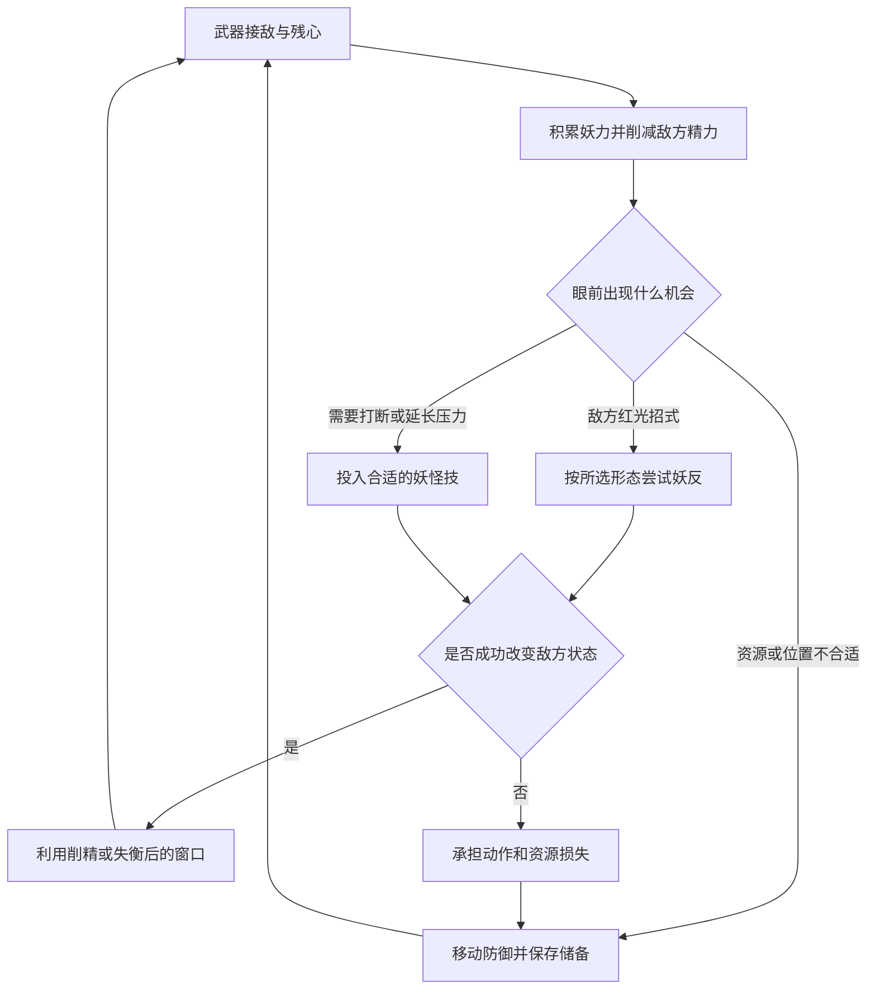

<!-- Imported from 游戏拆解分析/37款游戏拆解案/09_仁王2.md; original analysis and evidence boundaries preserved. -->

# 仁王2：怎样把敌人的危险转成自己的战斗资源

> 范围：2020 年《仁王2》本体单人初周目及本体能力，不混入 DLC 的手甲、机关棍及扩展高周目内容；完全版仅作为本体规则的参考载体。涉及马头鬼、夜刀神及常暗机制，含前期流程剧透。本文是公开成品内容分析，不宣称测试过精确削精量、无敌帧或 AI 行为概率。

《仁王2》的鲜明变化，是玩家不再只以人类武器对抗妖怪，还能把妖怪的动作、红光攻击与特殊战场状态转成自己的机会。残心和架势仍提供动作基本功，妖反、魂核与妖力则在其上增加一层资源转换：近战积累妖力，妖怪技改变敌人状态，敌人状态再为下一轮近战提供条件。

这使本作的核心吸引力更接近“组织一段属于自己的攻势”。玩家可以从危险中打断对手，从敌人身上取得能力，再通过构筑让这些动作更频繁或更适合自己的打法。深度来自工具之间发生关系，而不是每增加一条资源就自动增加一种乐趣。

## 1. 三种资源分别管理不同时间尺度

精力约束当前这段武器动作还能持续多久，妖力支持妖反与妖怪技，精华量表则关联妖怪化。它们不能统称为技能能量，因为获得方式、消费入口和承担的战斗任务不同。官方手册明确说明，近战攻击能够积累妖力，妖反和妖怪技会消耗妖力。[官方手册：任务界面与资源](https://www.gamecity.ne.jp/manual/t2wNiSht/ps/usa/4000.html)

这种分工让玩家在精力不足时，不一定只剩完全撤退。合适的妖怪技可能让敌人进入不利状态，同时给常规动作重新组织的机会；但它花掉的是另一份储备，之后遇到更危险的红光攻击时就可能缺少保险。当前延长攻势与之后保留应对之间，形成了可讨论的代价。

资源转换不保证无限循环。敌人抗性、招式命中、技能成本和构筑都会影响是否能够持续。分析应先描述普通装备下的一次可行衔接，再讨论构筑如何扩大它，不能把高强度成型方案的表现误认为角色出生时就拥有的能力。

<figure>
  
  <figcaption>图 1 · 敌人危险、妖反、魂核与战斗资源的联系。用于概括本文分析，不代表游戏内部状态机。</figcaption>
</figure>

查看可编辑图源

## 2. 妖反让红光成为风险与机会共用的信号

红光攻击首先告诉玩家：对手即将施加一类强威胁。妖反又告诉玩家：如果能够正确介入，这次威胁可能成为反攻入口。相同信号因玩家熟练程度不同而具有不同情绪，初见时偏向警报，熟悉后可能变成期待。

猛、迅、幻的介入方式并不一致。猛偏向主动攻击截断，迅通过带位移的行动与来袭相交，幻更强调瞬间防御式的对应。它们对距离、时间与敌人动作类型的要求不同，不能概括成看到红光就同时按下一组按键。守护灵选择因此也在选择一种响应习惯。

妖反的价值除了直接伤害，更在于改变敌人精力与局势。一次成功能够让原本由敌人主导的时段变成可追击窗口，给玩家强烈的因果反馈。失败则可能同时失去妖力、位置与生命，强化了决策成本。但若提示与实际介入时机的关系不清楚，失败就容易变成试错记忆，而非可迁移的理解。

## 3. 魂核把敌人记忆变成自己的动作选择

魂核允许玩家装备并调用妖怪能力。获得敌人能力以后，玩家会重新理解刚才面对的动作：它适合打哪种体型，覆盖哪个方向，能否帮助处理人群或打破僵局。敌人因此不仅贡献战利品，还能扩展玩家表达方式。

以早期能够获得的猿鬼相关能力为例，其跃起投枪的形象具有清晰来源，也与普通武器站地攻击不同。玩家使用它时，改变的不只是伤害种类，还包括角色所处的运动状态和攻击方向。官方入门材料明确介绍了魂核与妖怪能力的联系。[官方魂核介绍](https://blog.playstation.com/2020/03/11/survive-nioh-2s-opening-hours-with-9-gameplay-tips/)

组合成本则来自有限配置空间、妖力储备和每个动作自己的承诺。强力妖怪技如果只因高伤害而反复被选择，其他能力可能难以进入常用循环。真正丰富的选择，需要不同遭遇让打断、范围、移动和削精等作用分别有价值，而不能完全依赖玩家自觉追求花样。

## 4. 常暗改变既有经验的使用方式

常暗对精力恢复等条件施加压力，使玩家感到普通动作循环变得不那么宽裕。它不是简单把画面变暗，而是在提醒玩家重新安排资源和节奏。继续沿用原先较长的武器连段，可能更容易把自己推到无法应对下一击的状态。

这时妖怪能力的独立资源性质变得更重要。玩家可以考虑用它们接合武器动作，也需要更谨慎地选择残心与退出时机。对于已经理解资源关系的人，常暗是打法重组；对于只会一段固定连招的人，它则会明显提高压力。

关卡中的常暗区域和 Boss 战中的常暗阶段应当区分。前者经常把一个明确来源与区域通行、神社或奖励联系起来，后者服务于一场战斗内部的节奏变化。不能把两者的解除方式写成完全一致。共同点是，玩家的目标暂时从“继续前进”转为“恢复这片空间的正常条件”。

## 5. 场景一：马头鬼用大动作教玩家观察介入方式

马头鬼的体型和宽大武器让攻击方向较容易形成视觉印象，但大范围挥动仍会处罚站位不当。玩家在普通回避中学习其覆盖，再在红光招式出现时尝试妖反。同一敌人因此同时教授两件事：危险可以被绕开，也可能被主动截断。

选择不同妖反形态时，玩家需要采用不同接近方式。猛形态需要考虑能否及时触及目标，迅和幻则更依赖来袭与自身行动的对应。即便最后都显示妖反成功，背后的空间要求也不同。战斗教学若只展示一次成功而不说明这些差别，玩家更换守护灵后就可能误以为规则失效。

成功之后还需要兑现窗口。玩家若与敌人距离不合适，或自己的精力已经不足，虽然赢得反击机会，也未必能获得完整收益。这一细节让妖反与残心、站位真正接在一起，避免新机制成为悬浮在原系统外的独立小游戏。

对战斗策划而言，马头鬼可以被理解为一类入门强敌：用足够显眼的危险动作，向玩家展示反制价值，但保留传统闪避和谨慎输出的路线。这样才能允许不同学习速度的人推进，而不是把新按键变成没有解释空间的通关密码。

## 6. 场景二：夜刀神把阶段之前的攻击变成阶段之后的准备

夜刀神的蛇形身体与两侧小蛇，使“打哪里”具有超出当前伤害的意义。小蛇在后续常暗阶段可能成为独立威胁，玩家对它们的处理会改变接下来需要同时关注的对象数量。于是阶段之前的行动，不只是在削减 Boss 生命，也是在为之后的遭遇配置做准备。

如果只追求眼前本体伤害，进入多威胁局面后可能需要额外花时间移动和清理；如果提前处理相关部位，当前输出可能有所取舍，却换来更清楚的后续局势。这个因果关系让部位选择获得了战术意义，不依赖说明一个复杂的隐藏伤害公式。

场地中的毒与可用空间又把战前探索接了进来。此前对环境目标的处理会影响战斗区域的情况；进入场地后，玩家还需要避免自己的移动被危险区域挤压。Boss 因而同时考验动作识别、目标优先级和准备，而不是只考验一组反应时机。

这里的困难也容易叠加过多。玩家若同时不理解小蛇、常暗、毒与妖力，失败原因会变得混杂。良好的学习顺序应让其中一部分关系在前面得到展示，战斗中再组合起来。分析时可以逐项指出它们怎样互相放大，不能用“系统很多所以深”一笔带过。

## 7. 3C 与信息反馈必须替复杂度提供秩序

本作保留锁定、快速切换架势和高密度近战动作，再加入妖反与妖怪技。玩家面对的不只是更多按钮，还有更多需要及时识别的状态。红光、精力变化、敌人失衡和技能图标必须彼此区分，才能让一次成功被正确归因。

近身大妖怪、墙角与多人协作时，角色身体和特效可能遮挡关键起手。若玩家只能记住屏幕很乱，就难以把失败转化为学习。这也是为什么录像分析应关注出招前的信息是否可见，而不是只截成功命中的漂亮画面。

动作衔接则关系到玩家能否在意图改变后及时调整。妖反和部分妖怪技能够介入某些动作过程，但具体取消条件存在差异，不应未经测量宣称“所有动作都能随时取消”。从体验角度可以肯定的是，多种介入手段扩大了重新组织局势的空间，也提高了学习成本。

## 8. 构筑让循环拥有个人性，也会改变难度性质

武器、技能、守护灵、魂核、忍术阴阳术与装备效果共同塑造打法。与一代相比，妖怪能力不只是额外伤害，还能参与整个进攻节奏。某个构筑如果提升了玩家最常使用的资源获取方式，就会让动作偏好与装备追求形成闭环。

这种联动也意味着数值变化可能改变行为。妖力更容易获得时，某个技能从偶尔救场变成常规衔接；伤害或削精能力过高时，原本复杂的敌人可能来不及展示主要招式。因此难度不能脱离成长阶段谈论，更不能以成型玩家的连续压制否定初学阶段的挑战。

| 与一代相比的观察重点 | 直接影响 | 需要保留的边界 |
|---|---|---|
| 妖反 | 敌人强攻击变成介入机会 | 三种形态的距离与时机不同 |
| 魂核与妖怪技 | 敌方动作进入玩家循环 | 配置与妖力限制仍然存在 |
| 常暗 | 迫使玩家重组恢复与进攻 | 区域与 Boss 阶段不能混写 |
| 妖怪化 | 暂时改变角色行动形式 | 不等同于一代九十九武器 |

召唤与协作还能分担压力，但会改变敌人的朝向和玩家获得的窗口。讨论单人读招时不宜混用多人片段，讨论合作体验时则应分析队友怎样帮助资源循环，而不只比较通关速度。

## 9. 可迁移启示：每条新资源都要有清晰的兑换关系

《仁王2》的可借鉴之处，是让新增系统回答旧循环中的具体问题。精力不足时如何继续组织攻势，敌人强招怎样被反用，打过的妖怪怎样成为新工具，这些问题把妖力和魂核接到玩家正在做的事情上。新机制因此具有使用理由。

但复杂度必须被信息和学习顺序支撑。设计者可以先画出资源从哪里来、换成什么、最后怎样回到基础动作。如果一条资源只能通往另一个菜单，却不能改变眼前选择，它就可能只是负担；如果每条资源都能无条件补偿另一条，又可能形成失去风险的自动循环。

评价类似系统时，应观察玩家能否说明自己为何保留一次妖反、为何在此刻调用妖怪技，以及能否把一个敌人的经验迁移到另一个敌人。本文不声称这些效果对所有玩家同样成立。对于愿意钻研动作与构筑的人，本作最亮的部分正在于把“危险属于敌人”逐渐改写为“危险也能成为我的机会”。

## 资料与支持范围

- [仁王2官方手册：How to Play](https://www.gamecity.ne.jp/manual/t2wNiSht/ps/usa/4000.html)：支持精力、妖力、守护灵与魂核的基础关系，仅采用本体共有规则。
- [仁王2官方手册：Basic Controls](https://www.gamecity.ne.jp/manual/t2wNiSht/ps/usa/2000.html)：支持残心、切架势、妖反与妖怪技具有不同操作入口。
- [Survive Nioh 2’s Opening Hours](https://blog.playstation.com/2020/03/11/survive-nioh-2s-opening-hours-with-9-gameplay-tips/)：支持魂核能力与常暗的公开介绍；该文对妖反的单一示例未被推广为三种形态的共同规则。
- 马头鬼、夜刀神与资源组织的解释属于成品公开内容的原创分析，不是开发者公布的隐藏算法。资料核对日期：2026-09-20。

---

[返回游戏拆解](/blog/game-breakdown/)
