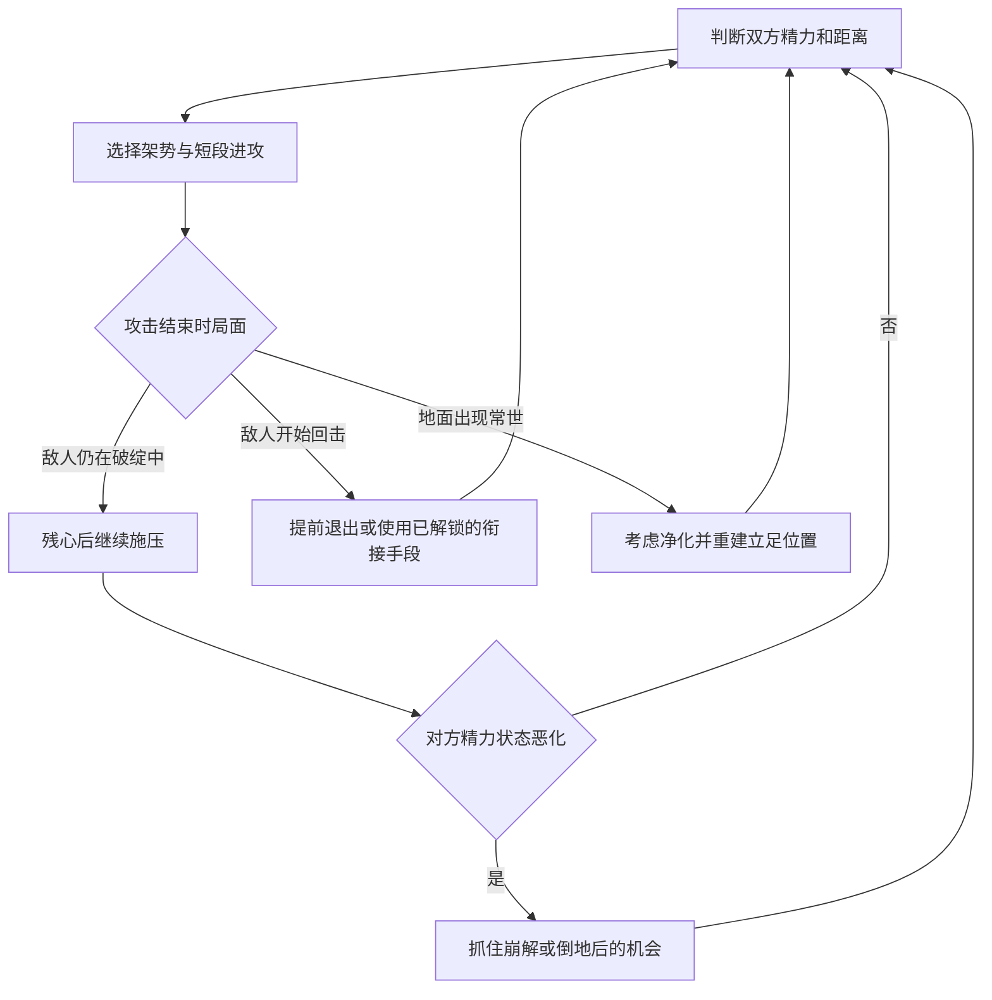

<!-- Imported from 游戏拆解分析/37款游戏拆解案/08_仁王.md; original analysis and evidence boundaries preserved. -->

# 仁王：精力管理怎样从等待恢复变成主动争取进攻

> 范围：2017 年《仁王》本体，以初周目及其常规武器、任务与成长为主，不混入 DLC 新武器、后续高周目装备体系或《仁王2》的妖反和妖怪技。涉及怨灵鬼、飞缘魔等前期敌人，含机制剧透。本文依据公开成品内容分析，不提供未经测量的帧数、倍率和内部 AI 规则。

《仁王》的突出吸引力，是玩家能够通过越来越精确的动作组织，显著改变自己可以连续进攻多久。精力原本是要求停手的限制，残心、架势切换和武技却允许玩家更主动地经营这项限制。游戏由此把“我更熟练了”表现为肉眼可见的节奏变化：同样的敌人，初学时需要频繁退出，熟悉后则能在合适条件下持续施压。

与此同时，随机装备、任务重玩和忍术阴阳术又提供另一种成长欲望：通过准备和搭配让某种打法变得可靠。动作掌握与装备经营并存，是本作的力量，也是理解门槛的来源。完整拆解需要解释两者如何接合，而不只是分别列出武器、词条和技能树。

## 1. 精力同时决定进攻长度和失误后果

攻击、闪避与防御都会与精力发生关系。精力不足意味着可用行动缩小，受到攻击时还可能陷入危险的耗尽状态。玩家必须在每段动作开始前，为其结束后的处境留出余地。只看一次攻击的伤害，很容易忽略它花掉的是后续撤离和防御的能力。

敌人也有精力或与之相关的可读状态，使玩家不仅经营自己，还能追求让对手失去行动优势。人形敌人的防御和妖怪的特殊状态，并不按完全相同的方式工作。设计上的共同点，是把对手的可行动程度变成另一个需要观察的目标，而不是让所有进展都隐藏在生命条里。

一个有效循环应该包含“本轮结束时我和敌人分别还能做什么”。玩家如果只盯着自己的精力，会错过压垮对方的机会；只盯着敌人的破绽，则可能在追击中耗尽自己。双向资源观察让较短的交锋也能产生多次判断。

## 2. 残心让恢复成为动作的一部分

残心允许玩家在攻击后主动回收一部分已经消耗的精力。官方说明同时给出精力条和角色周围光效作为识别提示，并说明妖怪领域会影响精力恢复。[官方战斗提示](https://blog.playstation.com/archive/2017/02/07/25-ways-to-defy-death-in-team-ninjas-awesome-ps4-action-game-nioh/)

它改变了动作结束的含义。攻击停下来之后，玩家仍有一次能够影响下一轮的输入；先前动作的成本不是只能被动接受，而是可以通过时机管理回收。这个设计把熟练收益直接落实为更多可用行动，因而比单纯给出评分更容易在战斗中被感知。

但残心并不是每次都应追求最大的恢复。敌人已经开始下一击时，继续等待完美时机可能得不偿失；需要立即移动时，及时退出反而更重要。相关技能解锁后，流转、闪避残心等又能把恢复与架势或位移结合起来，使“什么时候恢复”逐渐变成“怎样顺便恢复”。

<figure>
  
  <figcaption>图 1 · 精力、残心、架势与持续进攻的循环。用于概括本文分析，不代表游戏内部状态机。</figcaption>
</figure>

查看可编辑图源

图中没有把“残心成功”直接连接到安全追击，因为恢复了资源不等于敌人停止行动。资源与窗口必须同时成立。

## 3. 三种架势把武器拆成不同的行动承诺

上、中、下段改变同一武器的动作组织。概括来说，上段倾向较重的承诺，中段提供较均衡的交锋方式，下段偏向轻快连续，但具体用途仍取决于武器和武技。官方介绍将三种架势视为近战变化与掌握的重要来源。[官方架势介绍](https://blog.playstation.com/2017/01/16/nioh-how-to-defy-death-in-team-ninjas-latest/)

架势真正产生深度的地方，是它改变玩家能处理的窗口。一个敌人只留下很短的停顿，适合快速碰一下就离开；一个明确倒地窗口，则允许较长的动作。这时切换不是为了展示操作复杂，而是把当前资源转换成适合这个窗口的动作。

武技配置又让架势具有个人化含义。同一种输入在不同条件下可以承担削精、位移或输出任务，玩家需要选择哪些工具放进常用动作链。但如果可行打法长期集中在一项高收益技能，架势数量本身不会自动带来丰富决策。应观察真实切换理由，而不是以按键频率作为深度指标。

## 4. 人形与妖怪要求两种不同的压迫方式

人形敌人常把防御、精力耗尽和近身处置连接起来。玩家可以考虑通过攻击让对方防御承压，判断何时继续有机会崩解，何时会被反击。这里对手的防御本身成为可以经营的状态，而不只是伤害被挡住的失败结果。

妖怪则具有不同的身体与受击逻辑。攻击弱点、处理常世、观察精力状态，比假设所有普通攻击都能令其后仰更重要。常世使部分地面变成恢复条件较差的区域，残心净化则把资源操作与空间清理接合。玩家不只是避开危险，也可能主动修复自己继续战斗的立足点。

这两类关系共同要求玩家识别“对方当前是否真的受我控制”。如果把某次成功压制推广成永久规则，遇到不同类型敌人就会付出代价。敌人设计的价值，在于不断要求玩家重新分配已有工具，而不只是用更高伤害处罚相同动作。

## 5. 场景一：怨灵鬼把侧后方的安全变成有条件的判断

怨灵鬼所在的船舱限制了周旋空间，大体型和铁球又让威胁覆盖显得突出。初见玩家容易把“绕到背后”当作统一答案，但敌人的转身、横向覆盖和玩家自己的退出路线，决定了这个位置是否仍然安全。站在某个角度只是开始，不能替代持续观察。

攻击落空后，玩家有机会靠近输出。这里残心的意义十分具体：如果把所有精力都换成伤害，敌人恢复行动时可能没有足够余地；如果在短段攻击后恢复并及时撤离，就更容易让下一轮以可控制的状态开始。熟练不是每次多按几刀，而是知道这次最多能承诺多少动作。

战斗中铁链与铁球的状态变化，又改变了敌人的运动和攻击方式。此前根据一套覆盖关系形成的绕行习惯，需要重新校验。阶段转换因此成为一次空间知识的检查，而非仅仅增加攻击速度。场地仍是同一间船舱，玩家对它的使用方法却发生变化。

这一案例也说明高伤害的局限：若失败过快，玩家可能来不及分辨是站位错误、贪刀还是资源耗尽。设计者需要让关键起手和命中结果足够明确，否则“严格要求精力管理”会退化为泛化的挫败。

## 6. 场景二：飞缘魔把状态异常变成连续风险

飞缘魔的麻痹威胁使一次命中可能影响之后的行动能力。玩家处理的不是孤立的一次掉血，而是“被限制行动后还会遇到什么”。她的地面连击、空中行动与接近方式，使玩家需要在不同距离下识别威胁，不宜把整场战斗压成一个固定闪避节奏。

当玩家看见空中动作时，可以为接下来的攻击准备横向移动或其他处理；近身时则要判断当前连段是否已经结束。麻痹抗性、解除手段与恢复道具提供准备层面的缓冲，但不能让玩家忽略距离。资源准备让一次错误未必立刻终结，动作理解则减少错误发生的机会。

这场战斗把装备经营与技术学习联系起来。玩家可能先因状态异常失败，再回头理解抗性和道具，最终重新进入相同遭遇。这条路径有助于说明构筑是对问题的回答。反过来，如果玩家只被告知“去刷更高等级”，就会错过导致失败的具体条件。

因此，状态异常设计必须考虑后续连锁，而不只考虑异常本身的持续时间。无法行动、敌人高伤害和补给困难叠加时，惩罚可能远超界面显示的那次攻击。对玩家可理解性与恢复机会的安排，决定它是有意义的风险还是突然剥夺控制。

## 7. 镜头与任务空间决定复杂动作能否被执行

锁定帮助玩家围绕单个敌人组织攻击，但混战中它也可能让外围威胁离开视野。狭窄通道、楼梯和大型敌人身体会进一步限制观察。此时选择引出单个目标、先用远程解决高处敌人，实际上是在降低之后的输入复杂度。

任务地图中的神社、捷径和返回路线，让玩家逐渐降低探索风险。第一次进入需要观察埋伏和地形，熟悉之后可以更快回到关键挑战。可重复任务还为特定敌人和武器练习提供较明确的入口，但重复空间也可能使后半程的新鲜感更多依赖敌人配置与奖励。

残心光效、精力条、伤害反馈和敌人状态同时存在，构成了较高的信息密度。新玩家可能先盯条、再逐渐靠节奏和角色光效判断。这是学习过程，而不是界面越多越专业。若关键信号与装饰效果难以区分，复杂系统会增加无法被利用的认知负担。

## 8. 装备循环提供第二条成长，也可能稀释动作判断

掉落、强化和词条让战斗成果不断转化成下一次战斗的准备。玩家可以围绕偏爱的武器、忍术、阴阳术和守护灵建立方案，使一场战斗之外仍有追求。九十九武器则提供阶段性的强大状态，与《仁王2》的妖怪化需要严格区分。

装备数值和动作能力并不总是平滑相加。某些搭配会显著改变风险，足够强的方案可能让原本需要观察的阶段被迅速跳过。对喜欢经营构筑的玩家，这正是兑现准备的快感；对希望持续考验近战执行的玩家，它也可能让动作深度暂时失去作用。

| 成长来源 | 最直接改变的内容 | 分析时容易忽略的代价 |
|---|---|---|
| 练习残心与切架势 | 本轮可连续行动的长度 | 输入和注意力负担 |
| 学习武技 | 不同窗口下的处理方式 | 配置复杂，强选项可能挤压其他动作 |
| 装备与术法准备 | 容错、伤害与情境克制 | 菜单时间和数值碾压 |
| 熟悉任务路线 | 遭遇顺序与重试成本 | 内容重复后的新鲜感下降 |

因此，评价初周目的学习不能直接套用高周目构筑体验。文章需要说明玩家拥有何种工具、处于什么成长阶段，才能讨论某一场战斗到底在检验什么。

## 9. 可迁移启示：让熟练减少停顿，而不是消除风险

残心式设计的要点，是让资源恢复与已执行动作形成可辨认的联系。玩家要知道自己为什么获得更多行动，并能够在下一次复现。若恢复只是随机触发，节奏成长就难以被归因到操作；若恢复完全无成本，则原本的资源限制又可能失去作用。

更重要的是保留空间与敌人条件。资源回来了，不代表应该继续打；切到合适架势，也不保证位置正确。让动作技巧扩大可行选择，同时要求玩家判断何时使用，才能避免系统退化成每轮必须完成的手部体操。

《仁王》最适合战斗策划研究的，是技术成长怎样以持续行动的方式被表现，以及这条成长怎样与装备经营共存。它不需要被简化成“更复杂的魂类”。当玩家能够说清自己为何能多进攻一次、为何必须提前退出时，这套复杂度才真正转化成了可感知的掌握。

## 资料与支持范围

- [25 ways to defy death in Nioh](https://blog.playstation.com/archive/2017/02/07/25-ways-to-defy-death-in-team-ninjas-awesome-ps4-action-game-nioh/)：支持残心提示、常世与基础防御的规则核对。
- [Nioh: How to Defy Death](https://blog.playstation.com/2017/01/16/nioh-how-to-defy-death-in-team-ninjas-latest/)：支持架势与基础动作定位。
- [发行商提供的英文手册](https://cdn.akamai.steamstatic.com/steam/apps/485510/manuals/Nioh_steam_EN.pdf)：用于核对精力、操作与任务功能；虽为完全版手册，本文仅采用本体共有部分。
- 怨灵鬼、飞缘魔及成长关系为成品公开内容的原创分析，没有将任何单次观察写成精确阈值或最优打法。资料核对日期：2026-09-20。

---

[返回游戏拆解](/blog/game-breakdown/)
