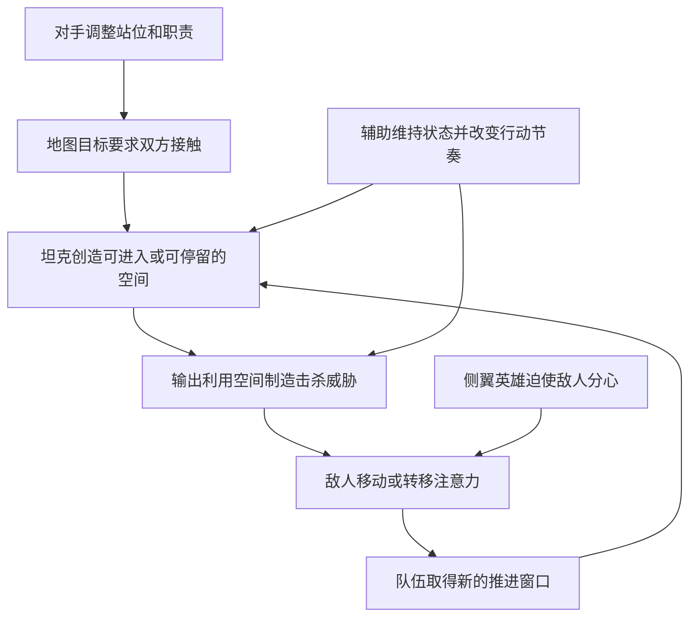

<!-- Imported from 游戏拆解分析/37款游戏拆解案/13_守望先锋.md; original analysis and evidence boundaries preserved. -->

# 守望先锋：让不同英雄以不同方式赢得同一场团战

> **分析范围**：初代 2016 年首发英雄的基础能力与六人队伍关系，用暴雪 2024 年 Overwatch: Classic 官方回顾校核。示例采用不重复英雄的自定阵容，并不宣称首发时强制职责队列或固定两坦克、两输出、两辅助。本文不分析现行 5v5、现行 6v6、天赋、角斗领域或 2026 年平衡。
>
> **剧透提示**：无剧情剧透，涉及国王大道与高台护送空间。案例是基于规则构造的团战局面，不是实测录像。人物名使用常见简体中文译名。

**核心论点：守望先锋的重要吸引力，是让玩家选择一种自己愿意扮演的战斗角色，再让这些差异在共同目标前产生依赖。英雄设计的任务不只是提供不同技能，而是为“怎样做出有价值的贡献”提供不同答案。**

## 1. 英雄身份由行动方式建立

莱因哈特举盾挡在队伍前面，猎空绕到侧后迫使敌人回头，天使维持队友状态，卢西奥帮助队伍改变移动节奏。这些角色并不只是换了一套外观：他们看待地图、敌人和队友的方式都不同。一个人关心入口能否通过，另一个人关心敌方辅助是否暴露，还有人关心哪名队友即将失去继续战斗的能力。

这使玩家可以在射击之外辨认自己的价值。保护队友经过危险路口、拖住回防者、争取最后一次接触目标的机会，都可能成为决定性动作。不过，允许多种贡献不意味着瞄准不重要，也不意味着所有玩家都能忽略基本空间判断。不同角色降低的是某些能力的必要性，同时提高了另一些能力的重要性。

英雄魅力因此要同时落在两处：独自操作时具有清晰、可感知的动作身份；进入团队后，其动作能改变其他人的行动条件。只有第一处，容易成为各自表演；只有第二处，玩家又可能觉得自己只是维持别人体验的工具。

## 2. 同一目标，制造了不同角色的相互依赖

占领和护送目标让双方必须围绕有限区域反复接触。坦克无法仅靠躲得好赢得目标，输出不能永远在远处寻找安全击杀，辅助也不能只追求面板治疗量。每种行动都要回到一个问题：它是否让队伍更有能力进入、维持或夺回目标附近的空间？

目标把不同战斗风格拉进同一个因果链。坦克暂时阻隔火力，队友才能穿过入口；输出施加威胁，对手才不能无限靠近己方辅助；辅助维持队友行动，团队才有余力把已取得的位置变成持续控制。这些关系不是任何时刻都按固定顺序发生，而是在团战中不断互换主次。

如果只统计一次技能造成多少伤害，就会漏掉这套结构。莱因哈特挡住的攻击可能没有创造任何推进；猎空的一次短暂骚扰虽然没有击杀，却可能迫使守方停止观察入口。真正值得追踪的是对手被迫放弃什么、队友因此获得什么。

## 3. 莱因哈特与猎空：两种完全不同的空间语言

莱因哈特以近战武器和正面屏障形成明显的前线；猎空用闪现和回溯改变接触、退出的位置。暴雪的 [Classic 官方说明](https://overwatch.blizzard.com/en-us/news/24146047/)列出了首发英雄基础能力，本文只引用这些基本关系，不引用现行英雄页中的新增天赋。

莱因哈特的威胁比较集中。他需要判断哪一段通路值得用屏障保护，什么时候接近到能够挥锤，什么时候必须退回实体掩体。举盾并不自动意味着控制空间：如果敌人无须理会他、可以从侧面攻击队友，屏障承受了很多伤害也可能没有战术收益。

猎空则通过迫使敌人分配注意力改变空间。她出现在侧面，会要求守方决定是否转身、由谁保护后排、是否继续压迫正面。她的移动资源让这种试探可以分阶段进行，但资源耗尽或退出路线判断失误，也会让她的脆弱迅速暴露。她需要的不只是快，而是让自己的接触与队伍正面行动发生在同一时刻。

| 维度 | 莱因哈特 | 猎空 |
|---|---|---|
| 主要空间作用 | 建立可跟随的正面推进方向 | 制造侧后压力与注意力分散 |
| 核心判断 | 保护谁通过哪里，何时收盾接战 | 何时进入、迫使谁回头、如何退出 |
| 对队友的依赖 | 需要跟进、火力与状态支持 | 需要队友同时制造正面压力 |
| 对手的回应 | 绕侧、拉距离、消耗推进资源 | 保护后排、限制路线、抓退出窗口 |
| 表面数据的盲点 | 格挡很多却没有取得位置 | 伤害不高却改变了敌方注意力 |

## 4. 场景一：国王大道入口的正面与侧面如何互相成全

设想进攻方在国王大道 A 点入口前停滞。莱因哈特站在门口不断举盾，队友隔着入口交换火力，猎空已经绕到侧边，但先一步暴露后被守方集中驱离。两边都在做符合自身角色的事情，却没有形成一次共同进攻。

问题在于压力没有重叠。猎空出现时，正面还没有推进，守方可以用较低代价回头处理她；等莱因哈特终于前进，猎空已经退出，守方又能把注意力全部放回入口。技能和位置都存在，但时间关系让它们逐一被解决。

若队伍约定一个共同接触时刻，局面就不同。莱因哈特先让队友缩短到可以跟进的距离，猎空在守方开始回应正面时接触后排。守方必须在继续压制入口和照看后方之间分配资源。猎空不必立即击杀辅助，她只要让一部分观察与攻击离开入口，就可能帮助正面跨过原本难以通过的地带。

守方仍有反制。它可以提前安排一人看住侧路，让主力保持对入口的压力；也可以主动退到下一处掩体，拒绝在前后夹击中硬守。优秀协同不是让对方没有按钮可按，而是让对方必须作出有成本的取舍。

## 5. 场景二：高台上的敌人，为什么不是多举一会盾就能解决

在具有连续高台的护送空间里，正面屏障可能挡住一个方向，却无法让近战英雄快速接近高处敌人。此时继续向屏障补充治疗，只是在延长一个尚未解决空间问题的队形。队伍需要重新判断，当前阵容能否把保护转换成接触。

温斯顿提供了另一种坦克思路：利用跳跃进入某个位置，并用屏障改变局部交火关系。他不是把莱因哈特的正面盾换成另一种颜色，而是让队伍可以围绕一次较主动的高处接触来安排后续动作。猎空若在地面侧翼同时施压，高台守方就需要判断留下还是转移。

但温斯顿跳上去不等于全队已经上去。他必须考虑队友能否提供火力、自己能否退出，以及辅助是否还能看见自己。若跳跃只把他送到多个敌人的集中视野中，机动能力就变成了更快地脱离队伍支持。这个反例说明，位移应该按照“到达后能发生什么”评价，而不只看移动距离。

同一类目标可以容纳不同阵容，但地图会改变其成立条件。窄口的可保护推进、高台的可接触性、侧路的进入成本，决定了英雄能力能否转化为实际价值。地图与英雄不是两张独立清单，而是共同定义一场团战有哪些合理打法。

## 6. 辅助设计：让队友继续行动，而非只填满血条

治疗的直接结果是恢复生命，但它的战斗意义在于延长某个行动。正在过路口的队友、即将获得击杀的队友、需要撤退的队友，对治疗的需求并不相同。若只按缺血多少排序，可能把资源投入一个已经无法影响局面的目标，却错过真正需要维持的接触窗口。

以天使的跟随支援和卢西奥的队伍移动支持为对照，两者都能帮助团队，但对站位提出不同要求。前者要关注连接对象和自身暴露，后者要判断队伍是否集中、当下更需要维持状态还是改变移动节奏。辅助因此具有自己的读局任务，不是把输出玩家的失误全部补回来。

另一方面，依赖也会制造挫败。输出可能不知道自己为何得不到支持，辅助可能觉得队友不断离开可帮助范围。清晰的视线、受击、队友状态和位置反馈，能帮助双方理解联系何时断开。对战斗策划来说，提升协作体验有时不需要更强的治疗，而需要让双方看懂帮助发生的条件。

<figure>
  
  <figcaption>图 1 · 英雄职责、团队资源与目标争夺的关系。用于概括本文分析，不代表游戏内部状态机。</figcaption>
</figure>

查看可编辑图源

## 7. 终极技能与阵容调整，给团战增加记忆

终极技能把之前的战斗积累带到后续团战，使一场接触不完全独立于上一场。队伍需要决定何时投入关键能力，是保证当前推进，还是为之后更难的目标保留。若多个能力同时解决了同一批敌人，额外投入可能没有增加足够价值，却降低了下一次接触的余地。

这使团战有了资源叙事：上一次逼出了什么，这一次还能承受什么，下一次准备怎样突破。英雄切换又允许团队重新思考解决方案，但切换本身也会改变资源与配合关系。玩家不只是反复完成同一套连招，而是在多次接触中理解对手的打法。

这里有一个设计危险：如果某些组合的收益过于确定，团战容易变成等待统一信号释放能力，其余时间只负责积攒条件。保留站位、时机、可躲避路线和局部应对，才能使强力能力成为争夺焦点，而不是对结果的提前宣判。

## 8. 清晰度与公平：多种贡献也意味着多种认知负担

英雄数量和能力组合越多，玩家越难在混战中读清发生了什么。不同体型、弹道、屏障、控制与移动同时出现，既构成鲜明表现，也增加辨认负担。音效、轮廓、敌我颜色和终极技能提示的价值，是帮助玩家从复杂表现里找到与当前决定有关的信息。

暴雪在 [2024 年关于 5v5 与 6v6 的开发讨论](https://overwatch.blizzard.com/en-us/news/24104605/)中公开回顾过人数、职责和认知复杂度的取舍。这段历史支持“队伍规模会改变体验结构”，不支持把首发 6v6 与现行任意 6v6 视为同一玩法。技能、地图、职责规则变了，相同人数也会产生不同交战关系。

公平同样不等于人人承担相同任务。莱因哈特与猎空的输入要求不同，可以成立；但双方都需要能够理解自己为何受限、对手为何获得优势。若一个英雄主要贡献只有熟练队伍才能察觉，普通玩家就可能把角色价值误读为弱。反馈设计因此也是平衡设计的一部分。

## 9. 设计代价、类型差异与迁移启示

守望先锋的代价是团队依赖很强。一个位置失守会影响其他职责，一名玩家的行动也可能只有在队友配合时才显得有效。过度追求角色纯粹性，会让一些玩家缺乏独立解决问题的能力；过度补齐每个角色的短板，又会让英雄逐渐趋同。

与 APEX 相比，守望先锋更直接让英雄武器和职责定义交战形式；与无畏契约相比，它允许更显著不同的输入方式共同参与目标争夺。它值得学习的不是简单的坦克、输出、辅助三分法，而是如何让不同操作习惯都能连接到同一条胜利因果链。

迁移时应先画出一种贡献怎样帮助队友行动，再确定贡献者自身要承担什么判断风险。保护角色需要选择方向和时机，侧翼角色需要选择接触与撤退，辅助角色需要选择帮助对象与安全位置。每个职责都拥有决策，合作才是角色之间的互相完成，而不是某些人服务另一些人。

## 资料与证据边界

- [暴雪：Overwatch: Classic 官方说明](https://overwatch.blizzard.com/en-us/news/24146047/)：用于核对首发英雄能力及 Classic 所回顾的历史范围；不把活动全部实施细节等同于 2016 年每一时期规则。
- [暴雪：Opening up the conversation on 5v5 and 6v6](https://overwatch.blizzard.com/en-us/news/24104605/)：用于说明人数、职责组织与可读性确有公开讨论；其 2024 年判断不是现行版本事实。

本文未引用英雄胜率、玩家规模、队列时长或留存数据。团战案例与角色价值解释属于作者分析，不能替代特定版本的录像复盘。

---

[返回游戏拆解](/blog/game-breakdown/)
