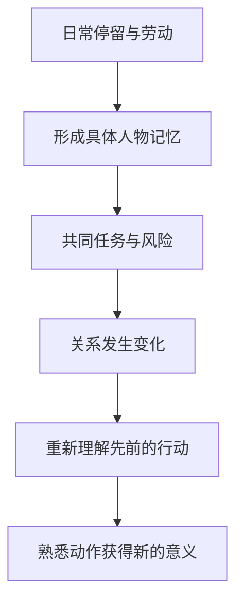

<!-- Imported from 游戏拆解分析/37款游戏拆解案/30_荒野大镖客2.md; original analysis and evidence boundaries preserved. -->

# 荒野大镖客2拆解案
## 生活的重复如何为一段无法挽回的故事赋予重量

**范围：**2018年本体故事模式，不包括《Red Dead Online》。以亚瑟主线及尾声为对象，不讨论不同平台的画质排名。**剧透级别：高，涉及亚瑟命运、帮派瓦解与尾声。**资料核对：2026年9月20日。

## 核心判断

《荒野大镖客2》的突出价值，是让玩家先花时间生活在一段关系里，再体验这段关系失去稳定性的过程。营地、马匹、旅途和小型互动，为主线人物提供了戏外仍然存在的生活。后续冲突之所以有重量，是因为玩家失去的还包括原本熟悉的日常秩序。

因此，“细节很多”并不是充分的设计解释。需要继续问：这个细节有没有改变玩家的行动，有没有建立可重复的关系，或者有没有让后来发生的事具有不同意义。只增加操作时长的细节，和能够积累感情的细节，应当分别评价。

## 一 营地把故事人物变成一起生活的人

营地同时是补给地点、任务入口和可以旁听的生活场所。玩家回到这里，不一定立刻推进主线，而可能遇到正在争论、劳动或休息的伙伴。同一人物在不同情境出现，使他不再只在“轮到他说台词”时存在。

任务外的片段尤其重要。主线经常必须强调人物的立场和矛盾，营地日常则提供更低压力的接触：一次闲谈、一首歌、一项请求，可以让玩家看到角色不承担剧情功能时的样子。等到信任开始崩溃，这些已经积累的印象会与新行为冲突。

这种效果有访问条件。经常返回营地、愿意停留的玩家会得到更多材料；只追任务标记的玩家，可能感到部分关系铺垫不足。可选叙事扩大了生活感，也让玩家接收故事的密度变得不一致。

<figure>
  
  <figcaption>图 1 · 营地、旅途与生活动作的情感积累。用于概括本文分析，不代表游戏内部状态机。</figcaption>
</figure>

查看可编辑图源

图示表示本文对体验积累的解释，不是剧情触发器或后台情感评分。

## 二 旅途将两个剧情节点变成共同经历

骑马路程同时容纳地理学习、人物对话与意外事件。跟随伙伴前往目的地时，移动给对话提供了自然时长，环境也会逐渐改变玩家对接下来事件的预期。玩家并非只知道“我们去办事”，而是经历了离开安全处、进入目标区域的过程。

问题在于，路线中的行动密度必须与对话匹配。长距离移动可能让关系自然发展，也可能让玩家只剩跟随。第一次旅程的景观、闲谈和陌生感，在重试时往往失去效力；若失败后必须重复大量无变化路段，叙事节奏就转化为恢复成本。

电影镜头可以突出景观与骑乘姿态，但会降低玩家对局部障碍和意外的直接观察。这是沉浸与控制之间的交换，不应简单归结为“电影镜头更高级”。

## 三 身体的耗时让角色具有生活感

拾取、翻找、照料马匹、处理猎物等过程，把资源从抽象数值变成角色亲手获得的东西。它们的共同作用，是让玩家意识到身体需要时间，物品占据空间，获取有具体来源。

马匹尤其连接了功能与关系。它承担移动、装载和野外活动中的实际用途，照料行为又让这种工具性逐渐具有陪伴意味。官方平台的实际试玩介绍，也将马匹互动、营地活动和人物回应列为体验组成部分。[PlayStation试玩记录](https://blog.playstation.com/2018/10/01/22-things-you-need-to-know-about-red-dead-redemption-2/)

但动画完整不自动等于体验更好。玩家已经理解一项劳动后，反复观看同样动作的新增信息会下降。判断耗时是否值得，要看它此刻是否仍在建立关系、传递状态或强化情境。否则，允许缩短重复操作可能更有利于保留生活感。

## 四 枪战维持亡命徒身份 也制造主题张力

掩体、武器切换、装填与死亡之眼，共同提供一种有重量但仍可导演出精彩结果的射击体验。死亡之眼放宽了即时瞄准压力，使玩家能组织目标顺序，演出高水平枪手的行动。它的价值包括能力幻想和场面表达，而不只是降低难度。

任务中的枪战经常承担剧情升级：谈判失败、抢劫失控、救援扩大为追逐。射击开始时，故事状态已经改变，玩家通过突破包围或掩护伙伴参与这个变化。然而，敌群与路线若长期采用类似结构，情境差异未必能维持同等战术新鲜感。

本作还有明显张力：剧情强调暴力后果和帮派衰亡，战斗却常允许玩家消灭大量敌人。两者可以共同塑造一名强悍而无力改变时代的角色，也可能让部分玩家觉得叙事痛苦和玩法轻松脱节。拆解应保留这个矛盾，而不是把所有机制都解释成完美服务主题。

## 五 开放世界允许角色表达 任务脚本要求戏剧发生

自由活动时，招呼、挑衅、帮助、威胁和逃跑构成较宽的行动语言。玩家能通过对人的处理方式，决定自己此刻扮演怎样的亚瑟。遭遇由多个规则串联时，还可能生成事先没有明确任务名称的小故事。

主线任务则经常收紧路线、目标和行动顺序。这种限制保证关键事件以合适节奏发生，但可能与此前建立的自由预期相撞。玩家已经知道某种办法在世界里成立，进入任务后却被失败条件阻止，便容易将规则理解为任意命令。

| 场景结构 | 提供的价值 | 主要代价 |
|---|---|---|
| 营地可选互动 | 关系可以在停留中积累 | 接收密度取决于玩家习惯 |
| 野外规则互动 | 行动引出个人经历 | 戏剧质量不稳定 |
| 严格编排的主线 | 保证高潮与人物出场 | 可能压缩已经学会的自由 |
| 尾声日常劳动 | 让生活状态通过行动变化 | 对期待高强度枪战者可能显得缓慢 |

## 六 案例一 与蓝尼喝酒如何改变玩家对伙伴的记忆

瓦伦丁的喝酒任务，把一位伙伴与一段非常具体的共同体验绑定。玩法暂时离开精准射击和生存资源，转向寻找、辨认、跟随和失序的感知。空间与人物的辨认被醉酒状态扰动，玩家是在操作中失去原来的确定性。

这个片段的设计价值，在于它为关系创造了非功利记忆。蓝尼不只是会帮忙的战斗单位，也与一次轻松、混乱、难以用任务收益概括的经历有关。后续危险涉及同伴时，玩家能够调动的记忆因此更具体。

同时，任务对操作自由的限制并没有完全消失。它依靠精心安排的变化制造醉酒感，重复体验的惊喜会减弱。这是一段适合首次记忆的强编排内容，不宜把它的成功误读为可以无限复用的系统循环。

## 七 案例二 债务线如何改变行动的道德语境

早期讨债把暴力放在清楚的工作流程里：接下帮派事务，找到目标，通过威胁或殴打收取利益。任务结构容易让玩家先以完成工作理解自己的行动，而不是停下来充分认识对方。

随着亚瑟命运与这些行为的后果逐渐连接，同样的“替帮派办事”会产生不同意义。游戏不是只让一段台词宣布角色变化，还让玩家回望此前亲手执行的任务。操作上的熟练与道德上的迟疑可以同时出现。

这条线的力度来自具体关联，也有边界：关键后果主要由作者编排，玩家不能通过早期完全拒绝一切行为重写主线。因此，更准确的体验是参与并重新解释一段既定人生，而不是拥有完整的道德模拟自由。

## 八 尾声用日常动作改变故事的尺度

尾声中的劳动与建立住处，把行动目标从逃亡和抢夺转向维持生活。相似的身体耗时，在不同情境里承担新的意义：此前的慢动作让亡命徒生活显得具体，之后则让安定显得需要投入。

玩家已经熟悉骑马、搬运、维护等行动，游戏不需要重新教一套庞大规则，就可以通过目标与人物关系的变化，使熟悉动作具有新的情绪。叙事与机制在这里的联系，比“过场之后接一段玩法”更紧密。

当然，节奏下降也会暴露玩家动机差异。想立刻得到复仇高潮的玩家，可能把劳动视为等待；愿意把注意力转向生活重建的玩家，则更容易接受这种尺度变化。这种分歧属于设计选择的实际成本。

## 九 技术表现如何成为连续生活的支撑

动画过渡、人物视线、声音距离、天气和场景密度，共同减少“现在进入另一种模式”的突兀感。它们的设计贡献，是让对话、赶路和交战更像发生在同一个连续空间里。

分析时应把结果与实现分开。可以观察角色转身是否自然、对话是否因距离或事件中断、状态变化是否在外观中体现；不能据此宣称具体使用了某种未公开AI架构，也不能把所有偶发事件都称作完全无脚本。

连续感也依赖限制：视野中同时允许多少高质量互动、关键剧情何时接管角色、哪类行为会被任务条件排除，都是制作取舍。复制外观细节而没有这些组织关系，未必能复制生活感。

## 十 能迁移到战斗与叙事设计的原则

最值得借鉴的是在高潮之前建立可操作的日常。合作战斗中的队友，可以先通过任务外行为、移动节奏与小型帮助成为具体的人；之后的一次救援或失去，才不必全部依赖配乐和台词。

第二条原则是让重复动作承担意义变化。相同的移动、照料或交互，在角色关系变化前后可以被重新解释。它比不断新增机制更节省学习成本，也要求编排者知道玩家已经形成什么习惯。

若项目追求短局、重复挑战和高度响应，则不宜直接复制本作的长过渡与繁复身体动作。应保留能建立关系的部分，压缩失去信息价值的重复。评价标准是行为有没有积累意义，而不是动画是否足够写实。

## 资料与证据边界

- [PlayStation的实际试玩记录](https://blog.playstation.com/2018/10/01/22-things-you-need-to-know-about-red-dead-redemption-2/)：用于核对营地、马匹、互动与镜头的公开体验描述。
- [Xbox Wire发布的官方实机演示](https://news.xbox.com/en-us/2018/08/09/watch-the-red-dead-redemption-2-official-gameplay-video/?ver=3.7.1)：提供官方玩法展示入口。
- 本文对蓝尼任务、债务线与尾声的分析基于游戏叙事和可见交互，不将心理效果写成开发者原话或玩家调查结果。没有提供未公开技术架构与未经实测的响应时间。

---

[返回游戏拆解](/blog/game-breakdown/)
