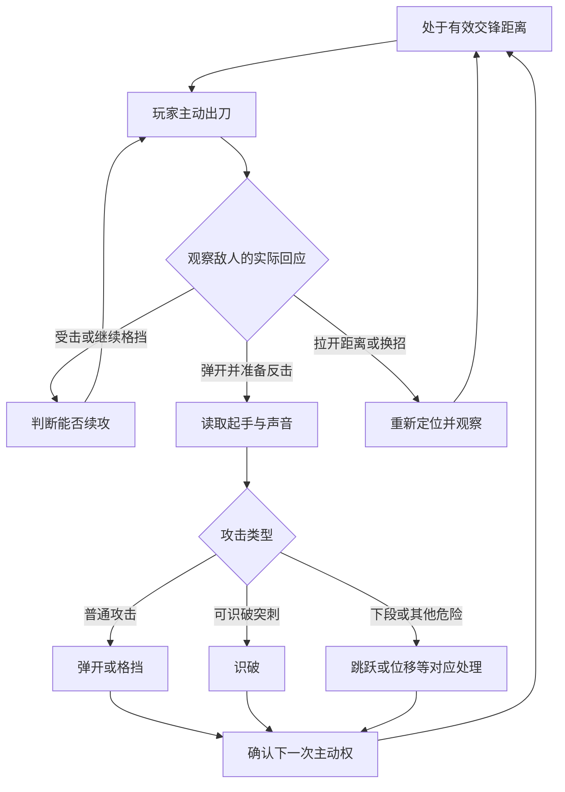

<!-- Imported from 游戏拆解分析/37款游戏拆解案/04_只狼.md; original analysis and evidence boundaries preserved. -->

# 只狼：主动进攻怎样成为读取敌人的方法

<figure class="official-game-screenshot">
  
  <figcaption>官方商店截图 · 狼与僧人敌人近身交锋，画面包含敌方长柄武器、玩家跳跃动作与义手斧。来源：<a href="https://store.steampowered.com/app/814380/">Steam 官方商店</a>。© 2019–2020 FromSoftware, Inc.; published and distributed by Activision. 画面版本可能与本文限定范围不同，仅作视觉参考，不作为文中案例的实录。</figcaption>
</figure>

> 范围：《只狼：影逝二度》本体单人流程，以保留九郎护身符且不敲钟鬼的常规条件讨论，不把无护身符、连战或极限速通当作基础难度。涉及天守阁弦一郎、狮子猿的阶段变化和战斗规则，含中度剧透。本文是成品机制分析，不宣称进行过帧数测量或玩家实验。

《只狼》令人持续投入的核心体验，是逐渐看懂高速交锋中的关系，并能够亲手维持这种关系。它没有把成长主要放在更换武器与堆叠装备上，而是让同一把刀随着玩家理解加深，承担越来越多的局面。玩家不仅学会等对手结束，还学会通过自己的攻击，迫使对手给出可辨认的回应。

因此，《只狼》的战斗不宜只用“节奏游戏”概括。声音和节奏确实帮助判断，但敌人会拉开距离、变化招式，场景也会引入其他威胁。真正稳定的是判断规则：观察回应，识别能否继续，选择相应动作。熟练体验来自把不确定局面不断缩小，而不是背诵一段永远不变的按键乐谱。

## 1. 生命与架势把胜利拆成两条相互影响的进度

生命伤害和架势压力提供不同的进展。削减生命会留下较持久的成果，而架势可能在压力中断后恢复；敌人的生命状态又会影响其架势恢复。玩家因此需要判断，眼前更适合先建立生命优势，还是持续压迫直到出现忍杀机会。[官方战斗说明](https://blog.playstation.com/2019/03/22/sekiro-shadows-die-twice-tips-for-dark-souls-bloodborne-veterans/)

这种组合使撤退具有双重含义。后退可能保护自己，却也让此前积累的架势压力流失；继续近身可能保住进度，同时要求处理下一轮攻击。风险由此连接到“是否让成果失效”，而不是只连接到当下会掉多少生命。对喜欢技术成长的玩家，这会产生持续交锋的动力。

它还允许同一敌人存在不同阶段策略。尚不熟悉时，玩家可以先寻找较可靠的生命伤害机会，降低后续维持架势的难度；熟练后则可能更早持续压制。但这不是所有敌人统一适用的速解法，敌人的体型、攻击方式和可承受压迫程度都会改变可行路线。

## 2. 没有精力条，不代表没有动作成本

《只狼》不使用常见的攻击精力条来约束挥刀与移动。限制转移到了动作承诺、自己的架势、敌人的反应和位置上。玩家可以积极出刀，但敌人弹开后仍然继续攻击，就可能撞进反击；不断后退虽然不消耗精力，却可能失去对招式的掌握与进攻进度。

普通格挡和精准弹开也承担不同风险。前者较容易维持即时防御，后者更有利于在交锋中反过来施加压力。自己的架势已经很高时，正确弹开与普通承受的后果并不相同。这让高架势状态仍可能保留技术性的生存空间，但容错已经收窄。

跳跃、闪避、识破和主动攻击并不是按优劣排列的替代关系。下段攻击、突刺、抓取及普通连击需要结合具体动作回应；识破还需要先解锁相应技能。敌人头上的危险提示只告诉玩家某类常规防御不再可靠，并不替玩家选择答案。

## 3. 攻击既制造压力，也向敌人提问

玩家连续攻击时，敌人格挡与弹开的表现可以构成转折信号。若对方只是承受防御压力，下一刀仍可能有价值；若出现明显弹开并接入反击，玩家就需要改变输入。刀剑声音、火花与身体动作合在一起，使这次转折能够被感知。

这里可以提出一个具体的机制解释：主动攻击有时会让敌人进入较容易识别的回应，而长时间游离在外，可能允许对方使用更广的招式范围。这个解释适用于部分人形交锋，不等于玩家攻击能控制全部 AI。没有开发资料，就不能把可见回应写成某个内部状态机的必然分支。

<figure>
  
  <figcaption>图 1 · 进攻、敌人回应与下一步动作的判断流程。用于概括本文分析，不代表游戏内部状态机。</figcaption>
</figure>

查看可编辑图源

图中每个“观察”都不能省略。把循环误读成固定连按，会把原本的信息判断重新变成赌博。

## 4. 场景一：天守阁弦一郎教玩家读回应

弦一郎的价值不只是难度门槛，还在于他能够用较完整的动作组合检验玩家是否理解交锋。玩家近身挥刀，会看到对方格挡、弹开与回击；对方也会通过弓箭、后撤、跳劈等动作改变距离与节奏。站在远处等待一个巨大破绽，不一定比主动建立接触更容易。

一次典型的分析单位，是“玩家攻击—敌人回应—玩家改选动作”，而不是一整条 Boss 血条。若玩家能从格挡和弹开的差异及时停手，就把先前攻击获得的信息转化成了防御收益；若听见转折仍继续挥刀，则暴露的是回应识别或习惯问题。成功和失败可以落到具体因果上。

跳劈后的后续动作进一步阻止玩家把单一节奏当作完整答案。玩家既要处理眼前的落点，也要继续读取随后出现的威胁。后跳射箭则提醒玩家，脱离近身交换并不意味着安全暂停。战斗不断在近身规则与重新接敌之间切换，维持了同一对手的变化空间。

这类设计对反馈要求很高。若敌人的普通格挡与关键弹开缺少明显差异，玩家就难以知道何时该停；若每种回应都能无代价取消为任意后续，学会前兆也没有意义。弦一郎提供的启示，是给积极进攻者信息收益，同时保留足以打破机械循环的分支。

## 5. 场景二：狮子猿让玩家重新定义“会打”

狮子猿的前段强调庞大身体、翻滚、抓取与空间位移。面对这类对手，玩家无法只照搬与人形武士贴身互砍的节奏，需要辨认身体运动会覆盖哪里、什么时候接近能保留退出路线。视觉上的野性让预判更困难，也使真正读清动作后的接近具有征服感。

后续阶段转向持剑的无首形态，动作形象与威胁类型重新组织。刀的轨迹给弹开带来更直接的用途，而恐怖效果的范围威胁又要求玩家及时脱离。前一阶段学习的距离经验仍有参考，但不能原样使用。变化的意义在于重新组合已有工具的价值，而不只是增加敌人伤害。

玩家在两段之间经历了一次对能力的重新解释：此前偏重移动与接近，之后更需要辨认剑击、连续回应和范围撤离。Boss 的剧情冲击由这一操作变化放大。若只有身体形象改变而决策没有变化，反转就更接近纯演出；这里则把惊讶延伸到接下来的实际行动。

这种设计的代价是阶段知识成本。首次到达新阶段，玩家可能尚未理解威胁就失败，并需要重新完成已经学会的部分。阶段之间的时长、学习信息与重试成本会直接影响反转是惊喜还是疲劳，不能仅凭“藏了一阶段”判断质量。

## 6. 忍义手提供局部解法，不能替代基本读招

忍义手把远程干扰、特定控制或情境克制加入刀剑循环。它们的意义在于重新安排局部交锋：让难以接近的时刻出现机会，让某类敌人的优势暂时失效，或者给玩家一种更适合自身习惯的处理方式。纸人资源使这种介入具有次数成本。

好的工具使用可以缩小难题，却通常仍需要玩家在之后接近、输出或防御。工具因此与基础动作形成前后关系：它改变条件，刀剑动作兑现条件。若分析只统计工具造成的伤害，就会漏掉其真正创造的安全、距离或时间价值。

与此同时，工具的适用条件往往需要额外知识。熟悉敌人的玩家看见明确克制，新玩家却可能完全不知道此选项存在。因而“游戏给了办法”不等于“办法已经被有效传达”。道具描述、环境线索与试用成本共同决定工具能否成为普通玩家的真实选择。

## 7. 立体移动与潜行负责组织战斗之前的局面

钩绳、跳跃与攀爬把关卡变成可以先观察再进入的空间。玩家能够选择从哪里接近、先消除哪个威胁、何时退出并重新安排。部分精英遭遇允许通过潜行取得初始优势，这让关卡学习能够影响后续正面战斗的长度和压力。

例如在苇名城一带的屋顶与地面之间移动，玩家不仅是在赶路，也是在改变视野和敌人的接触顺序。进入人群正面与先解决外围目标，得到的战斗需求不同。立体路线因此把一部分难度放在开打之前，避免整个游戏只剩单挑反应测试。

潜行与 Boss 战的关系也有边界。能够处理外围士兵，不代表可以绕过所有核心对决。关卡允许机智和路线选择，关键战斗又要求玩家兑现刀剑能力，二者分别提供准备自由和能力检验。如果不区分这两个层级，就容易把“只狼打法单一”或“所有问题都能逃课”都说得过满。

## 8. 复活保护交锋连续性，成长强化理解的可见成果

复活让一次致命失误不必立刻变成长距离重跑。它可以保留刚刚建立的战斗情境，也可能为重新判断位置提供机会，但受到资源与再次使用条件的限制。宫崎英高在访谈中将其与高风险战斗的节奏、策略利用及故事主题联系起来。[宫崎英高谈复活](https://blog.playstation.com/2018/07/13/interview-miyazaki-on-the-limbs-and-lore-of-sekiro-shadows-die-twice/)

有限复活还改变了玩家对本次尝试的理解。倒下之后仍有继续观察新阶段的可能，失败不一定立刻切断信息获取。但如果玩家把复活当成两条可以随意消耗的生命，就可能忽略下一次还需要满足恢复条件。机制既降低中断成本，也保留了局势规划。

生命、攻击力、技能和忍义手升级带来成长，其中不少关键提升与特定挑战或探索相连。它们能增加容错、扩展工具，却不完全取代对动作的理解。玩家再次遇见相似攻击时处理得更从容，会比仅看到数值增长更直接地感知自己变强。

## 9. 可迁移启示：让玩家知道自己为什么失去了主动权

《只狼》的设计价值不只是高难度弹反，而是把行动与回应组织成可学习的对话。主动进攻得到信息，准确防御也推动胜利；进攻与防御因此不再是两个完全隔开的阶段。设计其他动作游戏时，可以先检查防御是否只延缓失败，还是确实改变敌人的状态与下一步机会。

也必须保留适用边界。稳定、可辨认的回应适合单个强敌，放进多敌混战后可能被视野外攻击打断；高度强调精准时机的系统，也会对视觉、声音、性能与输入反馈提出更高要求。不要把一个成功 Boss 的交换结构直接复制给整张战场。

要验证类似方案，应观察玩家能否指出一次转折的信号，能否在失败后改变下一次选择，以及主动攻击是否真的减少了需要同时考虑的情况。本文只提供机制层面的解释，不声称所有玩家都会享受这种压力。它适合希望靠理解与执行获得明确成长的玩家，也因此形成了强烈而清晰的作品性格。

## 资料与支持范围

- [Sekiro: Tips for Dark Souls, Bloodborne Veterans](https://blog.playstation.com/2019/03/22/sekiro-shadows-die-twice-tips-for-dark-souls-bloodborne-veterans/)：核对架势、弹开、忍杀和工具使用的基础关系。
- [Interview: Miyazaki on the Limbs and Lore of Sekiro](https://blog.playstation.com/2018/07/13/interview-miyazaki-on-the-limbs-and-lore-of-sekiro-shadows-die-twice/)：支持复活与战斗连续性之间的开发者设计背景。
- 弦一郎、狮子猿和苇名城的因果解释来自成品公开内容；流程图描述玩家可见决策，不是逆向取得的 AI 实现。资料核对日期：2026-09-20。

---

[返回游戏拆解](/blog/game-breakdown/)
