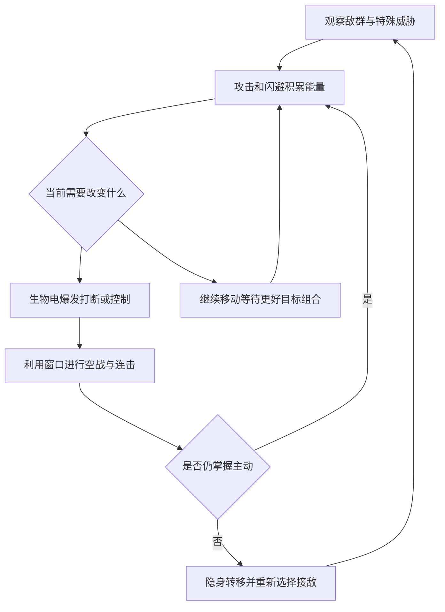

<!-- Imported from 游戏拆解分析/37款游戏拆解案/29_漫威蜘蛛侠迈尔斯.md; original analysis and evidence boundaries preserved. -->

# 《漫威蜘蛛侠：迈尔斯》：新能力怎样让同一座城市拥有另一个英雄

> 剧透等级：完整剧情。涉及开场犀牛人、布雷斯韦特大桥、菲恩、罗克森与终局。本文以 2020 年本体为对象，区分 PS4 与 PS5 的呈现条件，不使用《蜘蛛侠 2》的能力扩展解释本作。本文未进行本轮实机或逐帧测试。

## 1. 核心论点：角色差异必须改变决策，而不只改变动作颜色

《迈尔斯》最值得拆解的地方，是它在继承前作移动与基础战斗的条件下，让玩家逐渐感觉自己操控的是另一个蜘蛛侠。生物电提供更鲜明的爆发与控制，隐身提供主动改变接触状态的办法；较青涩的身体表达、社区关系和成长故事，则让这些能力成为人物身份的一部分。

因此，判断角色差异不能只统计新增招式。更重要的问题是：玩家是否因为新能力而改变目标顺序，是否选择不同的进攻窗口，暴露或受压后又是否拥有新的处理方式。如果最优决策仍然完全相同，视觉再明显也可能只是表现变化。

本作还把能力和责任放在同一条成长线上。迈尔斯一开始并不能稳定处理所有新力量，强大有时会让局势恶化；最终，他需要理解自己为何而战，以及愿意为社区承担什么。角色从“另一个蜘蛛侠”成为“这里的人认识的蜘蛛侠”，是机械差异与地方关系共同完成的结果。

## 2. 摆荡动画怎样让继承的能力产生不同性格

迈尔斯已经具备蜘蛛侠的移动基础，玩家不需要重新学一套完全陌生的通勤系统。但空中的姿势、翻转、调整与偶尔显得不够从容的过渡，会表达一个正在熟悉身体的新英雄。相似输入能够产生不同气质，使玩家在最频繁的移动中持续接触角色性格。

这里需要区分表现青涩与控制不可靠。角色可以在画面中稍显慌乱，输入仍然应稳定地抵达玩家想去的位置。若用真实的随机失误表现成长，玩家很容易把人物特点理解成手感缺陷。较好的方案是把青涩放进姿态和反应，把路线与时机的决定权留给玩家。

冬季城市、音乐和社区活动又改变了移动的情绪背景。同一套楼间穿行不只是重复前作地图，而是从新的家庭与邻里位置观看它。单靠换季美术不能自动创造归属感，沿途行动需要不断回到具体的人和地点，城市才会从熟悉的游乐场变成迈尔斯的生活范围。

## 3. 场景一：犀牛人开场怎样把“新能力”变成必要办法

开场与彼得共同追捕犀牛人，先让迈尔斯处在学习和追赶的位置。失控的巨大目标穿过城市，要求玩家用已经熟悉的移动能力跟上局势；彼得的存在则为成熟英雄提供参照。玩家既继承前作的操作自信，又看见新主角尚未完全掌握局面的状态。

当彼得暂时无法继续主导，迈尔斯面对犀牛人的力量差距，生物电能力出现并提供新的应对。新招式不是在安全菜单里孤立解锁，而是在原有解法不足的处境里获得意义：它能制造此前难以取得的窗口，改变对强敌的可行动空间。

这一教程因此同时完成能力教学与身份建立。玩家知道迈尔斯并非只能模仿彼得，也知道差异能够实际解决问题。反例是特殊能力一出现就无条件克制所有敌人，后续战斗便容易退化成等能量、放技能。新能力需要在之后面对距离、数量和特殊防御的不同条件，才能保持决策价值。

## 4. 生物电循环如何鼓励接触，又留下消耗判断

生物电攻击带来伤害、硬直和位移等直接效果，能为后续进攻打开窗口。普通攻击与恰当闪避可以帮助积累能量，玩家因此有理由继续接触敌人，再把积累转化为一次明显的局势变化。它形成的是进攻、积累、爆发、重新组织的循环，而非独立于基本战斗的装饰技能。

不同爆发方式需要对应不同问题。单体处理适合优先打断关键威胁，群体挑空或范围效果则能改变一组敌人的站位与行动。若玩家先把敌人聚集，再投入范围能力，资源的收益便来自前置安排，而不只来自按钮本身的伤害。

官方入门说明确认了通过攻击与闪避积累能量、使用生物电能力，以及部分敌人会限制这种能力的方向。本文以此核对循环框架，不引用未经测试的具体积累量或免疫名单。[PlayStation 官方玩法说明](https://blog.de.playstation.com/2020/11/27/so-spielt-ihr-marvels-spider-man-miles-morales/)

成长与模组可能进一步改变收益。如果一套配置让强力爆发几乎没有空档，玩家就可能不再关注基本拳脚和敌人差异。评价时应记录能力解锁进度，不宜把终局配置的循环直接视为开场就存在的设计。

<figure>
  
  <figcaption>图 1 · 生物电、隐身与战斗选择的联系。用于概括本文分析，不代表游戏内部状态机。</figcaption>
</figure>

查看可编辑图源

## 5. 隐身为何应同时作为进攻和撤离工具理解

隐身最直接的用途是接近目标，但它对战斗结构的贡献更大：玩家可以在局势不利时主动改变敌我接触关系。脱离包围、重新选择位置、优先处理关键对象，都让隐身超出“把潜行变简单”的单一定位。

与生物电相比，隐身处理的是信息，生物电处理的是当下威胁。前者减少对方有效应对的机会，后者打破对方已形成的压力。两种能力共享一个目的——重新取得主动——却通过不同条件发挥作用。是否先隐身接近，再把爆发投入最重要目标，便可以成为角色特有的决策。

隐身也不能成为无限重置按钮。持续时间、恢复、特定敌人的应对与攻击后的状态变化，需要使它保留选择成本。这里不写一套适用于所有技能配置的固定规则，而应观察玩家能否理解隐身何时安全、何时仍有风险。官方支持文档还列出了战斗镜头、闪避窗口等辅助设置，实际测试应记录这些条件。[Insomniac 辅助选项说明](https://support.insomniac.games/hc/en-us/articles/46670895263635-What-Accessibility-options-does-Marvel-s-Spider-Man-Miles-Morales-feature)

## 6. 敌人与资源差异怎样避免成为彼得的换皮

地下帮的高科技武器与罗克森的战术装备，给新能力提供了不同的作用对象。近战压迫、远程威胁和对能力的限制，使玩家不能只对所有人重复同一种生物电动作。理想的遭遇应让控制、空战、装置和隐身各自有合适时机，而不是增加一批只需要更多伤害的敌人。

装置与角色能力的关系也和前作不同。彼得拥有较丰富的工具表达，迈尔斯的辨识度更集中在身体能力。拉拢敌群再爆发、用陷阱创造窗口再接近，都能使装置承担组合前提，而不是与新能力争夺同一份使用注意力。

资源分析尤其需要避免混淆两作。不能把第一部“专注用于治疗与终结”的结构原样写进本作；迈尔斯需要分别考虑生物电能力、隐身可用性和终结条件，成长配置又会影响它们的配合。真正应记录的是一次资源投入改变了哪个问题，以及玩家因此放弃了什么机会，而非罗列界面上的所有量表。

## 7. 场景二：大桥危机怎样让强大与失控同时发生

布雷斯韦特大桥上的冲突，把迈尔斯放在敌对势力、危险物资与市民之间。战斗与新能力展示随后转为桥体受损后的救援，目标从打倒眼前敌人改成维持通路、帮助人离开。玩家刚刚体验的力量，并不能保证所有后果都处于控制之中。

这一段最有价值的因果，是能力产生的结果超出个人意图。迈尔斯想阻止危险，却必须处理更大的损害和他人的反应。蛛丝救援与身体支撑让承担责任变成可参与的动作，也使“英雄是谁”不再只由胜利或强度定义。官方实机介绍明确将桥上冲突、新能力与保护市民放在同一段展示中。[Insomniac 官方实机说明](https://blog.playstation.com/2020/09/16/see-the-marvels-spider-man-miles-morales-new-gameplay-demo/comment-page-2/)

反例是后果完全依赖过场，玩家感觉自己的操作一直正确，却突然被告知失败。线性叙事可以安排这种落差，但需要让玩家理解角色确实处于未知力量和复杂局势中，而非把系统未提示的风险当作玩家应承担的错误。

## 8. 社区与菲恩怎样给能力成长提供方向

友好邻里应用把居民求助带到迈尔斯面前，支线以店铺、熟人和日常问题让英雄工作保持地方尺度。它不只提供经验奖励，也让玩家反复看到“我帮助过的人还在这里”。帮助寻找、修复或调查，与阻止大型犯罪共同构成社区英雄的职责。

菲恩既是亲密关系，也是冲突中心，使个人信任与对城市后果的判断发生冲撞。迈尔斯必须面对一个自己能够理解、却不能任由其行动的人。最终战的高科技武器变化为战斗制造不同威胁，而随后对能量灾难的处理，又把生物电从主动攻击推向承担风险。

终局与社区的回应使英雄身份获得关系上的确认。迈尔斯并非因为完全复制彼得才被接受，而是因为他在具体地点承担了具体后果。这里的潜在弱点是篇幅较集中，人物立场变化可能显得急促；若玩家主要快速推进主线，部分社区积累也可能不足以支撑结尾同样强的情感效果。

## 9. 3C、演出与可迁移的角色设计

生物电的亮色、声音和震动为爆发提供明确的开始与命中反馈，隐身则通过角色外观和界面变化表达状态。两种能力具有不同的信息需求：爆发需要让玩家读到作用范围与结果，隐身需要让玩家持续知道自己是否仍处于保护条件中。华丽表现必须服从这一区别。

PS5 的触觉反馈可以加强能力的身体感，但不能被视为 PS4 体验成立的前提。镜头与辅助设置也会影响目标识别和闪避难度，不能只凭某段高帧率录像判断基础设计一定比前作更灵敏。可观察效果与平台技术条件应分别记录。

迁移到新角色设计时，可以使用三个检查：新能力改变了什么决策，敌人是否为这种决策提供条件，人物故事是否解释能力与责任的关系。若只有招式更多，玩法可能变繁；若只有数值更高，角色可能失衡；若动作、决策和关系共同变化，较少新增内容也能形成明确身份。

## 来源与论证边界

- [PlayStation 德语官方玩法说明](https://blog.de.playstation.com/2020/11/27/so-spielt-ihr-marvels-spider-man-miles-morales/)：用于核对能量积累、生物电、隐身和社区任务的基础范围；本文只简要归纳机制，未大段改写原文。
- [Insomniac 官方实机说明](https://blog.playstation.com/2020/09/16/see-the-marvels-spider-man-miles-morales-new-gameplay-demo/comment-page-2/)：支持大桥、保护市民与两种新能力的公开展示。
- [Insomniac 辅助选项支持文档](https://support.insomniac.games/hc/en-us/articles/46670895263635-What-Accessibility-options-does-Marvel-s-Spider-Man-Miles-Morales-feature)：仅用于提醒测试条件差异，不把可选辅助当作默认规则。

场景因果与人物评价为本文分析。未测量能量恢复量、控制时间、伤害倍率或全部技能组合；所有关于最优打法与玩家认同度的结论仍需独立实证。

---

[返回游戏拆解](/blog/game-breakdown/)
