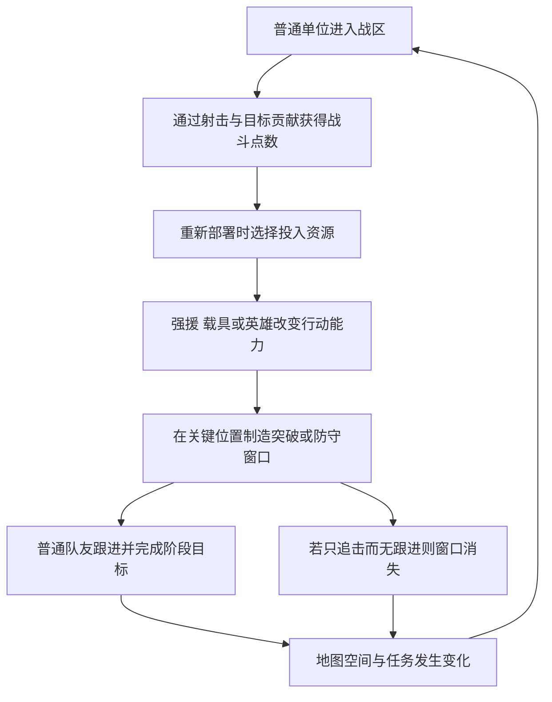

<!-- Imported from 游戏拆解分析/37款游戏拆解案/32_星球大战前线2.md; original analysis and evidence boundaries preserved. -->

# 星球大战：前线 2：让普通士兵也能参与一场星战大片

> **分析范围**：EA / DICE 于 2017 年发行的《Star Wars Battlefront II》，主体为银河突击 Galactic Assault。依据 2017—2019 年官方介绍讨论阶段目标、战斗点数、普通兵种与英雄体验；不混入 2005 年同名作品、霸权模式、独立星际战机模式或英雄对决规则。不分析 2026 年服务器生态与现行强度。
>
> **剧透提示**：涉及纳布希德城和第二死星的多人地图目标，不涉及单人战役结局。战斗案例为规则构造情境，不是实际对局复盘，也不代表当前地图人数与匹配情况。

**核心论点：前线 2 的独特吸引力，是把星战的场景、声音和角色身份变成玩家能够参与的行动。银河突击通过阶段目标组织集体推进，再以战斗点数和不同单位，让玩家在普通士兵、强援与英雄之间经历权力和责任的变化。**

## 1. 电影感来自“我在其中做事”，不只是画面像电影

熟悉的建筑、装甲、光剑和爆能枪声，可以迅速唤起星战联想，但联想本身还不构成一场好战斗。玩家需要知道自己站在哪里、正在阻止什么，以及眼前巨大的战争场面如何与自己的动作发生联系。否则再壮观的背景，也可能只是一段跑图时经过的布景。

银河突击把多人战斗组织成有阶段变化的推进过程。玩家可能先在街道争夺移动目标相关的位置，随后进入建筑，最终在集中区域决战。地形尺度和行动目标一起变化，让一局比赛拥有类似战役的起伏，而不是在同一个据点无限交换击杀。

官方首发地图介绍将其描述为双方各二十人的多阶段模式，并明确不同地图具有不同目标。[EA 银河突击地图介绍](https://www.ea.com/games/starwars/battlefront/news/galactic-assault-maps)这一规则提供了大场面的组织基础；它并不保证每个玩家都能清楚理解战局，仍需要地图、提示和个人贡献反馈共同支持。

## 2. 普通士兵先建立尺度，英雄才显得强大

玩家以普通单位参与战场时，需要依赖掩体、距离、队友与目标位置。即使不是队伍中最强的射手，也可能通过占住入口、保护正在执行目标的队友、持续压制一个方向而产生作用。大量普通单位构成了战线，也建立了这场战争的正常危险尺度。

英雄在此基础上获得特殊意义。光剑、原力和更鲜明的移动方式，不只是另一套伤害效果，而是改变玩家面对枪线时的态度。之前需要避开的地方，现在可能成为可以主动施压的方向；之前只能争取掩护，现在可以尝试带领队伍穿过阻碍。

这种强弱差异本来就是题材幻想的一部分，却也意味着普通士兵不能只充当英雄的消耗品。地图需要让普通单位仍能完成目标、集火、绕路或支持队友。英雄体验要成立，既要让操作者感觉身份变化，也要让面对英雄的人仍然拥有可理解的行动。

## 3. 战斗点数把贡献转化为下一次角色选择

银河突击等模式中的战斗贡献可以获得战斗点数，玩家可以在重新部署时投入点数选择载具、强援或英雄，具体可用项还取决于模式和地图。[EA 战斗点数与强援说明](https://www.ea.com/games/starwars/battlefront/news/battle-points-and-reinforcements)支持这一基本关系。它不是让当前士兵在地图中直接升级成英雄，也不等同于局外解锁货币。

设计意义在于，普通兵阶段的行动会为之后的体验积累机会。玩家即使暂时没有占据最强位置，也能通过持续参与接近一种新的角色身份。一次死亡因此不仅是惩罚，还可能成为重新审视战场、投入资源和换用单位的节点。

但积累也会带来机会成本。尽早选择强援可以影响当前目标，继续等待可能获得更想使用的英雄。若只为了保留英雄机会而减少对目标的投入，个人愿望便可能与团队需求冲突。系统需要让玩家理解，强大单位的价值来自在需要的时刻进入战场，而不是仅仅出现在选择菜单里。

| 单位层次 | 玩家体验重心 | 对战局的典型作用 | 需要防止的问题 |
|---|---|---|---|
| 普通士兵 | 从局部位置参与共同目标 | 稳定占位、火力和目标交互 | 成为没有有效选择的陪衬 |
| 特殊强援 | 用更鲜明工具处理某类局面 | 改变突破、机动或火力条件 | 没有用途，只是英雄前的过渡 |
| 英雄 | 明显的角色身份与主动权 | 制造关键接触与推进窗口 | 为保命或刷击杀而远离目标 |

## 4. 场景一：希德城街道上，普通克隆兵怎样影响巨大战争机器

纳布希德城的银河突击包含街道阶段：分离主义方护送 MTT 前进，共和国方需要争夺并使用离子干扰武器来阻止它；随后战斗会转向宫殿内部目标。基础地图流程见 [EA 希德城官方导览](https://www.ea.com/games/starwars/battlefront/news/tips-and-tricks-exploring-naboo-theed-in-battlefront-ii)。本文不把宫殿机库等其他模式空间混入这条流程。

设想一名克隆兵试图取得离子武器，队友正在街口与机器人交火。若所有人只追逐最近敌人，目标工具附近可能始终缺少保护；即使拿到工具，使用者也可能暴露在多条枪线之下。此时个人射击的意义来自它能否为目标行动争取时间。

一个队友占住侧巷，另一个人压制主要来敌方向，持有工具者才有机会完成关键动作。三人的任务不同，却能被同一辆正在前进的 MTT 解释。庞大载具因此成为全队共同理解的压力来源：它的位置告诉玩家时间正在流逝，目标不只是 UI 上的一行文字。

机器人一方同样需要理解这层关系。击杀远处普通士兵不一定比阻止目标武器使用更重要，护送也不意味着所有人紧贴载具。控制通向目标的路线，才会让巨大战争机器获得持续推进条件。地图把电影里的攻防画面转化为普通玩家可以参与的任务分工。

## 5. 从街道到宫殿，阶段变化怎样重新定义好位置

街道阶段强调较长的视线、多个接近方向和移动目标；进入宫殿后，入口、走廊、柱体与较集中的目标开始支配行动。玩家不能把上一阶段的站位逻辑原样带入下一阶段，同一兵种或英雄的优势也会随空间改变。

这种变化让一张地图具有内部节奏。开阔区域允许较远距离观察与转移，室内区域强化接触密度和突破时机。玩家不仅感到场景更换，也需要重新判断自己该看哪个入口、队友需要怎样的火力、当前单位是否适合继续使用。

不过，集中目标也容易形成拥堵。双方在窄口反复投入范围攻击与英雄能力，可能让个体很难辨认自己为何死亡。多入口和绕侧路线可以提供替代，但路线如果过长或收益不明确，玩家仍会涌向最显眼的正面。设计不能只在平面图上证明存在侧路，还要让玩家在战斗压力下意识到它值得使用。

## 6. 场景二：第二死星走廊里，维达怎样创造一次推进

第二死星的狭窄通路把正面交火集中起来。EA 的官方地图导览特别提到维达的承压、格挡与光剑投掷，以及重装兵在走廊战中的用途。[第二死星官方导览](https://www.ea.com/games/starwars/battlefront/news/tips-and-tricks-exploring-death-star-ii-in-battlefront-ii)这些是本文采用的基础能力，不涉及具体减伤或耐力数值。

设想维达与几名帝国士兵准备穿过被反抗军控制的走廊。若维达只冲进去追逐一个目标，后方士兵可能来不及跟进，他也会暴露在侧面和远处火力中。英雄很强，但他的强度没有自动转化为队伍推进。

若维达先让敌人无法安稳维持原有枪线，士兵便能在新的窗口里进入掩体、占住入口或处理目标。维达承担的是改变接触条件的角色，队友负责把短暂变化变成持续占位。英雄一旦离开，队伍是否还能维持位置，才是这次突破是否真正有价值的判断。

反抗军的应对也不应被简化为“看见维达就死”。提前拉开距离、从不同角度形成火力、避免全员挤在同一方向，都能改变交火条件。具体能否成功仍取决于版本、配置和操作，但分析重点是空间与团队行动必须保留作用，否则英雄身份带来的快感会由另一批玩家单方面承担成本。

## 7. 英雄个性需要改变问题，而不只是改变光剑颜色

以维达与蕾伊对照，维达在上述走廊情境里更容易体现正面压力与承压身份；蕾伊的洞察则能够提供附近敌人的位置信息，帮助队伍理解复杂空间。EA 的[希德城导览](https://www.ea.com/games/starwars/battlefront/news/tips-and-tricks-exploring-naboo-theed-in-battlefront-ii)明确提到了洞察的信息用途。这里比较的是代表性功能，不是对两人完整技能或强度的排名。

两类能力可以支持不同的英雄感。一个角色让玩家愿意主动面对危险，另一个角色让玩家更有把握选择接触方向。电影角色的辨识度应通过这种行动倾向被反复确认，而不只存在于登场动画和配音。

英雄设计还需要与兵种职责相容。英雄提供的优势越全面，普通单位越可能只剩跟随；英雄过度依赖队友，又可能无法兑现题材承诺。合适的关系是英雄改变局部问题的难度，普通单位仍负责维持战线和完成大量目标行动。这样队伍能感到英雄来了有帮助，又不至于只有拿到英雄的人才算真正参与游戏。

<figure>
  
  <figcaption>图 1 · 普通士兵、英雄与战场目标的协作关系。用于概括本文分析，不代表游戏内部状态机。</figcaption>
</figure>

查看可编辑图源

## 8. 声音与视觉奇观，必须帮助玩家理解战争

爆能枪、载具与光剑的声音具有题材辨识度，也可以提示威胁类型。远处出现重型机械声与近处响起光剑声，会让玩家对即将发生的接触形成不同预期。视觉上，轮廓、弹道方向和建筑尺度共同说明战场中的力量差异。

表现设计的难题，是同时服务世界可信度与战斗可读性。大量激光、爆炸、烟尘与人物声音叠加，可以形成宏大战场，却也可能遮住真正决定下一步的信息。玩家在欣赏奇观时仍需要知道攻击来自哪里、目标在哪、哪条路可以撤退。

因此，电影感不宜被理解成越混乱越真实。对玩家有意义的规模感，是意识到周围有更大战争，同时能理解自己这一小段行动的作用。局部反馈清楚，大场面才不会把个人能动性淹没。对普通士兵尤其如此，因为他没有英雄级的容错来补偿信息缺失。

## 9. 设计代价与可迁移启示

把强大角色作为局内资源选择，会产生潜在的正反馈：熟练玩家更容易积累资源，又更能利用强单位，优势可能进一步扩大。英雄名额与可选状态也可能让玩家过度关注菜单机会，而非当前战局。这里只指出结构风险，不声称所有版本都以相同程度发生。

多阶段推进则有另一种代价。阶段目标能组织大场面，也会限制自由；当某个窄口长时间无法通过，宏大战役可能变成重复冲门。设计师需要让每个阶段的失败原因足够清楚，让普通单位拥有替代路线或可完成的小任务，而不是只等待己方英雄解决问题。

可迁移的原则，是先让基本角色拥有完整、可理解的参与感，再让特殊角色带来身份变化。阶段目标应把个人行为与集体结果连接起来，资源兑换应让玩家思考“现在需要什么”，声音和视觉应同时提供题材魅力与行动信息。前线 2 值得研究的，正是如何让一场熟悉的大电影被拆成很多人各自能够完成、又彼此相关的小行动。

## 资料与证据边界

- [EA：银河突击首发地图介绍](https://www.ea.com/games/starwars/battlefront/news/galactic-assault-maps)：支持多阶段目标及双方各二十人的历史模式框架。
- [EA：战斗点数与强援](https://www.ea.com/games/starwars/battlefront/news/battle-points-and-reinforcements)：支持局内贡献、点数投入与重新部署选择的关系。
- [EA：希德城官方导览](https://www.ea.com/games/starwars/battlefront/news/tips-and-tricks-exploring-naboo-theed-in-battlefront-ii)：支持 MTT、离子武器、宫殿阶段与蕾伊洞察的基础用途；不把其他模式的机库地图并入银河突击。
- [EA：第二死星官方导览](https://www.ea.com/games/starwars/battlefront/news/tips-and-tricks-exploring-death-star-ii-in-battlefront-ii)：支持走廊空间及维达、重装兵的代表性用途。

本文的参与感、英雄权力与公平取舍属于原创分析，不包含实际胜率、玩家留存、模式活跃度或商业化效果证明。

---

[返回游戏拆解](/blog/game-breakdown/)
