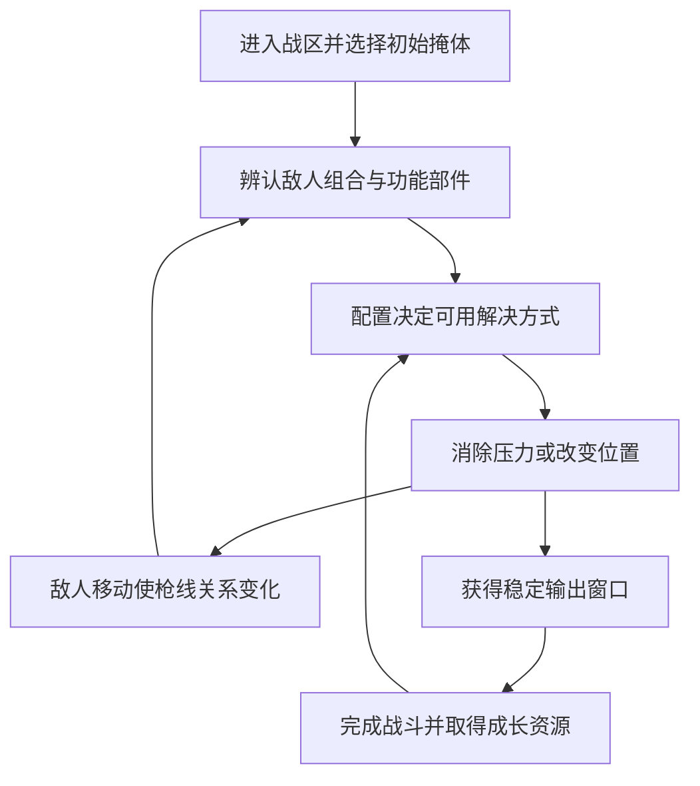

<!-- Imported from 游戏拆解分析/37款游戏拆解案/15_全境封锁2.md; original analysis and evidence boundaries preserved. -->

# 全境封锁 2：怎样让一块安全掩体逐渐变得不安全

<figure class="official-game-screenshot">
  
  <figcaption>官方商店截图 · 带游戏 HUD 的多人交火画面，能同时看到掩体、敌人、队友与空中无人机。来源：<a href="https://store.steampowered.com/app/2221490/">Steam 官方商店</a>。© 2019 Ubisoft Entertainment. All Rights Reserved. 画面版本可能与本文限定范围不同，仅作视觉参考，不作为文中案例的实录。</figcaption>
</figure>

> **分析范围**：2019 年本体 PVE 的基础掩体战、敌人组合、弱点与装备技能关系，以当年开发者访谈为依据。排除纽约军阀后续成长体系、当下赛季套装、突袭专属机制与 2026 年平衡。单人与合作的压力差异分别讨论，不直接混用。
>
> **剧透提示**：涉及华盛顿环境、敌方阵营与普通战斗构成，不包含剧情结局。案例为依据公开规则构造的战斗房间，不冒充具体任务的固定刷怪配置或实测记录。

**核心论点：全境封锁 2 的战斗亮点，是把装备构筑放进不断变化的掩体关系里。敌人不只要求玩家持续造成伤害，还会让玩家重新安排注意力、射击对象与停留位置；好的配置则让玩家以自己的方式解决这些变化。**

## 1. 枪战的真正单位，不是一条血条

玩家进入一个房间，选择入口旁掩体，开始射击前方敌人。几秒之后，侧面有人推进，远处投掷物落到附近，原本只能看见半个身体的目标换了位置。输入仍然主要是移动、瞄准和开火，但问题已经从“怎样打中他”变成“现在最需要处理谁，继续待在这里会发生什么”。

这就是拆解掩体战时应当抓住的变化。掩体并不是永久安全点，而是一个对特定威胁方向暂时有效的位置。敌人的移动、射程和攻击方式改变后，同一块掩体的价值也会改变。战斗体验由这组关系推动，而不是仅由地图摆了多少个可以蹲下的物件决定。

装备成长为玩家提供解决关系的方法。高爆发可以尽早移除一个压力源，恢复配置可以容忍更长的拉扯，自动攻击工具可以在玩家转移时继续维持部分威胁。配置因而具有行动风格，而不只是最终伤害数字。

## 2. 敌人组合怎样让玩家改变原计划

一个普通射手主要迫使玩家控制露头时机；接近型敌人迫使玩家检查距离；远程压制或投掷攻击则可能迫使玩家放弃当前位置。单个敌人未必复杂，但多种压力同时存在时，玩家必须安排处理顺序。

例如，持续攻击远处高威胁目标看似合理，却可能放任近处敌人进入侧翼；先处理冲到身边的敌人，又可能让远处压力持续积累。此时没有一种目标优先级永远正确，关键在于当前站位、血量、队友分布和技能是否可用。

Massive 的 AI 团队在 [2019 年开发访谈](https://news.ubisoft.com/en-us/article/5wu3eterDz21wNKiAcDJlJ/the-division-2-making-enemies-tougher-and-friendlies-smarter)中明确谈到增加敌人推进、撤退、侧翼和空间使用的差异。本文只把这些公开行为当作分析依据，不据此声称掌握内部仇恨公式、决策树或动态难度算法。

敌人设计是否成功，可以从玩家计划有没有被有意义地修改来观察。不断逼人移动却不给可用落点，只会形成混乱；让人永远停在入口逐一射击，也无法充分兑现掩体地图的潜力。理想压力应迫使选择，同时保留几条代价不同的解决路线。

## 3. 弱点让精确射击改变敌人的行为能力

如果弱点只等于更高伤害区域，玩家面对的仍然主要是一条总血量。全境封锁 2 部分敌人的外露装备与可破坏部件，会把射击位置和敌人能力联系起来：准确命中某个部位，可能削弱其特定威胁。开发者也公开说明了弱点与可破坏护甲的设计方向。[敌人设计访谈](https://news.ubisoft.com/en-us/article/5wu3eterDz21wNKiAcDJlJ/the-division-2-making-enemies-tougher-and-friendlies-smarter)

从分析角度看，这给“先打谁”之外增加了“先打他哪里”。一个威胁不一定要完全击杀才能暂时被处理；如果先破坏某种攻击工具，队友可能就能安全移动。精准射击由此拥有团队价值，也让装备和敌人外观成为可读的战斗信息。

可破坏护甲还承担解释作用。重装敌人承受大量射击时，装甲部位的反馈让玩家看到防护正在被处理，避免所有子弹都像无差别消失。这里并不意味着外观解释能消除所有数值问题：当装备差距过大，打破部件仍可能耗时过长，玩家也可能感到操作效果不足。

| 压力来源 | 玩家面对的问题 | 一种可能解法 | 解法的代价 |
|---|---|---|---|
| 敌人近距离推进 | 现有掩体将失去距离优势 | 集火近敌或转移 | 暂时放弃远处输出 |
| 投掷与范围威胁 | 留在原地会持续受压 | 提前换掩体 | 转移中可能暴露侧面 |
| 侧翼枪线 | 正面掩体不再足够 | 改变朝向、退到更深位置 | 丢失已获得的进攻角度 |
| 可破坏威胁部件 | 敌人仍不断制造问题 | 精确攻击功能部位 | 需要更好的角度与瞄准 |
| 重装防护 | 普通射击难以快速结束威胁 | 集中处理同一防护区域 | 注意力容易被单个目标占用 |

## 4. 场景一：一间展厅怎样让入口掩体失效

设想玩家从展厅入口进入，前方是中距离射手，左侧有接近型敌人，较远位置还有能迫使玩家离开掩体的攻击来源。这不是某一任务的固定配置，而是一种用于解释压力组合的局面。

玩家起初选择入口掩体，因为它能遮挡正面火力，也方便在危险时退回。若注意力全部放在远端目标，左侧敌人会逐渐缩短距离。等侧面已经形成枪线，玩家再向原本预想的下一块掩体移动，可能发现那条路线也被覆盖。问题不是原先的掩体突然失效，而是玩家没有更新它有效的条件。

一种处理方式是先压住接近者，让它无法顺利完成侧翼，再利用空隙观察远端威胁；另一种是及早转移到能同时看见两个方向的位置，用更差的正面输出角度换取更清晰的空间关系。如果当前配置有合适技能，还可以先让工具承担部分压制，再移动身体。

不同解法都不保证无伤，但分别体现不同构筑价值。爆发配置追求尽快删除一条压力线，持续输出配置需要维持接触，技能配置可以在玩家移动时延续部分攻击。敌人组合由此成为检验配置行动逻辑的场所，而不是单纯检验面板是否达标。

## 5. 场景二：合作战斗中，为什么四个人不该只盯同一个重装目标

设想四人队伍在开放街区面对重装敌人。集中火力可以更快处理其防护，因此全员持续射击看似高效；但若另外的敌人开始占据侧面，团队可能在击倒重装者之前就被迫散开。四个人同时输出，并不代表四个人都在解决当前最关键的问题。

更有效的分工可能是两人处理主要目标，一人控制侧路，一人保留观察与救援能力。负责侧路的人未必获得最多伤害，却让另外两人的输出得以持续。重装目标也因此不是单个耐久物体，而是能够吸走注意力、配合其他敌人形成压力的结构中心。

如果一名队友倒下，救援又会重新分配行动。直接冲过去可能让第二人失去掩护；先限制相关枪线，再组织救援，才能把保护工具的效果转化为恢复人数。技能的团队价值取决于它插入哪一个过程，而不是队伍菜单里是否带了所谓标准配置。

反例也应保留：当队伍伤害足以快速清除全部威胁，复杂分工可能并无必要。这个局面揭示了装备与难度的边界。若数值让压力在产生之前就消失，敌人行为再丰富也不会被玩家感知；若敌人过度耐打，又会让所有可用窗口显得过于短暂。

## 6. 构筑应当改变行为，而不只是改变结算速度

官方玩法介绍将装备与技能配置作为角色定制的重要部分，并展示了无人机等战斗工具。[育碧玩法说明](https://www.ubisoft.com/en-gb/game/the-division/the-division-2/details)支持这种基础定位；本文不据此给出任何当前版本配装推荐。

真正有辨识度的构筑，应让玩家对同一局面采取不同但合理的行动。偏重持续枪械输出的玩家关心稳定枪线；偏重技能的玩家还要考虑工具位置、作用对象和自己能否维持安全；偏重生存的玩家可能更愿意承担某次需要暴露的转移。行为差别越清楚，成长就越容易被感知为“我的打法正在成形”。

反过来，如果所有配置最终都只站在同一入口、瞄准同一目标，差异主要表现为结束得更快或更慢，构筑自由度就没有充分转化为体验自由度。设计师应当检查新装备是否引入新的取舍：多输出是否减少应急能力，远距离优势是否牺牲近处处理，技能覆盖是否要求额外位置维护。

这也解释了为何敌人设计与装备设计需要一起评估。敌人没有相应问题，某种工具就没有用途；某种工具能无代价解决所有问题，敌人差异又会被抹平。好配置不是没有短板，而是玩家知道自己的长处在哪些局面能够兑现。

## 7. 华盛顿的据点与街道，把战斗连接到秩序恢复

与一代雪中纽约的紧张不同，二代华盛顿有更多围绕社区、据点和公开活动的行动理由。玩家从任务内的封闭房间走到街道时，战斗被放进一个更大尺度的控制关系：某处有人争夺资源，某段道路存在敌人，一处据点与附近活动发生联系。

这种设计让战斗不只承担掉落装备的功能，也帮助玩家理解自己正在支持什么。帮助友方、重新进入某个地点、看见周围行动继续发生，会让重复战斗获得空间上下文。但“世界里有人移动”本身并不能保证世界生动，行动必须具有可辨认的起点、目标和结果。

对战斗策划而言，开放世界活动的价值不在数量，而在于它能否以不同进入方向和地形关系重新组织熟悉的敌人。玩家从正门进入或从侧巷接近，应该有机会面对不同的初始条件；否则所谓开放世界最终仍然是一串外观不同的固定刷怪房间。

<figure>
  
  <figcaption>图 1 · 敌人功能、掩体压力与玩家换位的关系。用于概括本文分析，不代表游戏内部状态机。</figcaption>
</figure>

查看可编辑图源

## 8. 压力必须能被读懂，才会成为战术

玩家被侧翼击倒时，若此前看见了敌人移动、听见了方向提示，也能辨认自己忽略的路线，失败就具有学习价值。若敌人突然出现在缺乏提示的位置，或危险反馈被大量效果遮住，玩家更可能把结果理解成不可预测的惩罚。

因此，敌人的危险程度与可读性不能分开。接近型敌人需要让玩家感知距离变化，远程攻击需要足够清楚的准备与落点信息，功能弱点需要在外形和命中反馈中建立联系。提示过弱会制造不公平感，提示过强则可能让处理顺序变成机械答案。

合作人数也会改变这层关系。多个玩家分散站位能看见更多方向，但同时带来更多枪声和特效。某段单人可读的攻击，在多人同时使用工具时可能被淹没。验证战斗时应分别观察不同人数下的信息负担，不能只证明敌人在空白场地里能被看懂。

## 9. 设计代价与迁移启示

全境封锁 2 的结构必须持续协调三件事：射击命中要有意义，装备成长要有意义，敌人压力也要有意义。任何一方过强都会压缩其他两方。高数值可能使战术失去必要性，过强压力可能迫使所有配置选择相同的保命方式，过分追求写实脆弱又可能削弱角色成长的可感知程度。

可迁移的做法，是先定义一块掩体在什么条件下安全，再用敌人组合逐步改变这些条件。为每一种变化提供可读信号，同时允许玩家通过击杀、破坏功能部件、技能和转移中的至少一种方式应对。随后检查不同构筑是否真的选择不同解法，而非只在同一解法上快慢不同。

这篇拆解最终关心的，是玩家怎样从“找到掩体开始输出”走向“理解当前压力，再安排下一段行动”。当装备选择、精确射击与空间判断能共同参与这段过程，刷装备的成长和掩体战的临场感才会互相支持。

## 资料与证据边界

- [育碧：Making Enemies Tougher and Friendlies Smarter，2019](https://news.ubisoft.com/en-us/article/5wu3eterDz21wNKiAcDJlJ/the-division-2-making-enemies-tougher-and-friendlies-smarter)：支持敌人行为差异、弱点与可破坏护甲的公开设计说明。本文没有据此重建内部 AI 实现。
- [育碧：The Division 2 Gameplay](https://www.ubisoft.com/en-gb/game/the-division/the-division-2/details)：支持射击 RPG、合作、装备与技能定制的基本范围；不作为现行赛季规则表。

场景与因果论证是原创分析，未进行难度对照实测，不包含击杀时间、精确数值或构筑胜率结论。

---

[返回游戏拆解](/blog/game-breakdown/)
