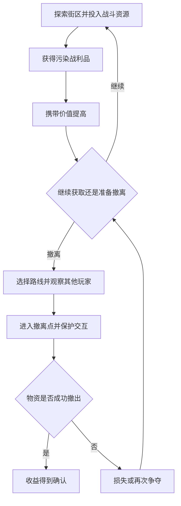

<!-- Imported from 游戏拆解分析/37款游戏拆解案/14_全境封锁1.md; original analysis and evidence boundaries preserved. -->

# 全境封锁 1：为什么拿到装备以后，紧张才真正开始

> **分析范围**：2016 年本体的掩体射击与暗区，撤离劫持以 2016 年 5 月 Conflict 更新后的规则为依据；单独讨论同年推出的 Survival 生存 DLC，不把 DLC 的寒冷、感染与开局重置机制当成本体通则。后续叛变规则、套装平衡与当下服务器生态不在范围内。
>
> **剧透提示**：包含纽约灾后环境、暗区撤离及生存模式流程，不涉及主要剧情结局。两个案例是规则推演，不是实测记录；不会据此推断真实玩家的信任倾向或留存原因。

**核心论点：全境封锁 1 的独特体验，来自城市氛围、成长价值与不稳定的人际关系相互加压。枪战让玩家付出代价获得物资，暗区却延迟确认物资归属，于是“已经得到的东西可能失去”成为下一段战斗的动机。**

## 1. 雪中的纽约为何不只是好看的背景

积雪、废弃车辆、临时隔离设施与仍可辨认的日常空间，组成一种秩序刚刚中断的环境。玩家经过的不是抽象竞技场，而是仍然残留生活痕迹的街道。熟悉的城市物件一方面解释灾难，另一方面提供掩体、遮挡和路线，环境叙事与战斗空间因而有机会指向同一个感受。

这里最有价值的不是“写实就更沉浸”的简单结论。写实细节只有参与玩家行动，才会被反复注意：汽车让玩家躲避街口火力，围栏限制撤退，狭窄入口使队伍难以同时展开。玩家逐渐把街区记成一组既有情绪色彩、又有战斗用途的地点。

雪景也不能自动证明所有人更喜欢一代。它提供的是一种可以分析的体验条件：相对冷寂的城市与突然爆发的战斗形成对比，安全区域与危险街头在节奏上互相衬托。真正的因果问题是环境如何改变观察、移动和期待，而不是用一个“氛围感”覆盖全部设计。

## 2. 掩体射击把安全变成一种暂时状态

掩体能降低正面暴露，却不能替玩家保证全局安全。向一个方向探头瞄准时，侧面道路和接近中的敌人仍可能改变局面。玩家需要在持续输出、恢复状态与转移之间分配时间。稳定站位带来命中机会，停留太久又可能让敌人获得更好的接触条件。

角色成长使这些判断有了持续背景。装备和技能会改变能承受多少压力、如何支持队友以及适合怎样的攻击距离，但数值优势必须通过具体操作兑现。若玩家只看伤害提升，就可能忽略新配置是否要求更长的暴露时间，或者是否丢掉了原本用于脱困的工具。

这形成射击 RPG 的基本张力：玩家希望更强的装备能带来可感知收益，同时又希望瞄准、站位和反应仍有意义。若数值差距吞没战术判断，真实枪械的外观可能让长时间射击显得难以理解；若操作完全压过成长，反复寻找装备的动机又会变薄。暗区进一步把这种张力带入人与人的对抗。

## 3. 暗区的关键，是延迟确认战利品归属

普通奖励循环常在击败敌人和拾取物品时完成一次小闭环。暗区中的污染战利品需要通过撤离处理，拾取只意味着暂时携带。玩家已经投入战斗，却还没有获得能够安心使用的结果，接下来的路程因而带着前面投入的重量。

2016 年 Conflict 更新允许玩家切断撤离绳索，使已挂上的战利品落地，并将劫持者标记为叛变；相关基础规则见[官方更新介绍](https://news.ubisoft.com/en-us/article/7H0k8pJFBRAPDXIZXeb6p4/the-division-conflict-update-brings-new-incursion-highvalue-targets-and-extraction-hijacks)及[游戏总监问答](https://news.ubisoft.com/en-us/article/3Zkm1NDfcBKjqQWHjsV58L/the-division-conflict-q-and-a-with-game-director-petter-mannerfelt)。这里撤出的是污染物资，人物并不需要随直升机离开地图。

这一差别非常重要。玩家可以留下继续行动，但随身价值已经改变了风险偏好。空手时值得冒险的近路，背着想要的装备时可能变得不值得；同一个街角、同一批敌人，会因玩家携带的东西不同而获得不同意义。地图不需要每次重建，也能让行动理由发生变化。

## 4. 场景一：战利品到手后，下一场战斗已经开始

设想两名队友完成一处敌人据点，其中一人获得了想要的污染装备。两人准备前往撤离点，却发现附近另一支小队也在向同一方向移动。此时新问题不是那支队伍有多少血，而是双方的目标、能力和意图都不完全透明。

最直接的选择是立刻前往撤离区，但这可能让对方知道自己急于处理物资；绕路可以减少接触，却会延长暴露在暗区的时间；继续打一处据点能增加收益，也会增加状态消耗。每条路线都在不同维度付出代价，没有一种选择可以同时保证安全、效率和最大回报。

如果进入交火，原本普通的掩体决策也会变化。击倒对方后继续追击，也许能解除威胁，但可能让携带物资的队友失去保护；掩护队友撤出则会放弃一次击杀机会。装备奖励由此进入了战斗过程，而不只是战斗结束后的菜单数值。

这个案例不要求玩家真的失去装备才成立。只要规则让失去成为可理解的可能，玩家在到达撤离点前就需要认真选择。不过，若损失过于频繁或难以判断，紧张也可能变成疲劳，尤其对资源有限或独自行动的玩家如此。

## 5. 场景二：撤离区里的陌生人为什么比普通敌人更难判断

撤离区把多个玩家的目标集中到一个有限地点。设想你的队伍准备挂包，另一名玩家始终停在外围，没有立刻开火。对方可能只是等待自己的撤离时机，也可能在观察你们何时分散。敌我关系没有像常规阵营战那样提前全部说明，玩家必须从位置和动作里推测意图。

一个队友看守主要入口，一个人留意绳索，携带物资者选择挂包时机，这种分工同时服务战斗与信任管理。若所有人一起低头完成交互，就可能在最想结束风险的瞬间失去观察；若始终不敢靠近，撤离机会又会过去。系统通过目标交互，让保护别人和完成自己的事情发生真实冲突。

劫持机制进一步把“看起来已经成功”变成需要继续防守的阶段。它可以制造强烈转折，但同样可能让已经投入很多时间的玩家感到结果被突然夺走。清楚呈现叛变、劫持进程与可干预时机因此很重要：玩家需要知道自己正在承受何种风险，才能把失败理解成一次对抗，而不是规则突然改口。

陌生人最终没有攻击，也是一种有效结果。系统没有强迫每次相遇都变成背叛；真正维持悬念的是合作和敌对都存在可能。若某个服务器环境让所有接触都可以被预测为恶意，社会判断空间反而会缩小为普通的见人开枪。

## 6. 数值、技能与团队分工怎样影响暗区判断

在有装备成长的玩家对抗中，双方看到的外表未必足以判断真实战斗能力。这个不透明度会增加紧张，也会削弱“我本来可以做得更好”的清晰感。玩家可能正确判断位置，却因为装备与配置差距无法完成预期击杀；也可能误把数值优势带来的胜利全部归因为技术。

小队技能分工可以把一部分不确定性转换为可管理风险。侦察能力帮助判断附近威胁，恢复手段让持续交火成为可能，控制或火力工具帮助队友移动。重要的不是队伍拥有多少技能名称，而是有没有人在某个关键时刻仍保留所需工具。

| 局面 | 看似合理的个人行为 | 对团队可能造成的后果 | 更值得检查的关系 |
|---|---|---|---|
| 遭遇陌生小队 | 所有人同时瞄准一人 | 侧路失去观察 | 集火与警戒怎样分配 |
| 队友需要恢复 | 继续追击低血目标 | 携带物资者失去保护 | 击杀收益是否高于保住物资 |
| 准备挂包 | 全员同时交互 | 无人应对突然接触 | 交互与掩护能否错开 |
| 资源不足 | 继续提高随身收益 | 下一次遭遇缺乏余力 | 何时结束这一轮风险投入 |

## 7. 生存 DLC 把同一种紧张推到了资源层

Survival 是独立模式，不能用来描述本体日常流程。官方说明提到，玩家从有限装备起步，需要处理感染、寒冷和物资问题，最终完成撤离目标。[官方术语说明](https://news.ubisoft.com/en-us/article/34a1ZEQfIJDfA9564QERIU/the-division-a-glossary-of-terms-every-agent-should-know)与[生存 DLC 介绍](https://www.ubisoft.com/en-au/game/the-division/news-updates/6bPtlpsk2d0EERn9IDC6XW/the-division-survival-free-dlc-week)支持这些基础条件。

它的设计意义在于重新安排资源的价值次序。常规成长中可能不值得关注的一件衣物，在低温下可以改变可行动范围；绕进建筑不只是寻找更强武器，还可能是为了争取继续探索的条件。环境因此从情绪背景变成直接影响路线的约束。

与暗区相同，生存模式要求玩家决定何时停止增加收益，转向保住已经投入的过程；不同之处在于，压力不只来自其他玩家，也来自持续恶化的自身状态。PVE 与 PVP 选项会改变威胁结构，不能把一种模式的遭遇直接推广到另一种。

<figure>
  
  <figcaption>图 1 · 掩体战斗、战利品与暗区撤离的风险循环。用于概括本文分析，不代表游戏内部状态机。</figcaption>
</figure>

查看可编辑图源

## 8. 为什么一代与二代应该拆成不同文章

一代适合追问“世界、物资与陌生人怎样共同制造不安全感”。二代更适合深入分析敌人组合、弱点与空间压力怎样推动掩体战变化。两作都存在射击成长循环，但一篇文章应优先选择最能解释该作具体体验的关系。

这不意味着一代没有战术、二代没有氛围，而是避免把系列共有系统换个名字再次罗列。尤其是暗区规模、规则与装备体系经历多次调整，不能把二代的某个规则回填进一代，也不能用今天的匹配人口说明当年设计的效果。

两作对照真正有价值的地方，是观察相似的基础动作怎样被不同环境重新解释。同样从一块掩体移动到另一块，一次可能主要为了应对敌人侧翼，另一次则可能为了不让陌生队伍看见自己前往撤离点。动作相似，玩家面对的问题不同。

## 9. 设计代价与迁移启示

延迟确认奖励能放大紧张，也会放大失败成本。如果玩家不能估算风险、没有合理避让路线，或装备差距让对抗接近单方面碾压，紧张就不再由选择产生，而主要来自等待不可控损失。若回报又过度集中在高风险区域，不喜欢该体验的玩家会感到成长被强迫绑定。

这里还需要区分意图不透明与规则不透明。玩家可以不知道陌生人会不会发动攻击，但应该知道哪些物资仍有风险、什么行为会改变敌我状态，以及撤离何时真正完成。前者为观察和信任判断提供空间，后者若长期含糊，就会让玩家连自己正在接受什么代价都无法确定。好的紧张应来自对方接下来会怎样做，而不是系统会不会突然用另一套规则结算。

可以迁移的是“让获得、携带和确认收益成为不同阶段”，但每一阶段必须让玩家理解自己还能做什么。撤离前能换路线，交互时能分工，遭遇后能选择放弃部分收益，才会形成有层次的风险管理。只增加掉落损失，不会自动得到值得回忆的故事。

全境封锁 1 最值得战斗策划学习的，是如何让枪战的意义超出当场击杀：同一场交火可以是争夺物资、保护同伴、掩护撤离，也可以是对陌生人意图的一次试探。世界和成长不是战斗外面的包装，而是决定玩家为什么开火、什么时候停火的条件。

## 资料与证据边界

- [Conflict 更新官方介绍](https://news.ubisoft.com/en-us/article/7H0k8pJFBRAPDXIZXeb6p4/the-division-conflict-update-brings-new-incursion-highvalue-targets-and-extraction-hijacks)：支持 2016 年加入撤离劫持的历史事实。
- [游戏总监 Petter Mannerfelt 问答](https://news.ubisoft.com/en-us/article/3Zkm1NDfcBKjqQWHjsV58L/the-division-conflict-q-and-a-with-game-director-petter-mannerfelt)：支持切绳、战利品落地、劫持触发叛变及污染物资需要撤离。
- [官方术语说明](https://news.ubisoft.com/en-us/article/34a1ZEQfIJDfA9564QERIU/the-division-a-glossary-of-terms-every-agent-should-know)、[生存 DLC 介绍](https://www.ubisoft.com/en-au/game/the-division/news-updates/6bPtlpsk2d0EERn9IDC6XW/the-division-survival-free-dlc-week)：支持生存模式的基本约束，不代表本体规则。

社会心理与风险偏好的描述是对规则可能作用的分析，不是对玩家群体的实证结论；本文不声称进行了实际撤离测试。

---

[返回游戏拆解](/blog/game-breakdown/)
