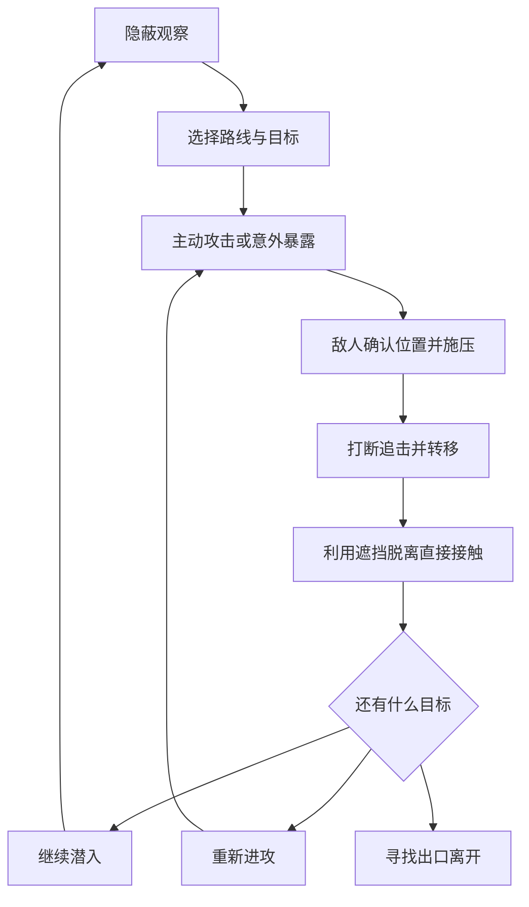

<!-- Imported from 游戏拆解分析/37款游戏拆解案/23_最后生还者2.md; original analysis and evidence boundaries preserved. -->

# 《最后生还者 2》：当敌人也在寻找你，战斗怎样制造压力与立场

> 剧透等级：完整剧情。涉及艾莉与艾比双线、希尔克列斯特、医院地下、剧院及结尾。本文以 2020 年本体单人战役为对象，不将 Remastered 的 No Return 模式混入主线节奏分析。本文未进行本轮实机或逐帧测试，敌人内部算法不作无依据推定。

## 1. 核心论点：紧张来自控制权不断易手

《最后生还者 2》的战斗魅力，不只来自近身动作的冲击，更来自玩家难以长期稳定地占据优势。潜行时可以观察和挑选目标，暴露后会被搜索、包围和追击；利用遮挡离开敌人的确认位置，又可能重新取得行动主动。战斗不再只有“没有被发现”与“潜行失败”两个结果，而是一段控制权反复变化的过程。

这种结构与人物故事形成复杂关系。玩家可以熟练、有效甚至享受地解决遭遇，叙事却不断要求重新理解被攻击的人。本文的判断是：作品让行动上的能力与立场上的不安同时存在。它没有消除动作游戏的快感，而是把快感放进一个会改变解释的叙事次序里。

开发者曾明确说明，部分场景允许玩家在被发现并交战以后直接逃离，不必清空敌人，也存在能够完全潜行通过的段落。这支持“暴露不是唯一终点”的设计方向，但不意味着所有关卡都允许同样自由。[Neil Druckmann 官方访谈](https://blog.playstation.com/archive/2019/10/09/neil-druckmann-discusses-new-the-last-of-us-part-ii-details/)

## 2. 敌人感知怎样成为玩家可以利用的信息

分析敌人时，与其笼统评价“AI 很聪明”，不如观察三个问题：它何时知道玩家在哪里，知道以后如何表达，失去信息以后如何继续寻找。敌人的喊话、朝向、巡查、追赶和相互响应，会帮助玩家判断当前风险。信息并非全部正确揭示，却应足以支持下一步计划。

草丛、低矮遮挡、房屋和门窗提供不同程度的隐藏条件。趴下能改变身体暴露，但不能让角色无条件消失；移动与接近仍可能提升风险。狗的嗅觉追踪进一步迫使玩家考虑“当前看不见”之外的暴露来源。玩家需要移动来摆脱压力，又可能因为移动产生新的信息，这就使隐蔽成为需要维护的状态。

这里不需要假定具体感知半径、共享黑板或行为树实现。策划真正需要验证的是：敌人的反应是否可解释，玩家能否通过改变位置与速度影响局势，以及不同敌人带来的压力是否有明确区别。无法预测任何反应的敌人不是更真实，只会削弱计划的价值。

## 3. 场景一：希尔克列斯特如何容许失误继续变成玩法

希尔克列斯特的住宅区遭遇，把街道、庭院、屋内、窗户和草丛接成一组局部相连的空间。玩家可以从边缘观察，挑选较孤立的目标；一旦被发现，房屋与院落又提供多次切断视线的机会。空间不是供玩家找到一个最安全掩体后停住，而是支持不断换位。

狗和人类敌人的组合使停留带来持续压力。藏在一个位置并不意味着问题已经解决，玩家要考虑追踪如何靠近自己，是否投入诱饵或武器、是否绕行，以及下一处遮挡在哪里。决定开枪也不必立刻转化为站桩消灭所有人：枪声可以是为撤退争取窗口，也可以是引导敌人注意力后重新组织进攻的一部分。

这一场景的设计价值，在于让错误产生新的局面。一次暴露会改变空间的安全程度，但并不必然抹掉全部策略余地。反例则是玩家不相信自己能摆脱敌人，立刻读档恢复完美潜行；此时遭遇包含的转换深度没有被使用。教学与早期关卡需要让玩家实际经历一次成功脱身，才能把“失败后仍可玩”从抽象可能变成可信知识。

<figure>
  
  <figcaption>图 1 · 潜行、感知、暴露与换位的压力循环。用于概括本文分析，不代表游戏内部状态机。</figcaption>
</figure>

查看可编辑图源

## 4. 资源、近身与空档怎样共同控制节奏

弹药和制作材料使每次处置都带有机会成本。消音器、弓箭、诱饵和爆炸物分别改变信息暴露、距离与群体威胁，价值不只是伤害高低。治疗和制作需要空档，因而脱离接触既是防守，也是为后续行动恢复条件。一个能够安全停留片刻的房间，会临时成为玩家计划中的资源。

闪避让近身交锋更有即时判断，但没有把角色变成可以无视包围的高速动作英雄。玩家需要辨认敌人的动作与后续压力，决定继续搏杀还是拉开距离。命中、挣脱和处决的表现强化身体接触，也会占用注意力和位置；如果只欣赏动画而不讨论动画前后的风险，就没有真正分析战斗。

艾莉与艾比的武器、能力成长和近身表达存在差异，使双线切换不只是剧情换人。玩家需要重新熟悉可用解法，也会重新理解身体力量和距离。与此同时，角色能力重建可能打断刚形成的熟练感，这是叙事重新起步与动作成长之间必须承担的成本。

## 5. 场景二：医院地下怎样从搜索变成逃离与反击

艾比进入医院地下时，环境和历史信息先建立未知威胁。黑暗、封闭结构与感染痕迹把移动变成谨慎接近，而不是直接将一只高血量敌人摆在开阔竞技场中央。鼠王登场后，玩家需要逃跑、辨认通路，再寻找能够回身攻击的距离。敌人体量和追击压力把空间读法改写为“哪里还能通过，哪里会被堵住”。

这一段的重点是阶段性的行为改变。探索阶段需要观察，逃离阶段需要快速识别路线，战斗阶段则要兼顾输出、移动和资源使用。相同的医院空间因为威胁不同而产生不同功能。玩家不是单纯重复射击直到血量清空，而是在身体威胁下不断重新确认可行动范围。

强烈演出也限制了策略广度。狭窄空间和高压追逐可以制造恐惧，却可能让首次失败来自路线误读。若重试仍反复播放长段铺垫，恐惧会变成机械等待。因此应分别评价首次体验中的未知和重复挑战中的清晰度；二者不是同一个优化目标。

## 6. 剧院对决如何把熟悉能力变成敌方压力

剧院段落让玩家操控艾比对抗艾莉。其关键不是新增一个陌生强敌，而是让之前与玩家身份关联的手段出现在对面。潜伏、远程武器和临时布置不再只是自己解决问题的工具，而成为需要猜测和躲避的威胁。角色切换由此改变了同一种行为的意义。

这场对决把叙事立场转成操作难题：玩家知道双方为何来到这里，却必须以其中一人的身体行动。它不要求玩家在情感上立刻接受所有行为，但不容许一直停留在抽象的旁观判断。熟悉的人物能够伤害自己，使此前建立的同情无法保持单向。

这一设计也可能引发抵抗。部分玩家会拒绝推进，或者把强制对抗理解成作者施压，而不是有说服力的体验变化。分析需要承认，视角切换只能创造理解对方的机会，不能保证理解，更不能保证原谅。真正可迁移的是让既有能力在不同关系中被重新体验，而非照搬一次强制角色反转。

## 7. 动画、声音与镜头怎样让信息具有身体重量

趴卧、转身瞄准、穿窗、拾取和近身挣扎如果转换突兀，玩家会先注意控制状态改变，再注意危险。连续的动作表现让移动意图与角色身体更接近，既帮助玩家确认自己正在做什么，也让仓促逃跑看起来有代价。贴近角色的镜头强化局部压力，但也需要方向性声音、威胁提示和场景轮廓补足视野。

破玻璃是一个小而完整的例子：它能提供通道或资源，同时制造噪声。选择快速打破玻璃还是寻找另一条路，把环境交互、移动和敌人感知连接起来。联合总监在官方访谈中具体解释过这种取舍，本文以此作为已公开的设计实例，不推断玻璃或声音系统的内部实现。[顽皮狗官方播客第 5 集](https://www.naughtydog.com/podcasts/thelastofus/en/ep-05)

敌人的姓名和同伴反应也具有双重功能：既传达局势变化，又让一次击杀像是发生在某种关系中。它可能加深情绪重量，也可能因为重复而被熟练玩家视为信息提示。技术表现能够承载意义，却不能单独保证情感效果。

## 8. 叙事节奏为何既增强战斗，也挑战玩家耐心

双线结构会让玩家在尚未解决的冲突中暂时离开一个角色，进入另一人的日常、关系和危险。它延迟情节答案，换取重新理解人物的时间。博物馆回忆、同行探索和短暂安全空间，提供与持续暴力不同的身体节奏，使角色不只存在于互相伤害的时刻。

这与战斗成长并不总是顺滑一致。玩家可能刚适应一套能力，又回到较弱的装备状态；情节正到紧张处，操作节奏却重新放缓。叙事的反思需求与动作游戏的推进欲望在此发生冲突。把一切迟缓都称为“有意为之”不足以完成评价，应继续问：延迟产生了多少新理解，是否超过了它消耗的投入。

结尾的近身对抗再次改变胜利的意义。执行攻击仍是操作目标，但故事已将关系和代价推到前景。游戏让“能够赢”与“还要不要继续”不再天然一致。这种不舒服的终点，是作品的重要辨识度，也决定了它并不适合所有寻求轻松动作奖励的玩家。

## 9. 迁移条件：让感知、空间和目标共同允许变局

战斗策划可优先借鉴三个相互依赖的条件：敌人必须以可读方式获取和丢失信息；关卡必须提供真正可用的转移路径；任务目标必须允许玩家在局面变化后继续前进。只增加复杂感知却不给逃路，会变成压迫；只扩大战场却要求清空所有敌人，可能削弱撤离的意义。

测试时应观察暴露后是否有多种可行响应，而不只统计潜行成功率。可以记录玩家何时选择读档、何时认为转移有用、是否理解敌人为什么追来，以及离开区域是否被认为是有效完成目标。这些是建议的验证指标，不是本文已经测得的数据。

叙事层面的迁移要求更高。若没有足够时间建立双方的日常和关系，仅靠敌人喊名字，很难使暴力获得复杂含义。若产品主要依赖无限重复刷取，情绪负担还可能与长期动作快感冲突。应先确定希望玩家承担怎样的立场，再决定战斗需要多大的道德与身体重量。

## 来源与论证边界

- [Neil Druckmann 2019 年官方访谈](https://blog.playstation.com/archive/2019/10/09/neil-druckmann-discusses-new-the-last-of-us-part-ii-details/)：支持部分遭遇允许绕过、交战后撤离，以及敌人交流的公开设计方向。
- [顽皮狗官方播客第 5 集](https://www.naughtydog.com/podcasts/thelastofus/en/ep-05)：本文仅使用破玻璃引发通路、资源与噪声取舍的局部说明，链接本身含大量剧情剧透。
- [Neil Druckmann：2018 年实机发布说明](https://blog.playstation.com/2018/06/11/the-last-of-us-part-ii-gameplay-revealed/)：支持开发者对潜行、动画和复杂空间的方向说明，不能替代最终版逐场实测。

上述来源不证明玩家一定产生共情，也不证明某种玩法最优。本文的场景因果、评价和迁移条件均为设计分析；难度与辅助设置会显著改变感知压力。

---

[返回游戏拆解](/blog/game-breakdown/)
