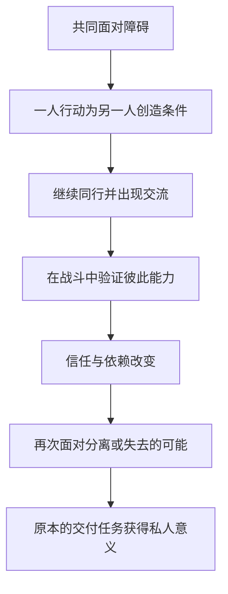

<!-- Imported from 游戏拆解分析/37款游戏拆解案/22_最后生还者1.md; original analysis and evidence boundaries preserved. -->

# 《最后生还者 1》：共同活下去，怎样变成无法放手

> 剧透等级：完整剧情。涉及序章、匹兹堡、冬季章节、长颈鹿与医院结局。本文以 2013 年原版单人主线的叙事、关卡和资源框架为对象；2014 年 Remastered 与 2022 年 Part I 的表现及 AI 改进不反推为原版事实。未进行本轮实机或逐帧测试。

## 1. 核心论点：关系不是剧情奖励，而是一路使用的生存方式

《最后生还者》的主要吸引力，在于玩家逐渐把“把艾莉送到目的地”理解成“带着这个人继续活下去”。它没有依靠一条独立的好感度数值来完成转变，而是把合作移动、战斗帮助、可选谈话、资源压力和离别风险放进同一段旅程。人物关系一开始是任务条件，后来成为玩家解释一切行动的中心。

这意味着战斗不是剧情之间必须填满的空档。玩家反复经历危险，才知道同行意味着什么；玩家又需要在危险以外看见艾莉的好奇、幽默与脆弱，才不会把她只当成需要护送的目标。两种时间互相赋予价值：紧张让安静值得珍惜，安静让下一次紧张有了具体对象。

本文的主张不是所有玩家都会认同乔尔的最终选择，而是游戏用操作与节奏建立了理解这个选择的条件。情感理解与道德赞同可以分开，这正是结局仍能引发讨论的原因。

## 2. 序章怎样先教玩家失去，再教玩家生存

序章先让玩家以莎拉的视角接触熟悉住宅中的异常，随后转为乔尔抱着受伤的她逃离混乱。这里的移动目标十分简单，却承担了重要的身体关系：乔尔的双手不是用来自由探索和消灭敌人，而是抱着一个人。角色的重量、视野中的人群和有限路线，让“保护”先于完整战斗系统成为玩家理解世界的方式。

莎拉之死因此不仅是背景设定。玩家刚刚为了把她带离危险而行动，目标却被剧情截断。此后成年乔尔的疏离与功利便有了可追溯的经验基础。若用一段文字交代他失去女儿，观众能够知道事实，却未必拥有“刚才还在试图做到”的身体记忆。

这一结构也有取舍：玩家并没有挽救莎拉的分支，操作不能改写作者设定。它提供的是参与和理解，而不是结局控制。如果把线性叙事包装成能改变所有命运的模拟，便会产生错误承诺；本作更有效的地方，是让早期目标清晰，同时很快确立这个世界不会保证努力成功。

## 3. 稀缺资源如何让每次暴力留下余波

弹药、治疗和制作材料有限，使战斗决策跨越单个房间。开枪能迅速化解眼前威胁，却可能让下一次遭遇更难；潜行节约子弹，却要求暴露在更长的观察与移动过程中；砖瓶提供打断、引诱和近身机会，让环境中的廉价物件成为局势转换工具。

材料在不同物品间共享尤其关键。治疗与进攻并不是两条完全独立的补给线，玩家需要考虑把同一份资源用于立即恢复还是主动削减威胁。制作和治疗还会占用时间，因此安全位置不只是躲子弹的地方，也是重新获得行动能力的条件。战斗的后果随背包一起进入下一段探索。

资源压力并非只靠“少”成立。若补给过少到使玩家只愿意读档，谨慎就会变成保存完美结果；若补给过多，物品选择又可能失去分量。不同难度会明显改变这种关系。分析时应说明设置，而不能拿一次极限资源体验代表所有玩家。这里讨论的是资源结构能如何制造余波，不是未经测试的掉落数值。

## 4. 场景一：匹兹堡的步枪支援如何改变伙伴的位置

匹兹堡段落中，艾莉在乔尔遭遇危险时救下他，之后又在高处持步枪提供支援。重要的变化是职责重新分配。此前她常被放在保护对象的位置，这时玩家开始必须承认她的行动能力，也必须在继续保护她和信任她之间调整理解。

支援不是单独在过场里宣布“她成长了”。玩家进入下方战区，敌人的压力、掩体和移动仍由自己处理，但艾莉已成为局势的一部分。叙事中的信任变化由战斗站位表达出来：乔尔在前方承受风险，艾莉从相对安全的位置介入。这种安排让成长具有操作后果，同时避免马上把她变成和乔尔完全相同的战斗角色。

反例是伙伴只在系统方便时突然有效，平时却无法解释其存在。玩家会把帮助理解成脚本奖励，而不是稳定关系。原版也存在伙伴在敌人附近移动却未触发相应反应的可信度摩擦。这类保护性处理可能减少护送烦躁，却暴露感知规则的不一致。不能为了突出情绪效果而省略这一代价。

## 5. 探索中的小协作为何比不断护送更有效

木板、梯子、托举和水上运送让两个人反复共同解决移动问题。单看每项交互都不复杂，但它们把“等另一个人跟上”“给对方一条路”“由对方打开前进条件”变成旅途习惯。关系通过多次小依赖建立，而非只在大事件中确认。

这种设计通常不会要求玩家持续管理艾莉的血量或路径，因而保留了同行感，又降低传统护送任务的负担。玩家关注的主要仍是自己的生存与前进，只是在过程中不断注意到另一个人。可选对话则让注意力产生柔性的回报：停下来听笑话或观察遗留物，不一定增加战力，却增加对伙伴的了解。

重复也可能削弱意义。若每次水域都使用相近的解决办法，玩家会先识别“又到搬运环节”，再感到人物的相互依赖。协作动作要有用，最好同时承接当前情境的变化：谁主动、谁等待、是否回应，以及此前的争执有没有改变同行的语气。互动数量本身并不能替代关系发展。

<figure>
  
  <figcaption>图 1 · 资源、伙伴协作与共同生存的关系。用于概括本文分析，不代表游戏内部状态机。</figcaption>
</figure>

查看可编辑图源

## 6. 场景二：冬季章节把担心变成新的操作身份

冬季章节转向操控艾莉，让玩家亲自体验保护对象的生存能力与身体限制。她能狩猎、寻找物资并应对敌人，但近身力量与乔尔不同。相似的潜行、瞄准和移动因此获得不同含义：玩家熟悉世界的规则，却不能完全沿用乔尔的应对直觉。

与大卫的餐厅对峙进一步收紧信息和空间。玩家需要利用遮挡、声音与行动时机寻找接近机会，敌人的威胁不是简单增大血量，而是迫使玩家承认正面力量的不对称。燃烧环境又把对抗放进逐渐失控的场景中。此时控制艾莉，使她不再只是乔尔想要救的人，而成为玩家刚刚努力让其活下来的主体。

从人物角度看，这种切换也防止了单向关系：故事不是只有成年人赋予孩子生存，而是双方以不同方式承担照顾。其风险是切换可能被玩家视为剥夺熟悉装备与能力。需要用足够清晰的情境和可理解的新优势，使脆弱感转化为紧张，而不是单纯感到角色被削弱。

## 7. 长颈鹿与医院：为什么高潮之前需要允许停留

长颈鹿场景不靠新的困难成立。它让玩家在长期警觉以后，有机会为好奇而移动，为看见某物而停下。艾莉重新表现出兴趣，乔尔也暂时从护送职责中退出来，共享一段没有立即索取代价的时间。这段安静的力量来自之前积累的危险，单独抽出并不能复制同样效果。

医院结局则把相反的动力推到前景：乔尔无法接受再次失去。战斗推进、寻找艾莉与抱她离开，将序章中“抱着女儿逃走”的身体姿态带回玩家手中。相似的动作承载不同的处境，使开场的创伤和结尾的选择形成可以操作的呼应。

这里的线性尤其重要。游戏没有把最终立场交给一个善恶按钮，玩家必须面对乔尔的行动及其谎言。由此产生的价值是角色一致性，代价是玩家可能被迫执行不认同的事。一篇分析应讨论这种不适如何形成，而不把所有拒绝认同的反应归因于玩家没有理解故事。

## 8. 3C 与版本差异：可信不等于每条规则都写实

贴近身体的第三人称视角限制全局信息，瞄准、转身和近身冲突也让危险显得具体。声音、姿态、命中反应和有限可见范围共同塑造紧张。敌人的搜索与遮挡让玩家能够在不完全掌握局势时作决定，战斗的可读性因而需要环境线索补足。

原版开发回顾明确提到，药店曾是 AI 与书架遮挡交互的早期试验场。它说明空间和感知共同构成设计问题，而不能证明任意遭遇都使用相同内部算法。[顽皮狗十周年开发回顾](https://www.naughtydog.com/blog/celebrating_the_10th_anniversary_of_the_last_of_us)

2022 年 Part I 官方介绍则明确讨论重建动画、视觉和伙伴行为等变化。用该版本画面分析关系表达可以成立，但应标注素材版本；不能把更新后的过渡动作、伙伴避让或表现细节直接写成 2013 年实现。[Part I 官方重制说明](https://blog.playstation.com/2022/07/21/how-naughty-dog-rebuilt-the-last-of-us-part-i/comment-page-2/)

## 9. 迁移：怎样让战斗真正服务人物关系

可迁移的重点，是让关系变化改变角色在玩法中的职责。需要建立信任，就让一个人承担先前由另一个人包办的工作；需要表现创伤，就让熟悉的协作动作出现迟疑或失去回应；需要表达依赖，就让玩家切身体验对方缺席时少了什么。过场负责确认变化，操作负责让变化有重量。

这种方法适合拥有持续伙伴、明确角色弧线和可控关卡顺序的作品。若是可随时换队友、无限刷取或多人掉线频繁的结构，就不宜把关键情绪完全压在唯一一次协作上。可以转而建立反复可见的支援偏好、稳定的反应和共同恢复机制，让关系通过行为风格累积。

最后需要保持克制：每场战斗都极端惨烈，会削弱惨烈的区分度；每段同行都要求等待，会把亲密变成拖延。游戏让人牵挂伙伴，依赖的不是苦难总量，而是危险、能力、安静和改变之间的安排。

## 来源与论证边界

- [顽皮狗：《最后生还者》十周年回顾](https://www.naughtydog.com/blog/celebrating_the_10th_anniversary_of_the_last_of_us)：支持原版开发者对空间、AI 与表演工作的回忆；本文只作简短引用，未扩写成完整开发史。
- [PlayStation：How Naughty Dog rebuilt The Last of Us Part I](https://blog.playstation.com/2022/07/21/how-naughty-dog-rebuilt-the-last-of-us-part-i/comment-page-2/)：仅用于区分重制版的公开改进范围。

章节体验、人物关系和操作的因果联系为本文分析。没有测试掉落概率、感知范围或动画帧数；难度、辅助选项及版本差异需要在后续实证中独立记录。

---

[返回游戏拆解](/blog/game-breakdown/)
