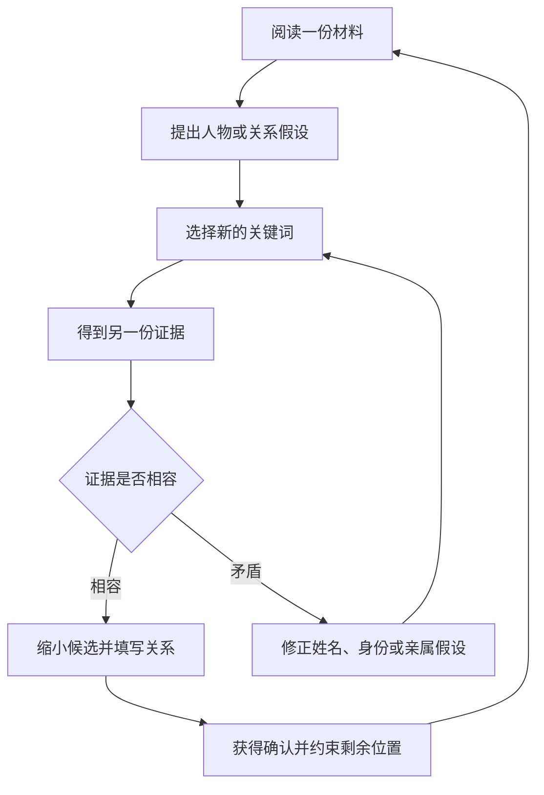

<!-- Imported from 游戏拆解分析/37款游戏拆解案/37_鲁特里一家死了.md; original analysis and evidence boundaries preserved. -->

# 鲁特里一家死了拆解案
## 搜索如何变成建立和修正人物关系的推理

**范围：**2025年Steam重制版《The Roottrees Are Dead》的主案；附加案件Roottreemania仅在扩展讨论中出现，不与2023年网页原版混写。**剧透级别：低至中，说明开场背景和推理结构，不公布完整族谱及关键身份答案。**资料核对：2026年9月20日。

## 核心判断

《鲁特里一家死了》的主要吸引力，是让零散的人名、照片和文本逐渐成为可以解释的关系网。玩家既需要找到资料，也需要判断资料之间怎样相互限制。成功的瞬间往往不是获得一条答案，而是先前互不相关的材料突然能够共同支持一个结论。

因此，“搜索游戏”不是充分的描述。搜索负责打开信息，家族关系负责组织信息，确认反馈负责稳定已经解决的部分，而人物经历让抽象关系具有记忆点。这几层互相支持，才使填写族谱具有持续动力。

## 一 遗产问题给信息整理一个明确目标

开场的坠机与遗产分配背景，解释了为什么需要追查血缘关系。玩家面对的任务不是无边界阅读，而是寻找谁属于这张家族网络。关系结构因此同时是目标、进度表示和推理工具。

开发商介绍明确将照片、书籍、文章与亲属关系推断连接起来；Steam版还更新了界面与呈现，并包含另一份新案件。[开发商作品页](https://roottrees.com/) [Steam版说明](https://store.steampowered.com/app/2754380/The_Roottrees_are_Dead/)

把问题放在1998年的拟真电脑环境里，也为相对有限的搜索方式提供了情境。玩家需要输入词语、阅读结果和追踪线索，信息探索的节奏更接近在资料中推进，而不是在地图上寻找发光物件。

## 二 关键词是玩家自己生成的行动入口

许多任务游戏直接给出下一步目标，本作让玩家从已读材料里提取可继续搜索的词。人名、组织或相关概念，既是内容，也是新的行动可能。玩家需要判断哪一条值得继续追，而不是只沿着标记走。

这类自主性有两个层面：选择调查哪条分支，以及决定以什么问题接近它。即使最终答案固定，过程仍可以具有个人顺序。不同玩家先记住不同人物，也可能从不同材料开始建立关系。

设计风险是词语与系统可识别输入之间的落差。玩家可能已经形成合理假设，却不知道怎样把它表达成有效查询。此时卡住的原因不是推理不足，而是交互语言不匹配。拆解时必须区分“没有想到关系”与“想到了但搜不到”。

<figure>
  
  <figcaption>图 1 · 关键词、资料互证与族谱推理的流程。用于概括本文分析，不代表游戏内部状态机。</figcaption>
</figure>

查看可编辑图源

## 三 族谱是持续变化的约束系统

族谱的作用不只是展示完成百分比。一个位置的确认，会减少其他位置仍然可能容纳的人物范围；父母、子女和同代关系，又使身份不能脱离位置随意成立。

这让线索具有间接价值。某条材料未必直接回答当前空位，却可能排除一种亲属关系，或者使另一份模糊信息突然有用。进展因此不总是立刻新增一个正确名字，也可能是减少错误可能。

从设计上可以把它理解为关系约束，但不意味着玩家需要懂形式逻辑。图形结构把一部分逻辑外化，让玩家通过观察“这里还可能是谁”继续思考。好的界面在这里承担的是认知辅助，而不是装饰。

## 四 案例一 开场资料如何教会下一步由证据产生

开场提供事故与核心家族背景，让玩家先接触少量较容易辨认的人物和材料。初期调查的教学任务，是让玩家学会从已知信息中选择词语，找到补充材料，再把照片与身份连接起来。

一个有效的早期发现应同时完成两件事：解决一个局部问题，并教会玩家一种可以继续使用的方法。若只是弹出答案，玩家知道该填什么，却不知道下次怎样找；若开场材料过于分散，又会在规则尚未理解时积累大量记忆负担。

这一案例体现的是开场的信息组织，不是完整答案攻略。分析重点在于行动入口如何从材料里长出来，以及结果如何给下一次搜索提供方向。它使教程与真正的调查采用同一套语言。

## 五 案例二 未归位肖像怎样推动反向查证

在积累材料之后，玩家可能拥有一张尚未放入族谱的肖像，或者知道一个名字但不能确定它的位置。此时调查可以从“搜索一个人物”反过来，变为“什么证据能够解释这个未解决对象”。

一张照片本身不足以证明身份。它出现的材料、同行人物、职业或年代描述，可能需要与其他文本交叉。玩家要抵抗仅凭外貌或名称相近就填入的冲动，用关系验证直觉。

这类局面的重要性在于迫使玩家修正最早的理解。第一次阅读时被当作背景的句子，后来可能成为排除候选的关键。内容因此不是读完即失效的消耗品，而是随问题变化重新获得用途。

下面的表只表示推理功能，不提供游戏中真实人物的答案：

| 材料形式 | 可以提供什么 | 单独使用的风险 |
|---|---|---|
| 一张肖像 | 可辨认的人物外观 | 把相似外观误当身份 |
| 一则报道 | 姓名、活动与社会关系 | 将公开称呼当完整血缘事实 |
| 一份家族材料 | 亲属关系与历史线索 | 忽视叙述的时间和语境 |
| 已确认的族谱位置 | 对剩余候选的限制 | 过度相信尚未确认的相邻假设 |

## 六 确认反馈既奖励推理 也限制盲猜

反馈需要让玩家知道哪些部分已经足够可靠，否则大量猜测会污染后续推理。另一方面，如果每个字段一输入就立刻告诉对错，玩家可能通过低成本遍历绕过关系判断。

本作的身份确认让已解决部分稳定下来，给剩余位置提供新的约束。这里不把所有进度阶段概括为同一个固定确认数量。开发者对相关判断逻辑的介绍也提到，其处理依赖当前游戏状态。[开发者技术复盘](https://eviltrout.com/blog/2025-01-27-building-the-roottrees/)

对玩家来说，确认的意义还在于结束一部分工作。长篇调查需要能够信任的落点，否则每次矛盾都会让人怀疑整张族谱。反馈因此同时调节难度和心理负担。

## 七 界面让回看证据比记住一切更重要

玩家不断在搜索、阅读、笔记和族谱之间移动，操作成本会随材料数量增长。优秀的信息界面应允许玩家把精力花在关系判断，而不是重新寻找刚才那句话。

重制版的双向高亮笔记是有明确开发资料支持的亮点：记录可以回到来源，来源也保留与记录的联系。开发者还说明，游戏以Godot重写，并把二维交互界面呈现在三维场景中。[技术复盘中的界面说明](https://eviltrout.com/blog/2025-01-27-building-the-roottrees/)

其设计价值是保护可追溯性。一个结论不应该只剩玩家模糊记得的印象，而应能迅速找回支撑它的原文。三维房间则提供调查的生活情境，但不应增加频繁切换工具的负担。氛围界面和工作界面的效率需要一起考虑。

## 八 故事通过关系被逐渐认识

大量人物并不是靠连续过场统一介绍，而是在资料中的活动、称呼和联系中逐渐出现。玩家因为需要辨认他们而阅读，又可能因为读到他们的经历而对调查产生额外兴趣。

这种结构让剧情揭示与解题进展相互支持：找到身份的同时，玩家也更清楚一个家庭如何形成现在的样子。人物若只剩用于填空的姓名，推理仍可能成立，但情感和世界构建会变薄；如果人物故事太长且缺少可用信息，阅读又可能挤压推理节奏。

作品的情绪也因此不同于高压侦探追逐。大部分紧张来自认知上的未完成：知道若干关系，却还缺能够让它们连起来的一块材料。界面、音乐与居家场景可以维持专注，而无需持续制造外部危险。

## 九 难度来自关系密度 也可能来自信息摩擦

好的难度让玩家需要综合多条材料、修正假设并选择调查方向。较差的困难则可能来自未被提示的词法、难以辨认的界面、重复翻找或不清楚的确认条件。两者都能延长通关，但学习价值不同。

提示也应围绕这一区别设计。玩家不知道接下来查什么，可以得到方向；已经理解关系但卡在资料位置，可以得到检索帮助；只有在确实无法建立关联时，才需要更接近答案的提示。这里是基于本作问题结构提出的提示设计原则，不把它冒称为游戏全部提示的内部算法。

本地化会进一步影响推理。姓名、称呼、语义关联和可检索词必须相互协调，翻译流畅不代表线索链仍然公平。应检查译文是否仍提供足够明确的下一步入口，而不是只核对语句是否自然。

## 十 技术与内容生产的真正难点

这类游戏的复杂性很大一部分在内容关系上。一处人名、照片或关系描述出错，可能破坏多条推理路径；一个看似普通的界面回跳问题，又可能迫使玩家重复阅读大量材料。

开发者公开了数据和界面方面的实现经验，但本文不复制其整个工具链。更值得迁移的要求是把事实、呈现与验证分开：人物关系有一致来源，证据能被定位，确认逻辑能被检查，笔记能返回原始语境。

这不是只有推理游戏才需要。战斗策划的技能说明、敌人提示与伤害反馈，也依赖可追溯的规则。如果界面给出的信息与实际行为矛盾，玩家很难知道是自己的理解错了，还是系统不一致。

## 十一 可迁移的设计启示

让玩家自己提出下一步问题，是建立参与感的一种方式。任务不必每次直接指定目标，也可以提供足够清晰的材料，让玩家形成可执行的猜想，再用新的反馈确认或修正。

同时，应把困难放在有意义的关系上。让玩家忘记原文在哪里，不等于让玩家推理得更深入；要求输入系统唯一接受的词，也不自动构成聪明的谜题。界面可以减轻记忆与整理负担，把挑战留给理解。

Roottreemania扩展了关系调查的空间，但不是无限重玩系统。谜题答案一旦知道，首次发现感会明显减少。它更适合通过精心制作的新案件延续体验，而不是仅靠随机打乱姓名重复同一结构。

## 资料与证据边界

- [开发商作品页](https://roottrees.com/)：开场背景与照片、书籍、文章组成的调查循环。
- [Steam重制版说明](https://store.steampowered.com/app/2754380/The_Roottrees_are_Dead/)：版本差异与附加案件范围。
- [Robin Ward技术复盘](https://eviltrout.com/blog/2025-01-27-building-the-roottrees/)：本文仅引用Godot重写、界面与双向笔记、确认逻辑等少量事实；认知价值和设计原则为本文分析。
- 为避免伪造线索和泄露完整答案，案例聚焦可辨认的调查操作与资料类型，没有虚构一份具体家谱答案。

---

[返回游戏拆解](/blog/game-breakdown/)
