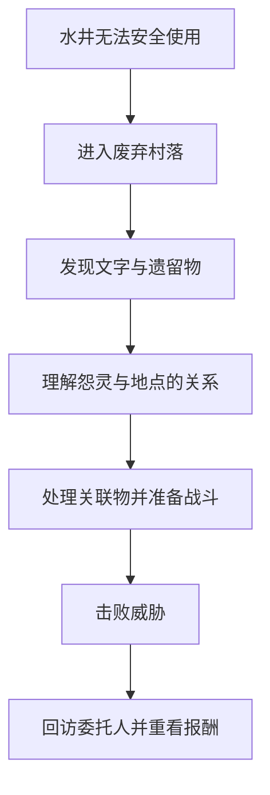

<!-- Imported from 游戏拆解分析/37款游戏拆解案/05_巫师3.md; original analysis and evidence boundaries preserved. -->

# 《巫师 3》：当杀怪变成理解人，任务怎样产生分量

> 剧透等级：中高。涉及“井边的恶魔”、血腥男爵及尸婴分支，不展开终局。本篇以 2015 年本体的任务结构与基础操作框架为对象，不将资料片、后续镜头选项和战斗调整混入原版。本文是设计分析，未声称进行了本轮实机或逐帧测试。

## 1. 核心论点：吸引力来自不断改变判断的猎魔工作

《巫师 3》值得拆解的核心，不是它有多少任务或多少分支，而是一个相当稳定的工作流程，能够不断改变玩家对人物的判断。杰洛特接到委托、调查、准备、处理威胁、回访；玩家在流程开始时通常关心目标在哪里，流程结束时却可能更在意谁制造了困境、谁承担代价，以及自己究竟帮助了谁。

这个变化把三件原本容易分离的事连在一起：移动用于寻找证据，战斗用于执行判断，对话用于重新解释执行结果。因此，故事不是贴在任务流程外的说明书，任务操作本身就是故事展开的顺序。本文的判断是：游戏最强的吸引力之一，是让专业能力与道德确定性分开。杰洛特可以知道怎样杀死怪物，却未必知道怎样让所有人都得到好结局。

这与职业角色的设定相合。官方对作品的介绍同时强调猎魔准备和有后果的选择；两者是本文讨论的事实基础，不代表官方替本文的具体因果推论背书。[《巫师 3》官方介绍](https://www.thewitcher.com/us/en/witcher3)

## 2. 猎魔人身份怎样统一玩家的活动

一个开放世界很容易把采集、谈价、查案和打怪做成彼此平行的清单。《巫师 3》用“受雇处理异常”的身份，将它们放进同一件工作。先谈报酬让委托有现实关系；先看伤口和踪迹让怪物具有可调查的生活痕迹；阅读资料和准备药剂则让遭遇战具有职业方法。玩家不是因为地图上有图标才行动，而是有理由相信，完成这份工作需要这些步骤。

猎魔感官尤其值得拆。它降低的是寻找交互物的困难，却保留了理解线索的叙事节拍。高亮足迹并不等于玩家真正推理出了路径，但它让镜头、移动和杰洛特的观察按次序发生：看见异常、靠近、检查、听到解释、形成下一目标。效果更接近引导玩家扮演熟练专家，而不是提供开放式侦探谜题。

这也是必须承认的边界。若把高亮关闭就称为“更沉浸”，可能只是增加寻找成本；若把所有线索一次标出，又会失去逐步修正判断的时间。值得复制的是信息释放的节奏，而不是单独复制一种扫描模式。

## 3. 场景一：井边的恶魔如何把战斗变成收尾

白果园的“井边的恶魔”很适合作为微型样本。任务最初给玩家的是明确的公共问题：水井附近存在危险，需要清除。到达废弃村落以后，房屋、遗留文字与井中物证逐步把一个敌人还原成曾经生活在这里的人。空间移动让信息具有发现顺序，玩家不是在接任务时一次读完背景，而是在寻找解决办法时接触这段遭遇。

随后，处理遗骸与关联物品，使“为什么怪物留在这里”和“怎样令其离开”进入同一条行动链。对日间妖灵的战斗准备及亚登法印的作用，又让知识落回可执行的应对。战斗不再只是完成任务计数的开关，它是前面调查所建立的问题的最后一环。

这个任务并不依赖巨大分支数量。即使玩家已经知道结局，依然可以辨认出一个有效的结构：先给功能性目标，再让目标变得有人生重量，最后让操作完成处置。其反例也很清楚：若玩家高速跳过文字，只追随感官高亮，整段流程便容易退化为依次点击线索和打一只妖灵。内容已经存在，并不意味着注意力必然抵达内容。

<figure>
  
  <figcaption>图 1 · 调查、准备、选择与任务后果的联系。用于概括本文分析，不代表游戏内部状态机。</figcaption>
</figure>

查看可编辑图源

## 4. 场景二：尸婴段落为何需要玩家一路护送

血腥男爵的家庭线把这一结构放大。玩家最初面对的是一位拥有权力和资源的委托人，调查却逐步暴露家庭暴力、失踪与创伤。关键不在于最后公布一份案情答案，而在于玩家必须继续和这个人同行，同时调整对他的态度。

选择将尸婴转化为家事妖精的路线时，男爵抱着它返回住处，杰洛特需要处理袭来的幽灵，并在适当时机安抚尸婴。护送把叙事关系转成职责：男爵承担携带与命名的动作，玩家负责使这段路能够继续。过程中敌人的干扰既是战斗挑战，也是对仪式连续性的威胁。若只用过场讲述同样事件，玩家能够理解情节，却不必持续承担“让这件事完成”的责任。

这里的设计并不等于强迫玩家原谅男爵。共同完成某件艰难的事，可以让人物更复杂，而不必抹去其过错。真正有价值的分析对象，是任务如何让谴责、怜悯和实务合作同时存在。与之相比，直接选择击杀尸婴的路线提供了不同的行动表达；分支的作用首先是允许玩家表达态度，而不只是制造结局数量。

## 5. 战斗如何为叙事提供一种职业可信度

本作战斗的核心贡献，是让杰洛特的专业性可以被操作出来。面对不同敌人，剑术、闪避、翻滚、法印和准备物品提供多种响应。怪物知识如果能改变战前配置或战中站位，调查信息就不只是世界观收藏，而是降低风险的方法。玩家因此有机会感到，自己赢在识别与准备，而不全是反应速度。

这里也存在明显张力。角色等级、装备与强势构筑可能压低敌种差异的重要性；当通用防护与循环输出足以解决多数战斗，玩家便缺少重新阅读怪物的理由。叙事仍在强调“每次猎魔各有隐情”，操作却可能重复同一套有效办法。对战斗策划而言，这比泛泛评价打击感更有用：知识被教给玩家以后，遭遇是否真的要求其参与决策？

因此，应把准备的价值与准备的强制性分开。低难度容许玩家主要消费故事，高难度提升装备和应对的权重，是一种受众取舍。不能只拿某一难度的体验，推断整个游戏完全依赖或完全不需要准备。

## 6. 移动、镜头与表演怎样承接任务情绪

开放世界里的赶路为任务提供间隔。村庄、泥路、战后遗迹和聚落距离，使人物的处境具有地理背景；一段惨烈对话之后骑马离开，也给玩家时间重新理解刚刚发生的事。如果所有任务都能在同一房间连续接取与交付，信息密度会上升，但事件之间的距离感会被压缩。

第三人称镜头在野外服务于路径和周边威胁，进入交谈后又把注意力收束到脸、姿态与回答。两种视野交替，使“这里有什么”和“这个人在回避什么”成为不同的观察任务。杰洛特较克制的表演也给选择留出空间：他拥有稳定性格，玩家仍能在职业边界内表达强硬、同情或利益取向。

控制本身并非处处都支持细致观察。小空间转身、搜取密集物件、追随感官标记，有时会让注意力从人物处境转到交互便利性上。技术分析应记录这种可见的摩擦，以及镜头是否帮助玩家定位对象；没有证据时，不需要猜测动画系统、寻路实现或输入延迟的内部参数。

## 7. 开放世界的自由与主线紧迫性为何互相拉扯

寻找希里的主线天然具有时间压力，地图却不断提供可以停留很久的支线与娱乐活动。玩家一方面被告知要尽快找到重要的人，另一方面又被奖励去接委托、研究装备、打昆特牌。这种冲突不能简单称为设计失败，因为长时间偏离也正是生活感和角色扮演空间的来源。

较好的支线会通过人物、区域和主题与主线互相照明。它不需要推进同一事件，但能说明杰洛特所处的世界，以及他在这个世界中的位置。较弱的时刻则是活动只剩图标与掉落，完成过程既不改变判断，也不留下新的关系。此时同样的地图自由便更容易变成清单压力。

| 内容连接方式 | 玩家可能获得的体验 | 容易失效的条件 |
| --- | --- | --- |
| 调查连接人物处境 | 解决问题同时理解人 | 高亮路径替代全部阅读 |
| 知识连接战斗应对 | 职业能力有用 | 数值碾压全部差异 |
| 回访连接行动后果 | 委托发生在持续世界中 | 回访只有报酬结算 |
| 支线连接区域主题 | 偏离主线仍有意义 | 奖励与图标压过情境 |

## 8. 可迁移的设计原则与使用条件

对战斗策划最有价值的借鉴，是让“认识敌人”和“处理敌人”共享一条因果链。玩家先看到猎物留下的痕迹，再根据痕迹预测能力，进入战斗后验证预测，战后则理解它和地点的关系。即使没有大量文本，也可以用破坏痕迹、受害对象和战场布置完成这种连接。

但迁移需要条件。若游戏以快速反复刷取为主，长调查会成为重复成本，应让首次任务承担理解，后续狩猎保留最关键的环境判断；若叙事强调复杂人物，就要给信息和后果留出空间，不能要求每一步都立即产出战斗高潮。所谓“道德灰度”也不能靠每次反转好坏实现，玩家需要有足够信息形成有理由的选择，而不是不断被隐藏条件惩罚。

一份有效的拆解最终应能解释：删去某条线索，会失去哪一次判断变化；缩短某段同行，会失去哪一层人物关系；让通用攻击解决所有怪物，会损失哪部分职业感。《巫师 3》的价值在于这些环节相互依赖，而不是它们各自都足够复杂。

## 9. 来源与论证边界

- [CD PROJEKT RED 官方游戏介绍](https://www.thewitcher.com/us/en/witcher3)：支持职业猎魔、准备与选择后果的产品框架。页面现含后续版本信息，本文未使用其中新版本战斗改动来解释 2015 年本体。
- [Paweł Sasko：10 Key Quest Design Lessons，GDC 2023](https://www.gdcvault.com/play/1028897/10-Key-Quest-Design-Lessons)：公开摘要确认讲座讨论情节、叙事结构、情感效果及选择后果；本文没有把未观看的完整演讲内容冒充开发者原话。

具体任务的因果关系、优缺点和迁移条件均为本文分析。未提供分支完成率、玩家行为统计或量化难度结论，不能据此声称已经证明所有玩家的动机。

---

[返回游戏拆解](/blog/game-breakdown/)
