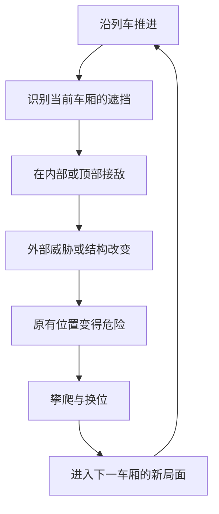

<!-- Imported from 游戏拆解分析/37款游戏拆解案/25_神秘海域2.md; original analysis and evidence boundaries preserved. -->

# 《神秘海域 2》：移动的战场，怎样把枪战变成冒险高潮

> 剧透等级：高。涉及悬崖列车开场、尼泊尔城市、列车、藏族村落与香巴拉终局。本文以 2009 年《纵横四海》单人本体为对象；合集版表现差异应另行标记。本文没有进行本轮实机或逐帧测试，不将动态场景的观感写成未经证实的物理实现。

## 1. 核心论点：奇观的价值在于它改变玩家正在做的事

《神秘海域 2》把前作的攀爬与枪战放进持续变化的局面，使动作冒险的高潮不再只是清空房间后的过场奖励。玩家正在射击，场景可能开始崩塌；玩家正在攀爬，通行结构本身又处于危险之中。观看与操作在同一段时间发生，因此壮观场面更容易被记成“我经历过的事”。

这一代的提升不能只写成制作规模更大。更重要的是移动改变了距离、入口、掩体和逃生方向，迫使玩家用已经学会的能力重新理解局势。系统复杂度未必大幅增加，但情境复杂度不断变化。本文将这种设计视为“稳定动词、变化条件”的集中示范。

它也存在明确成本：越精确的场面越难容纳任意行为，玩家必须看懂下一步，失败重试还可能暴露演出的结构。优秀的奇观设计需要同时解决首次观看的惊险和重复执行的清楚，不能只为宣传片中的那一次顺利演出服务。

## 2. 悬崖列车开场怎样用结果制造前进动力

游戏把受伤的德雷克放在悬挂于悬崖的车厢中，玩家最先需要解决的不是谁偷了什么，而是怎样离开眼前险境。攀爬提示、结构倾斜和身体状态共同缩小注意力，让复杂背景暂时退后。玩家在不知道完整来龙去脉时，仍然能理解每次向上移动的意义。

这个开场同时设置了两种目标：短期逃生目标可通过动作推进，长期因果问题则留给后续叙事回答。之后回到事件之前，玩家带着“事情怎样变成那样”的期待进入偷盗与背叛。倒叙没有让操作目标变模糊，反而用明确的身体处境承载了叙事悬念。

受伤状态也对英雄能力进行临时约束。熟悉的攀爬看起来比通常更艰难，主角依旧能行动，却不再显得总是从容。若只用台词说德雷克身受重伤，玩家的身体体验不会发生相同变化。此处的关键是操作、姿态与场景风险共同表达，而不是单独增加血屏或降低速度。

## 3. 场景一：列车怎样持续改写掩体的价值

列车段落把狭长车厢、车顶和车外攀爬连成一条不断前进的战场。玩家需要向前推进，却不必始终沿同一水平面前进。车厢内部提供遮挡，车顶扩大视野也暴露身体，侧面攀爬则改变进入敌人视野的位置。地形由此支持有限但真实的路线判断。

移动让场景变化具有直接后果。隧道、周边结构和外部火力会改变哪些位置还能停留，玩家不能只在一个好掩体后耗尽所有敌人。战斗目标因此从“守住一个安全点”转向“在不断变化的条件下继续前进”。新的车厢又能逐步加入不同遮挡与敌人组合，保持同一场事件的连续性。

列车不是背景视频的理由，就在于这种空间重估。若只有景色快速经过，而玩家仍在一个不变的平台上重复射击，速度感可以很强，决策变化却很少。拆解应明确是哪一次环境变化迫使玩家换路线、换目标或改变暴露时间，而不把所有视觉移动都算作玩法创新。

<figure>
  
  <figcaption>图 1 · 移动战场与节奏变化组织冒险的流程。用于概括本文分析，不代表游戏内部状态机。</figcaption>
</figure>

查看可编辑图源

## 4. 枪战与攀爬不再只负责轮流出现

前作常让攀爬负责连接战斗区域，本作则更频繁地让攀爬进入遭遇内部。玩家从边缘接近敌人、改变高度、利用悬挂位置攻击或寻找新的入口，使垂直空间成为战斗变量。德雷克的动作身份因此更统一：探险时擅长移动，战斗时仍然依靠同一种能力解决问题。

潜行击倒也为遭遇提供了较安静的起手方式。它的作用不必被理解为可以永久维持潜行，而是允许玩家在公开交火前改变初始局面：减少一个威胁、占据较好位置、观察敌人关系。之后战斗可以自然升级，形成由自己开启的动作场面。

不过，不能把后续作品更完整的脱离交战与重新隐蔽能力倒灌到第二部。这里值得关注的是多种动作在同一空间里的交叠程度。若攀爬路线只负责通关，战斗路线只负责躲枪，二者即使画面连续，设计上仍然可能各管各的。

## 5. 场景二：倒塌楼房如何改变玩家对安全的判断

尼泊尔城市中的直升机威胁与楼房坍塌，把通常稳定的掩体变成不可靠条件。玩家起初仍按照枪战习惯寻找遮挡，但外部火力迫使位置发生变化，建筑本身的破坏又把射击任务转成逃离任务。熟悉场景突然不再支持熟悉行为，是惊险感的重要来源。

这里的镜头和路径必须配合。玩家需要在震动、碎屑、噪声与结构改变中仍看得出下一处可去位置。演出越密集，目标轮廓和角色朝向越不能含混；否则困难便来自读不懂画面，而不是处理危险。理想结果是玩家来不及制定长计划，却依然觉得每一个即时决定有根据。

同一场景的反例是过度自动化。若结构毁坏以后只有按住前进，玩家可能主要在观看；这并非完全没有价值，却应和需要重新选位的战斗分开评价。电影式参与不是单一强度，可以在少量输入和充分决策之间变动，但作品需要安排这些不同层次的比例。

## 6. 藏族村落为何是高潮设计的一部分

德雷克进入村落后，玩家从枪火和逃生转入缓慢移动、观察居民与接触日常。丹津与德雷克的语言隔阂，使关系更多依靠动作、引导和共同经历建立。这段内容看似暂时离开主线压力，实际上为之后危险中的村落提供了情感参照。

如果玩家只在袭击发生时第一次看见村庄，它主要是一组需要清理敌人的建筑。先让玩家经历日常，房屋与道路便拥有先前用途，后续破坏意味着某种生活被侵入。相同地图因此能先承担观察，再承担防卫或穿越，空间价值随时间发生改变。

安静也恢复玩家的感知能力。连续不断的高压场面会使更大的爆炸很快失去区别，村落段落让动作尺度下降，后续紧张才有重新上升的余地。反例是安静只有强制慢走却没有新的关系或观察，玩家会感到暂停而不是呼吸。低强度内容仍需有清楚的体验产出。

## 7. 人物关系怎样给壮观事件提供方向

德雷克、克洛伊和艾莲娜之间的关系使寻宝不只是通往最终宝物的路线。不同人物对于风险、信任和脱身的态度，会改变一场行动的意义。玩家不只是想知道目的地在哪里，也在判断谁会留下、谁会离开，德雷克又会为谁改变计划。

伙伴在交战、攀爬和危机中的存在，让人物关系沿着关卡继续发生。保护和救援若只出现在过场，很容易成为剧情要求；如果此前已共同穿越危险，它们便更像既有关系的延续。德雷克的幽默则把危险保持在冒险类型之内，避免所有苦难都按沉重生存剧处理。

终局对宝藏与力量的追逐让反派形成更明确的极端参照。这里的战斗并不是复杂伦理选择，而是为整段追逐提供动作收束。应当按作品希望建立的冒险气质评价，不必要求它承担与《最后生还者》相同的道德重量。

## 8. 技术效果的评价单位应该是玩家还能做什么

开发者复盘将电影化动作冒险与角色体验作为项目的重要方向，动态场景是理解这一代的关键材料。引用这些公开内容时，应区分已说明的设计目标与本文从成品提出的判断。[Richard Lemarchand 的《神秘海域 2》开发复盘](https://richardlemarchand.com/wp-content/uploads/2025/11/GDM-March-2010-Uncharted-2-Postmortem.pdf)

对策划而言，最实用的技术问题不是“引擎有多先进”，而是列车运动时攀爬是否仍可读、场景崩塌时输入是否连续、镜头改变后瞄准和移动是否仍符合预期。动画过渡、碰撞、声音和脚本需要共同保护这些基本感受。具体实现应由公开资料或实际工程验证支持，不能仅凭录像反推出后台算法。

失败重试也是技术与设计的交界。检查点若落在复杂演出之前，玩家会反复看同一段铺垫；若切得过碎，又可能失去连续行动的紧张。应分别检查首次、第二次和多次失败后的节奏，判断体验是否仍让人想再试，而非只验证通关录像足够精彩。

## 9. 迁移：用环境变化改变问题，别只增加动静

本作最值得迁移的是一种关卡方法：先建立稳定规则，让玩家形成一个可行办法，再改变空间条件，使原办法需要调整。变化可以来自移动载具、视线遮挡、入口失效或新的撤离方向，不必每次都摧毁整座建筑。只要变化能改变决策，就已经具有玩法价值。

小团队可以先做短场景：同一套移动与射击，经历一个安全位置逐渐失效、一个新入口被打开，以及一次从战斗转为撤离的目标转换。验证玩家是否看懂变化及因果，再决定需要多少演出。不能先做昂贵奇观，最后期待提示箭头补救可读性。

它的限制同样清楚。若作品依赖多人同时行动或开放式长期战斗，严格同步的场面更难可靠执行；若强调反复挑战，变化需要有可学习的规则，而非只剩一次性惊喜。《神秘海域 2》值得研究的不是“电影越多越好”，而是如何让壮观事件持续占据玩家的操作时间，又不拿走全部判断。

## 来源与论证边界

- [Richard Lemarchand：2010 年《Uncharted 2》开发复盘](https://richardlemarchand.com/wp-content/uploads/2025/11/GDM-March-2010-Uncharted-2-Postmortem.pdf)：一手开发资料，用于核对项目方向与动态场景的开发背景；本文未逐项复述技术实现。
- [顽皮狗：Uncharted 十周年回顾](https://www.naughtydog.com/blog/uncharted_10th_anniversary)：提供系列历史定位，不承担具体场景机制的证明。

列车、城市楼房和村落的因果解析为本文分析。本文不声称已测量场景移动速度、输入延迟、敌人刷新规律或实际失败率。

---

[返回游戏拆解](/blog/game-breakdown/)
