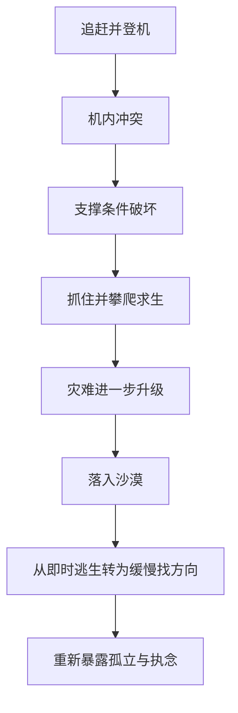

<!-- Imported from 游戏拆解分析/37款游戏拆解案/26_神秘海域3.md; original analysis and evidence boundaries preserved. -->

# 《神秘海域 3》：不断失控的冒险，怎样逼角色面对自己的执念

> 剧透等级：完整剧情。涉及少年时期、苏利与德雷克的关系、货船、货机、沙漠及终局。本文以 2011 年《德雷克的诡计》单人本体为对象，不将后续作品的战斗移动能力混入分析；合集版瞄准与表现差异须另注。本文未进行本轮实机或逐帧测试。

## 1. 核心论点：第三部把冒险从本领展示推向失去控制

《神秘海域 3》继续提供可以亲手穿过的动作奇观，但更有辨识度的是它不断让德雷克失去稳定条件：建筑燃烧，船体倾覆，货机解体，方向感在沙漠中消失。玩家仍能操作，却经常只能处理眼前一步。主角擅长冒险，并不代表他真的掌握这趟旅程。

这种失控与人物主题可以互相解释。德雷克对身份、历史和证明自己的执念，让他反复继续追逐；苏利与艾莲娜则让追逐显露出人际代价。本文的核心判断是：本作最值得拆的不是“场面比上一部更大”，而是身体上的失控如何与人物拒绝停下的心理构成对照。

但这种联系并不始终紧密。部分大型段落首先满足动作刺激，和核心人物线的联系较薄。完整分析必须把成功的形式呼应与显得绕远的内容一起讨论，不能因为主题存在，就把每一段爆炸都解释成主题的必然表达。

## 2. 少年章节与苏利：冒险为什么是一种身份需求

少年时期的德雷克追逐戒指和历史线索，苏利由此进入他的生活。这里的移动、尾随与逃跑，不只是用小体型重演成年角色的本领，而是在展示冒险身份形成之前的渴望：他想靠近某种故事，并把自己放进其中。成年后的执着因此不只是贪财，而和自我认同发生联系。

苏利同时提供帮助、经验和稳定关系，使两人的联系超过任务伙伴。之后当苏利受威胁，玩家理解德雷克为何无法轻易退出；当苏利提醒风险，玩家又能感到这不是普通的关卡警告，而是熟悉的人在质疑他继续前进的理由。

这一背景的作用，需要由后续行为兑现。若少年段落只提供人物履历，成年关卡仍然只是接任务和打敌人，那么身份主题就悬在玩法之外。有效的连接来自不断重复的选择：在已经付出代价后，角色为什么还继续寻找；他究竟要救一个人，还是借救人维持追逐的理由。

## 3. 近身混战如何建立随手应变的身体形象

开场酒吧等近身场面，让德雷克在桌椅、墙面和多人包围中搏斗。玩家需要在攻击、反击和挣脱之间处理局部压力，场景物体参与动作表现，使近身不只是切换到一套固定连招。环境中的碰撞与临时利用，强化了“在混乱里找办法”的人物风格。

这类设计的优点是输入不必复杂，演出仍然可以丰富。角色通过姿态、距离和周围对象完成不同动作，玩家的任务主要是识别威胁与时机。相比要求记住大量招式，它更容易让首次进入的玩家迅速做出符合冒险电影气质的应对。

代价是动作意图可能不够透明。玩家想攻击某人，却被拉进另一段近身反应；环境互动带来观赏变化，却未必增加可选择策略。因此必须区分动作多样性与决策多样性。设计目标若是人物表达与节奏变化，前者有价值；若要承担长期格斗深度，还需要更稳定的目标选择、风险信息和操作收益。

## 4. 场景一：货机段落怎样把简单目标连续改写

货机段落最初的目标是追上并登机。飞机起飞以后，目标从接近载具变成在载具内部生存；舱门、货物和敌人的变化，又把地面上的搏斗转为危险的悬挂与攀爬；飞机解体后，玩家要处理的进一步缩小为眼前的求生。每个阶段的目标都简单，但前一个目标达成并不意味着安全。

这种连续改写使惊险不必依赖增加复杂规则。玩家已经会跑、跳、爬和搏斗，关卡改变的是这些动作发生的支撑条件。货物不再只是场景装饰，而会成为落脚点、危险来源或前进路径。镜头通过展示身体与高空的关系，把短距离输入放大成巨大的处境变化。

开发者在十周年回顾中描述了从“追上飞机并登机”到“飞机在角色身处其中时坠毁”的构想演进，说明可玩性是制作中的具体问题。本文只用这一公开背景确认设计对象，以下参与感判断来自场景分析。[顽皮狗《神秘海域 3》开发回顾](https://www.naughtydog.com/blog/uncharted_3_drakes_deception_10_year_anniversary)

反例也必须看见：画面变化很大，不代表每一步都有丰富判断。有些时段只要求及时执行明确动作，有些时段才允许读局势、选目标。它们可以共同组成高潮，但拆解时不能把“仍然能按键”自动等同于充分的玩家主动性。

<figure>
  
  <figcaption>图 1 · 空间失控、操作应对与冒险节奏的联系。用于概括本文分析，不代表游戏内部状态机。</figcaption>
</figure>

查看可编辑图源

## 5. 场景二：沙漠如何让控制还在、能力却不再够用

货机之后的沙漠段落把此前的密集输入突然拉长。玩家仍在推动角色前进，却很难获得通常那种明确的路径回报；辽阔环境、远距离镜头、步态和声音，共同把熟练英雄缩小成一个接近极限的人。场面规模依然很大，行动能力却显得很小。

方向不明与幻觉让“跟着目标继续走”的惯性受到质疑。苏利的形象在孤立时刻出现，使对伙伴的依赖从实际支援转为心理支撑。与前一段高速险情并置后，玩家不仅获得喘息，也被迫停留在疲惫和迷失中。若把沙漠直接剪成一段过场，信息可以保留，缓慢前进的时间感却会减弱。

这种设计尤其依赖长度。太短，虚弱只是视觉标签；太长，玩家可能只感到无意义地推摇杆。开发者公开回顾提到了宽阔镜头与迷失感的目标，但没有提供一个适用于所有玩家的最佳持续时间。应观察这一段是否使玩家重新理解角色，而不是只计算操作量低不低。

## 6. 场景三：倾覆货船让空间读法本身变成挑战

货船上的战斗与逃生，利用水面、船体和倾斜结构打破稳定地面的预期。玩家先把舱室当作能够站立、射击和通过的空间，局势变化后，原本的墙面、地面和出口关系需要重新识别。视觉上的翻转由此能进入操作：路径、遮挡和危险方向都发生变化。

这与列车式前进不同。列车强调一边战斗一边持续推进，货船则更强调原有空间秩序失效后如何重新找路。水流、倾斜与封闭通道把逃生感放在前景。玩家需要读懂局部的可通行性，而不是依靠一张稳定的平面地图。

然而，这条营救线索并未按预期兑现核心人物进展，使整个段落也容易被看作动作上的绕行。它在操作层面可以成立，在叙事效率上却未必同样强。这是本作极好的取舍案例：一个非常精彩的关卡仍然可能延迟主要关系的发展。评价不应强迫两者得出同一个分数。

## 7. 镜头与输入的关系决定险境是否公平

第三部大量使用强烈的镜头构图来显示高度、尺度和破坏。镜头靠近人物时，近身危险更具体；镜头拉远时，德雷克显得渺小。但无论构图如何变化，玩家仍需知道朝哪移动、能抓住什么，以及失败来自错误判断还是指向不清。

因此，可观察的技术效果应包括：镜头转向时输入方向是否容易理解，震动与碎屑是否遮住关键轮廓，攀爬动画是否清楚反馈成功抓握，过场结束后是否及时交还控制。没有测试就不写具体帧数，也不根据表面流畅推断后台一定采用某种实现。

检查点是另一层导演。紧张场面如果因失败重演过长铺垫，玩家会提前等待“危险从这里开始”，惊奇变成程序识别。较好的重试入口应接近需要重新判断的动作，同时保留足够情境，让玩家理解为何突然处于危险中。第一次与第五次游玩的节奏，需要分开评价。

## 8. 终局怎样把宝藏和重要的人放到同一个动作里

本作最终需要回答的，不只是追到的秘密是什么，而是德雷克愿不愿意停止以冒险证明自己。苏利的安危使这一问题具体化：当继续抓住象征物与抓住现实关系无法完全兼得时，人物的成长需要在动作里发生，而不仅是发表一段总结。

这让前面的执念、少年背景和反复失控形成收束。玩家见过德雷克怎样执着接近目标，也经历过身体和关系为这种执着付出的代价，结尾的放下才具有参照。艾莲娜的存在又把“停止这一次追逐”延伸为更长期的生活选择，而非单次脱险后的庆祝。

但人物弧线与中段奇观之间仍有距离。若玩家主要记住船、飞机和沙漠，却不记得各段怎样改变人物关系，说明体验重心偏向场面。完整拆解应承认这种可能，而不是根据结尾主题反向赋予每一分钟同等叙事必要性。

## 9. 迁移条件与来源边界

对战斗和关卡策划，最可迁移的方法是让场景依次撤走玩家依赖的稳定条件：稳定地面、稳定视野、稳定支援、稳定方向。每撤走一项，都要提供仍然可以理解的短期目标。这样能制造失控感，同时维持操作上的基本信任。

迁移不能只复制灾难数量。小规模关卡也能通过出口失效、掩体倒塌、支援暂离实现相同原则。必须先定义希望改变哪种判断，再决定需要哪种演出。若变化只是让镜头晃动、角色迟缓，却没有重新组织玩家的目标，它很容易只增加不便。

叙事上则应检查每个大型段落有没有带来关系、信息或立场变化。单纯提供刺激也可以是合理目标，但需要控制篇幅，避免主线情绪长时间停留在原地。第三部最有用的经验，正是精彩关卡与高效叙事并不天然等价。

- [顽皮狗：《神秘海域 3》十周年开发回顾](https://www.naughtydog.com/blog/uncharted_3_drakes_deception_10_year_anniversary)：本文简要使用货机创意与沙漠镜头目标的公开说明；没有复述技术细节或把它们当作全部关卡的实现方式。
- [顽皮狗：2011 年货机官方实机展示](https://www.naughtydog.com/blog/cargo_plane_gameplay_direct_feed_gamescom_pax)：确认公开演示的场景范围；开发中演示不能替代最终版完整实测。

人物与关卡的因果关联为本文解释，未提供玩家感受统计。平台、版本和难度可能改变瞄准及重试体验，应在实际取样时分别记录。

---

[返回游戏拆解](/blog/game-breakdown/)
