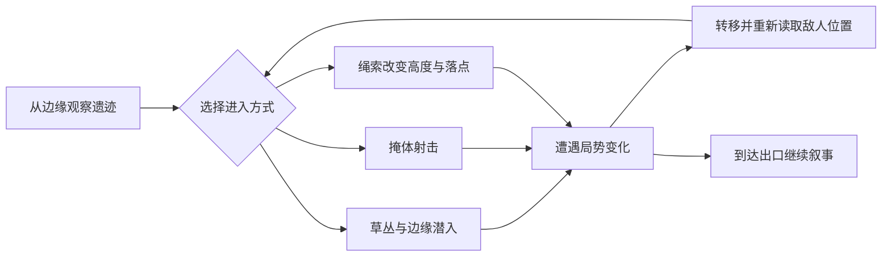

<!-- Imported from 游戏拆解分析/37款游戏拆解案/27_神秘海域4.md; original analysis and evidence boundaries preserved. -->

# 《神秘海域 4》：让冒险更自由，也让主角学会选择生活

> 剧透等级：完整剧情。涉及德雷克与艾莲娜的婚后生活、山姆的谎言、海盗遗产、终局剑斗与尾声。本文以 2016 年《盗贼末路》单人本体为对象，不纳入《失落的遗产》或多人系统；重制版本仅影响呈现条件，不默认改变以下结构。本文未进行本轮实机或逐帧测试。

## 1. 核心论点：结局之所以成立，是因为游戏也让人舍不得冒险

《神秘海域 4》的独特吸引力，是它在系列最成熟的动作冒险里，讨论这种冒险该占据人生多少位置。玩家获得更顺畅的移动、更宽的探索空间与更灵活的遭遇，能够理解德雷克为什么难以离开这一切；同时，家庭、谎言与修复关系又让这种欲望产生现实代价。

如果冒险毫无乐趣，主角选择离开便很容易，人物冲突也会失去说服力。游戏先把回归冒险做得足够诱人，再让玩家看见它与重要关系的冲突。因此，更好玩的关卡并不只是技术升级，也能为角色主题服务。本文分析的重点是两种吸引力如何并存：继续追逐的自由，以及愿意对他人负责的成熟。

结局也没有把解决办法简化为永远停止冒险。尾声呈现的是生活关系与探索兴趣能够重新安排，而不是一方彻底消灭另一方。这使告别保持温暖，也要求前面的关卡充分展示“值得留下的是什么”。

## 2. 场景一：阁楼玩具枪与家庭游戏怎样重新定义英雄

游戏让成年德雷克在家中接触旧物，并在阁楼用玩具枪重演冒险。玩家熟悉的瞄准和射击被放进安全、私人的空间，动作还在，风险却消失了。这个小段落不只是怀旧彩蛋，而是在让玩家触摸一种未被满足的欲望：德雷克已经拥有生活，却仍会回到旧身份里寻找兴奋。

与艾莲娜共处和游玩《古惑狼》的片段，则把“玩游戏”变成两个人生活中的互动。输赢、调侃和日常对话没有巨大外部危险，却展示亲密关系如何存在于普通时间中。玩家因此获得一组与宝藏不同的价值：这个家并不是空洞的道德目标，而是已经可以参与的生活。

这段开场的节奏较慢，也可能让只期待枪战的玩家感到延迟。但它提供了后续选择必需的参照。没有具体的家庭生活，谎言伤害的只是一句抽象承诺；有了共同经历，玩家才能辨认冒险开始时被放在身后的东西。

## 3. 宽线性探索怎样延长冒险欲望而不丢失方向

马达加斯加的越野探索扩大了行进空间，玩家可以停车调查遗迹，也可以沿主要路线继续。车辆使视野和速度放大，下车又把注意力收回到局部细节。山姆与苏利的谈话在移动间延续，探索因此既是找路，也是共同生活在冒险里的时间。

“宽线性”不等于开放世界。整体目的地与叙事顺序仍受控制，扩大的是局部路线、观察顺序和停留时间。官方试玩报告也明确用这一概念描述马达加斯加段落；本文据此界定其自由的尺度，不将宣传中的“大”理解为任意顺序的沙盒。[PlayStation 官方试玩报告](https://blog.playstation.com/archive/2016/04/04/uncharted-4-first-hands-on-report)

取舍在于，探索越宽，玩家越可能偏离人物对话的节奏，或者把遗迹辨识变成寻找下一个可交互点。较好的区域需要有稳定远景和清楚的局部兴趣点，让偏离仍然像主动调查，而非不知道正路在哪。空间面积本身不保证探索感。

## 4. 场景二：遗迹遭遇怎样把绳索变成决策工具

马达加斯加或岛屿遗迹中的遭遇，将高台、草丛、攀爬边缘和绳索连接起来。玩家可以先观察敌人，从一侧进入，也可以主动开火后通过不同高度转移。绳索的价值不只是跨越缺口，而是迅速改变玩家与威胁的相对位置。

摆荡能够跳过一段暴露路线，接近孤立敌人，或者让敌人原先控制的地面不再是唯一通道。与此同时，摆荡轨迹和落点也带来风险：玩家需要知道落下后有没有掩体、会不会进入多条射线，以及是否值得为了近身击倒放弃当前安全位置。只有当这些条件不同，绳索才真正进入战斗选择。

草丛与视线遮挡又让遭遇允许一定程度的脱离和重组。玩家不必把第一次暴露理解为所有潜行选择的终结。开发者在官方访谈中明确强调移动、掩体、近身与绳索之间的连接和策略选择；这支持交互方向，不证明每场战斗都同样开放。[顽皮狗：E3 演示设计访谈](https://blog.playstation.com/2015/06/23/uncharted-4-inside-that-e3-demo/)

<figure>
  
  <figcaption>图 1 · 宽线性空间、绳索与行动选择的联系。用于概括本文分析，不代表游戏内部状态机。</figcaption>
</figure>

查看可编辑图源

## 5. 追车高潮如何把多种移动连成同一件事

马达加斯加追车段落把驾驶、攀挂、拖行、跳车和枪战连成一条事件。玩家的长期目标相对稳定，短期操作则随着所在载具和位置不断改变。这种结构保留了系列的大场面传统，同时展示第四部对动作衔接的投入。

绳索在这里与遗迹遭遇承担不同职责。遗迹中的绳索主要提供路线选择，追车中的绳索更多承担情境连续性：当原本的移动方式失效，它让角色仍然与事件连接。相同能力既可以扩大策略，也可以承接导演安排。分析不能因为使用了同一种工具，就把两者都写成同等自由。

镜头需要同时让玩家看清目标车辆与身体的危险位置。移动速度和多层交通增加壮观程度，却也可能遮蔽即将到来的落点。技术效果应以动作是否连续、关键位置是否可读来评价，而不是仅看物件数量。高度脚本化的段落也需要检查失败后能否迅速重新进入真正的操作问题。

## 6. 与艾莲娜再次同行，为什么比道歉更重要

谎言暴露后，关系受损不会靠一句解释立即修复。后续共同穿越岛屿，让原本熟悉的合作动作在新情绪下重新发生：还是攀爬、寻找路径和应对危险，但两个人如何交谈、是否回应、什么时候重新放松，已经不同。

这类场景让关系变化留在操作时间里。玩家不是看完争执过场，马上进入一个与情绪无关的关卡；同行的沉默、观察和逐步恢复的交流，使修复具有持续过程。相同任务行为能够承载不同关系状态，是成熟叙事设计的重要能力。

反例是所有合作都只为推进路径，即使两人刚刚经历严重冲突，语气和行为也立刻恢复常态。那样的过场与玩法会互相否定。第四部值得学习的是给关系留下余波，但这种余波也需要变化，持续太久的冷淡会使玩家只感到对话被撤走，而不是理解过程在推进。

## 7. 海盗遗产与最终剑斗怎样共同收束执念

海盗聚落与领袖们的遗留痕迹，把追逐财富的共同理想逐步展示为互相猜疑和毁灭。探索不仅负责指向下一块宝藏，也在为眼前人物提供一个极端镜像。玩家通过建筑、文件和灾难遗迹看到，一群人如何在共同目标下走向彼此吞噬。

最终雷夫的剑斗将德雷克从擅长的枪战与攀爬组合中抽离，要求玩家阅读方向与动作，处理一场身体接近、退路有限的对抗。它不是全面考查此前所有武器的毕业考试，而是为角色的执念冲突寻找一种更集中、更不从容的形式。官方回顾明确说明，团队希望这场战斗表现德雷克不再游刃有余的一面。[顽皮狗五周年开发回顾](https://www.naughtydog.com/blog/uncharted_4_a_thiefs_end_the_5_year_anniversary_retrospective)

这种转变也有代价。玩家可能觉得自己积累的射击能力没有在最终战得到充分兑现。是否接受这一点，取决于作品更重视系统综合考核还是人物结局。拆解应说明它选择了什么，并承认失去了什么，而不把特殊战斗天然评价为更高级。

## 8. 3C 的成熟如何让人物既有能力又有重量

第四部的移动观感依赖大量过渡：跑向边缘、接入攀爬、落地调整、进入掩体和接触环境。玩家的操作意图需要快速被接受，人物又不能看起来完全无重量。动作反馈因此是在响应与身体可信度之间安排，而不是单纯追求动画更长或更写实。

镜头也在两种任务之间切换。探索时需要容纳风景、伙伴和远处方向，战斗时需要支持威胁识别与转移，亲密对话又要求更细的表情和姿态。技术细节只有服务这些观察目标时才与策划分析相关。对实际实现，没有公开证据就不推断动作匹配算法或后台路径选择方式。

较高表现精度还会提高玩家期待。伙伴卡住、重复动作或突兀转向，在精致世界中更容易显眼。持续可信比某一个极精细镜头更重要，也需要为非预期停留、反复换向与玩家提前离开准备合理反馈。

## 9. 迁移：让核心乐趣参与主题，而不是等待主题训诫

本作给叙事与战斗策划的共同启发，是先让核心活动值得投入，再讨论它的代价。若故事说角色沉迷冒险，玩法就必须让玩家理解这种诱惑；若故事要求照顾关系，就必须让关系在操作时间里具有可感知的价值。主题可以通过两种好东西之间的冲突成立，不必靠剥夺乐趣来表达。

战斗层面可以迁移“动作共享空间”：同一种攀爬和绳索既服务探索，也进入遭遇；敌人配置则检验玩家是否读懂路线。叙事层面可以迁移“相同动作，不同关系”：第一次共同移动建立熟悉，冲突后重走类似流程展示变化。二者都要求稳定角色和足够连续的场景顺序。

开放世界或多人作品需要额外考虑关系状态和参与者不同步。不能直接照搬固定搭档的沉默，也不能假设每个玩家都按同一顺序体验家庭与冒险。可迁移的是让体验之间存在因果，而不是一套必须原样保留的桥段。

## 来源与论证边界

- [PlayStation：2016 年首次试玩](https://blog.playstation.com/archive/2016/04/04/uncharted-4-first-hands-on-report)：支持宽线性空间及马达加斯加探索的公开描述。
- [顽皮狗：Inside That E3 Demo](https://blog.playstation.com/2015/06/23/uncharted-4-inside-that-e3-demo/)：支持动作之间连接、绳索与策略选择的设计方向；未以演示代表所有最终关卡。
- [顽皮狗：五周年回顾](https://www.naughtydog.com/blog/uncharted_4_a_thiefs_end_the_5_year_anniversary_retrospective)：本文只简要引用最终剑斗的角色表达目标，其余主题联系与评价为本文分析。

未测试敌人感知数值、绳索轨迹参数、输入帧数或玩家路线分布。不同难度和辅助设置会改变可用策略，需要在实证时控制。

---

[返回游戏拆解](/blog/game-breakdown/)
