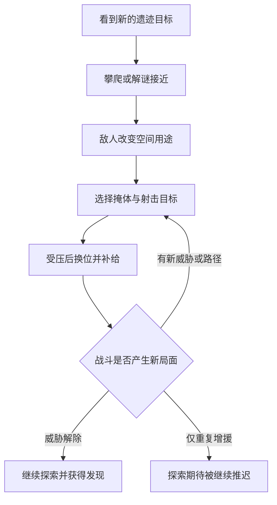

<!-- Imported from 游戏拆解分析/37款游戏拆解案/24_神秘海域1.md; original analysis and evidence boundaries preserved. -->

# 《神秘海域 1》：有限动词如何撑起一场寻宝冒险

> 剧透等级：高。涉及开场海盗、岛屿与遗迹、地堡中的异变生物及黄金乡真相。本文以 2007 年《德雷克的宝藏》单人本体的结构为对象，不将后续作品的绳索、重新潜行等能力移植进来；若使用《德雷克合集》录像，应另注版本。本文未进行本轮实机或逐帧测试。

## 1. 核心论点：第一作建立的是一个可信的冒险伙伴

《神秘海域 1》的辨识度，不在于后续作品那种接连升级的巨大灾难，而在于玩家愿意跟着德雷克、艾莲娜和苏利进入下一处遗迹。探索、攀爬、枪战与斗嘴不断交替，构成一种轻快但有危险的寻宝气质。玩家追逐的既是宝藏，也是“这几个人接下来会遇到什么”。

这套体验依赖少数动作反复变换语境。攀爬可以是进入遗迹的方法，也可以是逃离危险的办法；开枪可以保护同行者，也可以阻止敌人先一步抵达目标。角色的表情、声音和动作把功能相近的关卡连接成旅程。本文将它视为一款依靠人物连续性来组织动作循环的作品，而不是一部被枪战打断的电影。

同时，第一作也最清楚地暴露了这套循环的难题：当敌群不断补充，探索期待会被延迟，轻快冒险可能变成耐心消耗。理解它既要解释角色魅力为何有效，也要指出哪些战斗长度和空间安排削弱了这种魅力。

## 2. 开场船战怎样一次介绍角色、危险与操作

德雷克与艾莲娜在海上打捞棺木，原本是带着摄影机记录发现的工作，海盗随后打断了这种秩序。船只提供有限掩体，敌船与登船者把远程和近距离威胁放进同一小场景，玩家迅速接触瞄准、掩护和处理接近目标的基本要求。

这段战斗不仅是教程。艾莲娜作为记录者对事件的反应，以及德雷克在危险中仍然保留的口吻，明确了人物气质：他有经验，但并不是面对枪火毫无情绪的机器；她也不是一个等待交付的沉默任务对象。苏利的介入则把角色关系放进实际脱险过程，介绍人物的同时继续推动事件。

场景的价值在于信息集中，却没有把所有说明集中成一段旁白。玩家做着最基础的战斗动作，同时知道谁在场、为何遭袭、谁能帮助自己。若把这一段只写成“教射击和掩体”，便遗漏了同一空间如何兼任人物介绍与类型承诺。

## 3. 遗迹探索为何需要先让玩家看见目的地

进入丛林、堡垒与遗迹以后，远处可见的建筑、断开的通路和局部攀爬点，为玩家提供一连串空间目标。关卡并不追求完全自由的考古，而是让玩家在有限范围内读懂“可以怎样继续”。跳跃和攀爬把看见目的地与实际抵达之间的距离变成操作过程。

解谜与手记则赋予德雷克另一种能力：他不只会开枪，也能够把历史信息和眼前结构联系起来。谜题未必需要高度开放的推理，仍然可以通过翻看、观察、调整与结果反馈，表现这个人物的知识。重要的是玩家做了哪一类判断，而不是谜题有没有拦住玩家很久。

环境美术和镜头在这里必须同时服务观赏与指路。可攀爬边缘、明暗对比和空间开口，需要在自然场景中保持可读。过分明确会使遗迹像搭好的障碍课程，过分隐蔽又会让玩家把寻找路径当成找像素。第一作的价值是展示这一平衡问题，并非每个位置都已找到最好的答案。

## 4. 场景一：堡垒庭院怎样把寻路变成阵地判断

堡垒与庭院中的交火，是观察第一作战斗结构的合适样本。玩家进入空间时先寻找前进方向，敌人出现后则必须重新解释相同物体：矮墙成为掩体，高台成为射线来源，楼梯和侧路成为转移通道。一个地方能够同时支持探索与作战，减少了玩法之间的彻底断裂。

敌人从不同方向施压时，固定躲在最初掩体后并不总是可靠。投掷物、逼近和侧向火力促使玩家离开原位置。武器弹药来自场景与敌人掉落，又使玩家在安全和补给之间进行选择。战斗因此有机会形成“观察—压制—转移—补给”的循环，而非纯粹比拼准星稳定性。

但敌群波次会改变这套循环的意义。第一波结束时，玩家可能已经把目标转回寻路；新的敌人如果只是从相近位置补入，就会延迟探索回报，而不提供同等新判断。这里应记录每次增援究竟改变了射线、距离还是目标。若都没有改变，数量只是拉长战斗，人物的冒险步伐便被拖慢。

<figure>
  
  <figcaption>图 1 · 移动、射击与探索组织冒险的流程。用于概括本文分析，不代表游戏内部状态机。</figcaption>
</figure>

查看可编辑图源

## 5. 射击、近身与受击怎样塑造“会狼狈的英雄”

德雷克的身体表达与纯粹军事角色不同。攀爬时的伸手、落地后的调整、受压时的反应和战斗中的台词，会把高效率的玩家输入呈现成有风险的临场行动。玩家知道主角能力很强，同时仍然看得到他的狼狈。这使夸张脱险具有喜剧空间，也让艾莲娜和苏利的评价有了对象。

射击采用自由瞄准，使命中由玩家负责；近身则让距离缩短为直接的身体接触。二者交替时，玩家能感觉德雷克在用手边办法处理局面。开发者复盘明确记载，团队曾尝试自动锁定，后来改用手动瞄准。这可以支持“瞄准参与感是重要取舍”，不能据此推断每个参数的目的。[Druckmann 与 Lemarchand 的开发复盘](https://www.richardlemarchand.com/wp-content/uploads/2025/11/GDM-April-2008-UDF-Postmortem.pdf)

可信也有边界。写实的人形外观容易让玩家期待较少命中就产生结果，较长耐久则可能破坏身体反馈。不能只用减少血量解决全部问题，因为目标存活时间也决定战术窗口与遭遇长度。需要让受击反馈、敌人识别与场景压力共同匹配，而不是把“真实”当成一个孤立数值。

## 6. 场景二：地堡异变怎样改写此前学会的战斗习惯

地堡中的异变生物使作品从人类雇佣兵与海盗的寻宝冲突，转入更直接的恐怖压力。玩家此前习惯阅读敌人的枪口、掩体和距离，面对快速逼近的生物后，躲在固定掩体后的收益发生变化。威胁不再主要是对面射来什么，而是它多久会冲到身前、自己还有没有移动空间。

这使同样的枪械与移动规则产生新体验。短距离内迅速处理目标、避免被包围、保持可用通路，变得比维持一个稳定射击阵地更重要。较暗和封闭的环境又限制玩家提前确认所有入口，放大了近身危险。主题上的“宝藏具有灾难性代价”于是获得战斗层面的对应，而不只是一条结尾说明。

这种转调能带来惊喜，也可能让喜欢轻快寻宝的玩家感到类型突然变化。它的成立依赖前面的遗迹线索、空间气氛和足够短的集中呈现。若为制造新鲜感不断加入不受共同世界观约束的敌种，作品就会失去统一语气。此处可迁移的是用威胁结构重估旧动作，而不是把恐怖怪物视为万能高潮。

## 7. 伙伴对话怎样让线性路线保持人物连续性

德雷克、艾莲娜和苏利的对话经常不是正式情节通报，而是怀疑、试探、嘲讽和担心。字面上谈的是眼前状况，语气和停顿却在表达相互信任的程度。玩家从一个战场前往下一个战场时，关系仍然在移动中持续变化，减少了“剧情只在过场发生”的割裂。

寻宝目标也会被关系重新排序。继续追逐发现还是照顾同行者，不仅是对白立场，还会体现在等待、救援和重新会合中。结尾对黄金乡真相的揭示，使之前被视为财富的对象变成需要阻止流出的危险；角色的目标因此从占有转向处置，冒险获得了收束的理由。

与后续作品相比，第一作的人物变化更集中、结构更直线。这不必被写成缺点：清楚的目标和少量关系，能让玩家迅速投入。问题只在于同一段关系信息是否被过长的战斗间隔稀释，或者人物已经表达了变化，关卡行为却仍像没有发生过。

## 8. 第一作最值得学习的取舍，不是照搬波次

它证明少数通用动作足以支撑动作冒险，但前提是空间、目标和语气持续变化。庭院中的掩体枪战、遗迹中的攀爬与地堡中的移动求生，使用了重叠的能力，却要求玩家关注不同信息。内容扩展并不必然依赖新按钮，而可以依赖旧按钮承担的新职责。

同时，战斗密度需要服从冒险承诺。若玩家为了发现遗迹而前进，每场交火最好能够让路线、关系或威胁发生一点变化。将高低差、入口与前进目标一并设计，比先造一个漂亮庭院、再不断添加敌人更容易维持节奏。开发复盘也讨论了关卡早期迭代不足的问题，但本文不把某一场遭遇的缺点直接归因于未公开的生产过程。

对资源较少的项目，可先用一张白盒地图验证两件事：玩家能否清楚读到下一个冒险目标；敌人出现后是否以有意义的方式改变这张地图。再用两位伙伴的行为与简短对话解释关系。人物魅力需要具体反应，单靠不断说俏皮话容易成为噪声。

## 9. 迁移边界与来源

本作的线性结构适合高度控制的单人旅程。若迁移到开放世界，需要解决玩家从不同方向进入场景、伙伴不在场以及叙事顺序不确定的问题；若迁移到多人合作，则要重新安排镜头和等待，不能假设所有人同时看见同一处表演。

第一作也不适合用后续的成熟能力倒推评价。它没有第四部的绳索网络，也没有第二部同等规模的移动场景变化；应评价它如何建立角色、空间和动作的基本关系，再讨论哪里为续作留下了明确的问题。这样得到的结论才可以指导设计，而不只是说明新作比旧作更精致。

- [Neil Druckmann、Richard Lemarchand：2008 年《Drake's Fortune》开发复盘](https://www.richardlemarchand.com/wp-content/uploads/2025/11/GDM-April-2008-UDF-Postmortem.pdf)：本文简要使用手动瞄准方向、集中动作与迭代取舍的公开信息；其余场景因果为本文分析，未复述整篇开发史。
- [顽皮狗：系列十周年回顾](https://www.naughtydog.com/blog/uncharted_10th_anniversary)：用于确认第一作在系列中的历史范围，不作为战斗机制细节的证据。

本文没有测量敌人命中次数、刷新条件、掩体判定或控制延迟。实际素材应记录原版与合集差异、难度与瞄准设置，避免把版本体验混成统一事实。

---

[返回游戏拆解](/blog/game-breakdown/)
