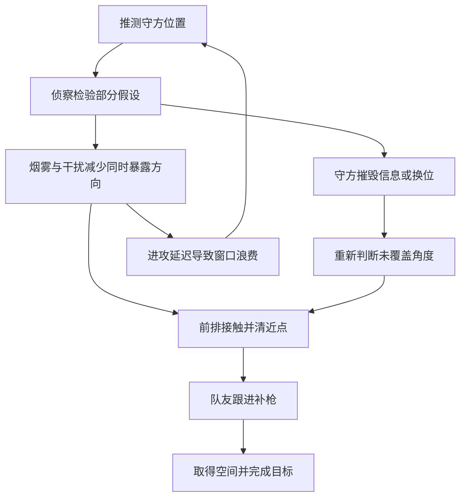

<!-- Imported from 游戏拆解分析/37款游戏拆解案/12_无畏契约.md; original analysis and evidence boundaries preserved. -->

# 无畏契约：英雄技能怎样把一次进点变成有组织的冒险

> **分析范围**：PC 标准爆破规则的基础设计，围绕猎枭与幽影的侦察、遮挡和视野干扰能力展开；不覆盖极速模式、娱乐模式、主机瞄准细节及 2026 年最新平衡。代表技能依据官方角色页核查，不使用冷却、价格、持续时间等版本敏感数值。
>
> **剧透提示**：无剧情剧透，包含 Ascent A 点的示意性战术分析。两组场景是根据公开规则构造的案例，不是职业赛复盘或实测结论。

**核心论点：无畏契约把英雄差异放进了一个高度共享的射击规则里。技能最重要的作用，是让团队能够主动安排“在什么信息条件下，与多少个角度同时交火”；枪械负责把这些准备兑现成结果。**

## 1. 最吸引人的瞬间，是计划真的发生了

一次成功进点不一定包含惊人的个人击杀。侦察逼出防守者的位置，烟雾暂时封住高台枪线，前排进入场地，后排跟上补枪，最后有人安全安装爆能器。每个操作单看都很短，但当它们按次序接起来，玩家会看见自己的决定如何成为团队结果的一部分。

这里的紧张感来自准备与兑现之间的距离。玩家可以事先知道计划，仍然不知道守方是否换位、对方还有哪些技能、第一枪会打向哪里。计划减少未知，但无法消灭对抗。若技能能完全保证进点成功，执行就只剩按步骤操作；若技能毫无帮助，准备又会变成装饰。

因此，无畏契约的英雄设计不能只问技能强不强，还要问它究竟改变了哪一个交火条件。它是让玩家知道一个位置有人，暂时看不见某条枪线，还是迫使敌人离开原本舒服的站位？当这个改变能被队友利用，个人技能才获得团队意义。

## 2. 共享枪战规则，为英雄差异提供共同地面

不同英雄的技能差别很大，但多数常规交火仍要面对瞄准、掩体、移动时机与枪线暴露。玩家不会因为选择控制者，就自动免于被侧面击杀；选择决斗者，也不意味着可以无视队友位置。英雄提供获得优势的方法，共享枪战决定优势需要怎样使用。

Riot 在 [网络与战斗设计文章](https://www.riotgames.com/en/news/peeking-valorants-netcode)中把信息获取与拒绝、协调移动、逐角清理，以及使用技能取得优势列为其战术射击设计关注点。本文据此讨论的是规则关系，不把技术目标当成每局网络表现或公平性的保证。

共享规则带来的好处，是对手可以用熟悉的枪战语言理解陌生能力。被烟雾挡住时，玩家知道自己失去了可见信息；被迫退出角落时，知道接下来要重新找掩体。能力增加题目，基础射击提供共同解题方式。危险在于能力数量持续增长后，特殊例外可能过多，玩家不再能凭通用经验推断结果。

## 3. 猎枭与幽影：增加信息与减少暴露

猎枭的侦察箭会揭示处于其可见范围内的敌人，而且可以被摧毁；幽影的烟雾球阻挡视野，暗魇会干扰被命中者的视野范围。这些基础功能见 [猎枭官方页](https://playvalorant.com/en-us/agents/sova/)与[幽影官方页](https://playvalorant.com/en-us/agents/omen/)。这里不罗列全部技能，因为拆解对象是两种能力如何共同处理进点风险。

猎枭帮助团队回答“这里可能有人吗”。侦察箭的价值不仅在于成功显示一个轮廓，也在于让守方决定要不要开枪暴露自己、离开位置，或继续躲在侦察视线之外。没有扫到人不等于整个区域无人：遮挡关系决定信息范围，过度相信侦察结果仍会产生错误。

幽影处理的则是“我们现在不想同时面对哪些方向”。烟雾改变可见枪线，却没有删除里面的人，也没有变成实体掩体。它允许团队暂时把一个复杂空间拆成较少的交火方向，但穿烟者、近点守卫与烟后反清仍然存在。

| 设计问题 | 猎枭的侦察 | 幽影的遮挡 |
|---|---|---|
| 改变的条件 | 缩小敌人位置的不确定性 | 减少某些方向的即时可见威胁 |
| 队友应当接什么 | 根据结果调整预瞄、清点与出枪 | 在遮挡有效时通过危险区域 |
| 对手保留的选择 | 摧毁、避开视线、重新站位 | 穿烟、转移、等待、从别处看点 |
| 常见误读 | 没扫到就一定没人 | 下烟后这条方向就绝对安全 |
| 失败的本质 | 信息的范围被误当成全局 | 暂时的视野优势没有及时兑现 |

## 4. 场景一：Ascent A 点的进攻如何拆成可处理的问题

设想进攻方从 A 主道准备进入 A 点。防守者可能从高台、场内掩体及近点发起交火。若所有进攻队员同时从入口向前跑，每个人都要在很短时间里判断多个位置，队友还可能互相挡住移动路线。人数多不必然等于有效火力多。

幽影先遮住预定的远端枪线，猎枭再用侦察确认部分场内位置。前排清近处，第二人把准星放在前排最可能接触的位置，后排检查没有被技能覆盖的角度。三类行动分别负责减少方向、缩小未知与保证第一人接触后有人能立即响应。

关键不在于技能全部用出来，而在于它们的时间关系。若烟先落很久，队伍却仍停在入口讨论，有限窗口就没有产生空间收益；若侦察信息出现时无人能出枪，守方可能完成换位；若前排一人先冲出去，后排还在准备技能，所谓协同只存在于口头计划里。

守方可以摧毁侦察箭后改到另一侧，也可以主动接近烟边，让进攻方对“已封住方向”的理解失效。于是成功进点并非消除守方选择，而是让守方在更短时间内做更多决定，再由进攻方抓住其中一个未被覆盖的窗口。

## 5. 场景二：同一套技能，在回防时改变了使用顺序

爆能器安装之后，空间的价值会改变。先前要进入的一片区域，现在有了必须处理的目标；时间不再只是回合长度，而是回防方必须完成清点与拆除的预算。守方可以不主动找枪，只要维持对关键位置的威胁，就可能迫使对方花掉时间。

设想猎枭与幽影从不同入口回防。若猎枭独自探出寻找击杀，他可能获得一人的信息，却无法让另一位队友立即受益。更有效的协同关系是先确认双方能同时接触战区，再用侦察或干扰迫使目标附近敌人暴露，烟雾切断另一个较远方向，形成局部可处理的接触。

这一阶段，技能是否还在手上本身就是之前决策的后果。前半回合为了生存用掉烟雾，可能让后半回合回防更难；为了保留工具而过早丢失位置，也可能导致没有回防机会。不存在一个适用于所有局面的“永远留技能”。设计的张力来自当下收益与未来用途都真实存在。

这个案例还能解释为什么击杀数不足以评价技能贡献。幽影可能没有拿到最后一个人头，却创造了队友能安心处理近点的窗口；猎枭也可能造成很少伤害，但让队友不必浪费时间检查一个危险角度。贡献发生在决策成本和暴露风险的变化上。

## 6. 英雄协同应当产生顺序，不能只堆叠效果

同一时间释放更多技能，不一定产生更好的进攻。侦察揭示的位置若被己方视野干扰遮住，队友未必能立即利用；前排已经通过入口，后排才投出辅助技能，也可能错过真正需要保护的时间。团队协作的基本单位应是一个接力关系：谁先改变条件，谁接着行动，谁处理行动的后果。

英雄职责也不应被简化成固定站位。控制者常负责安排枪线，但仍要参与补枪；先锋创造接触条件，但不能代替队友完成清点。职责告诉玩家主要关心什么，不是宣布其可以不理解其他环节。当职业分工过度僵化，队友失误会迅速变成互相归责，临场补救反而减少。

<figure>
  
  <figcaption>图 1 · 侦察、遮挡、接触、补枪与目标执行的流程。用于概括本文分析，不代表游戏内部状态机。</figcaption>
</figure>

查看可编辑图源

## 7. 清晰度与公平的代价：能反应不等于有好选择

战术射击里的能力反馈需要回答三个问题：发生了什么、影响哪里、现在能做什么。烟雾给出明显边界，侦察装置让对方知道信息从哪里来，视野干扰则需要让受影响者理解自己的感知状态。明确反馈可以让玩家把失败归因到可学习的原因。

但“有提示”仍不代表一定公平。一个守点者可能看见所有技能，却在狭窄地形里没有时间或路线应对。相反，若每种技能都很容易用一枪解决，进攻准备又可能不足以改变守方优势。平衡涉及地图宽度、技能投放位置、队友跟进距离与可逃空间，而不只是一项伤害或持续时间。

对竞技体验更有用的检验，是失败者能否指出一个合理的不同选择。可以更早撤退、换站位、保存反清工具，说明局面仍有学习路径；只能寄望对方失误，说明某种组合可能挤压了选择空间。这个判断需要具体地图和阵容案例，不能仅凭一次被连续控制的感受宣布整个系统失衡。

## 8. 与 APEX、守望先锋的英雄设计差异

APEX 的英雄经常帮助队伍在开放地图里延长或重置交火；无畏契约更重视在明确目标和回合约束下，为一次高风险接触创造条件。失去一名队员会立即压缩可覆盖的枪线，因此前期准备与补枪关系格外突出。这里的核心快感更接近“把不确定局面变得可以执行”。

守望先锋则让武器形式、移动方法和保护职责都随着英雄发生大幅变化，阵容本身就定义了一种交战方式。无畏契约即使使用英雄技能，仍然让常规枪械与射击基本功承担大量结果判定。学习新英雄因此既包含新的信息工具，也保留了可迁移的枪战能力。

设计上的启示是：先决定英雄要改变哪一层规则。若希望玩家靠共通枪战技巧建立长期掌握感，就让能力更多改变接触条件；若希望不同英雄像不同玩法，就需要接受更高的规则学习成本。两者都可以成立，但不能一面增加大量例外，一面假设玩家始终能凭一套通用经验理解公平。

## 9. 从拆解到可执行的设计原则

这套设计的代价是高度依赖同步。独立发挥仍然重要，但一个玩家可能已经创造良好窗口，队伍却没有人跟进。技能使用次数、伤害与击杀又难以完整显示这种贡献，容易让玩家高估可见结果、低估前置准备。新手还需要同时学习地图、枪械和英雄能力，初期认知压力不低。

可迁移的原则不是“每个角色都要有烟和闪”，而是让一个能力清楚改变一种交火问题，再给队友明确的利用方式，也给对手保留可理解的应对。设计文档应当能写出一句完整因果句：这个能力减少了哪种风险，因此谁可以采取原本不合理的行动，而对手能通过什么重新制造风险。

以猎枭与幽影为例，侦察让部分未知变成可处理信息，遮挡让复杂空间变成暂时较简单的枪线组合。真正有吸引力的英雄合作，发生在团队把这两种变化接成一次行动时。技能提供准备，执行保留悬念，结果让玩家看见自己的准备是否正确。

## 资料与证据边界

- [Riot：Peeking into VALORANT's Netcode](https://www.riotgames.com/en/news/peeking-valorants-netcode)：支持战术射击的公开设计目标，不用于宣称所有网络环境都满足目标。
- [猎枭官方角色页](https://playvalorant.com/en-us/agents/sova/)：支持侦察箭受可见范围约束、可被破坏的基础规则。
- [幽影官方角色页](https://playvalorant.com/en-us/agents/omen/)：支持烟雾遮挡与暗魇视野干扰的基础规则。

角色页属于动态资料；本文不据此回填历史数值。场景、体验解释与设计迁移均为原创分析，不代表职业战术推荐、胜率统计或玩家偏好调查。

---

[返回游戏拆解](/blog/game-breakdown/)
