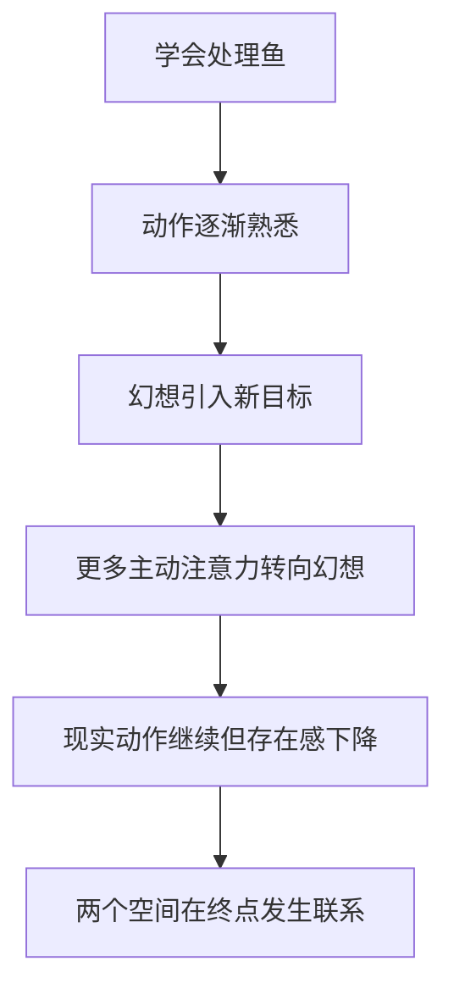

<!-- Imported from 游戏拆解分析/37款游戏拆解案/33_艾迪芬奇的记忆.md; original analysis and evidence boundaries preserved. -->

# 艾迪芬奇的记忆拆解案
## 操作如何让玩家参与一种感知方式

**范围：**《What Remains of Edith Finch》完整单人流程。**剧透级别：高，涉及Lewis、Walter等家族成员的经历及叙事结构。**本文讨论作品如何表达经历，不把其中的叙述当作现实心理诊断。资料核对：2026年9月20日。

## 核心判断

《艾迪芬奇的记忆》通过不断改变操作方式，让玩家短暂采用另一个人的注意力、习惯与想象。它的叙事并不主要要求玩家决定事件结局，而是让玩家亲手经历某种状态怎样逐渐变得可以理解，又怎样走向无法挽回的结果。

这解释了为什么“故事好”仍然不够完整。若把各段情节整理成文字，家族关系和死亡事实可以保留，但操作中的重复、注意力分配、身体节奏与视觉遮蔽会消失。这些恰好是作品最值得拆解的部分。

## 一 房屋把人物关系变成可穿行的结构

玩家探索的房屋同时是住所、纪念物和故事目录。进入一间房间之前，门上的信息、封闭的入口与能够窥见的内部，先建立“这里曾经属于某个人”的预期。生活用品保留个体痕迹，房间状态又暗示家族如何对待逝者。

空间顺序决定了信息顺序。玩家不能同时理解所有人的故事，而是在移动中不断增补关系。路径也让公开的家族叙述与私密空间形成区别：正常入口不可用时，穿过其他通道像是在接近一种不愿被直接打开的记忆。

这里的“房屋是家族记忆”是解释，而不是说建筑每个部件都有唯一象征。设计有效之处在于，空间确实承担了人物索引、叙事排序与情绪准备三种可观察功能。

## 二 短篇之间变化的是玩家与故事的关系

每个短篇采用不同的视觉和交互组织，使玩家无法长期依赖一套熟练操作。刚进入新故事时，理解规则本身就是一次认识人物的过程。动作承担的功能也随人物变化：可能是追逐、摆动、重复劳动，或尝试与封闭环境建立联系。

规则更新频繁，却通常不要求长时间训练。作品需要玩家把有限注意力留给情境，因此操作复杂度更像精确的表达预算：足以让身体参与，又不能高到使玩家只关心过关。

开发者曾说明，每个故事都希望具有独特形式，未知与惊异是重要追求；同时强调家屋与短篇世界之间的差别。[开发者关于创作来源的说明](https://blog.playstation.com/archive/2017/04/25/the-personal-stories-that-shaped-remarkable-ps4-adventure-what-remains-of-edith-finch-out-today/) [早期开发访谈](https://blog.playstation.com/2015/05/27/the-death-and-darkness-in-what-remains-of-edith-finch/)

## 三 必然结局为何仍然需要操作

在通常的挑战游戏中，玩家行动的重要性体现为改变胜负。本作经常让玩家知道终点不会因为操作更熟练而改变。行动的价值因此转移到理解过程：手上做了什么、注意力去了哪里，以及什么时候意识到已经接近终点。

这类有限能动性可以产生参与感，也可能造成拒绝。玩家可能不愿继续执行导致不幸的动作，却没有足以改变结局的选项。作品需要依靠前面的关系和感知铺垫，让这种不适具有叙事意义，而不是仅用按钮迫使玩家承担责任。

因此不应把它概括为“交互越多越能共情”。真正起作用的是交互形式与角色处境是否对应。无关的小游戏只会延迟文本；具有相同注意力结构的操作，才可能让玩家理解文本难以直接传达的经历。

## 四 案例一 Lewis的两项任务如何争夺注意力

Lewis的罐头工厂片段先要求处理鱼，再让想象世界逐渐进入画面。现实劳动具有较稳定的重复节奏，幻想部分则不断提供新的空间和目标。玩家一边继续完成简单动作，一边将更主动的注意力交给更有变化的一侧。

这个结构使“人在工作，心思已经离开”具有操作对应。重要的不是屏幕同时出现两个世界，而是两项任务对注意力的要求不对称：熟悉任务可以逐渐自动化，新的探索则不断要求判断。现实动作仍在继续，现实存在感却可能下降。

随着幻想占据更多感知空间，玩家对任务主次的理解也发生变化。故事表达因此通过画面占比、任务新鲜度和重复输入共同完成。创意总监明确谈过让玩家习惯机械动作，再把注意力引向幻想的目标。[Lewis片段开发访谈](https://blog.playstation.com/?p=189932)

这一案例不能外推为某种真实心理状态的完整模拟。玩家始终知道自己正在体验作者编排的段落，而且不同人的操作习惯会影响注意力分配。更稳妥的结论是：两项任务的组织，为理解角色处境提供了一个可参与的形式。

<figure>
  
  <figcaption>图 1 · 交互动作、注意力与人物感知的联系。用于概括本文分析，不代表游戏内部状态机。</figcaption>
</figure>

查看可编辑图源

图示是体验结构，不表示所有玩家都会按完全相同的心理速度变化。

## 五 案例二 Walter的重复如何让离开具有重量

Walter的地下生活通过受限空间与日常重复建立稳定秩序。玩家接触到的行动范围有限，外部世界更多以声音和叙述的方式存在。长时间的生活被压缩为少数可辨认的动作，重复因此承担了时间跨度。

当离开的机会出现时，行动本身并不需要复杂系统。此前已经被反复建立的封闭状态，使朝外走这件事获得足够大的变化幅度。玩家经历的是从可以预测的狭小环境走向无法控制的外部，而不是简单从房间A进入房间B。

这一段落也说明，节奏缓慢需要有清楚的基准。如果重复没有建立稳定性，离开就缺乏对照；如果重复持续得过久又没有新的信息，玩家会在变化出现前失去耐心。短篇的长度与动作次数，是表达中的重要取舍。

## 六 文字 摄像机与移动共同组织阅读

文字经常与空间和视线发生联系，使阅读不完全脱离行走。玩家看到一句话的同时，也在接近某件物品、转向某处或跨过一个门槛。文本的位置与出现时机，因此参与了节奏，而不仅是字幕排版。

摄像机有时扩大视野让人观察，有时收紧注意力让玩家接近特定对象。角色移动的速度与可观察物件的密度，也会决定玩家能否同时接收信息。若信息在动作忙碌时出现，阅读和操作就会竞争；如果两者相互等待，叙述可能变得机械。

对3C的评价应围绕作品目标。它不追求高强度动作游戏的连续自由，而需要稳定地引导观察，同时保留玩家自行靠近与辨认的感觉。能控制多少不是唯一标准，控制何时帮助玩家参与才是重点。

## 七 家族故事的不确定性需要保留

不同成员的经历通过日记、讲述、媒介与回忆进入玩家视野。叙述本身带有视角，奇异画面也未必等于世界的客观规则。如果直接把每个短篇当作完全可靠的事实，家族如何理解自身命运这一层就会消失。

作品可以同时容纳“发生了什么”和“人们怎样讲述它”。玩家在探索中收集的不只是死亡事件，也包括一个家庭保存、解释和重复这些事件的方式。所谓诅咒是否应被按字面理解，并不是拆解时必须替作品做出的唯一裁决。

这种开放性依赖具体性支撑。房间、物品与个人行为足够具体，玩家才能在不确定的解释之间思考；如果所有内容都抽象模糊，开放解读就可能退化为无从判断。

## 八 叙事取舍与重玩边界

本作的强项是集中而多变的首次体验。规则的新鲜、形式转换和不可预知的结尾，在第一次接触时尤其有效。再次游玩时，玩家更容易注意到铺垫与结构，但惊异感不可能完全保留。

低失败压力也让更多注意力留在情绪与解释上，同时减少了通过技能成长反复游玩的动力。这是作品类型的选择，不需要通过增加收集或难度来证明其价值。若增加惩罚导致玩家重试同一叙事动作，原本的脆弱感反而可能变成烦躁。

| 设计选择 | 可能产生的体验 | 必须承担的限制 |
|---|---|---|
| 短篇采用不同操作 | 每个人具有独特感知方式 | 规则需要迅速可懂 |
| 结局相对固定 | 注意力转向经历与意义 | 玩家可能拒绝被迫参与 |
| 房屋组织故事 | 人物关系可被空间化理解 | 路径会控制阅读顺序 |
| 保留叙述不确定性 | 玩家能思考记忆与解释 | 不能把含混当作深度本身 |

## 九 对其他游戏设计的启示

最值得迁移的，是把人物状态转译为注意力结构，而不是只让角色说出自己的感受。疲惫可以体现在重复任务与观察范围，犹豫可以来自两项都合理的行动要求，依赖可以表现为必须等待另一人的信息。

在战斗游戏里，这种思路可以用于特殊关卡、角色章节和短暂状态变化。但不能为了表达情绪突然破坏玩家已经依赖的基础控制，而不给任何提示。变化需要让玩家理解“角色正在经历什么”，而非怀疑系统出了故障。

若要验证这种设计，应关注玩家是否注意到想表达的关系，能否在不看解释的情况下描述自己在做什么，以及操作是否与情境产生关联。感动与否无法由一张机制表保证。

## 资料与证据边界

- [创作来源与短篇形式](https://blog.playstation.com/archive/2017/04/25/the-personal-stories-that-shaped-remarkable-ps4-adventure-what-remains-of-edith-finch-out-today/)：开发者对独特故事形式的说明。
- [家屋与故事世界的开发访谈](https://blog.playstation.com/2015/05/27/the-death-and-darkness-in-what-remains-of-edith-finch/)：支持视角和两类空间的创作背景。
- [Lewis片段访谈](https://blog.playstation.com/?p=189932)：支持重复劳动与幻想争夺注意力的明确设计目标。
- Walter、房屋及叙事可靠性的论述为对游戏内容的分析，不是对开发者意图或玩家心理状态的全面实证。

---

[返回游戏拆解](/blog/game-breakdown/)
