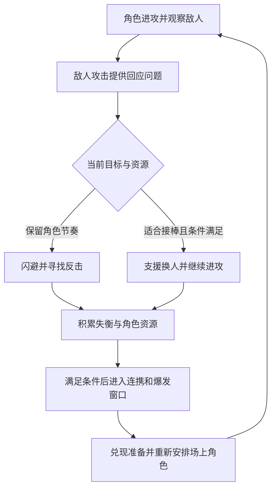

<!-- Imported from 游戏拆解分析/37款游戏拆解案/18_绝区零.md; original analysis and evidence boundaries preserved. -->

# 绝区零：怎样把一次正确防御，接成整支队伍的动作高潮

> **分析范围**：2024 年 1.0 首发的基础战斗，以 A 级安比、妮可、比利组成的狡兔屋队伍为例，讨论 3C、支援换人、失衡与角色体验。本文不涉及后续同名角色形态、现行异常队伍或 2026 年强度。首发终结技资源与后续版本存在变化，正文明确标注。
>
> **剧透提示**：包含首发普通敌人杜拉罕及六分街日常，不涉及章节结局。战斗场景为公开规则下的构造案例，不是实测连段；不提供帧数、无敌时间或伤害倍率。

**核心论点：绝区零的鲜明体验，是让玩家以相对容易理解的输入，参与一段角色轮流接棒的动作演出。防御、换人和进攻被安排在连续关系里，使“我躲过了一击”能够立即发展为“我们开始反击了”。**

## 1. 动作爽感来自玩家知道自己做对了什么

屏幕上出现很多特效并不足以产生稳定的爽感。玩家需要先感知威胁，再作出输入，最后从声音、动作和敌人反应里确认自己的决定有效。绝区零把这段因果做得非常靠近：敌人准备攻击，玩家选择闪避或符合条件的支援，角色随即以明显动作进入反击过程。

这使防御不只是暂停输出。一个成功时机可以带来新的登场角色、新的攻击方向与下一段连贯动作。玩家没有先退出战斗节奏、等危险结束再恢复输出，而是在回应敌人时继续参与节奏。输入次数不一定很多，但每次正确选择都有机会获得较强的表现确认。

制作人李振宇在[首发前开发介绍](https://blog.playstation.com/2024/06/28/zenless-zone-zero-debuts-on-ps5-july-4-details-on-combat-new-area-and-characters-unveiled/)中明确提到连携、极限支援和角色切换，以及易上手与复杂度的平衡。本文将其视为公开设计方向，而不据此断言所有玩家都感到简单或爽快。

## 2. 3C 的作用，是让操作意图容易抵达目标

3C 在这里指角色控制、镜头与操作输入的整体关系。玩家想攻击某个敌人，角色需要以可预期的朝向和距离接触目标，镜头需要让下一次威胁仍然可见，输入则需要让玩家分清普通攻击、强化技能、闪避和切换的用途。任一环节失配，华丽动作都会暴露出不受控感。

角色攻击中的位移和追击表现，可以减少玩家不断微调距离的负担，让注意力更多停留在敌人动作与换人时机上。但这种帮助也有代价：当附近有多个目标时，玩家必须能够理解攻击为何朝向其中一个；如果镜头或目标选择与预期不符，操作就可能变成看系统替自己完成动作。

镜头既负责展示角色，也负责传递战斗信息。拉近和强调登场能强化角色个性，却可能暂时压缩对周围敌人的观察。战斗策划需要把表现强度与危险密度一起设计：演出越占据视野，越要考虑玩家接下来是否有足够信息恢复判断。这是结构性取舍，不能只用“镜头更炫”评价。

## 3. 安比、妮可、比利：不同角色接不同一段工作

首发安比以近战与失衡积累体现击破角色的作用，妮可以以太攻击和聚拢类效果帮助组织目标，比利则以双枪与远程表现形成另一种输出手感。这些角色属于狡兔屋的基础身份可在[官方角色展示站](https://zenless.hoyoverse.com/m/en-us/main)核对；本文讨论其首发基础动作，不采用网站后续新增形态的规则。

安比让玩家关注连续近身接触与敌人何时进入可利用状态。妮可让玩家关注敌人是否集中、队友接下来能否覆盖更多目标。比利则让距离和射击表现更加突出。队伍价值不在于三人都能造成伤害，而在于每个人进入场上时能让接下来的一段行动更合理。

| 角色 | 本文关注的首发体验 | 给下一个角色创造的条件 | 容易出现的误区 |
|---|---|---|---|
| 安比 | 近身连段与失衡积累 | 更稳定的爆发与连携机会 | 为打完动作忽略敌人反击 |
| 妮可 | 改善多目标组织与支援衔接 | 让后续攻击更容易覆盖有效目标 | 无论敌人分布如何都照固定次序使用 |
| 比利 | 双枪表现与远程输出节奏 | 在合适窗口兑现队伍准备 | 把远程理解成无需关注距离与敌人行为 |

这不是一份最优配队指南。使用首发队伍的意义，是在低解释成本下看清三个角色怎样接棒。强度或具体循环需要按养成、关卡与版本另行验证。

## 4. 换人为何能成为防御动作的一部分

在许多角色切换游戏中，换人主要发生在主动轮换输出时。绝区零把一部分切换放在敌人攻击的回应窗口里：玩家不仅选择“我怎样避开”，还选择“下一位角色怎样接住这次攻击”。支援类型、可用资源与具体攻击条件决定可执行方式，不能把所有提示都理解为无条件格挡。

这种关系让场下队员保持存在感。他们并非等待技能冷却的图标，而是可以在危险来临时进入动作链的人。换人也不只改变屏幕上的模型，而会改变角色位置、攻击节奏和下一次操作预期。玩家对整支队伍的认识因此通过反复接棒建立。

但将防御与换人绑定，也会使队伍顺序成为实际操作问题。玩家要知道即将登场的是谁、其进场后适合做什么；只凭提示反复按切换，即使成功躲过攻击，也可能让后续输出节奏变乱。易上手的是进入这条动作链，熟练度则体现在能否有目的地安排它。

## 5. 场景一：面对杜拉罕，一次防御怎样转成爆发准备

设想安比正在近身攻击杜拉罕，敌人开始一段明显的近战进攻。玩家此时面临三个层次的问题：是否继续完成当前动作、用闪避保留安比在场，还是在满足条件时通过支援换到下一位角色。相同威胁可以根据队伍状态得到不同回应。

若玩家只为追求漂亮支援，每次看到机会就切换，可能不断打断原先希望完成的积累；若始终贪图当前连段，又可能承担不必要伤害。合理选择取决于失衡进度、角色资源以及下一人进入后能否继续有效接触。防御判断因此与队伍规划连在一起。

当敌人进入失衡并满足连携条件，战斗节奏开始从应对转向兑现。妮可参与衔接，比利在适合的窗口承担输出，前面的防御与积累就被转换成较集中的动作高潮。玩家看到的不是一个独立 QTE 奖励，而是之前多次正确判断共同换来的阶段变化。

反例是资源尚未准备好就进入失衡，或登场后没有及时对准有效目标。此时画面仍然华丽，但实际利用窗口的程度较低。这个差别很适合说明表现成功与战术成功并不总是同一回事，系统需要让熟练玩家看见自己还有优化空间。

## 6. 场景二：分散小怪检验的是组织能力，不是同一套循环

再设想几个普通敌人散在战区不同位置。若玩家照搬单体精英的固定顺序，可能花很多时间追逐目标，刚准备好的攻击只命中一人，连携又把注意力带向已经接近被击败的敌人。问题不是角色弱，而是同一套动作没有服务当前目标分布。

妮可的聚拢用途在这里更容易被理解：先改善目标位置，再让后续范围或远程攻击覆盖有效区域，可以减少移动与重新选择目标的成本。安比不必在每个弱小敌人身上完整执行一次精英战思路，比利的攻击也需要观察敌人是否仍处于合适范围。

这个案例说明，队伍分工应当允许随局面改变主次。精英战强调稳定回应与失衡窗口，多目标战更强调目标组织、攻击覆盖和减少无效移动。若不同关卡始终奖励完全相同的轮换次序，角色切换就容易从战术语言退化成固定播放列表。

## 7. 失衡、能量与终结技，为高潮设定准备和代价

失衡提供一个清楚的阶段目标，让玩家知道当前攻击除了削减生命，还在为下一段更稳定的输出创造条件。角色能量又决定强化技能何时可用，玩家需要考虑现在投入能否推进局面，还是保留到更合适的窗口。

首发时终结技使用涉及队伍共享的喧响值，因此选择谁释放会影响其他人的机会。这个历史边界非常重要：官方明确宣布 **1.4 起终结技喧响值不再共享**，不能把首发分析套在现行版本上。[1.4 开发者介绍](https://blog.playstation.com/2024/12/06/zenless-zone-zero-launches-version-1-4-december-18/)

共享资源的设计意义，是让团队高潮具有取舍，但也可能让某些角色的华丽终结技很少被实际使用。角色拥有演出却没有合理施放机会，会影响角色体验的完整性。后续取消共享改变了这组取舍；本文不直接判定哪种方案更好，只说明资源归属会影响谁有机会成为一段战斗的主角。

<figure>
  
  <figcaption>图 1 · 防御、支援、失衡与队伍接续的流程。用于概括本文分析，不代表游戏内部状态机。</figcaption>
</figure>

查看可编辑图源

## 8. 六分街日常，让动作人格获得战斗之外的延续

绝区零的角色体验还来自战斗外的城市生活。录像店、街区商店、邦布与人物相处，让玩家在低压力环境里接触这些角色所属的世界。高强度战斗之后回到熟悉地点，形成一种工作与日常往返的节奏，也给夸张战斗表现提供生活尺度。

首发版本还有电视格探索等不同表现方式，不能把后续的流程调整当成首发本来如此。官方在 1.4 介绍里明确谈到早期章节叙事流程的重做。[版本调整说明](https://blog.playstation.com/2024/12/06/zenless-zone-zero-launches-version-1-4-december-18/)这表明战斗与叙事入口会共同影响体验节奏，而不只是角色技能决定游戏是否流畅。

对设计分析而言，日常的价值在于让玩家愿意再次看见某个角色行动。战斗负责证明角色有怎样的身体语言与能力，日常负责扩展其性格和关系。当两者互相支持，玩家选择角色就同时是选择打法与选择一种相处感受。这里仍是体验解释，不是对抽取行为或商业效果的因果证明。

## 9. 设计代价与可迁移启示

容易进入的动作演出，可能让初学者很快获得成功反馈，也可能让部分玩家在重复后觉得自己参与的判断不足。若提示总能对应唯一正确按钮，防御容易变成条件反射；若敌人变化、资源和队伍状态会改变选择，熟练度才有继续发展的空间。

表现也可能遮住问题。连携演出越强，越要检查它有没有打断玩家原本有价值的操作；镜头越积极，越要检查玩家是否仍能判断目标；角色数量越多，越要保证不同角色的上场理由不只是数值轮换。动画质量是体验的重要部分，但应与行动自主性一起评价。

可以迁移的核心，是让成功防御产生一个具体的下一步，而不是只免除伤害。下一步可以是换角色、改变位置、创造敌人硬直或积累爆发条件，但必须让玩家看见自己如何从回应威胁进入主动进攻。再通过资源与敌人差异，让这一步不是永远相同的最优答案，动作爽感才有长期可学习的结构。

## 资料与证据边界

- [制作人李振宇：首发战斗与城市介绍](https://blog.playstation.com/2024/06/28/zenless-zone-zero-debuts-on-ps5-july-4-details-on-combat-new-area-and-characters-unveiled/)：支持连携、极限支援、换人与首发城市内容的公开定位。
- [绝区零官方角色展示站](https://zenless.hoyoverse.com/m/en-us/main)：仅用于核对人物与阵营身份，不作为首发技能数值档案。
- [HoYoverse：1.4 版本介绍](https://blog.playstation.com/2024/12/06/zenless-zone-zero-launches-version-1-4-december-18/)：支持喧响值共享规则和早期叙事流程后来发生调整，明确本文的历史边界。

本文以基础规则进行原创分析，没有测量输入窗口、追踪距离、镜头参数或输出效率；角色对照是体验分工说明，不是当前版本养成建议。

---

[返回游戏拆解](/blog/game-breakdown/)
